# ⚽ ALTO-SISTEMA

### Sistema integral de gestión deportiva


---

## 📖 Acerca del proyecto

ALTO-SISTEMA es una aplicación web destinada
a la administración integral de torneos
de fútbol amateur.

Su finalidad es digitalizar la organización
de competiciones deportivas mediante una
plataforma centralizada, modular, segura
y adaptable a diferentes dispositivos.

El sistema contempla la gestión simultánea
de múltiples torneos, ediciones, categorías
y formatos de competición.

El desarrollo responde a necesidades reales
de organización deportiva y aplica principios
de ingeniería de software, seguridad,
mantenibilidad y escalabilidad.

---

## 🆕 Novedades de la v0.4.0

### HU-006 — Gestión de categorías

Se incorpora el tercer nivel de la arquitectura
multitorneo de ALTO-SISTEMA:

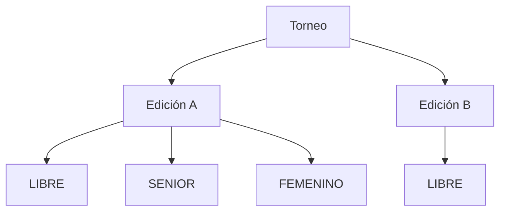

Cada edición puede contener sus propias categorías,
administradas de manera independiente.

No existen categorías predeterminadas ni una
cantidad fija de categorías por competición.

### Funcionalidades incorporadas

- Creación de categorías.
- Consulta individual.
- Listado por edición.
- Edición de nombre y descripción.
- Archivado reversible.
- Reactivación.
- Eliminación definitiva con confirmación.
- Nombre obligatorio de hasta 100 caracteres.
- Descripción opcional de hasta 500 caracteres.
- Unicidad de nombres dentro de cada edición.
- Comparaciones insensibles a mayúsculas y acentos.
- Normalización de espacios y caracteres Unicode.
- Búsqueda por nombre y descripción.
- Filtrado por estado administrativo.
- Indicadores generales independientes de los filtros.
- Identidad de la edición inmutable.
- Registro de fechas de creación y actualización.
- Persistencia en MySQL.
- Protección mediante autenticación.
- Validación del contexto torneo-edición-categoría.

### Estados administrativos

| Estado | Significado |
|---|---|
| ACTIVA | Categoría habilitada administrativamente |
| ARCHIVADA | Categoría conservada, pero desactivada |

Todas las categorías se crean en estado ACTIVA.

El archivado conserva su identidad, descripción
y relación con la edición correspondiente.

La reactivación recupera la categoría existente
sin crear registros nuevos.

Repetir el estado vigente no genera una
modificación innecesaria.

### Restricciones administrativas

| Operación | Torneo activo y edición planificada o en curso | Torneo archivado o edición finalizada |
|---|---|---|
| Consultar | Permitida | Permitida |
| Crear | Permitida | Bloqueada |
| Editar | Permitida | Permitida |
| Archivar | Permitida | Permitida |
| Reactivar | Permitida | Bloqueada |
| Eliminar sin dependencias | Permitida | Permitida |

Los cambios de estado de torneos y ediciones
no modifican automáticamente el estado de
sus categorías.

La reapertura de una edición o la reactivación
de un torneo recupera las operaciones habilitadas,
siempre que se cumplan las demás condiciones.

### Independencia de categorías

El nombre LIBRE puede existir simultáneamente
en diferentes ediciones y torneos.

No puede existir más de una categoría con
el mismo nombre dentro de una edición,
aunque alguna se encuentre archivada.

La eliminación definitiva libera el nombre
para una futura creación.

Una categoría no puede trasladarse a otra
edición mediante una modificación de sus datos.

### Integridad referencial

La migración `004_categorias.sql` establece
una relación restrictiva entre ediciones
y categorías.

No se puede eliminar una edición mientras
posea categorías asociadas.

Las futuras entidades deportivas dependientes
de categorías deberán conservar este principio.

### Búsqueda insensible a mayúsculas y acentos

El repositorio de categorías utiliza consultas
parametrizadas mediante `LIKE` y la intercalación
`utf8mb4_unicode_ci`.

Los caracteres especiales de búsqueda se escapan
para evitar interpretaciones involuntarias
como comodines.

Durante las pruebas de integración se detectó
y corrigió una diferencia en el comportamiento
de búsqueda por descripción mediante `LOCATE()`.

La corrección superó la prueba integral original
sin modificar sus criterios de aceptación.

### Interfaz de categorías

Se incorpora una pantalla administrativa con:

- Identificación del torneo y la edición.
- Navegación jerárquica.
- Indicadores de categorías totales, activas y archivadas.
- Buscador.
- Filtros administrativos.
- Formularios de creación y edición.
- Contadores de caracteres.
- Tarjetas con estados diferenciados.
- Advertencias de contextos restringidos.
- Mensajes de confirmación y error.
- Adaptación responsive.

La pantalla se encuentra disponible mediante
la ruta privada:

`/torneos/:torneoId/ediciones/:edicionId/categorias`

El acceso se realiza desde cada tarjeta
del módulo EDICIONES mediante el botón
GESTIONAR CATEGORÍAS.

Las tarjetas de ediciones incorporan dos
indicadores adicionales:

- CATEGORÍAS.
- ACTIVAS.

Los indicadores se actualizan al regresar
desde el módulo de categorías.

No se incorpora una opción independiente
en el menú lateral.

---

## 📸 Capturas de pantalla — v0.4.0

Las siguientes cinco capturas corresponden
a la implementación real de HU-006.

Se priorizan las nuevas funcionalidades,
evitando repetir evidencias de versiones anteriores.

Los registros deportivos utilizados son demostrativos.

### Integración con EDICIONES

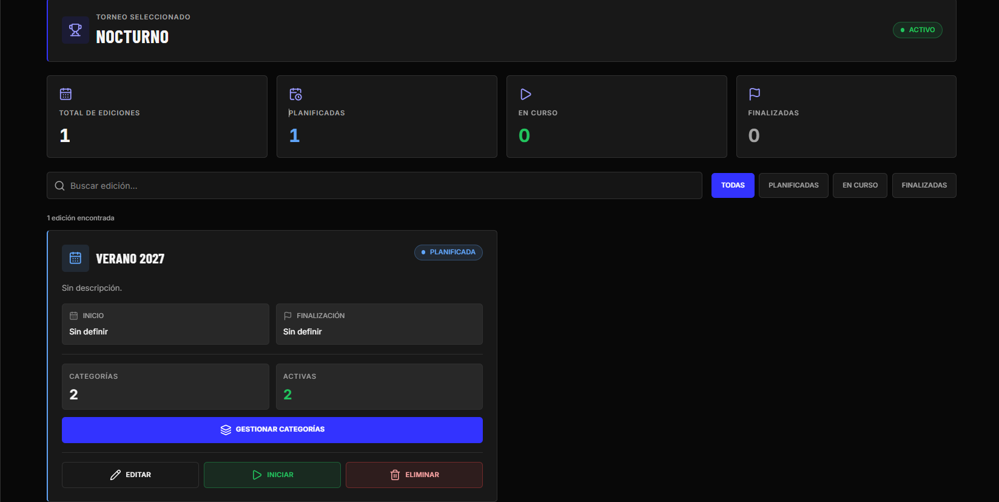

Cada edición muestra la cantidad de categorías
registradas, la cantidad de categorías activas
y el acceso directo a su administración.

### Gestión de categorías

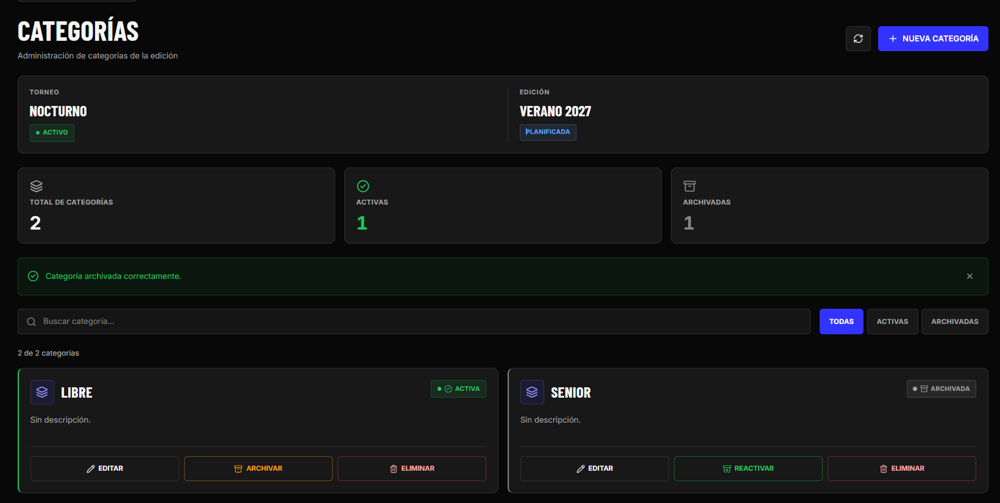

Visualización simultánea de categorías activas
y archivadas, con indicadores generales,
búsqueda, filtros y acciones administrativas.

### Formulario de categoría

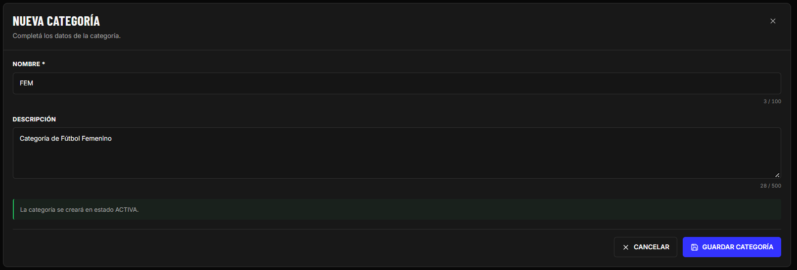

Formulario de creación con nombre obligatorio,
descripción opcional, contadores de caracteres
y advertencia sobre el estado inicial.

### Adaptación móvil

<p align="center">
  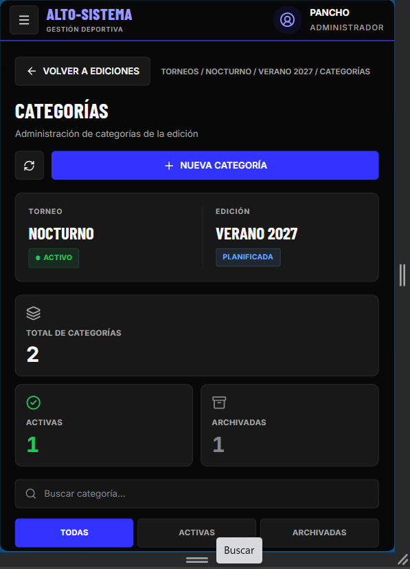
</p>

La interfaz reorganiza sus indicadores y
controles administrativos para pantallas pequeñas.

La validación se realizó mediante emulación
responsive en el navegador.

No constituye una prueba en un dispositivo físico.

### Pruebas automatizadas

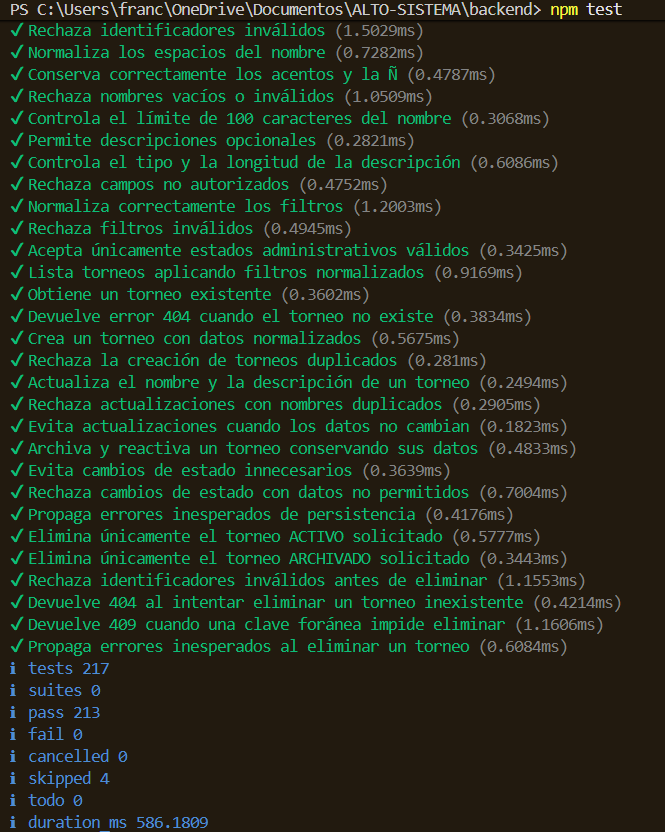

Regresión final documentada:

- 217 pruebas detectadas.
- 213 pruebas unitarias aprobadas.
- 4 integraciones omitidas intencionalmente.
- 0 pruebas fallidas.
- 0 pruebas canceladas.

Las cuatro integraciones se aprobaron
en ejecuciones separadas.

Resultado acumulado: **217/217 pruebas aprobadas**.

---

## 📜 Novedades de la v0.3.0 — Registro histórico

### HU-005 — Gestión de ediciones

Cada torneo puede contener múltiples ediciones independientes,
incluso del mismo año y simultáneamente en curso.

Funcionalidades incorporadas:

- Creación, consulta, listado, edición y eliminación de ediciones.
- Nombre libre, con el año integrado en el nombre si corresponde.
- Nombre obligatorio de hasta 100 caracteres, único dentro del torneo.
- Descripción opcional de hasta 500 caracteres.
- Fechas de inicio y finalización opcionales, editables y eliminables.
- Validación de fechas reales y coherencia cronológica.
- Búsqueda por nombre y descripción.
- Filtros por estado e indicadores dinámicos.
- Acceso mediante GESTIONAR EDICIONES desde TORNEOS.
- Indicadores de ediciones totales y en curso en TORNEOS.
- Independencia de registros entre torneos.
- Persistencia en MySQL y protección mediante autenticación.
- Confirmación de cambios de estado y eliminación definitiva.

### Ciclo de vida deportivo

| Estado | Significado | Transición permitida |
|---|---|---|
| PLANIFICADA | Estado inicial | INICIAR → EN_CURSO |
| EN_CURSO | Edición iniciada | FINALIZAR → FINALIZADA |
| FINALIZADA | Edición cerrada | REABRIR → EN_CURSO |

Las fechas son informativas y no producen cambios automáticos
de estado. Repetir el estado vigente no modifica el registro.

Los torneos archivados permiten consultar, editar, finalizar
y eliminar sus ediciones sin dependencias, pero no crear,
iniciar ni reabrir ediciones hasta su reactivación.

La migración 003 incorpora una clave foránea restrictiva:
no se puede eliminar un torneo con ediciones asociadas.

### Interfaz de ediciones

Se conserva el Sistema de Diseño v1.0, con colorimetría azul
para PLANIFICADA, verde para EN_CURSO y gris para FINALIZADA.

La pantalla incorpora indicadores generales, búsqueda, filtros,
formularios y tarjetas adaptables a pantallas pequeñas.

No se agrega una opción al menú lateral: se accede mediante
la ruta privada `/torneos/:torneoId/ediciones`.

<details>
<summary>📸 Ver las doce capturas históricas de v0.3.0</summary>

### Panel principal


El Dashboard muestra la versión 0.3.0 y la disponibilidad
del frontend, backend y base de datos.

### Torneos — Estado vacío


La interfaz refleja la ausencia de torneos registrados
y permite crear una competición.

### Torneos — Indicadores de ediciones

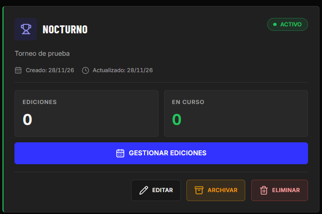

Cada tarjeta incorpora los indicadores de ediciones
totales y en curso, junto con el acceso a su gestión.

### Ediciones — Estado vacío

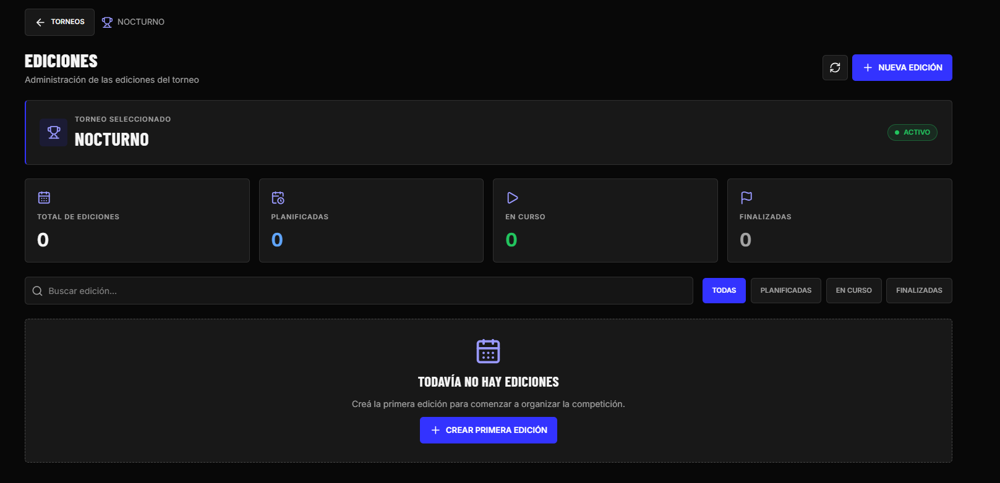

La pantalla identifica el torneo seleccionado e incluye
cuatro indicadores, buscador y filtros por estado.

### Formulario de creación

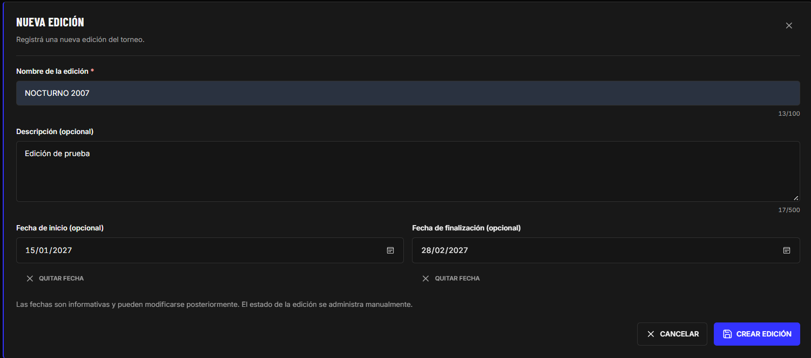

El nombre es obligatorio; la descripción y ambas fechas
son opcionales. El estado se administra manualmente.

### Edición planificada


Estado inicial PLANIFICADA, identificado en azul,
con la acción INICIAR disponible.

### Edición en curso


Estado EN CURSO, identificado en verde,
con la acción FINALIZAR disponible.

### Edición finalizada


Estado FINALIZADA, identificado en gris,
con la acción REABRIR disponible.

### Ediciones simultáneas

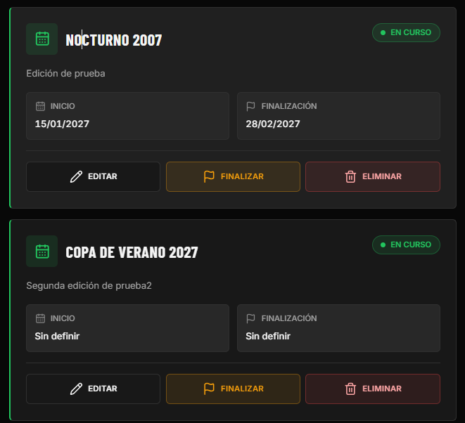

Dos ediciones del mismo torneo se encuentran
en curso simultáneamente.

### Restricciones de torneo archivado


El archivado conserva las ediciones existentes.
No se permite crear, iniciar ni reabrir ediciones.

### Adaptación móvil

<p align="center">
  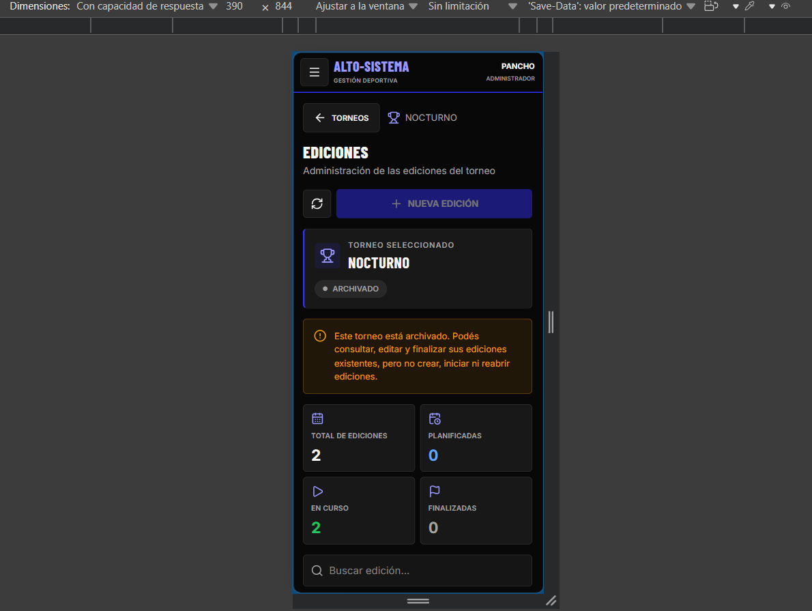
</p>

Simulación de 390 × 844 píxeles mediante el navegador.
No constituye una prueba en un dispositivo físico.

### Pruebas automatizadas

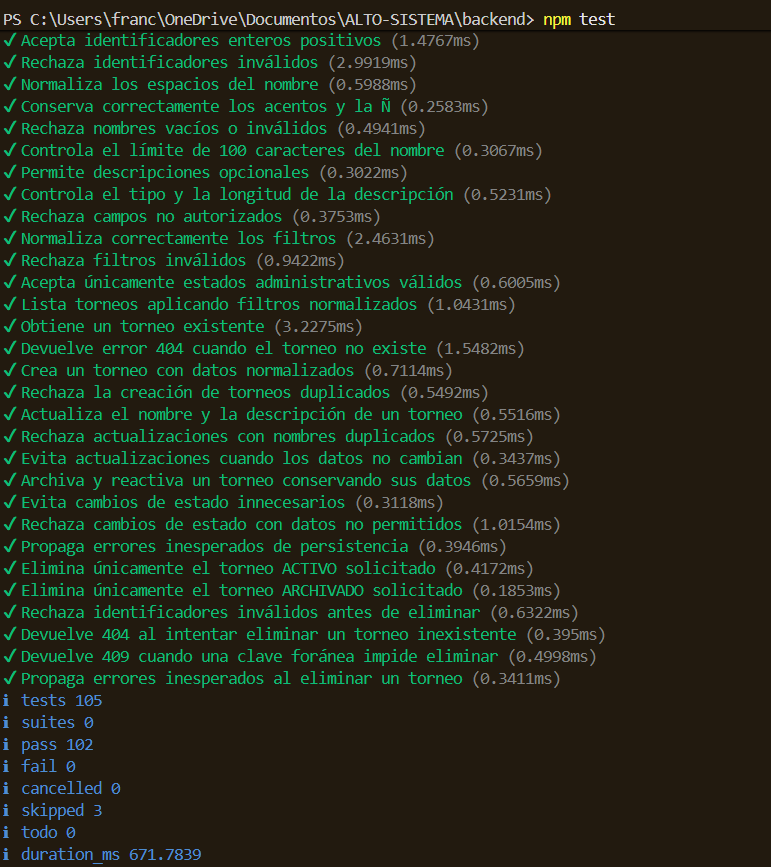

105 pruebas detectadas, 102 aprobadas,
3 integraciones omitidas intencionalmente y 0 fallos.

Las tres integraciones se aprobaron por separado.

Resultado acumulado: 105/105.

</details>

---

## 📜 Novedades de la v0.2.0 — Registro histórico

### HU-004 — Gestión integral de torneos

Primera implementación de un módulo deportivo
funcional en ALTO-SISTEMA.

Funcionalidades incorporadas:

- Creación de torneos.
- Consulta individual.
- Listado general.
- Edición de nombre y descripción.
- Validación de campos obligatorios.
- Prevención de nombres duplicados.
- Búsqueda por nombre y descripción.
- Filtrado por estado.
- Archivado reversible.
- Reactivación.
- Eliminación definitiva con confirmación.
- Cancelación de eliminación.
- Reutilización de nombres eliminados.
- Indicadores administrativos dinámicos.
- Registro de fechas de creación y actualización.
- Persistencia en MySQL.
- Protección mediante autenticación.

El módulo permite administrar múltiples
torneos independientes.

### Operaciones administrativas

| Operación | Comportamiento |
|---|---|
| CREAR | Registra una nueva competición |
| EDITAR | Modifica sus datos básicos |
| ARCHIVAR | Desactiva el torneo conservando sus datos |
| REACTIVAR | Recupera un torneo archivado |
| ELIMINAR | Borra definitivamente el registro |

La eliminación está disponible para torneos
activos y archivados, siempre que no tengan
entidades dependientes.

Requiere confirmación expresa y no puede
deshacerse desde la aplicación.

Desde v0.3.0, las ediciones asociadas impiden
efectivamente la eliminación de su torneo
mediante una restricción de clave foránea.

### Sistema de Diseño v1.0

Se incorpora una identidad visual compartida
por toda la aplicación.

Características:

- Identidad institucional oscura.
- Azul eléctrico como color principal.
- Tipografía Barlow Condensed.
- Tipografía Inter.
- Iconografía Lucide React.
- Design Tokens centralizados.
- Componentes CSS reutilizables.
- Formularios y botones uniformes.
- Estados visuales semánticos.
- Diseño responsive.
- Indicadores de foco.
- Mecanismos de accesibilidad.
- Compatibilidad con movimiento reducido.

La identidad institucional es independiente
de las futuras identidades visuales de las
competiciones y publicaciones deportivas.

<details>
<summary>📸 Ver las once capturas históricas de v0.2.0</summary>

### Panel principal

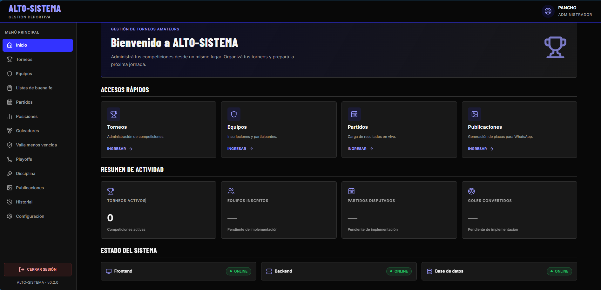

El Dashboard centraliza los accesos rápidos,
los indicadores administrativos y el estado
de disponibilidad del sistema.

### Acceso privado

<p align="center">
  
</p>

Pantalla de autenticación adaptada al
Sistema de Diseño v1.0.

### Gestión de torneos — Estado vacío

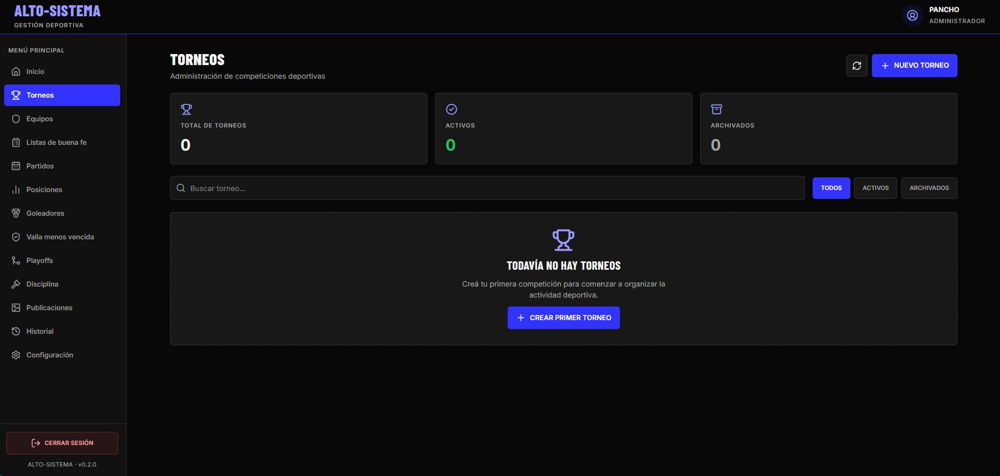

El módulo permite comenzar desde una base
sin competiciones registradas.

### Gestión de torneos — Listado


Visualización simultánea de torneos activos
y archivados, con indicadores dinámicos,
búsqueda, filtros y acciones administrativas.

### Creación de torneos

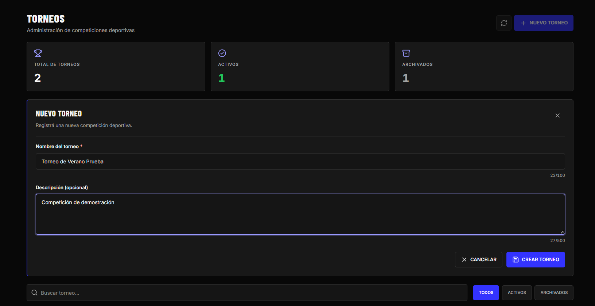

Formulario con validaciones, identificación
de campos obligatorios y contadores de caracteres.

### Edición de torneos

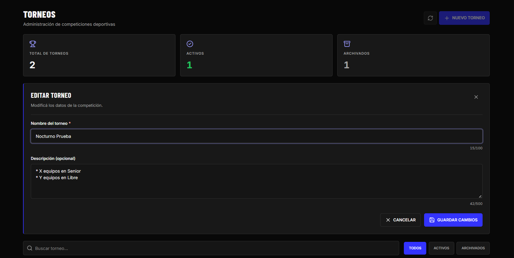

Modificación de los datos administrativos
de una competición existente.

### Eliminación definitiva


La eliminación requiere confirmación explícita
y advierte sobre la irreversibilidad de la operación.

### Adaptación móvil

<p align="center">
  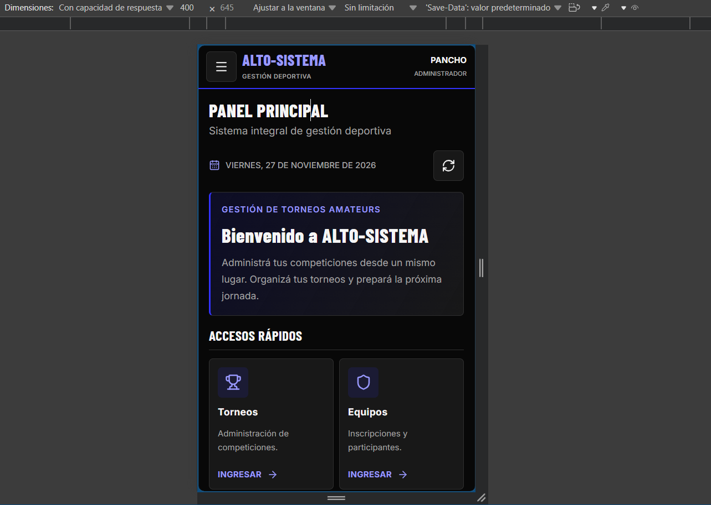
  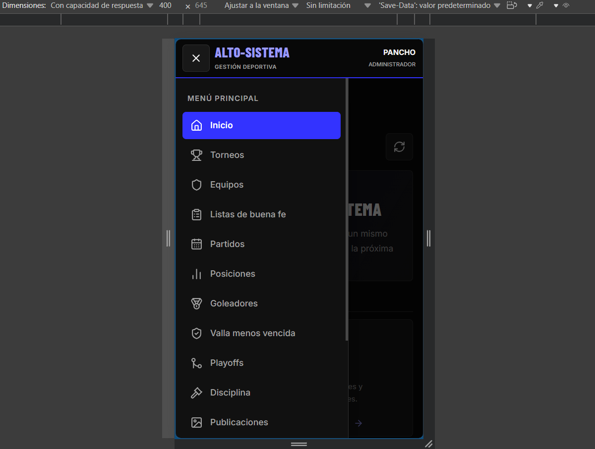
  
</p>

Simulación responsive de 400 × 645 píxeles
realizada mediante las herramientas del navegador.

### Pruebas automatizadas

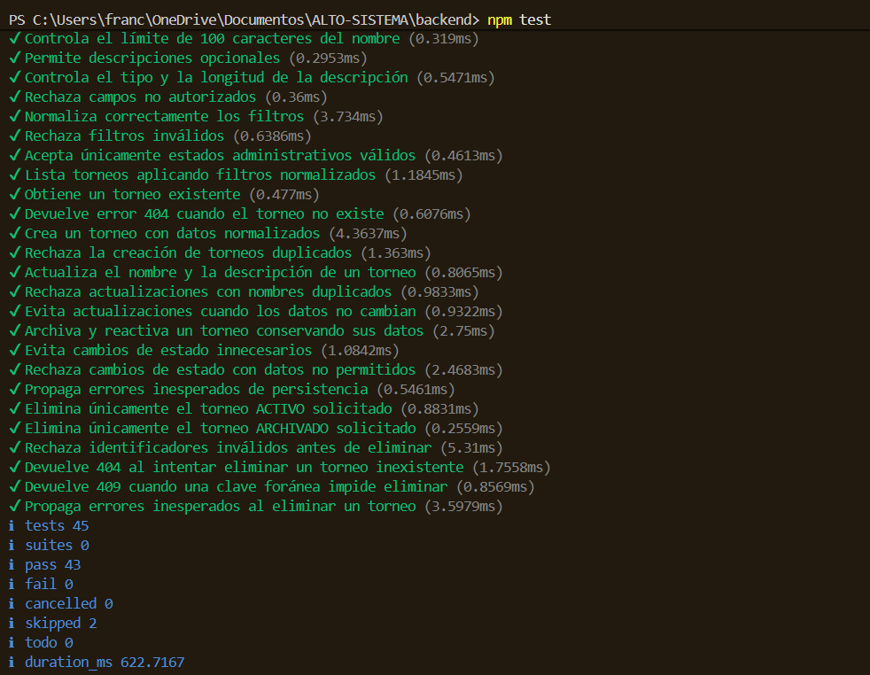

43 pruebas unitarias aprobadas con cero fallos.

Las dos integraciones se aprobaron por separado.

Resultado acumulado: 45/45.

</details>

<details>
<summary>📸 Ver las seis capturas históricas de v0.1.3</summary>

### Panel principal


### Acceso privado


### Adaptación móvil

<p align="center">
  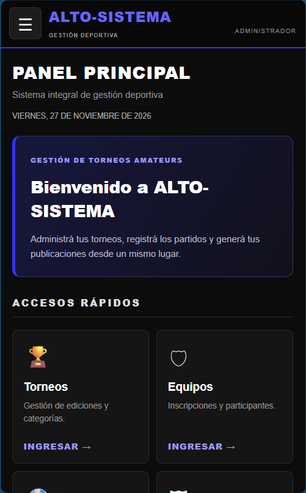
  
</p>

### Arquitectura


### Pruebas automatizadas


</details>

---

## 🎯 Objetivos del proyecto

- Administrar múltiples competiciones.
- Organizar ediciones y categorías.
- Gestionar equipos e inscripciones.
- Digitalizar listas de buena fe.
- Registrar acontecimientos deportivos.
- Gestionar jornadas y resultados.
- Automatizar tablas de posiciones.
- Calcular estadísticas deportivas.
- Gestionar copas y fases eliminatorias.
- Administrar sanciones disciplinarias.
- Exportar publicaciones deportivas en PNG.
- Facilitar la operación desde celulares.
- Conservar el historial de las competiciones.

---

## 💻 Stack tecnológico

| Tecnología | Utilización |
|---|---|
| React | Interfaces de usuario |
| Vite | Desarrollo y compilación |
| JavaScript | Lógica de aplicación |
| CSS | Sistema visual |
| Node.js | Entorno de ejecución backend |
| Express | API REST |
| MySQL | Persistencia relacional |
| mysql2 | Comunicación con MySQL |
| bcryptjs | Protección de contraseñas |
| express-session | Gestión de sesiones |
| express-mysql-session | Persistencia de sesiones |
| express-rate-limit | Limitación de solicitudes |
| React Router | Navegación |
| Lucide React | Iconografía |
| Fontsource | Tipografías locales |
| ESLint | Análisis estático |
| Node.js Test Runner | Pruebas automatizadas |
| Git | Control de versiones |

---

## 🏗️ Arquitectura

ALTO-SISTEMA utiliza una arquitectura
monolítica modular.

El frontend consume servicios REST del backend.

Las responsabilidades se distribuyen en capas
para separar la presentación, las reglas de
negocio y el acceso a los datos.

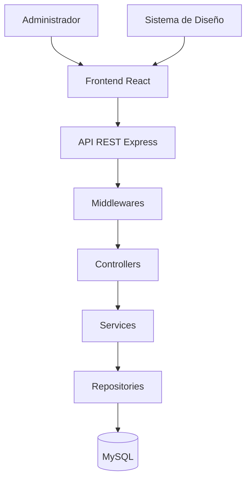

### Arquitectura multitorneo implementada

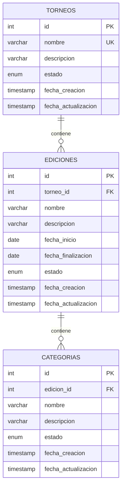

La unicidad de ediciones se establece mediante
la combinación de torneo y nombre.

La unicidad de categorías se establece mediante
la combinación de edición y nombre.

Las relaciones utilizan restricciones referenciales
para evitar eliminaciones accidentales de contextos
con información dependiente.

### Principios arquitectónicos

- Separación de responsabilidades.
- Organización modular.
- Configuración centralizada.
- Reglas de negocio independientes.
- Consultas parametrizadas.
- Migraciones versionadas.
- Validaciones del lado del servidor.
- Transacciones para operaciones deportivas.
- Reutilización de componentes.
- Verificación automatizada.
- Documentación permanente.

---

## 📁 Estructura del proyecto

```text
ALTO-SISTEMA/
│
├── backend/
│   ├── src/
│   │   ├── config/
│   │   ├── controllers/
│   │   ├── middlewares/
│   │   ├── repositories/
│   │   ├── routes/
│   │   ├── services/
│   │   ├── create-admin.js
│   │   ├── migrate.js
│   │   └── server.js
│   ├── tests/
│   ├── package.json
│   └── package-lock.json
│
├── database/
│   └── migrations/
│       ├── 001_usuarios.sql
│       ├── 002_torneos.sql
│       ├── 003_ediciones.sql
│       └── 004_categorias.sql
│
├── docs/
│   ├── capturas/
│   ├── ARQUITECTURA.md
│   ├── DESARROLLO.md
│   ├── MANTENIMIENTO.md
│   ├── MODELO_MULTITORNEO.md
│   └── SISTEMA_DE_DISENO.md
│
├── frontend/
│   ├── public/
│   ├── src/
│   │   ├── assets/
│   │   ├── config/
│   │   ├── layouts/
│   │   ├── pages/
│   │   │   ├── Torneos.jsx
│   │   │   ├── Torneos.css
│   │   │   ├── Ediciones.jsx
│   │   │   ├── Ediciones.css
│   │   │   ├── Categorias.jsx
│   │   │   ├── Categorias.css
│   │   │   └── ...
│   │   ├── services/
│   │   ├── styles/
│   │   │   ├── tokens.css
│   │   │   ├── typography.css
│   │   │   └── components.css
│   │   ├── App.jsx
│   │   ├── App.css
│   │   ├── index.css
│   │   └── main.jsx
│   ├── package.json
│   └── package-lock.json
│
├── .gitignore
└── README.md
```

La estructura representa los principales
componentes del proyecto.

---

## ✅ Funcionalidades implementadas

### Infraestructura

- Integración de frontend, backend y MySQL.
- API REST.
- Verificación de disponibilidad.
- Configuración centralizada.
- Control de versiones.

### Autenticación y seguridad

- Inicio de sesión privado.
- Administrador autenticado.
- Contraseñas protegidas mediante bcrypt.
- Sesiones persistentes en MySQL.
- Cookies HttpOnly y SameSite.
- Protección de recursos privados.
- Limitación de intentos de autenticación.
- Validación del origen de solicitudes.
- Credenciales excluidas del repositorio.

### Interfaz administrativa

- Dashboard.
- Menú lateral.
- Navegación responsive.
- Accesos rápidos.
- Sistema de Diseño v1.0.
- Indicadores de infraestructura.
- Contador real de torneos activos.

### Gestión deportiva

- Gestión integral de torneos.
- Creación, consulta y edición.
- Archivado y reactivación.
- Eliminación definitiva.
- Búsqueda y filtros.
- Indicadores administrativos.
- Gestión integral de ediciones por torneo.
- Fechas opcionales y editables.
- Estados deportivos manuales y reapertura.
- Ediciones simultáneas.
- Indicadores de ediciones por torneo.
- Gestión integral de categorías por edición.
- Categorías independientes y configurables.
- Unicidad de nombres dentro de cada contexto.
- Archivado y reactivación de categorías.
- Indicadores de categorías por edición.
- Restricciones según el contexto administrativo.
- Protección referencial entre torneos, ediciones y categorías.

### Persistencia

- Pool de conexiones.
- Migraciones SQL.
- Historial de migraciones.
- Verificación mediante checksums.
- Verificación estructural.
- Control de ejecución concurrente.
- Consultas parametrizadas.
- Transacciones y bloqueos de contexto.
- Procedimientos de respaldo y restauración.

### Calidad

- Pruebas unitarias.
- Pruebas de integración.
- Entorno aislado de pruebas.
- Regresión funcional.
- ESLint.
- Compilación de producción.
- Documentación técnica.

---

## 📋 Estado de los módulos

| Módulo | Estado |
|---|---|
| Inicio | Implementado |
| Torneos | Implementado y verificado; incluye ediciones y categorías |
| Equipos | Pendiente |
| Listas de buena fe | Pendiente |
| Partidos | Pendiente |
| Posiciones | Pendiente |
| Goleadores | Pendiente |
| Valla menos vencida | Pendiente |
| Playoffs | Pendiente |
| Disciplina | Pendiente |
| Publicaciones | Pendiente |
| Historial | Pendiente |
| Configuración | Pendiente |

La navegación de los trece módulos se
encuentra disponible.

Los módulos pendientes presentan una
pantalla provisional identificada.

Ediciones y categorías son niveles internos
del módulo TORNEOS.

No constituyen módulos independientes
del menú lateral.

---

## 🗄️ Migraciones de base de datos

| Versión | Archivo | Responsabilidad |
|---|---|---|
| 001 | `001_usuarios.sql` | Usuarios administrativos |
| 002 | `002_torneos.sql` | Registro de competiciones |
| 003 | `003_ediciones.sql` | Ediciones, estados, fechas y relación restrictiva con torneos |
| 004 | `004_categorias.sql` | Categorías, estados administrativos y relación restrictiva con ediciones |

### Estado de la migración 004

| Base de datos | Migraciones aplicadas |
|---|---:|
| Base principal | 4/4 |
| Base aislada de pruebas | 4/4 |

La actualización de ambas instalaciones
existentes se realizó correctamente.

La instalación desde una base vacía y la
idempotencia de las cuatro migraciones
deberán comprobarse durante el cierre técnico.

Las migraciones aplicadas deberán conservarse
sin modificaciones posteriores.

### Tabla de categorías

| Campo | Tipo | Restricción |
|---|---|---|
| id | INT | Clave primaria autoincremental |
| edicion_id | INT | Clave foránea obligatoria |
| nombre | VARCHAR(100) | Obligatorio |
| descripcion | VARCHAR(500) | Opcional |
| estado | ENUM | ACTIVA o ARCHIVADA |
| fecha_creacion | TIMESTAMP | Registro automático |
| fecha_actualizacion | TIMESTAMP | Actualización automática |

Restricciones:

- `uq_categorias_edicion_nombre`.
- `idx_categorias_edicion_estado`.
- `fk_categorias_edicion`.

La unicidad combina `edicion_id` y `nombre`.

La clave foránea utiliza `ON DELETE RESTRICT`
y `ON UPDATE RESTRICT`.

Motor de almacenamiento: InnoDB.

Codificación: utf8mb4.

Intercalación: utf8mb4_unicode_ci.

---

## 🔌 API REST — Torneos

Todos los endpoints deportivos requieren
una sesión autenticada.

| Método | Endpoint | Operación |
|---|---|---|
| GET | `/api/torneos` | Listar torneos |
| GET | `/api/torneos/:id` | Consultar torneo |
| POST | `/api/torneos` | Crear torneo |
| PUT | `/api/torneos/:id` | Actualizar datos |
| PATCH | `/api/torneos/:id/estado` | Cambiar estado |
| DELETE | `/api/torneos/:id` | Eliminar torneo |

### Filtros disponibles

- `busqueda`
- `estado`

### Estados administrativos

- `ACTIVO`
- `ARCHIVADO`

### Validaciones

- Nombre obligatorio.
- Nombre de hasta 100 caracteres.
- Descripción opcional.
- Descripción de hasta 500 caracteres.
- Nombre único.
- Normalización de espacios.
- Validación de identificadores.
- Validación de estados.
- Conservación del nombre de torneos archivados.
- Liberación del nombre de torneos eliminados.

### Eliminación definitiva

| Código HTTP | Resultado |
|---|---|
| 200 | Torneo eliminado correctamente |
| 400 | Identificador inválido |
| 401 | Autenticación requerida |
| 403 | Solicitud no permitida |
| 404 | Torneo inexistente |
| 409 | Eliminación impedida por dependencias |
| 500 | Error interno inesperado |

La eliminación utiliza consultas parametrizadas
y requiere un identificador válido.

La protección contra dependencias contempla
los errores generados por restricciones
de claves foráneas.

La restricción entre torneos y ediciones
fue comprobada en HU-005.

---

## 🔌 API REST — Ediciones

Todas las operaciones requieren autenticación y se limitan
al torneo identificado por `:torneoId`.

| Método | Endpoint | Operación |
|---|---|---|
| GET | `/api/torneos/:torneoId/ediciones` | Listar ediciones e indicadores |
| GET | `/api/torneos/:torneoId/ediciones/:edicionId` | Consultar edición |
| POST | `/api/torneos/:torneoId/ediciones` | Crear edición |
| PUT | `/api/torneos/:torneoId/ediciones/:edicionId` | Actualizar datos |
| PATCH | `/api/torneos/:torneoId/ediciones/:edicionId/estado` | Cambiar estado |
| DELETE | `/api/torneos/:torneoId/ediciones/:edicionId` | Eliminar edición |

Filtros disponibles: `busqueda` y `estado`.

El listado devuelve el torneo, las ediciones, el total de
resultados y los indicadores generales (`total`, `planificadas`,
`en_curso`, `finalizadas`).

Los indicadores no dependen del filtro.

Los campos editables son `nombre`, `descripcion`,
`fecha_inicio` y `fecha_finalizacion`.

Las fechas utilizan el formato `YYYY-MM-DD`
o `null` cuando no se informan.

La edición no puede cambiar de torneo
mediante una actualización.

Desde HU-006, una edición con categorías
asociadas no puede eliminarse.

| Código HTTP | Resultado |
|---|---|
| 200 | Consulta, modificación, cambio de estado o eliminación correctos |
| 201 | Edición creada |
| 400 | Datos, fechas, estado o identificadores inválidos |
| 401 | Autenticación requerida |
| 403 | Solicitud no permitida |
| 404 | Torneo o edición inexistente en el contexto solicitado |
| 409 | Conflicto de nombre, estado, restricciones o dependencias |
| 500 | Error interno inesperado |

---

## 🔌 API REST — Categorías

Todas las operaciones requieren autenticación
y validación del contexto jerárquico.

Ruta base:

`/api/torneos/:torneoId/ediciones/:edicionId/categorias`

| Método | Ruta relativa a la base | Operación |
|---|---|---|
| GET | `/` | Listar categorías e indicadores |
| GET | `/:categoriaId` | Consultar categoría |
| POST | `/` | Crear categoría |
| PUT | `/:categoriaId` | Actualizar datos |
| PATCH | `/:categoriaId/estado` | Cambiar estado |
| DELETE | `/:categoriaId` | Eliminar categoría |

### Creación

```json
{
    "nombre": "LIBRE",
    "descripcion": "Categoría libre"
}
```

El nombre es obligatorio.

La descripción puede omitirse o ser `null`.

El estado inicial es ACTIVA.

### Actualización

Campos editables:

- `nombre`
- `descripcion`

La actualización admite modificaciones parciales.

No se permite modificar el identificador,
la edición asociada ni el estado mediante PUT.

### Cambio de estado

```json
{
    "estado": "ARCHIVADA"
}
```

Estados disponibles:

- `ACTIVA`
- `ARCHIVADA`

### Filtros

- `busqueda`
- `estado`

### Respuesta de listado

Ejemplo ilustrativo:

```json
{
    "torneo": {
        "id": 1,
        "nombre": "NOCTURNO",
        "estado": "ACTIVO"
    },
    "edicion": {
        "id": 1,
        "torneo_id": 1,
        "nombre": "VERANO 2027",
        "estado": "PLANIFICADA"
    },
    "categorias": [],
    "total": 0,
    "indicadores": {
        "total": 0,
        "activas": 0,
        "archivadas": 0
    }
}
```

El campo `total` representa la cantidad
de resultados del listado solicitado.

Los indicadores representan la totalidad
de categorías de la edición, independientemente
de los filtros aplicados.

### Códigos HTTP

| Código HTTP | Resultado |
|---|---|
| 200 | Operación completada correctamente |
| 201 | Categoría creada |
| 400 | Datos, filtros, estado o identificadores inválidos |
| 401 | Autenticación requerida |
| 403 | Solicitud de origen no permitido |
| 404 | Contexto o categoría inexistente |
| 409 | Conflicto de nombre, restricciones o dependencias |
| 500 | Error interno inesperado |

### Componentes del módulo

Backend:

- `categoria.routes.js`
- `categoria.controller.js`
- `categoria.service.js`
- `categoria.repository.js`

Frontend:

- `Categorias.jsx`
- `Categorias.css`

Persistencia:

- `004_categorias.sql`

Pruebas:

- `categoria.service.test.js`
- `categoria.integration.test.js`

---

## 🎨 Sistema de Diseño v1.0

| Elemento | Definición |
|---|---|
| Color institucional | `#3333FF` |
| Fondo | `#080808` |
| Menú lateral | `#111111` |
| Paneles | `#181818` |
| Texto principal | `#F5F5F5` |
| Texto secundario | `#A3A3A3` |
| Títulos | Barlow Condensed |
| Interfaz | Inter |
| Iconografía | Lucide React |
| Altura interactiva mínima | 44 px |
| Radio estándar | 6 px |
| Punto de corte móvil principal | 900 px |

### Colorimetría de estados y acciones

| Estado o acción | Color semántico |
|---|---|
| ACTIVO / ACTIVA | Verde |
| ARCHIVADO / ARCHIVADA | Gris |
| PLANIFICADA | Azul informativo |
| EN CURSO | Verde |
| FINALIZADA | Gris |
| Crear / Gestionar | Azul institucional |
| Editar | Neutro |
| Archivar / Finalizar | Ámbar |
| Reactivar / Iniciar / Reabrir | Verde |
| Eliminar | Rojo |

La definición completa se encuentra en:

[Sistema de Diseño v1.0](docs/SISTEMA_DE_DISENO.md)

---

## 🧪 Resultados de pruebas — v0.4.0

### Pruebas automatizadas

| Tipo | Resultado |
|---|---:|
| Unitarias de autenticación | 13/13 |
| Unitarias de torneos | 30/30 |
| Unitarias de ediciones | 59/59 |
| Unitarias de categorías | 111/111 |
| Integración de autenticación | 1/1 |
| Integración de torneos | 1/1 |
| Integración de ediciones | 1/1 |
| Integración de categorías | 1/1 |
| **Total acumulado aprobado** | **217/217** |

Las pruebas de integración se ejecutaron
por separado de las pruebas unitarias.

Los controles internos de integración y las
repeticiones de regresión no se contabilizan
como pruebas adicionales.

### Regresión final documentada

| Control | Resultado |
|---|---:|
| Pruebas detectadas | 217 |
| Aprobadas | 213 |
| Omitidas intencionalmente | 4 |
| Fallidas | 0 |
| Canceladas | 0 |
| TODO | 0 |
| Duración | 586,1809 ms |

Las cuatro integraciones requieren habilitación
explícita mediante variables de entorno.

Todas fueron ejecutadas y aprobadas durante
el desarrollo de HU-006.

La duración corresponde al entorno local
y no constituye una prueba de carga.

### Pruebas unitarias de HU-006

111 pruebas aprobadas en la primera ejecución.

Grupos de validación:

1. Listado y contexto.
2. Filtros y búsqueda.
3. Identificadores.
4. Consulta individual.
5. Creación.
6. Actualización.
7. Cambios de estado.
8. Eliminación definitiva.
9. Errores de persistencia.
10. Transacciones y bloqueos.
11. Consistencia de indicadores.

Las pruebas utilizan un repositorio simulado
y no modifican la base de datos principal.

### Integración de HU-006

La prueba integral contempla 28 controles:

1. Verificación de base de datos aislada.
2. Disponibilidad del servidor.
3. Protección sin autenticación.
4. Autenticación y aislamiento de sesión.
5. Creación del contexto de prueba.
6. Estado inicial vacío.
7. Control de origen.
8. Validaciones de creación.
9. Creación correcta.
10. Unicidad por edición.
11. Independencia entre contextos.
12. Consulta individual.
13. Validación de identificadores.
14. Aislamiento de operaciones.
15. Edición de categorías.
16. Archivado y reactivación.
17. Filtros y búsqueda.
18. Estados inválidos.
19. Edición en curso.
20. Edición finalizada.
21. Reapertura de edición.
22. Torneo archivado.
23. Reactivación del torneo.
24. Integridad referencial.
25. Persistencia real.
26. Eliminación definitiva.
27. Eliminación de contextos vacíos.
28. Cierre de sesión.

Resultado final: **28/28 controles aprobados**.

Durante la primera ejecución se detectó un
fallo en la búsqueda por descripción con
caracteres acentuados.

Se corrigió el repositorio de categorías
y se repitió la prueba original.

La segunda ejecución fue satisfactoria,
con una duración total de 2723,073 ms.

La limpieza automática de los registros
ficticios se completó correctamente.

### Validaciones funcionales de HU-006

| Control | Funcionalidad |
|---:|---|
| 01 | Integración visual con EDICIONES |
| 02 | Estado inicial vacío |
| 03 | Creación sin descripción |
| 04 | Creación con descripción |
| 05 | Prevención de duplicados |
| 06 | Edición de categoría |
| 07 | Archivado |
| 08 | Reactivación |
| 09 | Búsqueda y filtros |
| 10 | Actualización de indicadores externos |
| 11 | Independencia entre ediciones |
| 12 | Restricciones de edición finalizada |
| 13 | Reapertura de edición |
| 14 | Restricciones de torneo archivado |
| 15 | Integridad referencial |
| 16 | Eliminación de registros |
| 17 | Adaptación responsive |

Los 17 controles fueron revisados durante
las pruebas manuales y confirmados por
el administrador.

La independencia de registros durante
la eliminación se verificó adicionalmente
mediante la prueba de integración.

La validación móvil corresponde a emulación
responsive en el navegador.

### Verificaciones técnicas

| Control | Resultado |
|---|---|
| Pruebas unitarias generales | 213/213 |
| Integraciones generales | 4/4 |
| Controles de integración de categorías | 28/28 |
| Migración sobre base principal | Satisfactoria |
| Migración sobre base de pruebas | Satisfactoria |
| Arranque de backend v0.4.0 | Confirmado |
| Arranque de frontend v0.4.0 | Confirmado |
| Validación funcional | Satisfactoria |
| Capturas oficiales | 5/5 revisadas |
| ESLint final | Pendiente de cierre |
| Compilación final de producción | Pendiente de cierre |
| Migraciones desde cero | Pendiente de cierre |
| Idempotencia de migraciones 001 a 004 | Pendiente de cierre |
| Limpieza final de datos demostrativos | Pendiente de confirmación |
| CHECK integral | Pendiente de cierre |

---

## 📊 Evolución de la calidad

| Versión | Pruebas acumuladas aprobadas |
|---|---:|
| v0.2.0 | 45/45 |
| v0.3.0 | 105/105 |
| v0.4.0 | 217/217 |

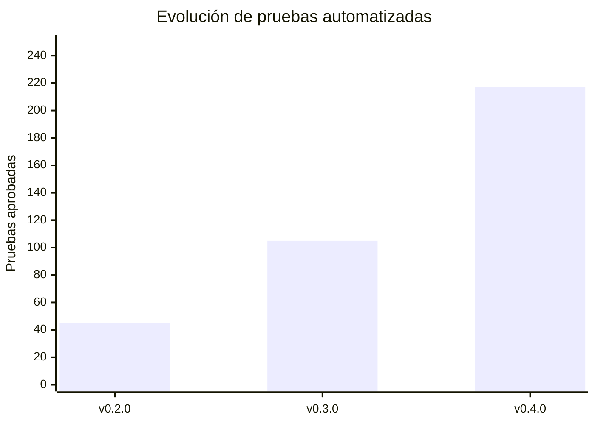

<details>
<summary>Resultados históricos de v0.3.0</summary>

### Pruebas automatizadas

| Tipo | Resultado |
|---|---:|
| Unitarias de autenticación | 13/13 |
| Unitarias de torneos | 30/30 |
| Unitarias de ediciones | 59/59 |
| Integración de autenticación | 1/1 |
| Integración de torneos | 1/1 |
| Integración de ediciones | 1/1 |
| Total acumulado | 105/105 |

Regresión final:

- 105 pruebas detectadas.
- 102 aprobadas.
- 3 integraciones omitidas.
- 0 fallidas.
- 0 canceladas.
- Duración: 671,7839 ms.

### Verificaciones técnicas

- ESLint sin errores informados.
- Compilación de producción exitosa.
- Migración sobre instalación existente.
- Instalación desde cero: 3/3 migraciones.
- Idempotencia: 3 registradas y 0 pendientes.
- Integraciones con MySQL satisfactorias.
- Coherencia de versiones.
- Backend y frontend v0.3.0 operativos.
- Doce capturas oficiales.
- Limpieza de registros demostrativos confirmada.

### Validaciones funcionales

Resultado: 17/17 controles validados.

Se comprobaron las operaciones de ediciones,
fechas opcionales, cambios de estado,
reapertura, indicadores, búsqueda, filtros,
independencia de contextos, restricciones
administrativas e integridad referencial.

La validación responsive se realizó
mediante simulación en el navegador.

</details>

<details>
<summary>Resultados históricos de v0.2.0</summary>

### Pruebas automatizadas

| Tipo | Resultado |
|---|---:|
| Unitarias de autenticación | 13/13 |
| Unitarias de torneos | 30/30 |
| Integración de autenticación | 1/1 |
| Integración de torneos | 1/1 |
| Total acumulado | 45/45 |

### Ejecuciones registradas

| Ejecución | Totales | Aprobadas | Omitidas | Fallidas |
|---|---:|---:|---:|---:|
| Pruebas unitarias | 45 | 43 | 2 | 0 |
| Regresión con autenticación | 45 | 44 | 1 | 0 |
| Integración aislada de torneos | 1 | 1 | 0 | 0 |
| Regresión final para captura | 45 | 43 | 2 | 0 |

### Verificaciones técnicas

- ESLint: 0 errores y 0 advertencias.
- Compilación de producción exitosa.
- Tiempo de compilación final: 3,49 segundos.
- Migraciones registradas: 2.
- Migraciones pendientes: 0.
- Revisión visual inicial: 8/8.
- Validación funcional satisfactoria.
- Limpieza de registros temporales.
- Documentación técnica actualizada.
- Once capturas oficiales.

### Validaciones funcionales

Se comprobaron las operaciones de torneos,
campos obligatorios, duplicados, búsqueda,
filtros, archivado, reactivación, persistencia,
independencia de registros, autenticación,
adaptación responsive y eliminación definitiva.

### Auditoría histórica de dependencias visuales

Durante la instalación de las dependencias
del Sistema de Diseño:

- 153 paquetes auditados.
- 0 vulnerabilidades detectadas.

Este resultado corresponde al momento
en que se realizó la auditoría.

</details>

---

## 🔐 Seguridad y privacidad

ALTO-SISTEMA es una herramienta privada
de administración deportiva.

Las contraseñas, secretos de sesión,
configuraciones privadas y respaldos
no deben incorporarse al repositorio.

Las futuras listas de buena fe incluirán
información personal cuya exposición
deberá mantenerse restringida.

La configuración definitiva de seguridad
para producción será evaluada antes
del despliegue público.

Las pruebas deportivas de integración
utilizan un entorno aislado.

No deben ejecutarse contra la base principal.

Las capturas destinadas al repositorio
deben revisarse para evitar la exposición
de credenciales o información privada.

---

## ⚙️ Instalación local

### Requisitos

- Node.js 24 LTS.
- npm.
- MySQL 8.
- Git.

### 1. Instalar dependencias del backend

Desde la raíz:

```bash
cd backend
npm ci
```

### 2. Preparar la base de datos

```sql
CREATE DATABASE alto_sistema
CHARACTER SET utf8mb4
COLLATE utf8mb4_unicode_ci;
```

Crear un usuario MySQL con los permisos
necesarios sobre la base correspondiente.

### 3. Configurar el entorno

Crear el archivo privado `backend/.env`:

```env
PORT=3000
HOST=127.0.0.1
FRONTEND_URL=http://localhost:5173

DB_HOST=localhost
DB_PORT=3306
DB_USER=TU_USUARIO
DB_PASSWORD=TU_CONTRASENA
DB_NAME=alto_sistema

SESSION_SECRET=TU_SECRETO_ALEATORIO
```

Reemplazar los valores de ejemplo
por una configuración privada propia.

El secreto de sesión deberá ser aleatorio.

Nunca publicar el archivo `.env`.

### 4. Ejecutar las migraciones

```bash
npm run migrate
```

La versión 0.4.0 contempla cuatro
migraciones estructurales.

### 5. Crear el administrador inicial

Configurar temporalmente:

- `ADMIN_USER`
- `ADMIN_PASSWORD`

La contraseña deberá contener al menos
12 caracteres y no superar los 72 bytes.

Ejecutar:

```bash
npm run create-admin
```

Retirar las variables temporales después
de completar la creación.

### 6. Iniciar el backend

```bash
npm start
```

Dirección:

http://localhost:3000

### 7. Instalar e iniciar el frontend

Desde otra terminal ubicada en la raíz:

```bash
cd frontend
npm ci
npm run dev
```

Dirección:

http://localhost:5173

---

## 🔍 Ejecución de pruebas

### Backend

Desde la carpeta backend:

```bash
npm test
```

Las pruebas unitarias se ejecutan
de forma predeterminada.

Resultado esperado sin integraciones habilitadas:

- 217 pruebas totales.
- 213 aprobadas.
- 4 omitidas.
- 0 fallidas.

Las 217 aprobaciones acumuladas se obtuvieron
mediante ejecuciones separadas.

### Pruebas unitarias de categorías

```bash
node --test tests/categoria.service.test.js
```

Resultado esperado: 111 pruebas aprobadas.

### Integración de autenticación

Variables temporales:

- `ALTO_INTEGRATION_TEST=1`
- `ALTO_TEST_USER`
- `ALTO_TEST_PASSWORD`

Requiere un backend operativo
y un administrador habilitado.

```bash
node --test tests/auth.integration.test.js
```

### Integración de torneos

Variables temporales:

- `ALTO_TORNEO_INTEGRATION_TEST=1`
- `DB_NAME=altosistemahu004test`
- `ALTO_TEST_USER`
- `ALTO_TEST_PASSWORD`

```bash
node --test tests/torneo.integration.test.js
```

Requiere una base aislada,
migraciones aplicadas, administrador
de pruebas y backend en el puerto 3001.

### Integración de ediciones

Variables temporales:

- `ALTO_EDICION_INTEGRATION_TEST=1`
- `DB_NAME=altosistemahu004test`
- `ALTO_TEST_USER`
- `ALTO_TEST_PASSWORD`

```bash
node --test tests/edicion.integration.test.js
```

Requiere una base aislada con las migraciones
correspondientes, administrador de pruebas
y backend en el puerto 3001.

### Integración de categorías

Variables temporales:

- `ALTO_CATEGORIA_INTEGRATION_TEST=1`
- `DB_NAME=altosistemahu004test`
- `ALTO_TEST_USER=admin_pruebas`
- `ALTO_TEST_PASSWORD`

```bash
node --test tests/categoria.integration.test.js
```

Requiere:

- Base aislada con las migraciones 001 a 004.
- Administrador ficticio de pruebas.
- Backend operativo en el puerto 3001.
- Contraseña ingresada de manera privada.

La prueba verifica el aislamiento de la base
y de la sesión antes de crear registros deportivos.

Los registros se identifican mediante UUID
y se eliminan al finalizar las comprobaciones.

Las integraciones deportivas no deben ejecutarse
contra la base principal.

Consultar el manual de mantenimiento
antes de habilitar las integraciones.

### Frontend

Desde la carpeta frontend:

```bash
npm run lint
npm run build
```

---

## 📚 Documentación técnica

| Documento | Responsabilidad |
|---|---|
| [Arquitectura](docs/ARQUITECTURA.md) | Organización técnica |
| [Desarrollo](docs/DESARROLLO.md) | Metodología |
| [Mantenimiento](docs/MANTENIMIENTO.md) | Procedimientos operativos |
| [Modelo multitorneo](docs/MODELO_MULTITORNEO.md) | Reglas deportivas |
| [Sistema de Diseño](docs/SISTEMA_DE_DISENO.md) | Estándares visuales |

### Política de evidencias visuales

A partir de v0.4.0, las capturas oficiales
se concentran en las funcionalidades nuevas
de cada incremento.

Se evita repetir pantallas y operaciones
documentadas previamente cuando no presentan
modificaciones relevantes.

Las evidencias históricas se conservan
en el repositorio y se organizan mediante
secciones desplegables.

Las pruebas automatizadas y la documentación
técnica complementan las evidencias visuales.

---

## 🗺️ Hoja de ruta

- [x] ETAPA 00 — Definición y planificación.
- [x] ETAPA 01 — Infraestructura y consolidación.
- [ ] ETAPA 02 — Torneos, ediciones, categorías e identidad visual.
  - [x] HU-004 — Gestión integral de torneos.
  - [x] HU-005 — Gestión de ediciones.
  - [ ] HU-006 — Gestión de categorías: implementada y verificada, pendiente de cierre formal.
  - [ ] HU-007 — Identidad visual de competiciones.
  - [ ] HU-008 — Selección del contexto deportivo.
- [ ] ETAPA 03 — Equipos y zonas.
- [ ] ETAPA 04 — Listas de buena fe.
- [ ] ETAPA 05 — Jornadas y partidos.
- [ ] ETAPA 06 — Tablas de posiciones.
- [ ] ETAPA 07 — Goleadores y valla menos vencida.
- [ ] ETAPA 08 — Copas y playoffs.
- [ ] ETAPA 09 — Disciplina.
- [ ] ETAPA 10 — Publicaciones y exportación PNG.
- [ ] ETAPA 11 — Operación móvil y sincronización.
- [ ] ETAPA 12 — Historial y respaldos.
- [ ] ETAPA 13 — Despliegue online.

---

## 📦 Historial de versiones

| Versión | Incremento | Estado |
|---|---|---|
| v0.1.0 | HU-001 — Infraestructura funcional | Aprobada |
| v0.1.1 | HU-002 — Autenticación | Aprobada |
| v0.1.2 | HU-003 — Interfaz base | Aprobada |
| v0.1.3 | Consolidación arquitectónica | Aprobada |
| v0.2.0 | HU-004 — Gestión integral de torneos y Sistema de Diseño | Aprobada y consolidada |
| v0.3.0 | HU-005 — Gestión de ediciones | Aprobada y consolidada |
| v0.4.0 | HU-006 — Gestión de categorías | Implementada y verificada; pendiente de cierre formal |

---

## 📌 Estado actual

**Versión local: v0.4.0**

**Última versión consolidada: v0.3.0**

ALTO-SISTEMA se encuentra en desarrollo activo.

La arquitectura multitorneo cuenta actualmente
con tres niveles deportivos implementados:

```text
TORNEO
  └── EDICIÓN
        └── CATEGORÍA
```

HU-006 incorpora la gestión de categorías
y completa el tercer nivel jerárquico
de la arquitectura multitorneo.

### Balance de validación

| Indicador | Resultado |
|---|---:|
| Pruebas unitarias aprobadas | 213 |
| Pruebas de integración aprobadas | 4 |
| Total acumulado | 217/217 |
| Controles de integración de HU-006 | 28/28 |
| Controles funcionales revisados | 17 |
| Migraciones implementadas | 4 |
| Capturas oficiales de v0.4.0 | 5 |
| Bloqueantes funcionales conocidos | 0 |

### Limitaciones actuales

- Sin despliegue en producción.
- Sin pruebas de carga.
- Sin auditoría formal de accesibilidad.
- Sin pruebas visuales automatizadas.
- Validación móvil física pendiente.
- Optimización tipográfica pendiente.
- Restauración de respaldos deportivos pendiente de verificación.
- Verificación referencial de entidades deportivas futuras pendiente.
- Indicadores de ediciones mediante consultas adicionales por torneo.
- Indicadores de categorías mediante una consulta adicional por tarjeta de edición visible.
- Optimización agregada de indicadores pendiente si el volumen de registros lo requiere.
- Identidad visual particular de competiciones pendiente.
- Selección global del contexto deportivo pendiente.
- Módulos deportivos restantes pendientes.
- Generación de publicaciones PNG pendiente.

### Cierre de HU-006

La implementación y las pruebas funcionales
se encuentran completadas.

La aprobación integral, las verificaciones
técnicas finales y la publicación en el
repositorio permanecen pendientes.

HU-007 no se inicia hasta completar
formalmente el cierre de HU-006.


---

## 👨‍💻 Autor

**Francisco Bacalini**

Estudiante de la Tecnicatura en Programación.

Argentina.

Proyecto personal de ingeniería de software
aplicada a la organización deportiva.

---

**ALTO-SISTEMA | Tecnología aplicada al fútbol amateur.**

© 2026 Francisco Bacalini.