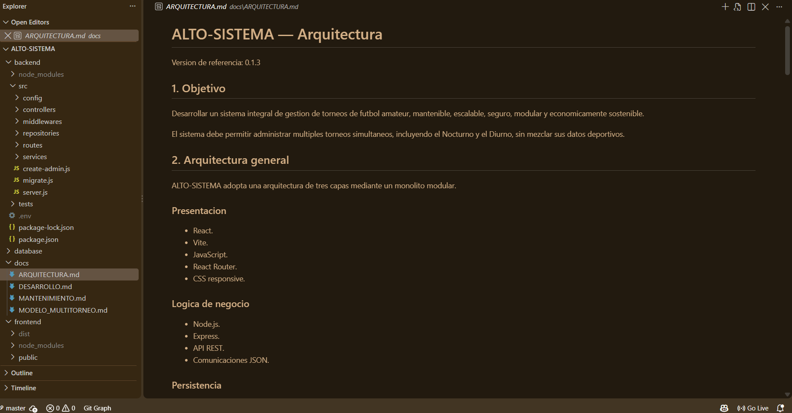
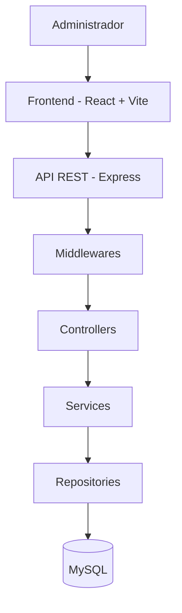

# ⚽ ALTO-SISTEMA

### Sistema integral de gestión deportiva


## 📖 Acerca del proyecto

ALTO-SISTEMA es una aplicación web orientada a la gestión integral
de competiciones de fútbol amateur.

El proyecto surge de la necesidad de centralizar, digitalizar y
optimizar los procesos administrativos y deportivos de múltiples
torneos, contemplando diferentes ediciones, categorías y formatos
de competición.

Su desarrollo está orientado a resolver una problemática real,
aplicando principios de ingeniería de software, seguridad,
mantenibilidad y escalabilidad.

## 📸 Capturas de pantalla

Capturas reales de la versión v0.1.3, en un entorno de desarrollo local.
Los módulos deportivos aún se encuentran pendientes de implementación.
Los datos de acceso visibles se han anonimizado.

### Panel principal


### Acceso privado


### Diseño responsive

Vista del panel principal y del menú desplegado mediante emulación móvil del navegador.

<p align="center">
  
  
</p>

### Arquitectura y documentación técnica



### Pruebas automatizadas


## 🎯 Objetivos

- Centralizar la administración de competiciones deportivas.
- Gestionar múltiples torneos de manera simultánea.
- Digitalizar las listas de buena fe.
- Registrar resultados y acontecimientos de los partidos.
- Automatizar tablas de posiciones y estadísticas.
- Administrar sanciones disciplinarias.
- Generar publicaciones deportivas en formato PNG.
- Facilitar la operación desde computadoras y dispositivos móviles.
- Preservar el historial deportivo de cada competición.

## 💻 Stack tecnológico

| Tecnología | Aplicación |
|---|---|
| React | Interfaz de usuario |
| Vite | Entorno de desarrollo y compilación |
| JavaScript | Lógica de aplicación |
| Node.js | Entorno de ejecución del backend |
| Express | API REST |
| MySQL | Persistencia de datos |
| bcryptjs | Hash de contraseñas |
| express-session | Gestión de sesiones |
| React Router | Navegación |
| ESLint | Análisis estático |
| Node.js Test Runner | Pruebas automatizadas |
| Git | Control de versiones |

## 🏗️ Arquitectura

ALTO-SISTEMA utiliza una arquitectura monolítica modular,
con separación de responsabilidades y comunicación mediante
una API REST.



### Principios de desarrollo

- Separación de responsabilidades.
- Modularidad.
- Configuración centralizada.
- Independencia de las reglas de negocio.
- Validación de datos.
- Persistencia mediante repositorios.
- Migraciones versionadas.
- Desarrollo incremental.
- Pruebas automatizadas.
- Documentación técnica continua.

## 📁 Estructura del proyecto

```text
ALTO-SISTEMA/
│
├── backend/
│   ├── src/
│   │   ├── config/
│   │   ├── controllers/
│   │   ├── middlewares/
│   │   ├── repositories/
│   │   ├── routes/
│   │   ├── services/
│   │   ├── create-admin.js
│   │   ├── migrate.js
│   │   └── server.js
│   ├── tests/
│   └── package.json
│
├── database/
│   └── migrations/
│
├── docs/
│   ├── capturas/
│   ├── ARQUITECTURA.md
│   ├── DESARROLLO.md
│   ├── MANTENIMIENTO.md
│   └── MODELO_MULTITORNEO.md
│
├── frontend/
│   ├── public/
│   ├── src/
│   │   ├── assets/
│   │   ├── config/
│   │   ├── layouts/
│   │   ├── pages/
│   │   └── services/
│   └── package.json
│
├── .gitignore
└── README.md
```

## ✅ Funcionalidades implementadas

### Infraestructura

- Comunicación entre frontend, backend y base de datos.
- API REST.
- Indicadores de disponibilidad de servicios.
- Configuración centralizada.
- Control de versiones mediante Git.

### Autenticación y seguridad

- Acceso privado de administrador.
- Hash de contraseñas mediante bcrypt.
- Sesiones persistentes en MySQL.
- Cookies HttpOnly y SameSite.
- Protección de rutas privadas.
- Limitación de intentos de inicio de sesión.
- Control de origen de solicitudes.
- Exclusión de credenciales del repositorio.

### Interfaz de usuario

- Panel principal de administración.
- Diseño responsive.
- Menú lateral de navegación.
- Menú desplegable para dispositivos móviles.
- Accesos rápidos.
- Identidad visual propia.
- Estructura de navegación para 13 módulos.

### Base de datos

- Conexión mediante pool de conexiones.
- Migraciones SQL versionadas.
- Registro de migraciones aplicadas.
- Verificación de integridad mediante checksums.
- Prevención de ejecuciones simultáneas del migrador.
- Procedimientos de respaldo y restauración comprobados.

### Calidad de software

- Pruebas unitarias.
- Pruebas de integración.
- Pruebas de regresión funcional.
- Análisis estático mediante ESLint.
- Compilación del frontend.
- Documentación técnica.

## 🧪 Resultados de las pruebas

Resultados correspondientes a la versión v0.1.3:

| Control | Resultado |
|---|---|
| Pruebas unitarias | 13/13 aprobadas |
| Pruebas de integración | 1/1 aprobada |
| Total de pruebas automatizadas | 14/14 aprobadas |
| Pruebas de regresión funcional | 14/14 aprobadas |
| CHECK integral de versión | 12/12 aprobado |
| Documentación técnica | 4/4 documentos |
| Compilación del frontend | Correcta |
| ESLint | Sin errores reportados |
| Restauración de respaldo | Comprobada |

## 🔐 Seguridad y privacidad

ALTO-SISTEMA está concebido como una aplicación de
administración privada.

Las credenciales, variables de entorno y copias de seguridad
no forman parte del repositorio.

El diseño contempla la protección de los datos personales
de los participantes y la separación entre la información
administrativa y las publicaciones deportivas.

La configuración de seguridad para producción será validada
antes del despliegue definitivo.

## ⚙️ Instalación local

### Requisitos

- Node.js 24 LTS.
- npm.
- MySQL 8.
- Git.

### 1. Instalar las dependencias del backend

Desde la raíz del proyecto:

```bash
cd backend
npm ci
```

### 2. Configurar MySQL

Crear una base de datos vacía:

```sql
CREATE DATABASE alto_sistema
CHARACTER SET utf8mb4
COLLATE utf8mb4_unicode_ci;
```

Crear un usuario de base de datos con los permisos necesarios
sobre dicha base.

### 3. Configurar las variables de entorno

Crear el archivo `backend/.env` con la siguiente estructura:

```env
PORT=3000
HOST=127.0.0.1
FRONTEND_URL=http://localhost:5173

DB_HOST=localhost
DB_PORT=3306
DB_USER=TU_USUARIO
DB_PASSWORD=TU_CONTRASENA
DB_NAME=alto_sistema

SESSION_SECRET=TU_SECRETO_ALEATORIO
```

Reemplazar los valores de ejemplo por credenciales propias.

El secreto de sesión debe ser generado de manera aleatoria
y mantenerse fuera del repositorio.

### 4. Ejecutar las migraciones

Desde la carpeta `backend`:

```bash
npm run migrate
```

### 5. Crear el administrador

Configurar temporalmente las variables de entorno
`ADMIN_USER` y `ADMIN_PASSWORD`.

La contraseña debe tener al menos 12 caracteres y no superar
los 72 bytes.

Ejecutar:

```bash
npm run create-admin
```

Eliminar las variables temporales de administración
una vez creado el usuario.

### 6. Iniciar el backend

```bash
npm start
```

Dirección local:

http://localhost:3000

### 7. Instalar e iniciar el frontend

Desde una segunda terminal, ubicada inicialmente en
la raíz del proyecto:

```bash
cd frontend
npm ci
npm run dev
```

Dirección local:

http://localhost:5173

## 🔍 Ejecución de pruebas

Desde la carpeta `backend`:

```bash
npm test
```

Las pruebas unitarias se ejecutan por defecto.

Para habilitar las pruebas de integración se requiere
un backend operativo, una base de datos configurada y
las siguientes variables de entorno temporales:

- `ALTO_INTEGRATION_TEST=1`
- `ALTO_TEST_USER`
- `ALTO_TEST_PASSWORD`

Para más información, consultar la documentación de mantenimiento.

Desde la carpeta `frontend`:

```bash
npm run lint
npm run build
```

## 📚 Documentación técnica

| Documento | Contenido |
|---|---|
| [Arquitectura](docs/ARQUITECTURA.md) | Diseño y organización del sistema |
| [Desarrollo](docs/DESARROLLO.md) | Metodología y estándares |
| [Mantenimiento](docs/MANTENIMIENTO.md) | Operación, pruebas y respaldos |
| [Modelo multitorneo](docs/MODELO_MULTITORNEO.md) | Reglas de negocio deportivas |

## 🗺️ Hoja de ruta

- [x] ETAPA 00 — Definición y planificación.
- [x] ETAPA 01 — Infraestructura y consolidación arquitectónica.
- [ ] ETAPA 02 — Torneos, ediciones, categorías e identidad visual.
- [ ] ETAPA 03 — Equipos y zonas.
- [ ] ETAPA 04 — Listas de buena fe.
- [ ] ETAPA 05 — Jornadas y partidos.
- [ ] ETAPA 06 — Tablas de posiciones.
- [ ] ETAPA 07 — Goleadores y valla menos vencida.
- [ ] ETAPA 08 — Copas y playoffs.
- [ ] ETAPA 09 — Disciplina.
- [ ] ETAPA 10 — Publicaciones y exportación PNG.
- [ ] ETAPA 11 — Operación móvil y sincronización.
- [ ] ETAPA 12 — Historial y copias de seguridad.
- [ ] ETAPA 13 — Despliegue online.

## 📦 Historial de versiones

| Versión | Incremento | Estado |
|---|---|---|
| v0.1.0 | HU-001 — Infraestructura funcional | Aprobada |
| v0.1.1 | HU-002 — Autenticación y acceso privado | Aprobada |
| v0.1.2 | HU-003 — Interfaz base y navegación | Aprobada |
| v0.1.3 | Consolidación arquitectónica y modelo multitorneo | Aprobada |
| v0.2.0 | HU-004 — Gestión de torneos | Planificada |

## 📌 Estado actual

**Versión actual: v0.1.3**

El proyecto se encuentra en desarrollo activo.

La infraestructura, la autenticación y la arquitectura base
se encuentran implementadas y verificadas.

Las funcionalidades deportivas se incorporarán progresivamente
mediante historias de usuario, criterios de aceptación,
pruebas funcionales y control de versiones.

El sistema todavía no se encuentra desplegado en producción.
Las pruebas de carga y la validación en dispositivos móviles
físicos están pendientes.

## 👨‍💻 Autor

**Francisco Bacalini**

Estudiante de la Tecnicatura en Programación.

Argentina.

Proyecto personal de desarrollo de software aplicado
a la gestión deportiva.

---

**ALTO-SISTEMA | Tecnología aplicada al fútbol amateur.**

© 2026 Francisco Bacalini.
