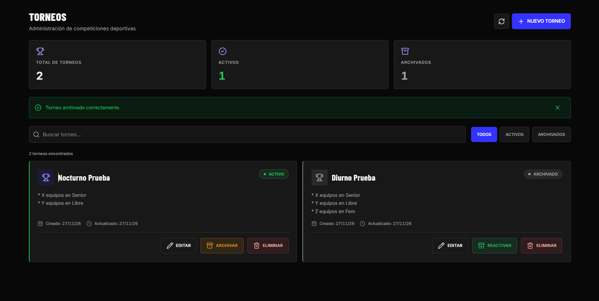
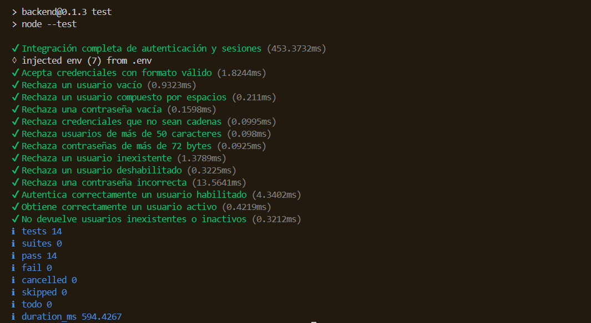
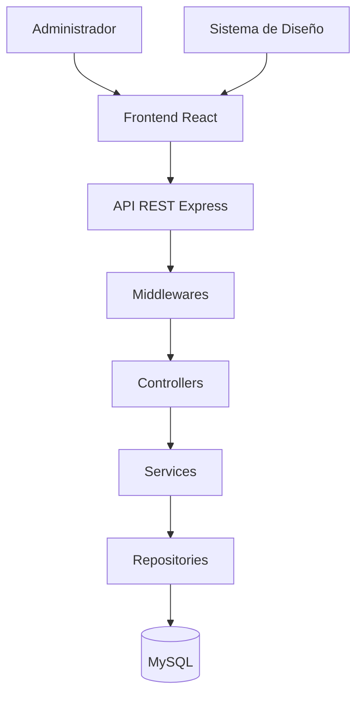

# ⚽ ALTO-SISTEMA

### Sistema integral de gestión deportiva


---

## 📖 Acerca del proyecto

ALTO-SISTEMA es una aplicación web destinada
a la administración integral de torneos
de fútbol amateur.

Su finalidad es digitalizar la organización
de competiciones deportivas mediante una
plataforma centralizada, modular, segura
y adaptable a diferentes dispositivos.

El sistema contempla la gestión simultánea
de múltiples torneos, ediciones, categorías
y formatos de competición.

El desarrollo responde a necesidades reales
de organización deportiva y aplica principios
de ingeniería de software, seguridad,
mantenibilidad y escalabilidad.

---

## 🆕 Novedades de la v0.2.0

### HU-004 — Gestión integral de torneos

Primera implementación de un módulo deportivo
funcional en ALTO-SISTEMA.

Funcionalidades incorporadas:

- Creación de torneos.
- Consulta individual.
- Listado general.
- Edición de nombre y descripción.
- Validación de campos obligatorios.
- Prevención de nombres duplicados.
- Búsqueda por nombre y descripción.
- Filtrado por estado.
- Archivado reversible.
- Reactivación.
- Eliminación definitiva con confirmación.
- Cancelación de eliminación.
- Reutilización de nombres eliminados.
- Indicadores administrativos dinámicos.
- Registro de fechas de creación y actualización.
- Persistencia en MySQL.
- Protección mediante autenticación.

El módulo permite administrar múltiples
torneos independientes.

### Operaciones administrativas

| Operación | Comportamiento |
|---|---|
| CREAR | Registra una nueva competición |
| EDITAR | Modifica sus datos básicos |
| ARCHIVAR | Desactiva el torneo conservando sus datos |
| REACTIVAR | Recupera un torneo archivado |
| ELIMINAR | Borra definitivamente el registro |

La eliminación está disponible para torneos
activos y archivados.

Requiere confirmación expresa y no puede
deshacerse desde la aplicación.

Las futuras entidades dependientes deberán
impedir la eliminación de competiciones
que posean información asociada.

### Sistema de Diseño v1.0

Se incorpora una identidad visual compartida
por toda la aplicación.

Características:

- Identidad institucional oscura.
- Azul eléctrico como color principal.
- Tipografía Barlow Condensed.
- Tipografía Inter.
- Iconografía Lucide React.
- Design Tokens centralizados.
- Componentes CSS reutilizables.
- Formularios y botones uniformes.
- Estados visuales semánticos.
- Diseño responsive.
- Indicadores de foco.
- Mecanismos de accesibilidad.
- Compatibilidad con movimiento reducido.

La identidad institucional es independiente
de las futuras identidades visuales de las
competiciones y publicaciones deportivas.

---

## 📸 Capturas de pantalla — v0.2.0

Las siguientes imágenes corresponden a la
implementación real de ALTO-SISTEMA v0.2.0.

### Panel principal


El Dashboard centraliza los accesos rápidos,
los indicadores administrativos y el estado
de disponibilidad de los componentes del sistema.

### Acceso privado

<p align="center">
  
</p>

Pantalla de autenticación adaptada al
Sistema de Diseño v1.0.

### Gestión de torneos — Estado vacío


El módulo permite comenzar desde una base
sin competiciones registradas.

### Gestión de torneos — Listado



Visualización simultánea de torneos activos
y archivados, con indicadores dinámicos,
búsqueda, filtros y acciones administrativas.

Los registros mostrados fueron creados
exclusivamente con fines demostrativos.

### Creación de torneos


Formulario con validaciones, identificación
de campos obligatorios y contadores
de caracteres.

### Edición de torneos


Modificación de los datos administrativos
de una competición existente.

### Eliminación definitiva


La eliminación requiere una confirmación
explícita que identifica el registro
y advierte sobre la irreversibilidad
de la operación.

### Adaptación móvil

<p align="center">
  
  
  
</p>

La interfaz administrativa se adapta
a pantallas pequeñas.

Las capturas corresponden a una simulación
responsive de 400 × 645 píxeles realizada
mediante las herramientas del navegador.

### Pruebas automatizadas


Ejecución de 43 pruebas unitarias
con cero fallos.

Las dos pruebas de integración se ejecutaron
y aprobaron por separado, alcanzando
un resultado acumulado de 45/45.

### Registro visual histórico — v0.1.3

<details>
<summary>Ver capturas de la versión anterior</summary>

#### Panel principal


#### Acceso privado


#### Adaptación móvil

<p align="center">
  
  
</p>

#### Arquitectura


#### Pruebas automatizadas



</details>

---

## 🎯 Objetivos del proyecto

- Administrar múltiples competiciones.
- Organizar ediciones y categorías.
- Gestionar equipos e inscripciones.
- Digitalizar listas de buena fe.
- Registrar acontecimientos deportivos.
- Gestionar jornadas y resultados.
- Automatizar tablas de posiciones.
- Calcular estadísticas deportivas.
- Gestionar copas y fases eliminatorias.
- Administrar sanciones disciplinarias.
- Exportar publicaciones deportivas en PNG.
- Facilitar la operación desde celulares.
- Conservar el historial de las competiciones.

---

## 💻 Stack tecnológico

| Tecnología | Utilización |
|---|---|
| React | Interfaces de usuario |
| Vite | Desarrollo y compilación |
| JavaScript | Lógica de aplicación |
| CSS | Sistema visual |
| Node.js | Entorno de ejecución backend |
| Express | API REST |
| MySQL | Persistencia relacional |
| mysql2 | Comunicación con MySQL |
| bcryptjs | Protección de contraseñas |
| express-session | Gestión de sesiones |
| express-mysql-session | Persistencia de sesiones |
| express-rate-limit | Limitación de solicitudes |
| React Router | Navegación |
| Lucide React | Iconografía |
| Fontsource | Tipografías locales |
| ESLint | Análisis estático |
| Node.js Test Runner | Pruebas automatizadas |
| Git | Control de versiones |

---

## 🏗️ Arquitectura

ALTO-SISTEMA utiliza una arquitectura
monolítica modular.

El frontend consume servicios REST del backend.

Las responsabilidades se distribuyen en capas
para separar la presentación, las reglas de
negocio y el acceso a los datos.



### Principios arquitectónicos

- Separación de responsabilidades.
- Organización modular.
- Configuración centralizada.
- Reglas de negocio independientes.
- Consultas parametrizadas.
- Migraciones versionadas.
- Validaciones del lado del servidor.
- Reutilización de componentes.
- Verificación automatizada.
- Documentación permanente.

---

## 📁 Estructura del proyecto

```text id="jp6q3w"
ALTO-SISTEMA/
│
├── backend/
│   ├── src/
│   │   ├── config/
│   │   ├── controllers/
│   │   ├── middlewares/
│   │   ├── repositories/
│   │   ├── routes/
│   │   ├── services/
│   │   ├── create-admin.js
│   │   ├── migrate.js
│   │   └── server.js
│   ├── tests/
│   ├── package.json
│   └── package-lock.json
│
├── database/
│   └── migrations/
│       ├── 001_usuarios.sql
│       └── 002_torneos.sql
│
├── docs/
│   ├── capturas/
│   ├── ARQUITECTURA.md
│   ├── DESARROLLO.md
│   ├── MANTENIMIENTO.md
│   ├── MODELO_MULTITORNEO.md
│   └── SISTEMA_DE_DISENO.md
│
├── frontend/
│   ├── public/
│   ├── src/
│   │   ├── assets/
│   │   ├── config/
│   │   ├── layouts/
│   │   ├── pages/
│   │   ├── services/
│   │   ├── styles/
│   │   │   ├── tokens.css
│   │   │   ├── typography.css
│   │   │   └── components.css
│   │   ├── App.jsx
│   │   ├── App.css
│   │   ├── index.css
│   │   └── main.jsx
│   ├── package.json
│   └── package-lock.json
│
├── .gitignore
└── README.md
```

---

## ✅ Funcionalidades implementadas

### Infraestructura

- Integración de frontend, backend y MySQL.
- API REST.
- Verificación de disponibilidad.
- Configuración centralizada.
- Control de versiones.

### Autenticación y seguridad

- Inicio de sesión privado.
- Administrador autenticado.
- Contraseñas protegidas mediante bcrypt.
- Sesiones persistentes en MySQL.
- Cookies HttpOnly y SameSite.
- Protección de recursos privados.
- Limitación de intentos de autenticación.
- Validación del origen de solicitudes.
- Credenciales excluidas del repositorio.

### Interfaz administrativa

- Dashboard.
- Menú lateral.
- Navegación responsive.
- Accesos rápidos.
- Sistema de Diseño v1.0.
- Indicadores de infraestructura.
- Contador real de torneos activos.

### Gestión deportiva

- Gestión integral de torneos.
- Creación, consulta y edición.
- Archivado y reactivación.
- Eliminación definitiva.
- Búsqueda y filtros.
- Indicadores administrativos.

### Persistencia

- Pool de conexiones.
- Migraciones SQL.
- Historial de migraciones.
- Verificación mediante checksums.
- Verificación estructural.
- Control de ejecución concurrente.
- Procedimientos de respaldo y restauración.

### Calidad

- Pruebas unitarias.
- Pruebas de integración.
- Entorno aislado de pruebas.
- Regresión funcional.
- ESLint.
- Compilación de producción.
- Documentación técnica.

---

## 📋 Estado de los módulos

| Módulo | Estado |
|---|---|
| Inicio | Implementado |
| Torneos | Implementado y verificado |
| Equipos | Pendiente |
| Listas de buena fe | Pendiente |
| Partidos | Pendiente |
| Posiciones | Pendiente |
| Goleadores | Pendiente |
| Valla menos vencida | Pendiente |
| Playoffs | Pendiente |
| Disciplina | Pendiente |
| Publicaciones | Pendiente |
| Historial | Pendiente |
| Configuración | Pendiente |

La navegación de los trece módulos se
encuentra disponible.

Los módulos pendientes presentan una
pantalla provisional identificada.

---

## 🗄️ Migraciones de base de datos

| Versión | Archivo | Responsabilidad |
|---|---|---|
| 001 | `001_usuarios.sql` | Usuarios administrativos |
| 002 | `002_torneos.sql` | Registro de competiciones |

### Estado verificado

- Migraciones registradas: 2.
- Migraciones pendientes: 0.
- Base de datos actualizada.
- Verificación de integridad satisfactoria.

La incorporación de la eliminación definitiva
de torneos no requirió modificaciones
estructurales adicionales.

Las migraciones aplicadas deberán conservarse
sin modificaciones posteriores.

---

## 🔌 API REST — Torneos

Todos los endpoints deportivos requieren
una sesión autenticada.

| Método | Endpoint | Operación |
|---|---|---|
| GET | `/api/torneos` | Listar torneos |
| GET | `/api/torneos/:id` | Consultar torneo |
| POST | `/api/torneos` | Crear torneo |
| PUT | `/api/torneos/:id` | Actualizar datos |
| PATCH | `/api/torneos/:id/estado` | Cambiar estado |
| DELETE | `/api/torneos/:id` | Eliminar torneo |

### Filtros disponibles

- `busqueda`
- `estado`

### Estados administrativos

- `ACTIVO`
- `ARCHIVADO`

### Validaciones

- Nombre obligatorio.
- Nombre de hasta 100 caracteres.
- Descripción opcional.
- Descripción de hasta 500 caracteres.
- Nombre único.
- Normalización de espacios.
- Validación de identificadores.
- Validación de estados.
- Conservación del nombre de torneos archivados.
- Liberación del nombre de torneos eliminados.

### Eliminación definitiva

La eliminación utiliza consultas parametrizadas
y requiere un identificador válido.

| Código HTTP | Resultado |
|---|---|
| 200 | Torneo eliminado correctamente |
| 400 | Identificador inválido |
| 401 | Autenticación requerida |
| 403 | Solicitud no permitida |
| 404 | Torneo inexistente |
| 409 | Eliminación impedida por dependencias |
| 500 | Error interno inesperado |

La protección contra dependencias contempla
los errores generados por restricciones
de claves foráneas.

Las futuras relaciones deportivas deberán
implementarse con restricciones adecuadas
para evitar pérdidas de información.

La comprobación real de estas relaciones
corresponderá a las siguientes historias
de usuario.

---

## 🎨 Sistema de Diseño v1.0

| Elemento | Definición |
|---|---|
| Color institucional | `#3333FF` |
| Fondo | `#080808` |
| Menú lateral | `#111111` |
| Paneles | `#181818` |
| Texto principal | `#F5F5F5` |
| Texto secundario | `#A3A3A3` |
| Títulos | Barlow Condensed |
| Interfaz | Inter |
| Iconografía | Lucide React |
| Altura interactiva mínima | 44 px |
| Radio estándar | 6 px |
| Punto de corte móvil principal | 900 px |

La definición completa se encuentra en:

[Sistema de Diseño v1.0](docs/SISTEMA_DE_DISENO.md)

---

## 🧪 Resultados de pruebas — v0.2.0

### Pruebas automatizadas

| Tipo | Resultado |
|---|---|
| Unitarias de autenticación | 13/13 |
| Unitarias de torneos | 30/30 |
| Integración de autenticación | 1/1 |
| Integración de torneos | 1/1 |
| **Total** | **45/45** |
| Pruebas fallidas | 0 |

Las 45 pruebas fueron verificadas mediante
ejecuciones separadas de regresión e integración.

### Ejecuciones registradas

| Ejecución | Totales | Aprobadas | Omitidas | Fallidas |
|---|---:|---:|---:|---:|
| Pruebas unitarias | 45 | 43 | 2 | 0 |
| Regresión con autenticación | 45 | 44 | 1 | 0 |
| Integración aislada de torneos | 1 | 1 | 0 | 0 |
| Regresión final para captura | 45 | 43 | 2 | 0 |

La integración de torneos contempla
20 controles internos previstos.

El resultado global de la prueba
de integración fue satisfactorio.

Los controles internos no se contabilizan
como pruebas automatizadas adicionales.

### Verificaciones técnicas

| Control | Resultado |
|---|---|
| ESLint: errores | 0 |
| ESLint: advertencias | 0 |
| Compilación de producción | Exitosa |
| Tiempo de compilación final | 3,49 segundos |
| Migraciones registradas | 2 |
| Migraciones pendientes | 0 |
| Revisión visual inicial | 8/8 |
| Validación funcional | Satisfactoria |
| Limpieza de registros temporales | Completada |
| Documentos técnicos actualizados | 6/6 |
| Capturas oficiales v0.2.0 | 11 |

### Validaciones funcionales

- Creación de torneos.
- Validación de campos obligatorios.
- Prevención de duplicados.
- Listado y búsqueda.
- Filtrado administrativo.
- Edición.
- Archivado.
- Reactivación.
- Persistencia.
- Independencia entre torneos.
- Protección mediante autenticación.
- Adaptación responsive.
- Cancelación de eliminación.
- Eliminación de torneos activos.
- Eliminación de torneos archivados.
- Reutilización de nombres eliminados.
- Actualización de indicadores.

Las comprobaciones funcionales fueron
realizadas en el entorno local de desarrollo.

Los registros utilizados para las capturas
demostrativas fueron eliminados al finalizar
el registro visual.

### Auditoría de dependencias visuales

Durante la instalación de las dependencias
del Sistema de Diseño:

- 153 paquetes auditados.
- 0 vulnerabilidades detectadas.

Este resultado corresponde al momento
en que se realizó la auditoría.

---

## 🔐 Seguridad y privacidad

ALTO-SISTEMA es una herramienta privada
de administración deportiva.

Las contraseñas, secretos de sesión,
configuraciones privadas y respaldos
no deben incorporarse al repositorio.

Las futuras listas de buena fe incluirán
información personal cuya exposición
deberá mantenerse restringida.

La configuración definitiva de seguridad
para producción será evaluada antes
del despliegue público.

---

## ⚙️ Instalación local

### Requisitos

- Node.js 24 LTS.
- npm.
- MySQL 8.
- Git.

### 1. Instalar dependencias del backend

Desde la raíz:

```bash id="2ut49e"
cd backend
npm ci
```

### 2. Preparar la base de datos

```sql id="ft9w12"
CREATE DATABASE alto_sistema
CHARACTER SET utf8mb4
COLLATE utf8mb4_unicode_ci;
```

Crear un usuario MySQL con los permisos
necesarios sobre la base correspondiente.

### 3. Configurar el entorno

Crear el archivo privado `backend/.env`:

```env id="v3ap5e"
PORT=3000
HOST=127.0.0.1
FRONTEND_URL=http://localhost:5173

DB_HOST=localhost
DB_PORT=3306
DB_USER=TU_USUARIO
DB_PASSWORD=TU_CONTRASENA
DB_NAME=alto_sistema

SESSION_SECRET=TU_SECRETO_ALEATORIO
```

Reemplazar los valores de ejemplo
por una configuración privada propia.

El secreto de sesión deberá ser aleatorio.

Nunca publicar el archivo `.env`.

### 4. Ejecutar las migraciones

```bash id="fgcj8a"
npm run migrate
```

### 5. Crear el administrador inicial

Configurar temporalmente:

- `ADMIN_USER`
- `ADMIN_PASSWORD`

La contraseña deberá contener al menos
12 caracteres y no superar los 72 bytes.

Ejecutar:

```bash id="nyx7re"
npm run create-admin
```

Retirar las variables temporales después
de completar la creación.

### 6. Iniciar el backend

```bash id="9twu4p"
npm start
```

Dirección:

http://localhost:3000

### 7. Instalar e iniciar el frontend

Desde otra terminal ubicada en la raíz:

```bash id="vc53pq"
cd frontend
npm ci
npm run dev
```

Dirección:

http://localhost:5173

---

## 🔍 Ejecución de pruebas

### Backend

Desde la carpeta backend:

```bash id="bzc28n"
npm test
```

Las pruebas unitarias se ejecutan
de forma predeterminada.

Resultado esperado sin integraciones:

- 45 pruebas totales.
- 43 aprobadas.
- 2 omitidas.
- 0 fallidas.

### Integración de autenticación

Variables temporales:

- `ALTO_INTEGRATION_TEST=1`
- `ALTO_TEST_USER`
- `ALTO_TEST_PASSWORD`

Requiere un backend operativo
y un administrador habilitado.

### Integración de torneos

Variables temporales:

- `ALTO_TORNEO_INTEGRATION_TEST=1`
- `DB_NAME=altosistemahu004test`
- `ALTO_TEST_USER`
- `ALTO_TEST_PASSWORD`

La prueba requiere una base aislada,
migraciones aplicadas, un administrador
de pruebas y un backend en el puerto 3001.

No deberá ejecutarse contra la base principal.

Consultar el manual de mantenimiento
antes de habilitar las integraciones.

### Frontend

Desde la carpeta frontend:

```bash id="2whf9g"
npm run lint
npm run build
```

---

## 📚 Documentación técnica

| Documento | Responsabilidad |
|---|---|
| [Arquitectura](docs/ARQUITECTURA.md) | Organización técnica |
| [Desarrollo](docs/DESARROLLO.md) | Metodología |
| [Mantenimiento](docs/MANTENIMIENTO.md) | Procedimientos operativos |
| [Modelo multitorneo](docs/MODELO_MULTITORNEO.md) | Reglas deportivas |
| [Sistema de Diseño](docs/SISTEMA_DE_DISENO.md) | Estándares visuales |

---

## 🗺️ Hoja de ruta

- [x] ETAPA 00 — Definición y planificación.
- [x] ETAPA 01 — Infraestructura y consolidación.
- [ ] ETAPA 02 — Torneos, ediciones, categorías e identidad visual.
  - [x] HU-004 — Gestión integral de torneos: verificada, pendiente de consolidación.
  - [ ] HU-005 — Gestión de ediciones.
  - [ ] HU-006 — Gestión de categorías.
  - [ ] HU-007 — Identidad visual de competiciones.
  - [ ] HU-008 — Selección del contexto deportivo.
- [ ] ETAPA 03 — Equipos y zonas.
- [ ] ETAPA 04 — Listas de buena fe.
- [ ] ETAPA 05 — Jornadas y partidos.
- [ ] ETAPA 06 — Tablas de posiciones.
- [ ] ETAPA 07 — Goleadores y valla menos vencida.
- [ ] ETAPA 08 — Copas y playoffs.
- [ ] ETAPA 09 — Disciplina.
- [ ] ETAPA 10 — Publicaciones y exportación PNG.
- [ ] ETAPA 11 — Operación móvil y sincronización.
- [ ] ETAPA 12 — Historial y respaldos.
- [ ] ETAPA 13 — Despliegue online.

---

## 📦 Historial de versiones

| Versión | Incremento | Estado |
|---|---|---|
| v0.1.0 | HU-001 — Infraestructura funcional | Aprobada |
| v0.1.1 | HU-002 — Autenticación | Aprobada |
| v0.1.2 | HU-003 — Interfaz base | Aprobada |
| v0.1.3 | Consolidación arquitectónica | Aprobada |
| v0.2.0 | HU-004 — Gestión integral de torneos y Sistema de Diseño | Aprobada |

---

## 📌 Estado actual

**Versión local: v0.2.0**

**Última versión consolidada: v0.1.3**

ALTO-SISTEMA se encuentra en desarrollo activo.

La gestión integral de torneos constituye
el primer módulo deportivo implementado.

Las verificaciones técnicas y funcionales
de HU-004 fueron completadas satisfactoriamente.

La documentación técnica y las capturas
oficiales de la versión 0.2.0 se encuentran
incorporadas.

La aprobación integral y publicación
de la versión permanecen pendientes
del cierre formal y del control de versiones.

### Limitaciones actuales

- Sin despliegue en producción.
- Sin pruebas de carga.
- Sin auditoría formal de accesibilidad.
- Sin pruebas visuales automatizadas.
- Validación móvil física pendiente.
- Optimización tipográfica pendiente.
- Restauración de respaldo con la nueva tabla pendiente.
- Verificación real de futuras claves foráneas pendiente.
- Módulos deportivos restantes pendientes.
- Generación de publicaciones PNG pendiente.

---

## 👨‍💻 Autor

**Francisco Bacalini**

Estudiante de la Tecnicatura en Programación.

Argentina.

Proyecto personal de ingeniería de software
aplicada a la organización deportiva.

---

**ALTO-SISTEMA | Tecnología aplicada al fútbol amateur.**

© 2026 Francisco Bacalini.
