# ⚽ ALTO-SISTEMA

### Sistema integral de gestión deportiva


---

## 📖 Acerca del proyecto

ALTO-SISTEMA es una aplicación web destinada
a la administración integral de torneos
de fútbol amateur.

Su finalidad es digitalizar la organización
de competiciones deportivas mediante una
plataforma centralizada, modular, segura
y adaptable a diferentes dispositivos.

El sistema contempla la gestión simultánea
de múltiples torneos, ediciones, categorías
y formatos de competición.

El desarrollo responde a necesidades reales
de organización deportiva y aplica principios
de ingeniería de software, seguridad,
mantenibilidad y escalabilidad.

---

## 🆕 Novedades de la v0.3.0

### HU-005 — Gestión de ediciones

Cada torneo puede contener múltiples ediciones independientes,
incluso del mismo año y simultáneamente en curso.

Funcionalidades incorporadas:

- Creación, consulta, listado, edición y eliminación de ediciones.
- Nombre libre, con el año integrado en el nombre si corresponde.
- Nombre obligatorio de hasta 100 caracteres, único dentro del torneo.
- Descripción opcional de hasta 500 caracteres.
- Fechas de inicio y finalización opcionales, editables y eliminables.
- Validación de fechas reales y coherencia cronológica.
- Búsqueda por nombre y descripción, filtros por estado e indicadores dinámicos.
- Acceso mediante GESTIONAR EDICIONES desde cada tarjeta de TORNEOS.
- Indicadores de ediciones totales y en curso en TORNEOS.
- Independencia de registros entre torneos.
- Persistencia en MySQL y protección mediante autenticación.
- Confirmación de cambios de estado y eliminación definitiva.

### Ciclo de vida deportivo

| Estado | Significado | Transición permitida |
|---|---|---|
| PLANIFICADA | Estado inicial | INICIAR → EN_CURSO |
| EN_CURSO | Edición iniciada | FINALIZAR → FINALIZADA |
| FINALIZADA | Edición cerrada | REABRIR → EN_CURSO |

Las fechas son informativas y no producen cambios automáticos
de estado. Repetir el estado vigente no modifica el registro.

Los torneos archivados permiten consultar, editar, finalizar
y eliminar sus ediciones sin dependencias, pero no crear,
iniciar ni reabrir ediciones hasta su reactivación.

La migración 003 incorpora una clave foránea restrictiva:
no se puede eliminar un torneo con ediciones asociadas.

### Interfaz de ediciones

Se conserva el Sistema de Diseño v1.0, con colorimetría azul
para PLANIFICADA, verde para EN_CURSO y gris para FINALIZADA.
La pantalla incorpora indicadores generales, búsqueda, filtros,
formularios y tarjetas adaptables a pantallas pequeñas.

No se agrega una opción al menú lateral: se accede mediante
la ruta privada `/torneos/:torneoId/ediciones`.

---

## 📜 Novedades de la v0.2.0 — Registro histórico

### HU-004 — Gestión integral de torneos

Primera implementación de un módulo deportivo
funcional en ALTO-SISTEMA.

Funcionalidades incorporadas:

- Creación de torneos.
- Consulta individual.
- Listado general.
- Edición de nombre y descripción.
- Validación de campos obligatorios.
- Prevención de nombres duplicados.
- Búsqueda por nombre y descripción.
- Filtrado por estado.
- Archivado reversible.
- Reactivación.
- Eliminación definitiva con confirmación.
- Cancelación de eliminación.
- Reutilización de nombres eliminados.
- Indicadores administrativos dinámicos.
- Registro de fechas de creación y actualización.
- Persistencia en MySQL.
- Protección mediante autenticación.

El módulo permite administrar múltiples
torneos independientes.

### Operaciones administrativas

| Operación | Comportamiento |
|---|---|
| CREAR | Registra una nueva competición |
| EDITAR | Modifica sus datos básicos |
| ARCHIVAR | Desactiva el torneo conservando sus datos |
| REACTIVAR | Recupera un torneo archivado |
| ELIMINAR | Borra definitivamente el registro |

La eliminación está disponible para torneos
activos y archivados.

Requiere confirmación expresa y no puede
deshacerse desde la aplicación.

Desde v0.3.0, las ediciones asociadas impiden efectivamente
la eliminación de su torneo mediante una restricción de clave foránea.
Las futuras entidades dependientes deberán conservar este principio.

### Sistema de Diseño v1.0

Se incorpora una identidad visual compartida
por toda la aplicación.

Características:

- Identidad institucional oscura.
- Azul eléctrico como color principal.
- Tipografía Barlow Condensed.
- Tipografía Inter.
- Iconografía Lucide React.
- Design Tokens centralizados.
- Componentes CSS reutilizables.
- Formularios y botones uniformes.
- Estados visuales semánticos.
- Diseño responsive.
- Indicadores de foco.
- Mecanismos de accesibilidad.
- Compatibilidad con movimiento reducido.

La identidad institucional es independiente
de las futuras identidades visuales de las
competiciones y publicaciones deportivas.

---

## 📸 Capturas de pantalla — v0.3.0

Las siguientes doce capturas corresponden a la implementación real de HU-005.
Los nombres, descripciones y fechas de los registros son demostrativos.
Los registros temporales se eliminaron después de obtener las evidencias.

### Panel principal

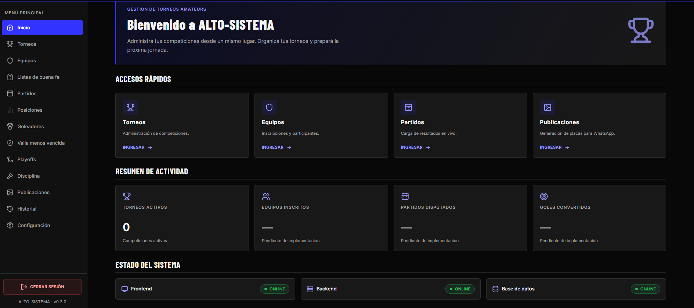

El Dashboard muestra la versión 0.3.0 y la disponibilidad del frontend, backend y base de datos.

### Torneos — Estado vacío

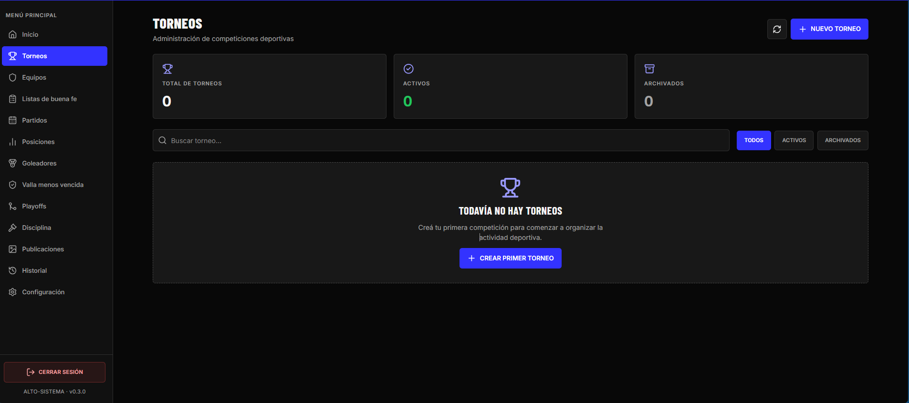

La interfaz refleja la ausencia de torneos registrados y permite crear una competición.

### Torneos — Indicadores de ediciones


Cada tarjeta incorpora los indicadores de ediciones totales y en curso, junto con el acceso a su gestión.

### Ediciones — Estado vacío


La pantalla identifica el torneo seleccionado e incluye cuatro indicadores, buscador y filtros por estado.

### Formulario de creación


El nombre es obligatorio; la descripción y ambas fechas son opcionales. Las fechas son informativas y el estado se administra manualmente.

### Edición planificada

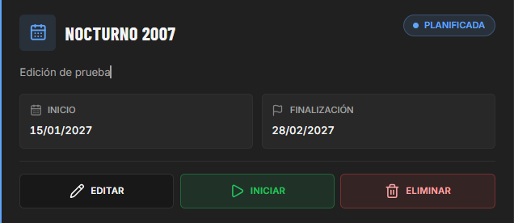

Estado inicial PLANIFICADA, identificado en azul, con la acción INICIAR disponible.

### Edición en curso

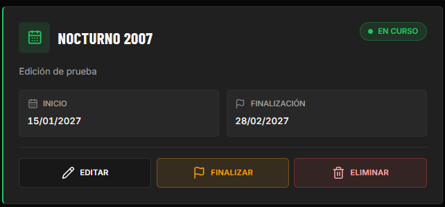

Estado EN CURSO, identificado en verde, con la acción FINALIZAR disponible.

### Edición finalizada

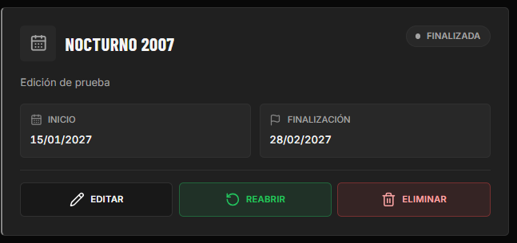

Estado FINALIZADA, identificado en gris, con la acción REABRIR disponible.

### Ediciones simultáneas


Dos ediciones del mismo torneo se encuentran en curso simultáneamente. Una de ellas no tiene fechas definidas.

### Restricciones de torneo archivado

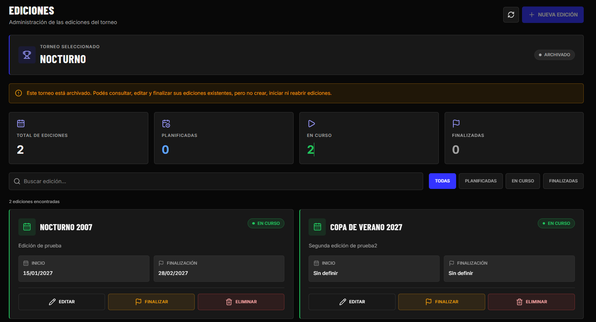

El archivado conserva las ediciones existentes. La creación queda deshabilitada y se informa que no se permite iniciar ni reabrir ediciones.

### Adaptación móvil

<p align="center">
  
</p>

Simulación de 390 × 844 píxeles mediante el navegador. Los indicadores se reorganizan en dos columnas. No constituye una prueba en un dispositivo físico.

### Pruebas automatizadas


Regresión de v0.3.0: 105 pruebas detectadas, 102 aprobadas, 3 integraciones omitidas intencionalmente y 0 fallos. Las tres integraciones habían sido aprobadas por separado; resultado acumulado: 105/105.

---

## 📸 Capturas de pantalla — v0.2.0

Las siguientes imágenes corresponden a la
implementación real de ALTO-SISTEMA v0.2.0.

### Panel principal


El Dashboard centraliza los accesos rápidos,
los indicadores administrativos y el estado
de disponibilidad de los componentes del sistema.

### Acceso privado

<p align="center">
  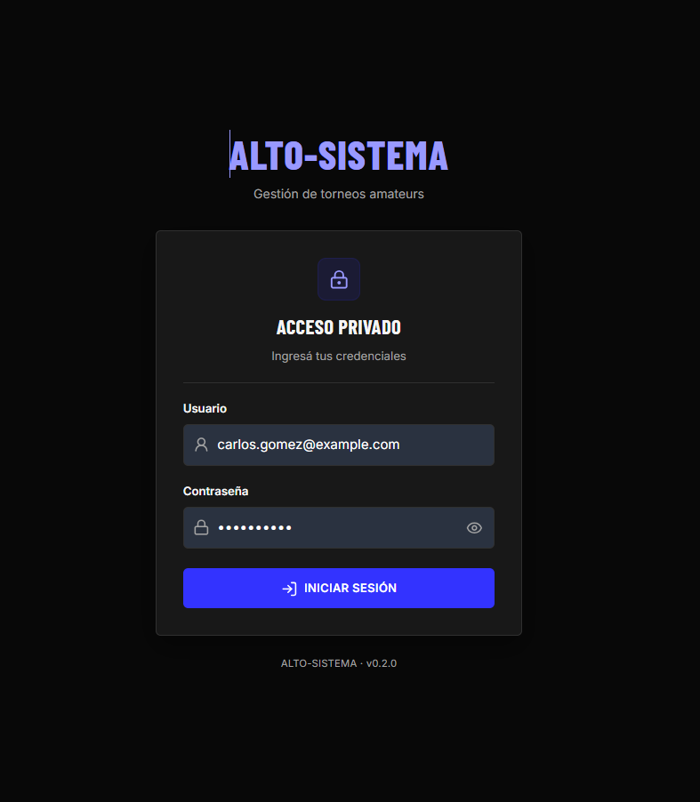
</p>

Pantalla de autenticación adaptada al
Sistema de Diseño v1.0.

### Gestión de torneos — Estado vacío


El módulo permite comenzar desde una base
sin competiciones registradas.

### Gestión de torneos — Listado


Visualización simultánea de torneos activos
y archivados, con indicadores dinámicos,
búsqueda, filtros y acciones administrativas.

Los registros mostrados fueron creados
exclusivamente con fines demostrativos.

### Creación de torneos


Formulario con validaciones, identificación
de campos obligatorios y contadores
de caracteres.

### Edición de torneos


Modificación de los datos administrativos
de una competición existente.

### Eliminación definitiva

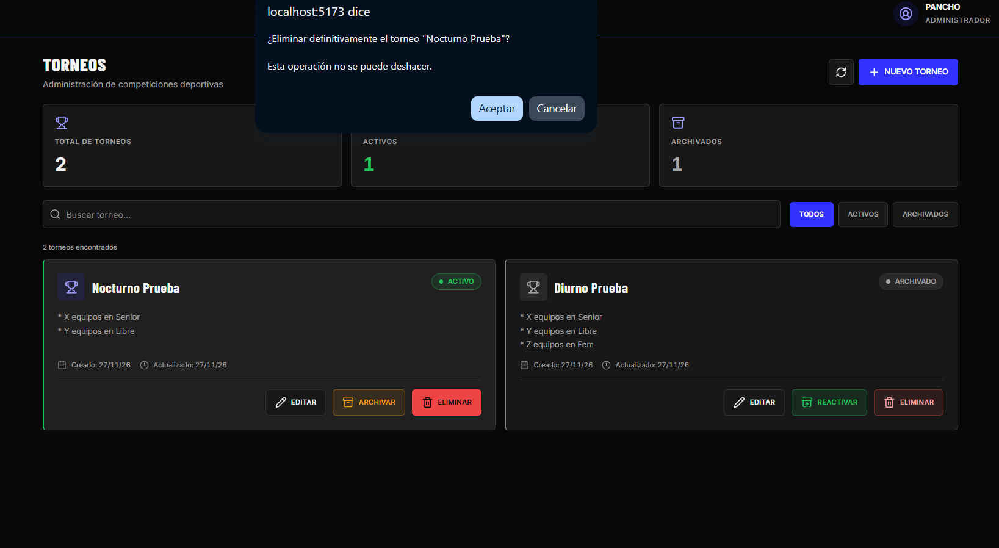

La eliminación requiere una confirmación
explícita que identifica el registro
y advierte sobre la irreversibilidad
de la operación.

### Adaptación móvil

<p align="center">
  
  
  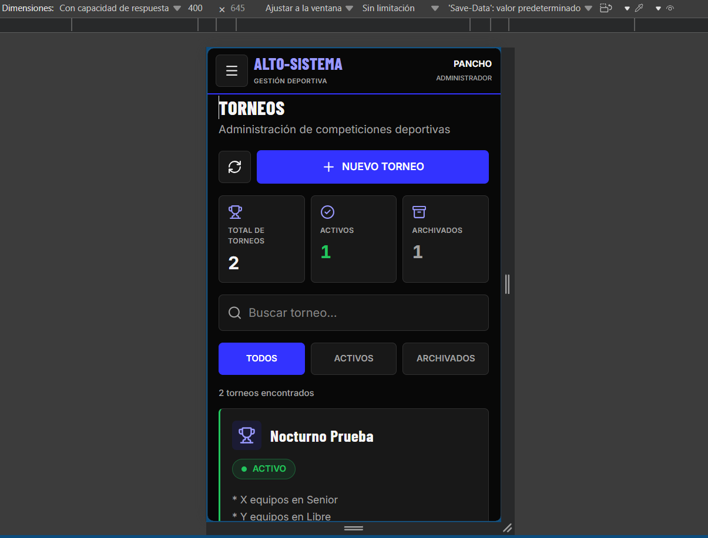
</p>

La interfaz administrativa se adapta
a pantallas pequeñas.

Las capturas corresponden a una simulación
responsive de 400 × 645 píxeles realizada
mediante las herramientas del navegador.

### Pruebas automatizadas


Ejecución de 43 pruebas unitarias
con cero fallos.

Las dos pruebas de integración se ejecutaron
y aprobaron por separado, alcanzando
un resultado acumulado de 45/45.

### Registro visual histórico — v0.1.3

<details>
<summary>Ver capturas de la versión anterior</summary>

#### Panel principal

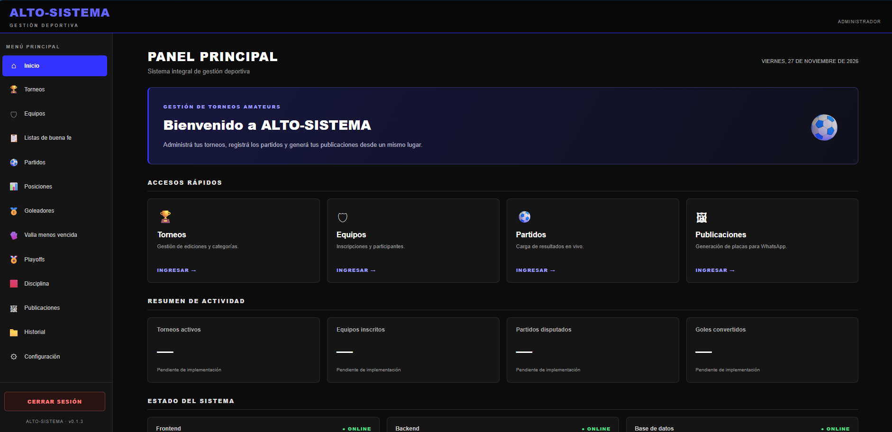

#### Acceso privado

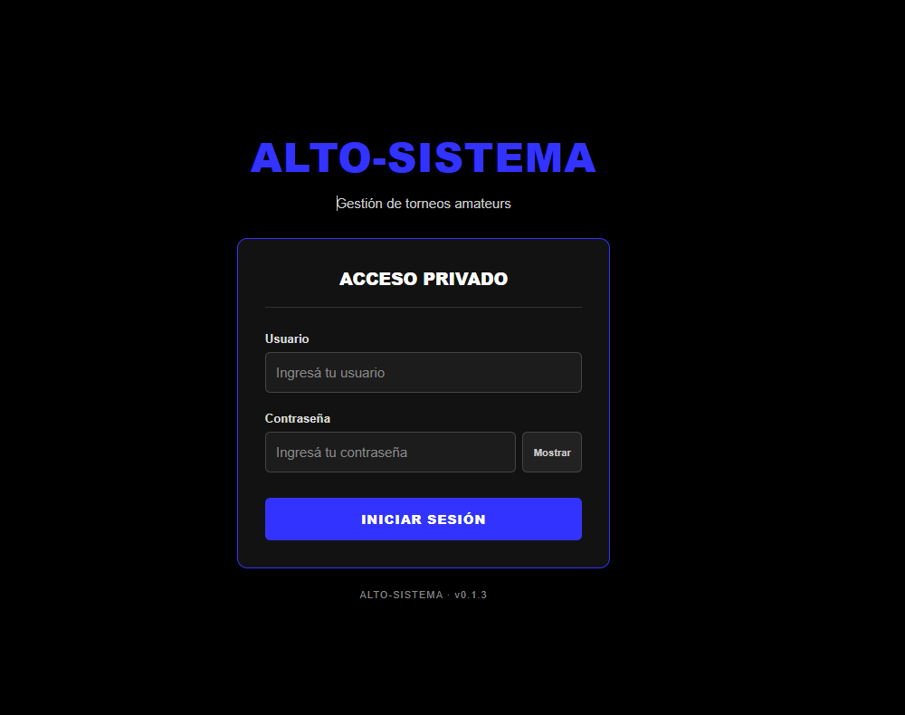

#### Adaptación móvil

<p align="center">
  
  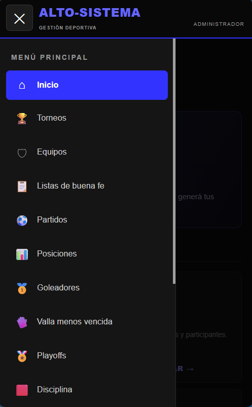
</p>

#### Arquitectura


#### Pruebas automatizadas


</details>

---

## 🎯 Objetivos del proyecto

- Administrar múltiples competiciones.
- Organizar ediciones y categorías.
- Gestionar equipos e inscripciones.
- Digitalizar listas de buena fe.
- Registrar acontecimientos deportivos.
- Gestionar jornadas y resultados.
- Automatizar tablas de posiciones.
- Calcular estadísticas deportivas.
- Gestionar copas y fases eliminatorias.
- Administrar sanciones disciplinarias.
- Exportar publicaciones deportivas en PNG.
- Facilitar la operación desde celulares.
- Conservar el historial de las competiciones.

---

## 💻 Stack tecnológico

| Tecnología | Utilización |
|---|---|
| React | Interfaces de usuario |
| Vite | Desarrollo y compilación |
| JavaScript | Lógica de aplicación |
| CSS | Sistema visual |
| Node.js | Entorno de ejecución backend |
| Express | API REST |
| MySQL | Persistencia relacional |
| mysql2 | Comunicación con MySQL |
| bcryptjs | Protección de contraseñas |
| express-session | Gestión de sesiones |
| express-mysql-session | Persistencia de sesiones |
| express-rate-limit | Limitación de solicitudes |
| React Router | Navegación |
| Lucide React | Iconografía |
| Fontsource | Tipografías locales |
| ESLint | Análisis estático |
| Node.js Test Runner | Pruebas automatizadas |
| Git | Control de versiones |

---

## 🏗️ Arquitectura

ALTO-SISTEMA utiliza una arquitectura
monolítica modular.

El frontend consume servicios REST del backend.

Las responsabilidades se distribuyen en capas
para separar la presentación, las reglas de
negocio y el acceso a los datos.

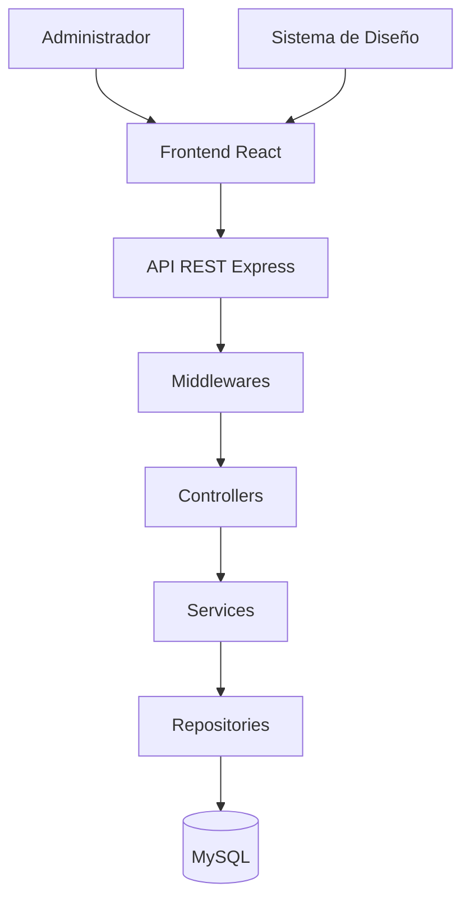

### Principios arquitectónicos

- Separación de responsabilidades.
- Organización modular.
- Configuración centralizada.
- Reglas de negocio independientes.
- Consultas parametrizadas.
- Migraciones versionadas.
- Validaciones del lado del servidor.
- Reutilización de componentes.
- Verificación automatizada.
- Documentación permanente.

---

## 📁 Estructura del proyecto

```text
ALTO-SISTEMA/
│
├── backend/
│   ├── src/
│   │   ├── config/
│   │   ├── controllers/
│   │   ├── middlewares/
│   │   ├── repositories/
│   │   ├── routes/
│   │   ├── services/
│   │   ├── create-admin.js
│   │   ├── migrate.js
│   │   └── server.js
│   ├── tests/
│   ├── package.json
│   └── package-lock.json
│
├── database/
│   └── migrations/
│       ├── 001_usuarios.sql
│       ├── 002_torneos.sql
│       └── 003_ediciones.sql
│
├── docs/
│   ├── capturas/
│   ├── ARQUITECTURA.md
│   ├── DESARROLLO.md
│   ├── MANTENIMIENTO.md
│   ├── MODELO_MULTITORNEO.md
│   └── SISTEMA_DE_DISENO.md
│
├── frontend/
│   ├── public/
│   ├── src/
│   │   ├── assets/
│   │   ├── config/
│   │   ├── layouts/
│   │   ├── pages/
│   │   ├── services/
│   │   ├── styles/
│   │   │   ├── tokens.css
│   │   │   ├── typography.css
│   │   │   └── components.css
│   │   ├── App.jsx
│   │   ├── App.css
│   │   ├── index.css
│   │   └── main.jsx
│   ├── package.json
│   └── package-lock.json
│
├── .gitignore
└── README.md
```

---

## ✅ Funcionalidades implementadas

### Infraestructura

- Integración de frontend, backend y MySQL.
- API REST.
- Verificación de disponibilidad.
- Configuración centralizada.
- Control de versiones.

### Autenticación y seguridad

- Inicio de sesión privado.
- Administrador autenticado.
- Contraseñas protegidas mediante bcrypt.
- Sesiones persistentes en MySQL.
- Cookies HttpOnly y SameSite.
- Protección de recursos privados.
- Limitación de intentos de autenticación.
- Validación del origen de solicitudes.
- Credenciales excluidas del repositorio.

### Interfaz administrativa

- Dashboard.
- Menú lateral.
- Navegación responsive.
- Accesos rápidos.
- Sistema de Diseño v1.0.
- Indicadores de infraestructura.
- Contador real de torneos activos.

### Gestión deportiva

- Gestión integral de torneos.
- Creación, consulta y edición.
- Archivado y reactivación.
- Eliminación definitiva.
- Búsqueda y filtros.
- Indicadores administrativos.
- Gestión integral de ediciones por torneo.
- Fechas opcionales y editables.
- Estados deportivos manuales y reapertura.
- Ediciones simultáneas.
- Indicadores de ediciones por torneo.
- Protección referencial efectiva entre torneos y ediciones.

### Persistencia

- Pool de conexiones.
- Migraciones SQL.
- Historial de migraciones.
- Verificación mediante checksums.
- Verificación estructural.
- Control de ejecución concurrente.
- Procedimientos de respaldo y restauración.

### Calidad

- Pruebas unitarias.
- Pruebas de integración.
- Entorno aislado de pruebas.
- Regresión funcional.
- ESLint.
- Compilación de producción.
- Documentación técnica.

---

## 📋 Estado de los módulos

| Módulo | Estado |
|---|---|
| Inicio | Implementado |
| Torneos | Implementado y verificado (incluye gestión de ediciones) |
| Equipos | Pendiente |
| Listas de buena fe | Pendiente |
| Partidos | Pendiente |
| Posiciones | Pendiente |
| Goleadores | Pendiente |
| Valla menos vencida | Pendiente |
| Playoffs | Pendiente |
| Disciplina | Pendiente |
| Publicaciones | Pendiente |
| Historial | Pendiente |
| Configuración | Pendiente |

La navegación de los trece módulos se
encuentra disponible.

Los módulos pendientes presentan una
pantalla provisional identificada.

---

## 🗄️ Migraciones de base de datos

| Versión | Archivo | Responsabilidad |
|---|---|---|
| 001 | `001_usuarios.sql` | Usuarios administrativos |
| 002 | `002_torneos.sql` | Registro de competiciones |
| 003 | `003_ediciones.sql` | Ediciones, estados, fechas y relación restrictiva con torneos |

### Estado verificado

- Migraciones registradas: 3.
- Migraciones pendientes: 0.
- Base de datos actualizada.
- Verificación de integridad satisfactoria.

Se verificó la actualización de una instalación existente,
la instalación desde una base vacía y la repetición de las
migraciones sin nuevas ejecuciones pendientes.

Las migraciones aplicadas deberán conservarse
sin modificaciones posteriores.

---

## 🔌 API REST — Torneos

Todos los endpoints deportivos requieren
una sesión autenticada.

| Método | Endpoint | Operación |
|---|---|---|
| GET | `/api/torneos` | Listar torneos |
| GET | `/api/torneos/:id` | Consultar torneo |
| POST | `/api/torneos` | Crear torneo |
| PUT | `/api/torneos/:id` | Actualizar datos |
| PATCH | `/api/torneos/:id/estado` | Cambiar estado |
| DELETE | `/api/torneos/:id` | Eliminar torneo |

### Filtros disponibles

- `busqueda`
- `estado`

### Estados administrativos

- `ACTIVO`
- `ARCHIVADO`

### Validaciones

- Nombre obligatorio.
- Nombre de hasta 100 caracteres.
- Descripción opcional.
- Descripción de hasta 500 caracteres.
- Nombre único.
- Normalización de espacios.
- Validación de identificadores.
- Validación de estados.
- Conservación del nombre de torneos archivados.
- Liberación del nombre de torneos eliminados.

### Eliminación definitiva

La eliminación utiliza consultas parametrizadas
y requiere un identificador válido.

| Código HTTP | Resultado |
|---|---|
| 200 | Torneo eliminado correctamente |
| 400 | Identificador inválido |
| 401 | Autenticación requerida |
| 403 | Solicitud no permitida |
| 404 | Torneo inexistente |
| 409 | Eliminación impedida por dependencias |
| 500 | Error interno inesperado |

La protección contra dependencias contempla
los errores generados por restricciones
de claves foráneas.

Las futuras relaciones deportivas deberán
implementarse con restricciones adecuadas
para evitar pérdidas de información.

La restricción entre torneos y ediciones fue comprobada
en HU-005 mediante integración con MySQL y validación funcional.

---

## 🔌 API REST — Ediciones

Todas las operaciones requieren autenticación y se limitan
al torneo identificado por `:torneoId`.

| Método | Endpoint | Operación |
|---|---|---|
| GET | `/api/torneos/:torneoId/ediciones` | Listar ediciones e indicadores |
| GET | `/api/torneos/:torneoId/ediciones/:edicionId` | Consultar edición |
| POST | `/api/torneos/:torneoId/ediciones` | Crear edición |
| PUT | `/api/torneos/:torneoId/ediciones/:edicionId` | Actualizar datos |
| PATCH | `/api/torneos/:torneoId/ediciones/:edicionId/estado` | Cambiar estado |
| DELETE | `/api/torneos/:torneoId/ediciones/:edicionId` | Eliminar edición |

Filtros disponibles: `busqueda` y `estado`.

El listado devuelve el torneo, las ediciones, el total de
resultados y los indicadores generales (`total`, `planificadas`,
`en_curso`, `finalizadas`). Los indicadores no dependen del filtro.

Los campos editables son `nombre`, `descripcion`, `fecha_inicio`
y `fecha_finalizacion`. Las fechas utilizan el formato
`YYYY-MM-DD` o `null` cuando no se informan. La edición
no puede cambiar de torneo mediante una actualización.

Las restricciones de unicidad, fechas y dependencia referencial
se complementan con validaciones y transacciones del backend.

| Código HTTP | Resultado |
|---|---|
| 200 | Consulta, modificación, cambio de estado o eliminación correctos |
| 201 | Edición creada |
| 400 | Datos, fechas, estado o identificadores inválidos |
| 401 | Autenticación requerida |
| 403 | Solicitud no permitida |
| 404 | Torneo o edición inexistente en el contexto solicitado |
| 409 | Conflicto de nombre, estado, restricciones o dependencias |
| 500 | Error interno inesperado |

---

## 🎨 Sistema de Diseño v1.0

| Elemento | Definición |
|---|---|
| Color institucional | `#3333FF` |
| Fondo | `#080808` |
| Menú lateral | `#111111` |
| Paneles | `#181818` |
| Texto principal | `#F5F5F5` |
| Texto secundario | `#A3A3A3` |
| Títulos | Barlow Condensed |
| Interfaz | Inter |
| Iconografía | Lucide React |
| Altura interactiva mínima | 44 px |
| Radio estándar | 6 px |
| Punto de corte móvil principal | 900 px |

La definición completa se encuentra en:

[Sistema de Diseño v1.0](docs/SISTEMA_DE_DISENO.md)

---

## 🧪 Resultados de pruebas — v0.3.0

### Pruebas automatizadas

| Tipo | Resultado |
|---|---:|
| Unitarias de autenticación | 13/13 |
| Unitarias de torneos | 30/30 |
| Unitarias de ediciones | 59/59 |
| Integración de autenticación | 1/1 |
| Integración de torneos | 1/1 |
| Integración de ediciones | 1/1 |
| **Total acumulado** | **105/105** |
| Fallidas y canceladas en las ejecuciones informadas | 0 |

Los resultados corresponden a ejecuciones separadas,
sin contabilizar nuevamente las pruebas de regresión ni
los controles internos de integración como pruebas adicionales.

Regresión final con `npm test` sobre v0.3.0:

| Control | Resultado |
|---|---:|
| Pruebas detectadas | 105 |
| Aprobadas | 102 |
| Omitidas intencionalmente (integraciones) | 3 |
| Fallidas | 0 |
| Canceladas | 0 |
| TODO | 0 |
| Duración | 671,7839 ms |

Las tres integraciones se aprobaron en ejecuciones anteriores.
La duración corresponde al entorno local, no a una prueba de carga.

### Verificaciones técnicas

| Control | Resultado |
|---|---|
| ESLint | Sin errores informados |
| Compilación de producción | Exitosa (2,52 segundos) |
| Migración sobre instalación existente | Satisfactoria |
| Migraciones desde cero | 3/3 |
| Idempotencia | 3 registradas, 0 pendientes |
| Integración y regresión con MySQL | Satisfactorias |
| Coherencia de versiones | 8/8 valores |
| Arranque del backend v0.3.0 | Satisfactorio |
| Reinicio del frontend v0.3.0 | Confirmado |
| Capturas oficiales v0.3.0 | 12/12 revisadas |
| Limpieza de registros demostrativos | Confirmada |

### Validaciones funcionales de HU-005

1. Integración visual con TORNEOS.
2. Navegación hacia EDICIONES.
3. Creación de ediciones.
4. Fechas opcionales.
5. Modificación de fechas.
6. Inicio de edición.
7. Finalización de edición.
8. Reapertura de edición.
9. Indicadores internos.
10. Ediciones simultáneas.
11. Modificación de nombre y descripción.
12. Eliminación de fechas.
13. Búsqueda y filtros.
14. Indicadores externos en TORNEOS.
15. Restricciones de torneos archivados.
16. Eliminación independiente e integridad referencial.
17. Adaptación responsive.

Resultado: **17/17 controles validados**, según las
comprobaciones y confirmaciones realizadas en el entorno local.

La validación responsive fue confirmada mediante simulación
en el navegador; no equivale a una prueba en un celular físico.
La captura 28 documenta la simulación móvil de 390 × 844 píxeles.

Los registros deportivos temporales utilizados en la base principal
se eliminaron al finalizar las comprobaciones y, posteriormente,
las capturas oficiales. La limpieza de los registros demostrativos
fue confirmada por el administrador.

---

## 🧪 Resultados de pruebas — v0.2.0 (histórico)

### Pruebas automatizadas

| Tipo | Resultado |
|---|---|
| Unitarias de autenticación | 13/13 |
| Unitarias de torneos | 30/30 |
| Integración de autenticación | 1/1 |
| Integración de torneos | 1/1 |
| **Total** | **45/45** |
| Pruebas fallidas | 0 |

Las 45 pruebas fueron verificadas mediante
ejecuciones separadas de regresión e integración.

### Ejecuciones registradas

| Ejecución | Totales | Aprobadas | Omitidas | Fallidas |
|---|---:|---:|---:|---:|
| Pruebas unitarias | 45 | 43 | 2 | 0 |
| Regresión con autenticación | 45 | 44 | 1 | 0 |
| Integración aislada de torneos | 1 | 1 | 0 | 0 |
| Regresión final para captura | 45 | 43 | 2 | 0 |

La integración de torneos contempla
20 controles internos previstos.

El resultado global de la prueba
de integración fue satisfactorio.

Los controles internos no se contabilizan
como pruebas automatizadas adicionales.

### Verificaciones técnicas

| Control | Resultado |
|---|---|
| ESLint: errores | 0 |
| ESLint: advertencias | 0 |
| Compilación de producción | Exitosa |
| Tiempo de compilación final | 3,49 segundos |
| Migraciones registradas | 2 |
| Migraciones pendientes | 0 |
| Revisión visual inicial | 8/8 |
| Validación funcional | Satisfactoria |
| Limpieza de registros temporales | Completada |
| Documentos técnicos actualizados | 6/6 |
| Capturas oficiales v0.2.0 | 11 |

### Validaciones funcionales

- Creación de torneos.
- Validación de campos obligatorios.
- Prevención de duplicados.
- Listado y búsqueda.
- Filtrado administrativo.
- Edición.
- Archivado.
- Reactivación.
- Persistencia.
- Independencia entre torneos.
- Protección mediante autenticación.
- Adaptación responsive.
- Cancelación de eliminación.
- Eliminación de torneos activos.
- Eliminación de torneos archivados.
- Reutilización de nombres eliminados.
- Actualización de indicadores.

Las comprobaciones funcionales fueron
realizadas en el entorno local de desarrollo.

Los registros utilizados para las capturas
demostrativas fueron eliminados al finalizar
el registro visual.

### Auditoría de dependencias visuales

Durante la instalación de las dependencias
del Sistema de Diseño:

- 153 paquetes auditados.
- 0 vulnerabilidades detectadas.

Este resultado corresponde al momento
en que se realizó la auditoría.

---

## 🔐 Seguridad y privacidad

ALTO-SISTEMA es una herramienta privada
de administración deportiva.

Las contraseñas, secretos de sesión,
configuraciones privadas y respaldos
no deben incorporarse al repositorio.

Las futuras listas de buena fe incluirán
información personal cuya exposición
deberá mantenerse restringida.

La configuración definitiva de seguridad
para producción será evaluada antes
del despliegue público.

---

## ⚙️ Instalación local

### Requisitos

- Node.js 24 LTS.
- npm.
- MySQL 8.
- Git.

### 1. Instalar dependencias del backend

Desde la raíz:

```bash
cd backend
npm ci
```

### 2. Preparar la base de datos

```sql
CREATE DATABASE alto_sistema
CHARACTER SET utf8mb4
COLLATE utf8mb4_unicode_ci;
```

Crear un usuario MySQL con los permisos
necesarios sobre la base correspondiente.

### 3. Configurar el entorno

Crear el archivo privado `backend/.env`:

```env
PORT=3000
HOST=127.0.0.1
FRONTEND_URL=http://localhost:5173

DB_HOST=localhost
DB_PORT=3306
DB_USER=TU_USUARIO
DB_PASSWORD=TU_CONTRASENA
DB_NAME=alto_sistema

SESSION_SECRET=TU_SECRETO_ALEATORIO
```

Reemplazar los valores de ejemplo
por una configuración privada propia.

El secreto de sesión deberá ser aleatorio.

Nunca publicar el archivo `.env`.

### 4. Ejecutar las migraciones

```bash
npm run migrate
```

### 5. Crear el administrador inicial

Configurar temporalmente:

- `ADMIN_USER`
- `ADMIN_PASSWORD`

La contraseña deberá contener al menos
12 caracteres y no superar los 72 bytes.

Ejecutar:

```bash
npm run create-admin
```

Retirar las variables temporales después
de completar la creación.

### 6. Iniciar el backend

```bash
npm start
```

Dirección:

http://localhost:3000

### 7. Instalar e iniciar el frontend

Desde otra terminal ubicada en la raíz:

```bash
cd frontend
npm ci
npm run dev
```

Dirección:

http://localhost:5173

---

## 🔍 Ejecución de pruebas

### Backend

Desde la carpeta backend:

```bash
npm test
```

Las pruebas unitarias se ejecutan
de forma predeterminada.

Resultado esperado sin integraciones habilitadas:

- 105 pruebas totales.
- 102 aprobadas.
- 3 omitidas.
- 0 fallidas.

Este resumen es el resultado esperado de una ejecución conjunta;
las 105 aprobaciones de HU-005 se obtuvieron en ejecuciones separadas.

### Integración de autenticación

Variables temporales:

- `ALTO_INTEGRATION_TEST=1`
- `ALTO_TEST_USER`
- `ALTO_TEST_PASSWORD`

Requiere un backend operativo
y un administrador habilitado.

### Integración de torneos

Variables temporales:

- `ALTO_TORNEO_INTEGRATION_TEST=1`
- `DB_NAME=altosistemahu004test`
- `ALTO_TEST_USER`
- `ALTO_TEST_PASSWORD`

La prueba requiere una base aislada,
migraciones aplicadas, un administrador
de pruebas y un backend en el puerto 3001.

No deberá ejecutarse contra la base principal.

### Integración de ediciones

Variables temporales:

- `ALTO_EDICION_INTEGRATION_TEST=1`
- `DB_NAME=altosistemahu004test`
- `ALTO_TEST_USER`
- `ALTO_TEST_PASSWORD`

Requiere la base aislada con las migraciones 001 a 003,
un administrador de pruebas y un backend en el puerto 3001.

Desde `backend`, con las variables configuradas:

```bash
node --test tests/edicion.integration.test.js
```

No deberá ejecutarse contra la base principal.

La instalación desde cero se verificó en `altosistemahu005fresh`.
Ambas bases aisladas se conservan para futuras verificaciones.

Consultar el manual de mantenimiento
antes de habilitar las integraciones.

### Frontend

Desde la carpeta frontend:

```bash
npm run lint
npm run build
```

---

## 📚 Documentación técnica

| Documento | Responsabilidad |
|---|---|
| [Arquitectura](docs/ARQUITECTURA.md) | Organización técnica |
| [Desarrollo](docs/DESARROLLO.md) | Metodología |
| [Mantenimiento](docs/MANTENIMIENTO.md) | Procedimientos operativos |
| [Modelo multitorneo](docs/MODELO_MULTITORNEO.md) | Reglas deportivas |
| [Sistema de Diseño](docs/SISTEMA_DE_DISENO.md) | Estándares visuales |

---

## 🗺️ Hoja de ruta

- [x] ETAPA 00 — Definición y planificación.
- [x] ETAPA 01 — Infraestructura y consolidación.
- [ ] ETAPA 02 — Torneos, ediciones, categorías e identidad visual.
  - [x] HU-004 — Gestión integral de torneos: aprobada y consolidada.
  - [ ] HU-005 — Gestión de ediciones: implementada y verificada, pendiente de cierre formal.
  - [ ] HU-006 — Gestión de categorías.
  - [ ] HU-007 — Identidad visual de competiciones.
  - [ ] HU-008 — Selección del contexto deportivo.
- [ ] ETAPA 03 — Equipos y zonas.
- [ ] ETAPA 04 — Listas de buena fe.
- [ ] ETAPA 05 — Jornadas y partidos.
- [ ] ETAPA 06 — Tablas de posiciones.
- [ ] ETAPA 07 — Goleadores y valla menos vencida.
- [ ] ETAPA 08 — Copas y playoffs.
- [ ] ETAPA 09 — Disciplina.
- [ ] ETAPA 10 — Publicaciones y exportación PNG.
- [ ] ETAPA 11 — Operación móvil y sincronización.
- [ ] ETAPA 12 — Historial y respaldos.
- [ ] ETAPA 13 — Despliegue online.

---

## 📦 Historial de versiones

| Versión | Incremento | Estado |
|---|---|---|
| v0.1.0 | HU-001 — Infraestructura funcional | Aprobada |
| v0.1.1 | HU-002 — Autenticación | Aprobada |
| v0.1.2 | HU-003 — Interfaz base | Aprobada |
| v0.1.3 | Consolidación arquitectónica | Aprobada |
| v0.2.0 | HU-004 — Gestión integral de torneos y Sistema de Diseño | Aprobada y consolidada |
| v0.3.0 | HU-005 — Gestión de ediciones | Verificada, pendiente de cierre formal y publicación |

---

## 📌 Estado actual

**Versión local: v0.3.0**

**Última versión consolidada: v0.2.0**

ALTO-SISTEMA se encuentra en desarrollo activo.

Los módulos de gestión de torneos y ediciones se encuentran
implementados y verificados. HU-005 superó 105 pruebas
automatizadas y 17 validaciones funcionales.

La documentación técnica y las capturas históricas se conservan.
Se actualizaron los siete documentos Markdown y se incorporaron
las doce evidencias de v0.3.0 a este README. Su presencia en el
repositorio local deberá verificarse antes del commit.

La aprobación integral, el cierre formal y la publicación de
HU-005 permanecen pendientes. HU-006 no se inicia hasta
completar este cierre.

### Limitaciones actuales

- Sin despliegue en producción.
- Sin pruebas de carga.
- Sin auditoría formal de accesibilidad.
- Sin pruebas visuales automatizadas.
- Validación móvil física pendiente.
- Optimización tipográfica pendiente.
- Restauración de respaldo que incluya torneos y ediciones pendiente de verificación.
- Verificación de claves foráneas de entidades deportivas futuras pendiente.
- Indicadores de ediciones en TORNEOS mediante una consulta adicional por torneo, con concurrencia limitada; optimización agregada futura si resulta necesaria.
- Módulos deportivos restantes pendientes.
- Generación de publicaciones PNG pendiente.

---

## 👨‍💻 Autor

**Francisco Bacalini**

Estudiante de la Tecnicatura en Programación.

Argentina.

Proyecto personal de ingeniería de software
aplicada a la organización deportiva.

---

**ALTO-SISTEMA | Tecnología aplicada al fútbol amateur.**

© 2026 Francisco Bacalini.
