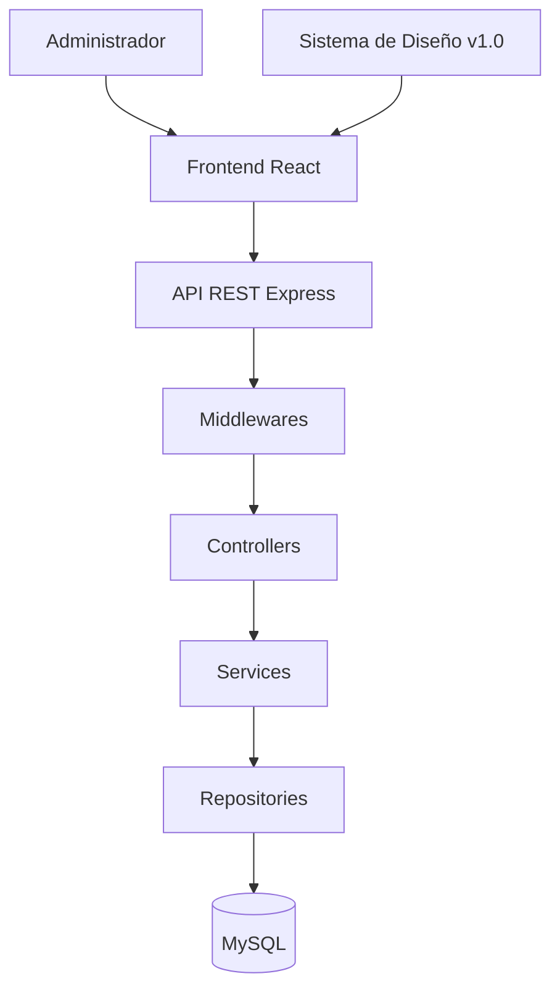
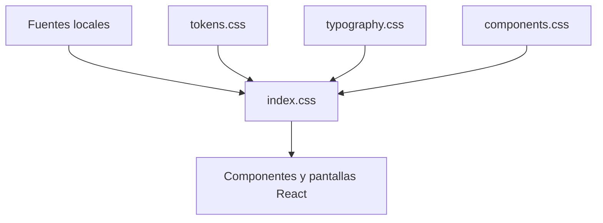
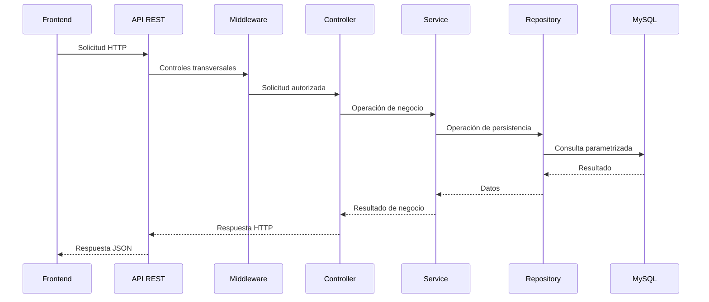
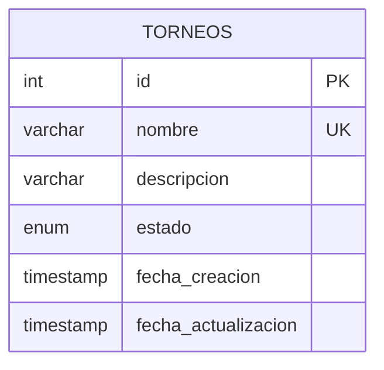
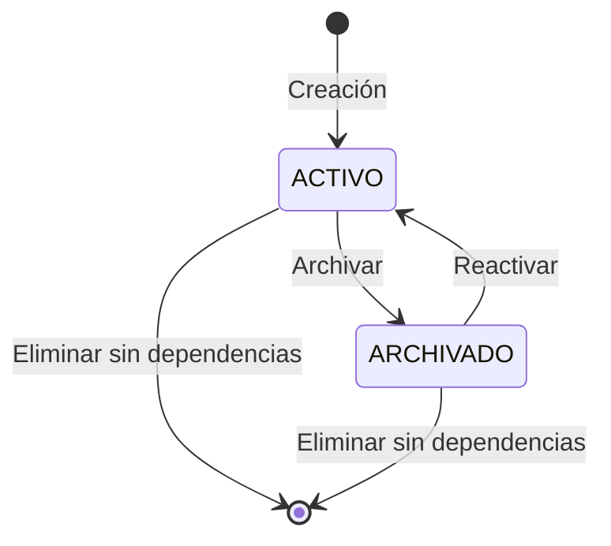
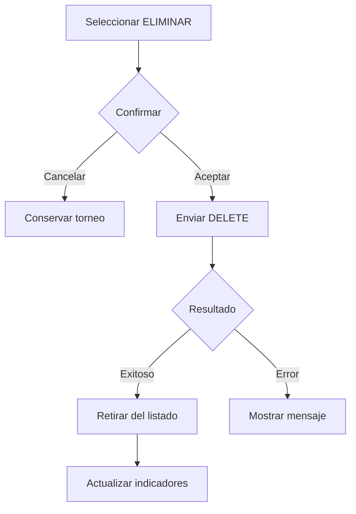
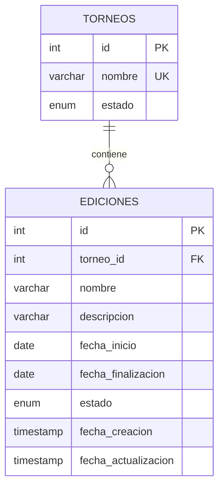
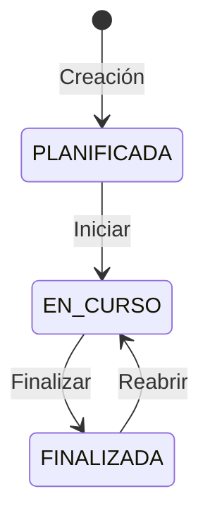
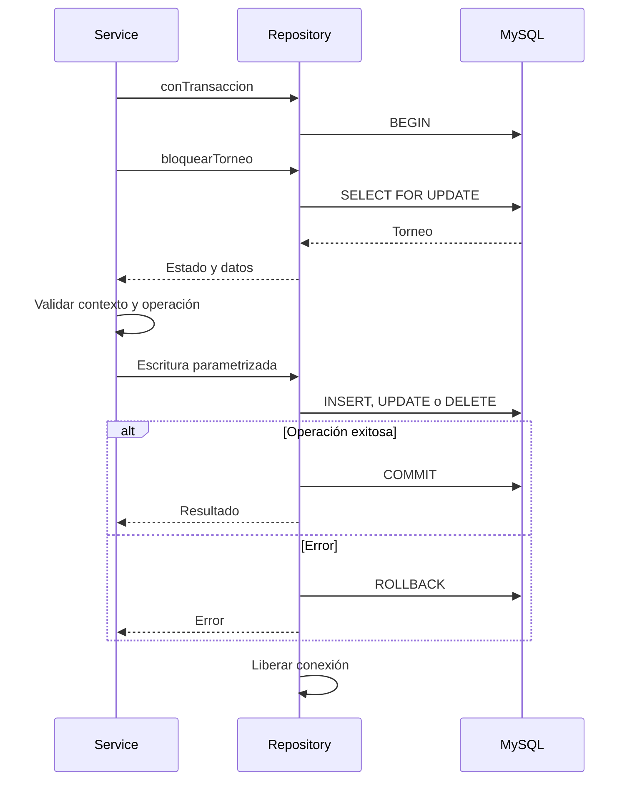
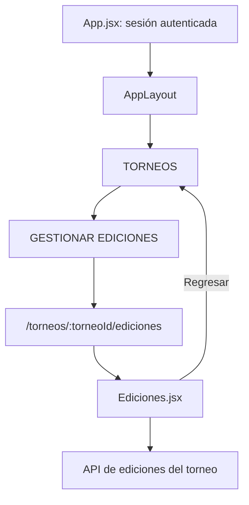

# ALTO-SISTEMA — Arquitectura

Versión de referencia: 0.3.0

Estado: HU-004 consolidada; HU-005 implementada y verificada.
Pendiente de CHECK integral y publicación definitiva de HU-005.

---

## 1. OBJETIVO

Desarrollar un sistema integral de gestión
de torneos de fútbol amateur, mantenible,
escalable, seguro, modular y económicamente
sostenible.

El sistema deberá permitir administrar
múltiples competiciones simultáneas,
incluyendo el Nocturno y el Diurno,
sin mezclar sus datos deportivos.

La arquitectura deberá facilitar la
incorporación progresiva de funcionalidades
sin comprometer los módulos existentes.

---

## 2. ARQUITECTURA GENERAL

ALTO-SISTEMA adopta una arquitectura
de tres capas mediante un monolito modular.

### 2.1. Presentación

- React.
- Vite.
- JavaScript.
- React Router.
- CSS responsive.
- Sistema de Diseño v1.0.
- Lucide React.
- Fontsource.

### 2.2. Lógica de negocio

- Node.js.
- Express.
- API REST.
- Comunicaciones JSON.
- Servicios de negocio independientes.
- Middlewares de seguridad.
- Validación de solicitudes.

### 2.3. Persistencia

- MySQL 8.
- Motor InnoDB.
- Codificación utf8mb4.
- Consultas SQL parametrizadas.
- Pool de conexiones.
- Migraciones versionadas.
- Restricciones de integridad.
- Sesiones persistentes.

### 2.4. Diagrama general



---

## 3. ARQUITECTURA DEL FRONTEND

### 3.1. Organización

```text
frontend/src/
├── assets/
├── config/
│   ├── app.config.js
│   ├── modulos.config.js
│   └── iconos.config.js
├── layouts/
│   ├── AppLayout.jsx
│   └── AppLayout.css
├── pages/
│   ├── Login.jsx
│   ├── Login.css
│   ├── Dashboard.jsx
│   ├── Dashboard.css
│   ├── ModuloPendiente.jsx
│   ├── ModuloPendiente.css
│   ├── Torneos.jsx
│   ├── Torneos.css
│   ├── Ediciones.jsx
│   └── Ediciones.css
├── services/
│   └── api.js
├── styles/
│   ├── tokens.css
│   ├── typography.css
│   └── components.css
├── App.jsx
├── App.css
├── index.css
└── main.jsx
```

### 3.2. Responsabilidades

| Elemento | Responsabilidad |
|---|---|
| assets | Recursos visuales |
| config | Configuración y catálogos |
| layouts | Estructuras visuales compartidas |
| pages | Pantallas de la aplicación |
| services | Comunicación con el backend |
| styles | Sistema de Diseño |
| App.jsx | Autenticación y enrutamiento |
| App.css | Estilos de la aplicación principal |
| index.css | Integración de estilos globales |
| main.jsx | Punto de entrada de React |

Los componentes deberán utilizar el
servicio centralizado de comunicación
con la API.

Las reglas de negocio críticas no
deberán depender exclusivamente
del frontend.

### 3.3. Configuración centralizada

La configuración general de la aplicación
se encuentra en:

`config/app.config.js`

Incluye:

- Nombre institucional.
- Versión.
- Descripción.
- Dirección de la API.
- Idioma.
- Zona horaria.

La definición de los módulos se encuentra en:

`config/modulos.config.js`

Incluye:

- Identificador.
- Ruta.
- Título.
- Descripción.
- Disponibilidad de acceso rápido.

La iconografía se encuentra centralizada en:

`config/iconos.config.js`

La navegación no deberá mantener
definiciones independientes de los
mismos módulos.

### 3.4. Registro de módulos implementados

App.jsx dispone de un registro centralizado
de componentes deportivos implementados.

Actualmente:

- Inicio: Dashboard.
- Torneos: Torneos.
- Ediciones: Ediciones, mediante la ruta privada
  `/torneos/:torneoId/ediciones` bajo AppLayout.

EDICIONES es una pantalla dependiente del torneo,
no una nueva opción del menú lateral.

Los módulos secundarios que aún no
dispongan de una implementación funcional
utilizarán ModuloPendiente.

Este mecanismo permite incorporar
nuevos módulos sin reconstruir
la navegación general.

### 3.5. Servicio API

El archivo `services/api.js` centraliza
la comunicación HTTP con el backend.

Contempla:

- URL base configurable.
- Métodos GET, POST, PUT, PATCH y DELETE.
- Envío de solicitudes JSON.
- Recepción de respuestas.
- Inclusión de credenciales de sesión.
- Tratamiento de errores HTTP.
- Tratamiento de errores de conexión.
- Cancelación de solicitudes compatibles.

Los módulos TORNEOS y EDICIONES utilizan los cinco
métodos HTTP disponibles para administrar
el ciclo de vida de sus registros.

HU-005 reutiliza `api.js` sin modificarlo.

### 3.6. Estado de autenticación

App.jsx administra:

- Verificación inicial de sesión.
- Usuario autenticado.
- Presentación del acceso privado.
- Presentación de rutas administrativas.
- Inicio de sesión.
- Cierre de sesión.
- Mensajes asociados al cierre de sesión.

La protección visual del frontend
no reemplaza los controles de
autenticación del backend.

---

## 4. SISTEMA DE DISEÑO

### 4.1. Propósito

El Sistema de Diseño v1.0 proporciona
una identidad visual compartida
por toda la aplicación.

Sus objetivos arquitectónicos son:

- Reducir la duplicación de CSS.
- Centralizar valores visuales.
- Favorecer la reutilización.
- Mantener consistencia entre módulos.
- Facilitar el mantenimiento.
- Establecer patrones responsive.
- Incorporar mecanismos de accesibilidad.

### 4.2. Capas de estilos



### 4.3. Design Tokens

El archivo `tokens.css` contiene
las variables visuales compartidas:

- Colores.
- Tipografías.
- Tamaños.
- Espaciados.
- Radios.
- Bordes.
- Sombras.
- Transiciones.
- Dimensiones.
- Capas visuales.

Los módulos deberán reutilizar
estos valores siempre que corresponda.

### 4.4. Tipografía

Barlow Condensed se utiliza
principalmente en encabezados,
identidad institucional y marcadores.

Inter se utiliza en la interfaz
administrativa, formularios,
tablas y estadísticas.

Las fuentes se distribuyen
junto con la aplicación mediante
Fontsource.

### 4.5. Componentes reutilizables

Los estilos comunes se identifican
mediante el prefijo `as-`.

Incluyen:

- Botones.
- Paneles.
- Tarjetas.
- Indicadores.
- Formularios.
- Buscadores.
- Filtros.
- Estados administrativos.
- Mensajes.
- Tablas.
- Estados vacíos.
- Indicadores de carga.
- Estructuras de página.

Cada módulo podrá definir estilos
específicos cuando los componentes
globales resulten insuficientes.

Las acciones destructivas deberán
utilizar los estilos semánticos
de peligro correspondientes.

### 4.6. Independencia visual

La identidad institucional de
ALTO-SISTEMA es independiente
de las identidades visuales
de las competiciones.

Las futuras configuraciones
de colores, logotipos y
publicaciones deportivas no
deberán modificar accidentalmente
la interfaz administrativa.

Los estándares completos se
encuentran en:

[SISTEMA_DE_DISENO.md](SISTEMA_DE_DISENO.md)

---

## 5. ARQUITECTURA DEL BACKEND

### 5.1. Organización

Estructura general con los archivos incorporados en HU-005
(los componentes de HU anteriores se conservan):

```text
backend/
├── src/
│   ├── config/
│   ├── controllers/
│   │   └── edicion.controller.js
│   ├── middlewares/
│   ├── repositories/
│   │   └── edicion.repository.js
│   ├── routes/
│   │   └── edicion.routes.js
│   ├── services/
│   │   └── edicion.service.js
│   ├── create-admin.js
│   ├── migrate.js
│   └── server.js
├── tests/
│   ├── edicion.service.test.js
│   └── edicion.integration.test.js
├── package.json
└── package-lock.json
```

### 5.2. Responsabilidades

| Capa | Responsabilidad |
|---|---|
| config | Configuración e infraestructura |
| routes | Definición de endpoints |
| controllers | Solicitudes y respuestas HTTP |
| services | Validaciones y reglas de negocio |
| repositories | Acceso a los datos |
| middlewares | Controles transversales |
| tests | Pruebas automatizadas |
| server.js | Inicialización del servidor |
| migrate.js | Gestión de migraciones |
| create-admin.js | Creación inicial del administrador |

### 5.3. Separación de responsabilidades

Los controladores no deberán
contener consultas SQL.

Los repositorios no deberán
gestionar respuestas HTTP.

Los servicios de negocio deberán
concentrar las reglas y validaciones
de cada dominio funcional.

Los middlewares deberán resolver
controles transversales reutilizables.

Las rutas deberán organizarse
por responsabilidad funcional.

### 5.4. Configuración

La configuración general del backend
se encuentra centralizada en:

`src/config/app.config.js`

La infraestructura deberá utilizar
variables de entorno cuando corresponda.

Las credenciales y los secretos
no deberán almacenarse directamente
en el código fuente.

---

## 6. FLUJO DE UNA SOLICITUD



El servicio de negocio deberá validar
la operación solicitada antes de
efectuar modificaciones persistentes.

Los errores de negocio deberán
traducirse en respuestas HTTP
comprensibles para el frontend.

Los errores inesperados deberán
gestionarse sin exponer información
interna sensible al usuario.

---

## 7. MÓDULO DE AUTENTICACIÓN

### 7.1. Responsabilidad

Administrar el acceso privado
a ALTO-SISTEMA.

### 7.2. Funcionalidades

- Inicio de sesión.
- Verificación de credenciales.
- Validación de usuario activo.
- Consulta de sesión autenticada.
- Cierre de sesión.
- Protección de rutas privadas.
- Persistencia de sesiones en MySQL.
- Limitación de intentos de acceso.

### 7.3. Endpoints principales

| Método | Endpoint |
|---|---|
| POST | `/api/auth/login` |
| GET | `/api/auth/me` |
| POST | `/api/auth/logout` |

Las operaciones deportivas deberán
requerir autenticación válida.

El frontend no constituye una
barrera de seguridad suficiente
por sí mismo.

---

## 8. MÓDULO DE TORNEOS

### 8.1. Identificación

| Propiedad | Valor |
|---|---|
| Historia de usuario | HU-004 |
| Versión | 0.2.0 |
| Entidad | Torneo |
| Tabla | `torneos` |
| Migración | `002_torneos.sql` |
| Estado | Implementado y verificado |

### 8.2. Responsabilidad

Administrar la identidad básica
de las competiciones deportivas
y su ciclo de vida administrativo.

El módulo constituye la primera
implementación de la arquitectura
multitorneo.

### 8.3. Componentes

Frontend:

- `pages/Torneos.jsx`
- `pages/Torneos.css`

Backend:

- `routes/torneo.routes.js`
- `controllers/torneo.controller.js`
- `services/torneo.service.js`
- `repositories/torneo.repository.js`

Persistencia:

- `database/migrations/002_torneos.sql`

Pruebas:

- `backend/tests/torneo.service.test.js`
- `backend/tests/torneo.integration.test.js`

### 8.4. Modelo de persistencia



| Campo | Tipo | Restricción |
|---|---|---|
| id | INT | PK, autoincremental |
| nombre | VARCHAR(100) | Obligatorio y único |
| descripcion | VARCHAR(500) | Opcional |
| estado | ENUM | ACTIVO o ARCHIVADO |
| fecha_creacion | TIMESTAMP | Obligatorio |
| fecha_actualizacion | TIMESTAMP | Actualización automática |

El estado inicial de un nuevo
torneo será ACTIVO.

Existe un índice sobre el estado
administrativo del torneo.

### 8.5. Ciclo de vida administrativo



El archivado es reversible.

El archivado no elimina los
datos existentes.

La edición de los datos básicos
está permitida para torneos
activos y archivados.

La eliminación definitiva está
disponible en ambos estados siempre que
no existan ediciones ni otras dependencias
que la impidan.

ELIMINADO no constituye un estado
administrativo persistente.

Una eliminación exitosa retira
físicamente el registro de MySQL.

Las futuras operaciones deportivas
deberán comprobar el estado de
la competición correspondiente.

### 8.6. Endpoints

| Método | Endpoint | Operación |
|---|---|---|
| GET | `/api/torneos` | Listado |
| GET | `/api/torneos/:id` | Consulta individual |
| POST | `/api/torneos` | Creación |
| PUT | `/api/torneos/:id` | Edición |
| PATCH | `/api/torneos/:id/estado` | Cambio de estado |
| DELETE | `/api/torneos/:id` | Eliminación definitiva |

Todos los endpoints requieren
una sesión autenticada.

### 8.7. Validaciones de negocio

El servicio deberá garantizar:

- Identificadores válidos.
- Nombre obligatorio.
- Normalización Unicode NFC.
- Normalización de espacios.
- Nombre de hasta 100 caracteres.
- Descripción de hasta 500 caracteres.
- Descripción opcional.
- Estados administrativos válidos.
- Prevención de nombres duplicados.
- Validación de filtros.
- Existencia del torneo solicitado.

La unicidad del nombre se protege
mediante la restricción correspondiente
de MySQL.

La validación no distingue nombres
únicamente por diferencias de
mayúsculas y minúsculas.

Un torneo archivado conserva
la reserva de su nombre.

La eliminación definitiva libera
el nombre para futuras creaciones.

### 8.8. Respuestas HTTP

| Código | Significado |
|---|---|
| 200 | Operación exitosa |
| 201 | Torneo creado |
| 400 | Datos inválidos |
| 401 | Sesión no válida |
| 403 | Solicitud no permitida |
| 404 | Recurso o ruta inexistente |
| 409 | Conflicto de unicidad o dependencias |
| 500 | Error interno inesperado |

### 8.9. Interfaz administrativa

El módulo incorpora:

- Indicadores de torneos registrados.
- Indicadores de torneos activos.
- Indicadores de torneos archivados.
- Formulario de creación.
- Formulario de edición.
- Búsqueda por nombre y descripción.
- Filtros administrativos.
- Confirmación de archivado.
- Confirmación de reactivación.
- Confirmación de eliminación.
- Estados de carga.
- Estados vacíos.
- Mensajes de error.
- Mensajes de confirmación.

El listado inicial se obtiene
mediante la API.

La búsqueda y los filtros de la
interfaz actual operan sobre
los registros cargados.

La API también admite filtros
del lado del servidor.

Las creaciones y modificaciones
exitosas actualizan el listado local
con los datos devueltos por el backend.

Las eliminaciones exitosas retiran
el registro correspondiente del listado
y actualizan los indicadores.

### 8.10. Integración con Dashboard

El Dashboard consulta:

`GET /api/torneos?estado=ACTIVO`

El indicador de torneos activos
utiliza el total devuelto por
la API.

Cuando no existen torneos activos,
el indicador muestra cero.

Cuando la consulta falla,
muestra un guion y un estado
de indisponibilidad.

No se deberán utilizar valores
ficticios como estadísticas reales.

### 8.11. Límites del módulo

HU-004, en su alcance original, no implementaba
ediciones. HU-005 incorpora su gestión y vínculo
con los torneos sin sustituir las operaciones
administrativas existentes.

Continúan pendientes:
- Categorías.
- Equipos inscritos.
- Zonas.
- Jornadas.
- Partidos.
- Copas.
- Estadísticas deportivas.
- Identidad visual de competiciones.
- Selección del contexto deportivo.

Estas responsabilidades serán
incorporadas mediante las historias
de usuario correspondientes.

### 8.12. Arquitectura de eliminación

La eliminación definitiva utiliza
las cuatro capas del módulo:

| Capa | Responsabilidad |
|---|---|
| Route | Exponer el endpoint DELETE |
| Controller | Gestionar la respuesta HTTP |
| Service | Validar identificador y errores |
| Repository | Ejecutar la eliminación parametrizada |

La consulta se limita al identificador
del torneo solicitado.

El repositorio devuelve la cantidad
de filas afectadas.

El servicio interpreta el resultado
y transforma los errores conocidos
en errores de negocio.

Una eliminación exitosa devuelve:

```json
{
    "mensaje": "Torneo eliminado correctamente."
}
```

### 8.13. Confirmación de eliminación

La interfaz solicita confirmación
mediante el mecanismo nativo
del navegador.

La confirmación identifica el torneo
por su nombre y advierte que
la operación es irreversible.

Si el administrador cancela,
no se realiza la solicitud DELETE.

Durante la operación se bloquean
las acciones administrativas
incompatibles.

El frontend solamente retira
el registro después de recibir
una respuesta exitosa.



### 8.14. Protección de dependencias

El servicio contempla los errores
de restricciones de claves foráneas
que impiden eliminar un torneo.

Estos errores se traducen en una
respuesta HTTP 409.

La implementación de las futuras
entidades dependientes deberá utilizar
restricciones de integridad que
impidan eliminaciones incompatibles.

No deberán incorporarse eliminaciones
en cascada que destruyan información
deportiva histórica.

Desde HU-005, la tabla `ediciones` depende
de `torneos` mediante `fk_ediciones_torneo`
con ON DELETE RESTRICT y ON UPDATE RESTRICT.

La protección real fue verificada contra MySQL
y desde la interfaz: al intentar eliminar un
torneo con ediciones asociadas, se rechazó
la operación y se conservaron sus registros.

Una vez eliminadas las ediciones temporales,
se pudo eliminar el torneo correspondiente.
La comprobación unitaria de HU-004 conserva
la simulación del error de dependencia.

### 8.15. Independencia de operaciones

La eliminación de un torneo no deberá
alterar los datos de otras competiciones.

La independencia se verificó mediante:

- Pruebas unitarias.
- Pruebas de integración con MySQL.
- Comprobaciones funcionales.

La reutilización de un nombre eliminado
genera un nuevo registro.

No constituye una restauración
del torneo anterior.


### 8.16. Integración con EDICIONES (HU-005)

Las tarjetas de TORNEOS incorporan:

- Total de ediciones asociadas.
- Cantidad de ediciones EN_CURSO.
- Botón GESTIONAR EDICIONES.

El acceso utiliza el identificador del torneo
seleccionado y permanece disponible para
torneos activos y archivados.

Los indicadores se obtienen reutilizando
la API de EDICIONES, mediante consultas
adicionales por torneo con concurrencia
limitada a cuatro solicitudes.

Si una consulta falla, se muestra un guion
en lugar de informar un cero incorrecto.

El regreso a TORNEOS vuelve a consultar
los datos. La actualización de indicadores
fue verificada desde la interfaz.

La solución evita introducir un endpoint
agregado en HU-005. Su costo aumenta con
la cantidad de torneos; una consulta
agregada podrá evaluarse cuando existan
mediciones que justifiquen la optimización.

### 8.17. Módulo de ediciones

| Propiedad | Valor |
|---|---|
| Historia de usuario | HU-005 |
| Versión | 0.3.0 |
| Entidad | Edición |
| Tabla | `ediciones` |
| Migración | `003_ediciones.sql` |
| Estado | Implementado y verificado |

La edición representa una realización concreta
de un torneo. Un torneo puede tener cero,
una o múltiples ediciones, incluso simultáneas.

El nombre contiene libremente la denominación
y el año cuando corresponda. No existe un
campo independiente para el año.

#### 8.17.1. Componentes y responsabilidades

| Capa | Archivo | Responsabilidad |
|---|---|---|
| Presentación | `frontend/src/pages/Ediciones.jsx` | Gestión de ediciones del torneo seleccionado |
| Estilos | `frontend/src/pages/Ediciones.css` | Diseño específico y responsive |
| Enrutamiento | `frontend/src/App.jsx` | Ruta privada parametrizada |
| Integración | `frontend/src/pages/Torneos.jsx` y `Torneos.css` | Acceso e indicadores por torneo |
| Route | `backend/src/routes/edicion.routes.js` | Endpoints anidados y autenticación |
| Controller | `backend/src/controllers/edicion.controller.js` | Respuestas HTTP y tratamiento de errores |
| Service | `backend/src/services/edicion.service.js` | Validaciones y reglas deportivas |
| Repository | `backend/src/repositories/edicion.repository.js` | Consultas parametrizadas y transacciones |
| Inicialización | `backend/src/server.js` | Registro del router |
| Persistencia | `database/migrations/003_ediciones.sql` | Tabla, índices y restricciones |
| Migrador | `backend/src/migrate.js` | Verificación estructural de la nueva migración |

#### 8.17.2. Modelo de persistencia



| Campo | Tipo | Restricción |
|---|---|---|
| id | INT | PK, autoincremental |
| torneo_id | INT | Obligatorio; FK a `torneos.id` |
| nombre | VARCHAR(100) | Obligatorio; único dentro del torneo |
| descripcion | VARCHAR(500) | Opcional |
| fecha_inicio | DATE | Opcional |
| fecha_finalizacion | DATE | Opcional |
| estado | ENUM | PLANIFICADA, EN_CURSO o FINALIZADA |
| fecha_creacion | TIMESTAMP | Obligatorio; valor inicial automático |
| fecha_actualizacion | TIMESTAMP | Obligatorio; actualización automática |

Motor InnoDB, codificación utf8mb4 y colación
`utf8mb4_unicode_ci`.

Restricciones e índices:

- `uq_ediciones_torneo_nombre`: UNIQUE (`torneo_id`, `nombre`).
- `idx_ediciones_torneo_estado`: índice (`torneo_id`, `estado`).
- `fk_ediciones_torneo`: ON DELETE RESTRICT y ON UPDATE RESTRICT.
- `chk_ediciones_fechas`: si ambas fechas están presentes,
  la finalización debe ser igual o posterior al inicio.

La unicidad es compuesta: el mismo nombre puede
existir en torneos distintos. La colación protege
contra duplicados que solo difieran en mayúsculas
o acentos dentro del mismo torneo.

La relación con categorías todavía no está implementada.

#### 8.17.3. Ciclo de vida deportivo



El estado inicial es PLANIFICADA.

Las fechas son informativas, editables e
independientes del estado deportivo. Pueden
omitirse, informarse por separado o eliminarse.

Las transiciones se ejecutan manualmente y no
modifican automáticamente las fechas.

Repetir el estado actual no produce una escritura.
No está permitido finalizar directamente una
edición planificada ni volver a PLANIFICADA
desde los otros estados.

No existe una restricción que limite a una sola
edición en curso por torneo.

#### 8.17.4. Relación con el estado administrativo

| Operación | Torneo ACTIVO | Torneo ARCHIVADO |
|---|---|---|
| Listar y consultar | Permitida | Permitida |
| Crear | Permitida | Bloqueada |
| Editar datos | Permitida | Permitida |
| Iniciar | Permitida | Bloqueada |
| Finalizar una edición en curso | Permitida | Permitida |
| Reabrir | Permitida | Bloqueada |
| Eliminar sin dependencias | Permitida | Permitida |

El archivado no cambia los estados deportivos
ni elimina sus datos asociados.

Las restricciones se aplican en el Service.
La interfaz también deshabilita las acciones
incompatibles, pero no sustituye esa protección.

#### 8.17.5. Endpoints privados

| Método | Endpoint | Operación |
|---|---|---|
| GET | `/api/torneos/:torneoId/ediciones` | Listar ediciones |
| GET | `/api/torneos/:torneoId/ediciones/:edicionId` | Consultar edición |
| POST | `/api/torneos/:torneoId/ediciones` | Crear edición |
| PUT | `/api/torneos/:torneoId/ediciones/:edicionId` | Actualizar datos |
| PATCH | `/api/torneos/:torneoId/ediciones/:edicionId/estado` | Cambiar estado |
| DELETE | `/api/torneos/:torneoId/ediciones/:edicionId` | Eliminar edición |

El router utiliza `mergeParams: true` para
recuperar el identificador del torneo padre
y se protege mediante `requireAuth`.

Se registra en `server.js` antes del router
general de TORNEOS. Las escrituras están
sujetas a los controles de origen existentes.

Filtros del listado: `busqueda` y `estado`.

La respuesta del listado incluye `torneo`,
`ediciones`, `total` e `indicadores`.
El total del listado corresponde a los registros
obtenidos; los indicadores corresponden al
conjunto completo de ediciones del torneo.

Los indicadores contienen `total`, `planificadas`,
`en_curso` y `finalizadas`.

La consulta individual devuelve `edicion`.
Las escrituras de creación, edición y cambio de
estado devuelven `mensaje` y `edicion`.
La creación responde HTTP 201 y encabezado Location.
La eliminación exitosa devuelve un `mensaje`.

#### 8.17.6. Validaciones y errores

El Service valida:

- Identificadores enteros positivos dentro del rango INT.
- Existencia del torneo y pertenencia de la edición.
- Campos permitidos en cada operación.
- Nombre obligatorio de hasta 100 caracteres.
- Descripción opcional de hasta 500 caracteres.
- Normalización Unicode NFC y de espacios del nombre.
- Fechas de calendario válidas en formato YYYY-MM-DD.
- Coherencia entre fechas, incluso al actualizar parcialmente.
- Unicidad dentro del torneo.
- Estados y transiciones permitidos.
- Restricciones derivadas del archivado.
- Filtros de búsqueda.

El torneo asociado no puede cambiarse mediante
la actualización de una edición.

| Código HTTP | Significado |
|---|---|
| 200 | Operación exitosa |
| 201 | Edición creada |
| 400 | Identificador, datos, fechas o filtros inválidos |
| 401 | Autenticación requerida |
| 403 | Solicitud no permitida |
| 404 | Torneo o edición inexistente en el contexto solicitado |
| 409 | Duplicado, dependencia, transición prohibida o conflicto transaccional |
| 500 | Error interno inesperado |

Los errores de negocio se representan mediante
`EdicionError`. Los errores conocidos de MySQL
se traducen a respuestas controladas.
Los errores inesperados no exponen detalles SQL.

#### 8.17.7. Transacciones e independencia

Las escrituras utilizan el mecanismo
`conTransaccion` del Repository.

El Service comprueba y bloquea el registro
del torneo padre mediante SELECT FOR UPDATE
antes de ejecutar la operación de escritura.



Las operaciones de edición individual se limitan
por `torneo_id` e `id`. Consultar o modificar
una edición mediante el identificador de otro
torneo no debe devolver ni alterar sus datos.

La restricción UNIQUE mantiene la unicidad
también frente a solicitudes concurrentes.

La eliminación del torneo no se realiza en
cascada. La FK impide eliminar un torneo
con ediciones asociadas.

La eliminación definitiva de una edición requiere
confirmación explícita. Cuando se incorporen
categorías y otras entidades dependientes,
deberán establecerse sus restricciones de integridad.

#### 8.17.8. Presentación y navegación



La pantalla utiliza `useParams` y `useNavigate`.
El componente de gestión se identifica con una
clave basada en el identificador del torneo,
evitando reutilizar su estado local al cambiar
de contexto.

La carga inicial se cancela mediante AbortController
al desmontar el componente o iniciar una nueva consulta.

El listado completo se filtra localmente por nombre,
descripción y estado. La búsqueda no distingue
mayúsculas ni tildes. Los indicadores se calculan
sobre el listado completo, no sobre los resultados
filtrados.

Las mutaciones exitosas actualizan el estado local
con las respuestas del servidor. No se eliminan
tarjetas anticipadamente ante solicitudes fallidas.

Los campos DATE se reciben como cadenas YYYY-MM-DD
y se muestran como DD/MM/AAAA, evitando conversiones
de zona horaria sobre fechas sin componente horario.

La interfaz reutiliza el Sistema de Diseño v1.0:

| Estado | Identidad visual |
|---|---|
| PLANIFICADA | Azul informativo |
| EN_CURSO | Verde de éxito |
| FINALIZADA | Gris neutro |

La pantalla ofrece cuatro indicadores, formularios
con fechas opcionales, confirmaciones de transición
y eliminación, mensajes de error y estado vacío.

No se añaden dependencias ni una opción nueva
al menú lateral.

En pantallas pequeñas se reorganizan los indicadores,
filtros, tarjetas y campos de fecha. La validación
responsive fue confirmada mediante la simulación
del navegador, no en un dispositivo físico.

---

## 9. SEGURIDAD

### 9.1. Controles implementados

- Acceso privado mediante autenticación.
- Hash de contraseñas mediante bcrypt.
- Sesiones persistentes en MySQL.
- Regeneración de sesión al autenticar.
- Cookies HttpOnly.
- Cookies SameSite=Lax.
- Protección de origen en escrituras.
- Configuración CORS.
- Consultas SQL parametrizadas.
- Limitación de intentos de inicio de sesión.
- Credenciales mediante variables de entorno.
- Exclusión de archivos sensibles en Git.
- Protección de endpoints deportivos.
- Validaciones del lado del servidor.

El endpoint DELETE se encuentra sujeto
a los mismos controles de autenticación
y origen que las restantes escrituras.

### 9.2. Información sensible

Los siguientes elementos no deberán
publicarse en el repositorio:

- Contraseñas.
- Secretos de sesión.
- Archivos de entorno privados.
- Respaldos de bases de datos.
- Registros con datos personales.

Las futuras listas de buena fe
contendrán información personal.

Su tratamiento deberá incorporar
controles específicos de privacidad.

### 9.3. Pendientes para producción

- HTTPS.
- Configuración segura de producción.
- Revisión de cookies y dominios.
- Política de rotación de credenciales.
- Respaldos periódicos.
- Revisión del limitador de solicitudes.
- Gestión integral de expiración de sesión.
- Monitoreo operativo.
- Evaluación de seguridad.

---

## 10. PERSISTENCIA

### 10.1. Fuente de verdad

MySQL constituye la fuente de
verdad de los datos persistentes.

El estado almacenado en React
representa información utilizada
para la presentación.

Las validaciones definitivas
deberán realizarse en el backend
y mediante restricciones de
integridad de la base de datos.

### 10.2. Migraciones

Las modificaciones estructurales
deberán realizarse mediante
migraciones SQL versionadas.

```text
database/migrations/
├── 001_usuarios.sql
├── 002_torneos.sql
└── 003_ediciones.sql
```

| Versión | Responsabilidad |
|---|---|
| 001 | Usuarios administrativos |
| 002 | Gestión de torneos |
| 003 | Gestión de ediciones y relación con torneos |

El migrador contempla:

- Orden de ejecución.
- Registro de migraciones.
- Verificación de checksums.
- Control de ejecución concurrente.
- Verificación estructural.
- Identificación de migraciones aplicadas.
- Identificación de ejecuciones incompletas.

Las migraciones aplicadas no deberán
modificarse posteriormente.

Toda modificación estructural
deberá incorporarse mediante
una nueva migración.

La incorporación de la eliminación
definitiva en HU-004 no requirió modificar
las migraciones existentes.

HU-005 añade `003_ediciones.sql` y amplía
la verificación estructural del migrador,
sin modificar las migraciones 001 y 002.

### 10.3. Integridad

Las restricciones, relaciones
e índices deberán proteger
la consistencia de los datos.

Las operaciones que involucren
múltiples escrituras relacionadas
deberán utilizar transacciones
cuando corresponda.

MySQL puede efectuar confirmaciones
implícitas durante operaciones DDL.

El migrador no deberá presuponer
que todas las modificaciones
estructurales pueden revertirse
mediante una transacción convencional.

### 10.4. Conservación histórica

No deberán eliminarse datos
deportivos históricos sin una
política previamente definida.

El archivado constituye el mecanismo
administrativo de conservación
de competiciones.

La eliminación definitiva podrá
utilizarse para torneos sin
dependencias incompatibles.

Las futuras relaciones deportivas
deberán proteger la información
histórica mediante restricciones
adecuadas.

### 10.5. Verificación final

La ejecución histórica del migrador
en la versión 0.2.0 registró:

| Control | Resultado |
|---|---|
| Base de datos | alto_sistema |
| Migraciones registradas | 2 |
| Migraciones pendientes | 0 |
| Errores | 0 |
| Estado | Actualizada |

La verificación de HU-005, previa a la actualización
del número de versión a 0.3.0, registró:

| Base de datos | Migraciones registradas | Pendientes |
|---|---:|---:|
| `alto_sistema` | 3 | 0 |
| `altosistemahu004test` | 3 | 0 tras aplicar 003 |
| `altosistemahu005fresh` | 3 | 0 |

La instalación limpia y la repetición de las
migraciones sobre la base nueva fueron verificadas.
No se modificó la base principal durante
las pruebas de instalación aislada.

---

## 11. ARQUITECTURA MULTITORNEO

### 11.1. Jerarquía objetivo

```text
Torneo
└── Edición
    └── Categoría
        ├── Fases
        ├── Zonas
        ├── Equipos inscritos
        ├── Jornadas
        ├── Partidos
        ├── Copas
        └── Estadísticas
```

La estructura representa la
jerarquía deportiva objetivo.

No implica que todas sus
entidades se encuentren
implementadas actualmente.

### 11.2. Estado de implementación

| Entidad o contexto | Estado |
|---|---|
| Torneo | Implementado y verificado |
| Edición | Implementada y verificada (HU-005) |
| Categoría | Pendiente |
| Identidad visual | Pendiente |
| Contexto deportivo | Pendiente |
| Restantes entidades deportivas | Pendiente |

### 11.3. Independencia de datos

Los datos deportivos deberán
vincularse al contexto correcto.

La separación deberá garantizarse
en frontend, backend y persistencia.

No deberán existir en el código
de negocio valores predefinidos
para:

- Nombres de torneos.
- Nombres de ediciones.
- Nombres de categorías.
- Cantidades de equipos.
- Cantidades de zonas.
- Formatos de competición.

Las competiciones deberán poder
configurarse según sus necesidades.

### 11.4. Reglas transversales

Las reglas que involucren
múltiples categorías o torneos
deberán definirse expresamente.

Esto incluye las futuras reglas
de disciplina y habilitación.

Los datos deberán permanecer
independientes salvo cuando
una regla deportiva aprobada
establezca una relación transversal.

### 11.5. Evolución prevista

La ETAPA 02 contempla:

- HU-004: Gestión de torneos — consolidada en v0.2.0.
- HU-005: Gestión de ediciones — verificada en v0.3.0; cierre pendiente.
- HU-006: Gestión de categorías.
- HU-007: Identidad visual.
- HU-008: Selección del contexto deportivo.

Las etapas posteriores deberán
utilizar el contexto deportivo
correspondiente.

---

## 12. PRINCIPIOS DE DESARROLLO

Se establecen los siguientes
principios de diseño:

- SOLID.
- DRY.
- KISS.
- Separación de responsabilidades.
- Bajo acoplamiento.
- Alta cohesión.
- Reutilización de componentes.
- Normalización de datos.
- Validaciones del lado del servidor.
- Control de versiones mediante Git.
- Pruebas automatizadas.
- Documentación versionada.

El desarrollo deberá favorecer
soluciones simples y mantenibles.

No deberán incorporarse niveles
de abstracción innecesarios
sin una justificación funcional
o arquitectónica.

Cada historia de usuario deberá
respetar las decisiones previamente
aprobadas.

---

## 13. ESCALABILIDAD

La arquitectura deberá permitir:

- Múltiples torneos simultáneos.
- Múltiples ediciones.
- Nuevas categorías.
- Nuevos formatos deportivos.
- Reglamentos configurables.
- Identidades visuales independientes.
- Conservación del historial.
- Incorporación de funcionalidades.

Se mantiene el monolito modular
como estrategia arquitectónica.

No se considera necesaria
actualmente una arquitectura
de microservicios.

La capacidad de carga real
deberá comprobarse mediante
mediciones y pruebas.

### 13.1. Evolución del acceso a datos

El listado completo de torneos y ediciones
y su filtrado local resultan
adecuados para el alcance
administrativo inicial.

Cuando el volumen de información
lo requiera, podrán incorporarse:

- Paginación del lado del servidor.
- Filtros especializados.
- Índices adicionales.
- Consultas optimizadas e indicadores agregados por torneo.
- Carga diferida de información.

Estas mejoras deberán justificarse
mediante necesidades reales.

### 13.2. Rendimiento del frontend

Se priorizará:

- Reutilización de estilos.
- Reducción de duplicaciones.
- Distribución local de recursos.
- Cancelación de consultas innecesarias.
- Actualización del estado local
  mediante respuestas de la API.

La optimización de fuentes
y la división del código
podrán evaluarse posteriormente.

---

## 14. CALIDAD Y PRUEBAS

### 14.1. Estrategia

El proyecto contempla:

- Pruebas unitarias.
- Pruebas de integración.
- Verificación estructural.
- Pruebas de regresión.
- Análisis estático.
- Compilación de producción.
- Revisión visual.
- CHECK integral por historia de usuario.

### 14.2. Aislamiento de pruebas

Las pruebas de integración
de torneos y ediciones utilizan una base
de datos independiente.

Base de pruebas:

`altosistemahu004test`

Puerto del backend de pruebas:

`3001`

Las pruebas deberán evitar
modificaciones accidentales
de los datos principales.

Los registros temporales deberán
limpiarse de manera controlada.

HU-005 reutiliza `altosistemahu004test` con
la migración 003 aplicada. La instalación
desde cero se verificó separadamente en
`altosistemahu005fresh`.

La regresión de autenticación HTTP se realizó
contra el backend principal del puerto 3000.

### 14.3. Resultados definitivos de HU-004

| Control | Resultado |
|---|---|
| Pruebas unitarias de autenticación | 13/13 |
| Pruebas unitarias de torneos | 30/30 |
| Integración de autenticación | 1/1 |
| Integración de torneos | 1/1 |
| Total de pruebas automatizadas | 45/45 |
| Controles internos de integración | 20/20 |
| Pruebas fallidas | 0 |
| ESLint: errores | 0 |
| ESLint: advertencias | 0 |
| Compilación de producción | Exitosa |
| Tiempo de compilación final | 3,49 segundos |
| Revisión visual inicial | 8/8 |
| Validación funcional | Satisfactoria |
| Limpieza de torneos temporales | Completada |
| Migraciones pendientes | 0 |

Las 45 pruebas automatizadas contemplan:

- 43 pruebas unitarias.
- 2 pruebas de integración.

Los resultados se obtuvieron mediante
ejecuciones separadas.

Los 20 controles internos forman parte
de una única prueba de integración
y no se contabilizan como pruebas
automatizadas adicionales.

### 14.4. Verificaciones de persistencia

Durante las etapas anteriores
y el desarrollo de HU-004
se realizaron controles de:

- Ejecución de migraciones.
- Idempotencia.
- Verificación estructural.
- Migraciones sobre una base nueva.
- Respaldo de base de datos.
- Restauración de respaldo de v0.1.3.
- Persistencia de registros.
- Unicidad de nombres.
- Eliminación física de torneos.
- Reutilización de nombres.
- Independencia de registros.

### 14.5. Verificación de eliminación

La ampliación de HU-004 incorporó
seis pruebas unitarias adicionales.

Las pruebas contemplan:

- Eliminación de torneos activos.
- Eliminación de torneos archivados.
- Rechazo de identificadores inválidos.
- Rechazo de registros inexistentes.
- Tratamiento de errores de dependencia.
- Propagación de errores inesperados.

La integración contempla la eliminación
efectiva de registros en MySQL,
la protección mediante autenticación
y origen, la independencia de torneos
y la reutilización de nombres.

La cancelación de eliminación fue
verificada mediante la interfaz.

### 14.6. Verificaciones pendientes

- Pruebas automatizadas del frontend.
- Pruebas visuales automatizadas.
- Auditoría formal de accesibilidad.
- Pruebas de rendimiento y carga.
- Validación en dispositivos móviles físicos.
- Restauración de un respaldo que incluya las tablas torneos y ediciones.
- Verificación real de claves foráneas de entidades futuras.
- Evaluación de seguridad de producción.
- Despliegue en producción.

Estos controles corresponden a
validaciones futuras o a entidades
todavía no implementadas.


### 14.7. Resultados de HU-005 — v0.3.0

| Control | Resultado |
|---|---|
| Pruebas unitarias de ediciones | 59/59 |
| Regresión unitaria de torneos | 30/30 |
| Regresión unitaria de autenticación | 13/13 |
| Integración de ediciones | 1/1 |
| Integración de torneos | 1/1 |
| Integración de autenticación | 1/1 |
| Total de pruebas automatizadas | 105/105 |
| Pruebas fallidas, canceladas u omitidas en las ejecuciones específicas | 0 |
| ESLint | Sin errores informados |
| Compilación de producción | Exitosa (2,52 segundos) |
| Validaciones funcionales | 17/17 |
| Migración sobre instalación existente | Exitosa |
| Migración desde cero | 3/3 aplicadas |
| Idempotencia de instalación nueva | 3 registradas, 0 pendientes |
| Integridad referencial torneo-edición | Verificada contra MySQL y en la interfaz |
| Limpieza de registros temporales de la base principal | Completada |
| Coherencia de versiones | 8/8 valores en 0.3.0 |

Las 105 pruebas corresponden a 102 unitarias y
tres pruebas de integración, ejecutadas por separado.

La integración de EDICIONES contempla 14 bloques
internos de verificación previstos, que no se
suman al total de pruebas. Se recibió el resumen
global satisfactorio de Node.js, no el diagnóstico
individual de cada bloque.

Las validaciones funcionales incluyeron creación,
edición, fechas opcionales, inicio, finalización,
reapertura, simultaneidad, búsqueda, filtros,
indicadores, archivado, eliminación e integridad
referencial. La validación responsive fue confirmada
por el administrador; no se dispone de captura móvil
de HU-005.

Los resultados técnicos fueron obtenidos antes de
actualizar el número de versión. Posteriormente se
comprobó la coherencia de las configuraciones y
se reiniciaron el backend y el frontend.

La restauración de un respaldo que incluya la
tabla ediciones, las pruebas de carga y la auditoría
de producción permanecen pendientes.

El CHECK integral formal y la publicación de
HU-005 todavía no se han completado.

---

## 15. CONTROL ARQUITECTÓNICO

Cada historia de usuario deberá:

1. Respetar la arquitectura definida.
2. Mantener la separación de responsabilidades.
3. Reutilizar los servicios existentes.
4. Respetar el Sistema de Diseño.
5. Proteger los datos privados.
6. Incorporar migraciones cuando corresponda.
7. Incorporar pruebas automatizadas.
8. Superar su CHECK integral.
9. Actualizar la documentación.
10. Registrar los cambios mediante Git.

Las modificaciones arquitectónicas
significativas deberán documentarse
antes de consolidarse.

La aprobación de una historia
de usuario requerirá verificar
sus criterios de aceptación.

La existencia de código implementado
no constituye por sí misma una
aprobación funcional.

---

## 16. EVOLUCIÓN ARQUITECTÓNICA

| Versión | Incorporación principal |
|---|---|
| 0.1.0 | Infraestructura inicial |
| 0.1.1 | Autenticación privada |
| 0.1.2 | Interfaz administrativa |
| 0.1.3 | Consolidación arquitectónica |
| 0.2.0 | Gestión integral de torneos y Sistema de Diseño v1.0 |
| 0.3.0 | Gestión de ediciones, integridad referencial y navegación dependiente del torneo |

La versión 0.2.0 incorpora el primer
módulo deportivo con un ciclo de vida
administrativo completo.

La versión 0.3.0 incorpora el segundo nivel
jerárquico del modelo multitorneo y el ciclo
de vida deportivo de sus ediciones.

La arquitectura deberá evolucionar
junto con las funcionalidades
aprobadas del proyecto.

---

**ALTO-SISTEMA**

Sistema integral de gestión deportiva.
