# ALTO-SISTEMA — Arquitectura

Versión de referencia: 0.4.0

Estado: HU-004 y HU-005 consolidadas.
HU-006 implementada y verificada funcionalmente.
Pendiente de CHECK integral y publicación definitiva de HU-006.

---

## 1. OBJETIVO

Desarrollar un sistema integral de gestión
de torneos de fútbol amateur, mantenible,
escalable, seguro, modular y económicamente
sostenible.

El sistema deberá permitir administrar
múltiples competiciones simultáneas,
incluyendo el Nocturno y el Diurno,
sin mezclar sus datos deportivos.

La arquitectura deberá facilitar la
incorporación progresiva de funcionalidades
sin comprometer los módulos existentes.

---

## 2. ARQUITECTURA GENERAL

ALTO-SISTEMA adopta una arquitectura
de tres capas mediante un monolito modular.

### 2.1. Presentación

- React.
- Vite.
- JavaScript.
- React Router.
- CSS responsive.
- Sistema de Diseño v1.0.
- Lucide React.
- Fontsource.

### 2.2. Lógica de negocio

- Node.js.
- Express.
- API REST.
- Comunicaciones JSON.
- Servicios de negocio independientes.
- Middlewares de seguridad.
- Validación de solicitudes.
- Administración del contexto deportivo.

### 2.3. Persistencia

- MySQL 8.
- Motor InnoDB.
- Codificación utf8mb4.
- Consultas SQL parametrizadas.
- Pool de conexiones.
- Migraciones versionadas.
- Restricciones de integridad.
- Transacciones.
- Bloqueos de contexto.
- Sesiones persistentes.

### 2.4. Diagrama general

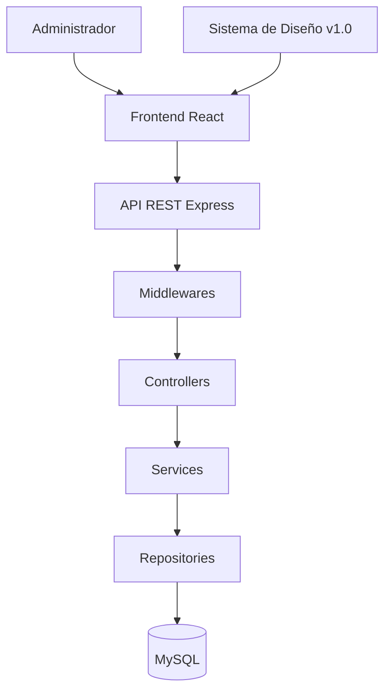

---

## 3. ARQUITECTURA DEL FRONTEND

### 3.1. Organización

```text
frontend/src/
├── assets/
├── config/
│   ├── app.config.js
│   ├── modulos.config.js
│   └── iconos.config.js
├── layouts/
│   ├── AppLayout.jsx
│   └── AppLayout.css
├── pages/
│   ├── Login.jsx
│   ├── Login.css
│   ├── Dashboard.jsx
│   ├── Dashboard.css
│   ├── ModuloPendiente.jsx
│   ├── ModuloPendiente.css
│   ├── Torneos.jsx
│   ├── Torneos.css
│   ├── Ediciones.jsx
│   ├── Ediciones.css
│   ├── Categorias.jsx
│   └── Categorias.css
├── services/
│   └── api.js
├── styles/
│   ├── tokens.css
│   ├── typography.css
│   └── components.css
├── App.jsx
├── App.css
├── index.css
└── main.jsx
```

### 3.2. Responsabilidades

| Elemento | Responsabilidad |
|---|---|
| assets | Recursos visuales |
| config | Configuración y catálogos |
| layouts | Estructuras visuales compartidas |
| pages | Pantallas de la aplicación |
| services | Comunicación con el backend |
| styles | Sistema de Diseño |
| App.jsx | Autenticación y enrutamiento |
| App.css | Estilos de la aplicación principal |
| index.css | Integración de estilos globales |
| main.jsx | Punto de entrada de React |

Los componentes deberán utilizar el
servicio centralizado de comunicación
con la API.

Las reglas de negocio críticas no
deberán depender exclusivamente
del frontend.

### 3.3. Configuración centralizada

La configuración general de la aplicación
se encuentra en:

`config/app.config.js`

Incluye:

- Nombre institucional.
- Versión.
- Descripción.
- Dirección de la API.
- Idioma.
- Zona horaria.

La definición de los módulos se encuentra en:

`config/modulos.config.js`

Incluye:

- Identificador.
- Ruta.
- Título.
- Descripción.
- Disponibilidad de acceso rápido.

La iconografía se encuentra centralizada en:

`config/iconos.config.js`

La navegación no deberá mantener
definiciones independientes de los
mismos módulos.

### 3.4. Registro de módulos implementados

App.jsx administra el registro de componentes
deportivos implementados y las rutas privadas
dependientes del contexto.

| Pantalla | Componente | Ruta privada |
|---|---|---|
| Inicio | Dashboard | `/` |
| Torneos | Torneos | `/torneos` |
| Ediciones | Ediciones | `/torneos/:torneoId/ediciones` |
| Categorías | Categorias | `/torneos/:torneoId/ediciones/:edicionId/categorias` |

EDICIONES y CATEGORÍAS son pantallas
dependientes de su contexto deportivo.

No constituyen nuevas opciones
del menú lateral.

Los módulos secundarios que aún no
dispongan de una implementación funcional
utilizarán ModuloPendiente.

Este mecanismo permite incorporar
nuevos módulos sin reconstruir
la navegación general.

### 3.5. Servicio API

El archivo `services/api.js` centraliza
la comunicación HTTP con el backend.

Contempla:

- URL base configurable.
- Métodos GET, POST, PUT, PATCH y DELETE.
- Envío de solicitudes JSON.
- Recepción de respuestas.
- Inclusión de credenciales de sesión.
- Tratamiento de errores HTTP.
- Tratamiento de errores de conexión.
- Cancelación de solicitudes compatibles.

Los módulos TORNEOS, EDICIONES y CATEGORÍAS
utilizan el mismo servicio para administrar
el ciclo de vida de sus registros.

HU-005 y HU-006 reutilizan esta infraestructura
sin introducir un segundo cliente HTTP.

### 3.6. Estado de autenticación

App.jsx administra:

- Verificación inicial de sesión.
- Usuario autenticado.
- Presentación del acceso privado.
- Presentación de rutas administrativas.
- Inicio de sesión.
- Cierre de sesión.
- Mensajes asociados al cierre de sesión.

La protección visual del frontend
no reemplaza los controles de
autenticación del backend.

### 3.7. Navegación jerárquica

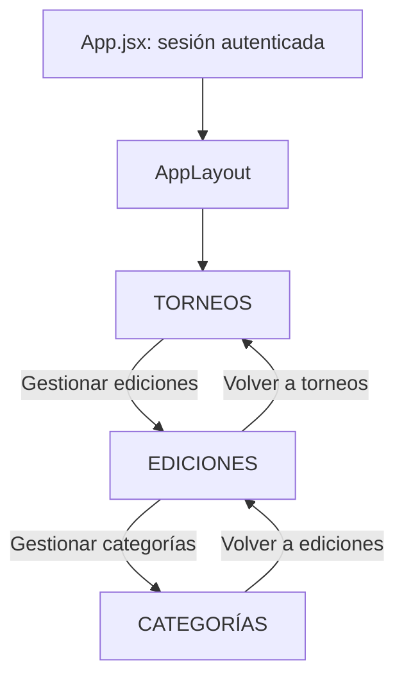

Los identificadores de torneo y edición
se obtienen mediante los parámetros
de navegación.

El backend comprueba la existencia y
pertenencia de los registros solicitados.

La selección jerárquica de estas pantallas
no equivale todavía a la selección global
del contexto deportivo prevista en HU-008.

---

## 4. SISTEMA DE DISEÑO

### 4.1. Propósito

El Sistema de Diseño v1.0 proporciona
una identidad visual compartida
por toda la aplicación.

Sus objetivos arquitectónicos son:

- Reducir la duplicación de CSS.
- Centralizar valores visuales.
- Favorecer la reutilización.
- Mantener consistencia entre módulos.
- Facilitar el mantenimiento.
- Establecer patrones responsive.
- Incorporar mecanismos de accesibilidad.

### 4.2. Capas de estilos

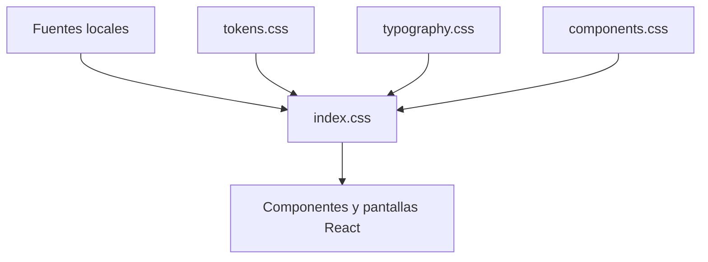

### 4.3. Design Tokens

El archivo `tokens.css` contiene
las variables visuales compartidas:

- Colores.
- Tipografías.
- Tamaños.
- Espaciados.
- Radios.
- Bordes.
- Sombras.
- Transiciones.
- Dimensiones.
- Capas visuales.

Los módulos deberán reutilizar
estos valores siempre que corresponda.

### 4.4. Tipografía

Barlow Condensed se utiliza
principalmente en encabezados,
identidad institucional y marcadores.

Inter se utiliza en la interfaz
administrativa, formularios,
tablas y estadísticas.

Las fuentes se distribuyen
junto con la aplicación mediante
Fontsource.

### 4.5. Componentes reutilizables

Los estilos comunes se identifican
mediante el prefijo `as-`.

Incluyen:

- Botones.
- Paneles.
- Tarjetas.
- Indicadores.
- Formularios.
- Buscadores.
- Filtros.
- Estados administrativos.
- Mensajes.
- Tablas.
- Estados vacíos.
- Indicadores de carga.
- Estructuras de página.

Cada módulo podrá definir estilos
específicos cuando los componentes
globales resulten insuficientes.

Las acciones destructivas deberán
utilizar los estilos semánticos
de peligro correspondientes.

### 4.6. Independencia visual

La identidad institucional de
ALTO-SISTEMA es independiente
de las identidades visuales
de las competiciones.

Las futuras configuraciones
de colores, logotipos y
publicaciones deportivas no
deberán modificar accidentalmente
la interfaz administrativa.

Los estándares completos se
encuentran en:

[SISTEMA_DE_DISENO.md](SISTEMA_DE_DISENO.md)

### 4.7. Aplicación en categorías

HU-006 conserva el Sistema de Diseño v1.0.

Los estilos específicos se concentran en:

- `Categorias.css`.
- Ampliación de `Ediciones.css`.

No se modifica la identidad visual global.

| Elemento | Identidad visual |
|---|---|
| Categoría ACTIVA | Verde |
| Categoría ARCHIVADA | Gris |
| Nueva categoría | Azul institucional |
| Gestionar categorías | Azul institucional |
| Editar | Neutro |
| Archivar | Ámbar |
| Reactivar | Verde |
| Eliminar | Rojo |

Los indicadores, formularios y tarjetas
reutilizan los componentes compartidos.

Las pantallas reorganizan su distribución
según el espacio disponible.

---

## 5. ARQUITECTURA DEL BACKEND

### 5.1. Organización

Estructura general de los componentes
deportivos y administrativos.

Los archivos de infraestructura y
autenticación de historias anteriores
se conservan.

```text
backend/
├── src/
│   ├── config/
│   ├── controllers/
│   │   ├── auth.controller.js
│   │   ├── torneo.controller.js
│   │   ├── edicion.controller.js
│   │   └── categoria.controller.js
│   ├── middlewares/
│   ├── repositories/
│   │   ├── torneo.repository.js
│   │   ├── edicion.repository.js
│   │   └── categoria.repository.js
│   ├── routes/
│   │   ├── auth.routes.js
│   │   ├── torneo.routes.js
│   │   ├── edicion.routes.js
│   │   └── categoria.routes.js
│   ├── services/
│   │   ├── auth.service.js
│   │   ├── torneo.service.js
│   │   ├── edicion.service.js
│   │   └── categoria.service.js
│   ├── create-admin.js
│   ├── migrate.js
│   └── server.js
├── tests/
│   ├── auth.service.test.js
│   ├── auth.integration.test.js
│   ├── torneo.service.test.js
│   ├── torneo.integration.test.js
│   ├── edicion.service.test.js
│   ├── edicion.integration.test.js
│   ├── categoria.service.test.js
│   └── categoria.integration.test.js
├── package.json
└── package-lock.json
```

La estructura representa los componentes
principales y no constituye un inventario
exhaustivo de todos los archivos.

### 5.2. Responsabilidades

| Capa | Responsabilidad |
|---|---|
| config | Configuración e infraestructura |
| routes | Definición de endpoints |
| controllers | Solicitudes y respuestas HTTP |
| services | Validaciones y reglas de negocio |
| repositories | Acceso a los datos |
| middlewares | Controles transversales |
| tests | Pruebas automatizadas |
| server.js | Inicialización del servidor |
| migrate.js | Gestión de migraciones |
| create-admin.js | Creación inicial del administrador |

### 5.3. Separación de responsabilidades

Los controladores no deberán
contener consultas SQL.

Los repositorios no deberán
gestionar respuestas HTTP.

Los servicios de negocio deberán
concentrar las reglas y validaciones
de cada dominio funcional.

Los middlewares deberán resolver
controles transversales reutilizables.

Las rutas deberán organizarse
por responsabilidad funcional.

### 5.4. Configuración

La configuración general del backend
se encuentra centralizada en:

`src/config/app.config.js`

La infraestructura deberá utilizar
variables de entorno cuando corresponda.

Las credenciales y los secretos
no deberán almacenarse directamente
en el código fuente.

### 5.5. Registro jerárquico de routers

Los routers deportivos se registran
en `server.js`, desde las rutas más
específicas hasta las más generales.

Orden de registro deportivo:

1. CATEGORÍAS.
2. EDICIONES.
3. TORNEOS.

```text
/api/torneos/:torneoId/ediciones/:edicionId/categorias

/api/torneos/:torneoId/ediciones

/api/torneos
```

Los routers anidados utilizan
`mergeParams: true` para recuperar
los identificadores del contexto padre.

Cada router deportivo exige autenticación.

Las operaciones de escritura están sujetas
al control de origen existente.

La jerarquía de rutas expresa el contexto
deportivo, pero su validación definitiva
corresponde a los servicios de negocio.

---

## 6. FLUJO DE UNA SOLICITUD

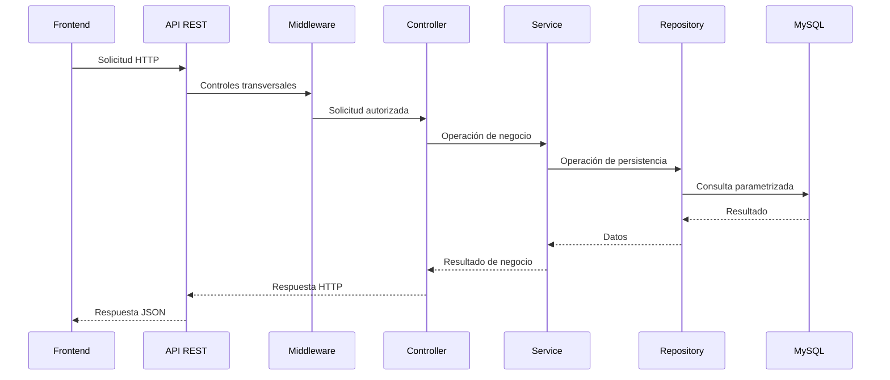

El servicio de negocio deberá validar
la operación solicitada antes de
efectuar modificaciones persistentes.

Los errores de negocio deberán
traducirse en respuestas HTTP
comprensibles para el frontend.

Los errores inesperados deberán
gestionarse sin exponer información
interna sensible al usuario.

### 6.1. Validación jerárquica

Las operaciones de categorías requieren
verificar sucesivamente:

1. Identificador del torneo.
2. Identificador de la edición.
3. Pertenencia de la edición al torneo.
4. Identificador de la categoría, cuando corresponda.
5. Pertenencia de la categoría a la edición.
6. Compatibilidad de la operación con los estados vigentes.

Una ruta con identificadores válidos
individualmente no constituye por sí sola
un contexto deportivo válido.

El servicio debe rechazar las combinaciones
de registros pertenecientes a contextos diferentes.

---

## 7. MÓDULO DE AUTENTICACIÓN

### 7.1. Responsabilidad

Administrar el acceso privado
a ALTO-SISTEMA.

### 7.2. Funcionalidades

- Inicio de sesión.
- Verificación de credenciales.
- Validación de usuario activo.
- Consulta de sesión autenticada.
- Cierre de sesión.
- Protección de rutas privadas.
- Persistencia de sesiones en MySQL.
- Limitación de intentos de acceso.

### 7.3. Endpoints principales

| Método | Endpoint |
|---|---|
| POST | `/api/auth/login` |
| GET | `/api/auth/me` |
| POST | `/api/auth/logout` |

Las operaciones deportivas deberán
requerir autenticación válida.

El frontend no constituye una
barrera de seguridad suficiente
por sí mismo.

HU-006 reutiliza el middleware
de autenticación existente.

No introduce un mecanismo independiente
de sesiones ni de credenciales.

---

## 8. MÓDULO DE TORNEOS

### 8.1. Identificación

| Propiedad | Valor |
|---|---|
| Historia de usuario | HU-004 |
| Versión de incorporación | 0.2.0 |
| Entidad | Torneo |
| Tabla | `torneos` |
| Migración | `002_torneos.sql` |
| Estado | Implementado, verificado y consolidado |

### 8.2. Responsabilidad

Administrar la identidad básica
de las competiciones deportivas
y su ciclo de vida administrativo.

El módulo constituye la primera
implementación de la arquitectura
multitorneo.

### 8.3. Componentes

Frontend:

- `pages/Torneos.jsx`
- `pages/Torneos.css`

Backend:

- `routes/torneo.routes.js`
- `controllers/torneo.controller.js`
- `services/torneo.service.js`
- `repositories/torneo.repository.js`

Persistencia:

- `database/migrations/002_torneos.sql`

Pruebas:

- `backend/tests/torneo.service.test.js`
- `backend/tests/torneo.integration.test.js`

### 8.4. Modelo de persistencia

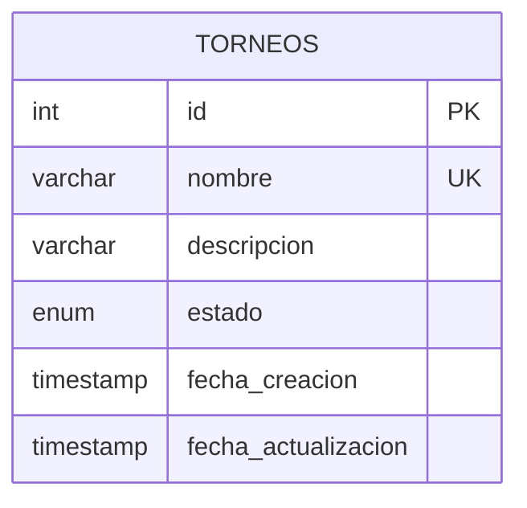

| Campo | Tipo | Restricción |
|---|---|---|
| id | INT | PK, autoincremental |
| nombre | VARCHAR(100) | Obligatorio y único |
| descripcion | VARCHAR(500) | Opcional |
| estado | ENUM | ACTIVO o ARCHIVADO |
| fecha_creacion | TIMESTAMP | Obligatorio |
| fecha_actualizacion | TIMESTAMP | Actualización automática |

El estado inicial de un nuevo
torneo será ACTIVO.

Existe un índice sobre el estado
administrativo del torneo.

### 8.5. Ciclo de vida administrativo

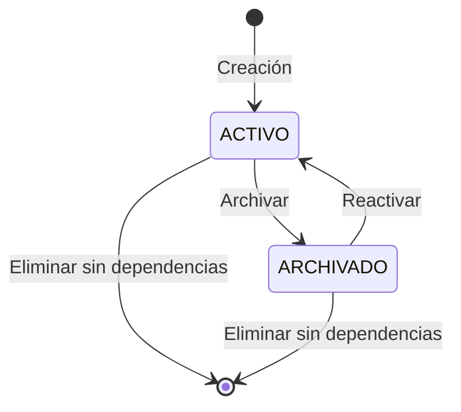

El archivado es reversible.

El archivado no elimina los
datos existentes.

La edición de los datos básicos
está permitida para torneos
activos y archivados.

La eliminación definitiva está disponible
en ambos estados siempre que no existan
ediciones ni otras dependencias incompatibles.

ELIMINADO no constituye un estado
administrativo persistente.

Una eliminación exitosa retira
físicamente el registro de MySQL.

### 8.6. Endpoints

| Método | Endpoint | Operación |
|---|---|---|
| GET | `/api/torneos` | Listado |
| GET | `/api/torneos/:id` | Consulta individual |
| POST | `/api/torneos` | Creación |
| PUT | `/api/torneos/:id` | Edición |
| PATCH | `/api/torneos/:id/estado` | Cambio de estado |
| DELETE | `/api/torneos/:id` | Eliminación definitiva |

Todos los endpoints requieren
una sesión autenticada.

### 8.7. Validaciones de negocio

El servicio deberá garantizar:

- Identificadores válidos.
- Nombre obligatorio.
- Normalización Unicode NFC.
- Normalización de espacios.
- Nombre de hasta 100 caracteres.
- Descripción de hasta 500 caracteres.
- Descripción opcional.
- Estados administrativos válidos.
- Prevención de nombres duplicados.
- Validación de filtros.
- Existencia del torneo solicitado.

La unicidad del nombre se protege
mediante la restricción correspondiente
de MySQL.

La validación no distingue nombres
únicamente por diferencias de
mayúsculas y minúsculas.

Un torneo archivado conserva
la reserva de su nombre.

La eliminación definitiva libera
el nombre para futuras creaciones.

### 8.8. Respuestas HTTP

| Código | Significado |
|---|---|
| 200 | Operación exitosa |
| 201 | Torneo creado |
| 400 | Datos inválidos |
| 401 | Sesión no válida |
| 403 | Solicitud no permitida |
| 404 | Recurso o ruta inexistente |
| 409 | Conflicto de unicidad o dependencias |
| 500 | Error interno inesperado |

### 8.9. Interfaz administrativa

El módulo incorpora:

- Indicadores de torneos registrados.
- Indicadores de torneos activos.
- Indicadores de torneos archivados.
- Formularios de creación y edición.
- Búsqueda por nombre y descripción.
- Filtros administrativos.
- Confirmaciones de cambios de estado.
- Confirmación de eliminación.
- Estados de carga.
- Estados vacíos.
- Mensajes de error y confirmación.

El listado inicial se obtiene
mediante la API.

La búsqueda y los filtros de la
interfaz actual operan sobre
los registros cargados.

La API también admite filtros
del lado del servidor.

Las creaciones y modificaciones
exitosas actualizan el listado local
con los datos devueltos por el backend.

Las eliminaciones exitosas retiran
el registro correspondiente del listado
y actualizan los indicadores.

### 8.10. Integración con Dashboard

El Dashboard consulta:

`GET /api/torneos?estado=ACTIVO`

El indicador de torneos activos utiliza
el total devuelto por la API.

Cuando no existen torneos activos,
el indicador muestra cero.

Cuando la consulta falla,
muestra un guion y un estado
de indisponibilidad.

No se deberán utilizar valores
ficticios como estadísticas reales.

### 8.11. Límites del módulo

HU-004 incorpora la gestión de torneos.

HU-005 incorpora la gestión de ediciones
y su vínculo con los torneos.

HU-006 incorpora la gestión de categorías
y su vínculo con las ediciones.

Continúan pendientes:

- Equipos inscritos.
- Zonas.
- Jornadas.
- Partidos.
- Copas.
- Estadísticas deportivas.
- Identidad visual de competiciones.
- Selección global del contexto deportivo.

Estas responsabilidades serán
incorporadas mediante las historias
de usuario correspondientes.

### 8.12. Arquitectura de eliminación

| Capa | Responsabilidad |
|---|---|
| Route | Exponer el endpoint DELETE |
| Controller | Gestionar la respuesta HTTP |
| Service | Validar identificador y errores |
| Repository | Ejecutar la eliminación parametrizada |

La consulta se limita al identificador
del torneo solicitado.

El repositorio devuelve la cantidad
de filas afectadas.

El servicio interpreta el resultado
y transforma los errores conocidos
en errores de negocio.

Una eliminación exitosa devuelve:

```json
{
    "mensaje": "Torneo eliminado correctamente."
}
```

### 8.13. Confirmación de eliminación

La interfaz solicita confirmación
mediante el mecanismo nativo
del navegador.

La confirmación identifica el torneo
por su nombre y advierte que
la operación es irreversible.

Si el administrador cancela,
no se realiza la solicitud DELETE.

Durante la operación se bloquean
las acciones administrativas
incompatibles.

El frontend solamente retira
el registro después de recibir
una respuesta exitosa.

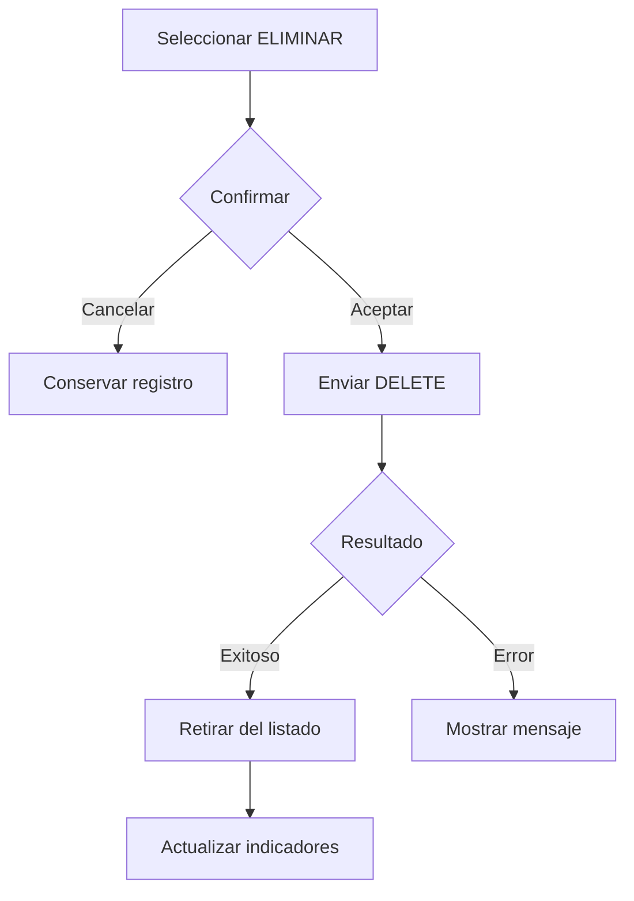

### 8.14. Protección de dependencias

El servicio contempla los errores
de restricciones de claves foráneas
que impiden eliminar un torneo.

Estos errores se traducen en una
respuesta HTTP 409.

No deberán incorporarse eliminaciones
en cascada que destruyan información
deportiva histórica.

Desde HU-005, la tabla `ediciones` depende
de `torneos` mediante `fk_ediciones_torneo`
con ON DELETE RESTRICT y ON UPDATE RESTRICT.

Desde HU-006, la tabla `categorias` depende
de `ediciones` mediante `fk_categorias_edicion`
con las mismas restricciones.

La protección real de ambas relaciones
fue verificada contra MySQL y desde
la interfaz administrativa.

La eliminación de contextos deportivos
deberá respetar el orden de dependencias.

### 8.15. Independencia de operaciones

La eliminación de un torneo no deberá
alterar los datos de otras competiciones.

La independencia se verificó mediante:

- Pruebas unitarias.
- Pruebas de integración con MySQL.
- Comprobaciones funcionales.

La reutilización de un nombre eliminado
genera un nuevo registro.

No constituye una restauración
del torneo anterior.

### 8.16. Integración con EDICIONES (HU-005)

Las tarjetas de TORNEOS incorporan:

- Total de ediciones asociadas.
- Cantidad de ediciones EN_CURSO.
- Botón GESTIONAR EDICIONES.

El acceso utiliza el identificador del torneo
seleccionado y permanece disponible para
torneos activos y archivados.

Los indicadores se obtienen reutilizando
la API de EDICIONES, mediante consultas
adicionales por torneo con concurrencia
limitada a cuatro solicitudes.

Si una consulta falla, se muestra un guion
en lugar de informar un cero incorrecto.

El regreso a TORNEOS vuelve a consultar
los datos.

La solución evita introducir un endpoint
agregado en HU-005.

Su costo aumenta con la cantidad de torneos;
una consulta agregada podrá evaluarse cuando
existan mediciones que justifiquen la optimización.

### 8.17. Módulo de ediciones

| Propiedad | Valor |
|---|---|
| Historia de usuario | HU-005 |
| Versión de incorporación | 0.3.0 |
| Entidad | Edición |
| Tabla | `ediciones` |
| Migración | `003_ediciones.sql` |
| Estado | Implementado, verificado y consolidado |

La edición representa una realización concreta
de un torneo. Un torneo puede tener cero,
una o múltiples ediciones, incluso simultáneas.

El nombre contiene libremente la denominación
y el año cuando corresponda.

No existe un campo independiente para el año.

#### 8.17.1. Componentes y responsabilidades

| Capa | Archivo | Responsabilidad |
|---|---|---|
| Presentación | `frontend/src/pages/Ediciones.jsx` | Gestión de ediciones |
| Estilos | `frontend/src/pages/Ediciones.css` | Diseño específico y responsive |
| Enrutamiento | `frontend/src/App.jsx` | Ruta privada parametrizada |
| Integración | `Torneos.jsx` y `Torneos.css` | Acceso e indicadores por torneo |
| Route | `backend/src/routes/edicion.routes.js` | Endpoints anidados |
| Controller | `backend/src/controllers/edicion.controller.js` | Respuestas HTTP |
| Service | `backend/src/services/edicion.service.js` | Validaciones y reglas deportivas |
| Repository | `backend/src/repositories/edicion.repository.js` | Consultas y transacciones |
| Inicialización | `backend/src/server.js` | Registro del router |
| Persistencia | `database/migrations/003_ediciones.sql` | Tabla, índices y restricciones |
| Migrador | `backend/src/migrate.js` | Verificación estructural |

#### 8.17.2. Modelo de persistencia

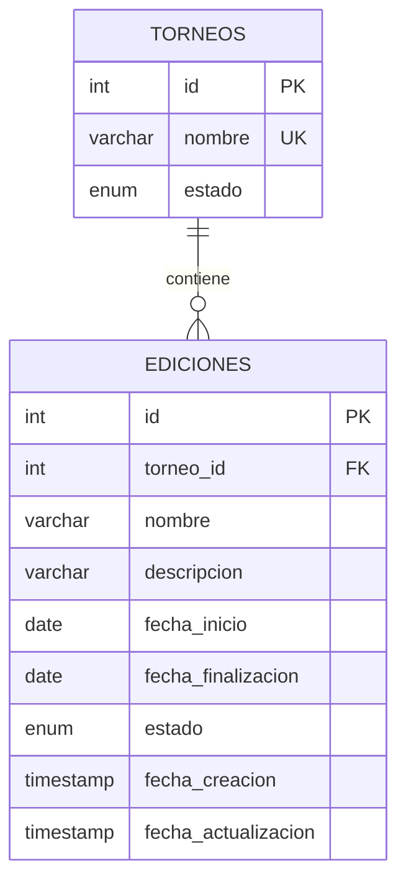

| Campo | Tipo | Restricción |
|---|---|---|
| id | INT | PK, autoincremental |
| torneo_id | INT | Obligatorio; FK a `torneos.id` |
| nombre | VARCHAR(100) | Obligatorio; único dentro del torneo |
| descripcion | VARCHAR(500) | Opcional |
| fecha_inicio | DATE | Opcional |
| fecha_finalizacion | DATE | Opcional |
| estado | ENUM | PLANIFICADA, EN_CURSO o FINALIZADA |
| fecha_creacion | TIMESTAMP | Obligatorio; valor inicial automático |
| fecha_actualizacion | TIMESTAMP | Obligatorio; actualización automática |

Motor InnoDB, codificación utf8mb4
y colación `utf8mb4_unicode_ci`.

Restricciones e índices:

- `uq_ediciones_torneo_nombre`: UNIQUE (`torneo_id`, `nombre`).
- `idx_ediciones_torneo_estado`: índice (`torneo_id`, `estado`).
- `fk_ediciones_torneo`: ON DELETE RESTRICT y ON UPDATE RESTRICT.
- `chk_ediciones_fechas`: si ambas fechas están presentes, la finalización debe ser igual o posterior al inicio.

La unicidad es compuesta: el mismo nombre puede
existir en torneos distintos.

La colación protege contra duplicados que solo
difieran en mayúsculas o acentos dentro del mismo
torneo.

Desde HU-006, cada edición puede contener
categorías independientes.

#### 8.17.3. Ciclo de vida deportivo

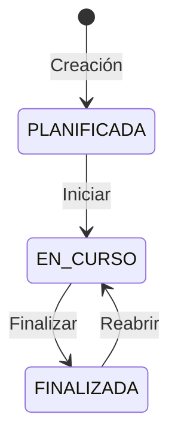

El estado inicial es PLANIFICADA.

Las fechas son informativas, editables e
independientes del estado deportivo.

Pueden omitirse, informarse por separado
o eliminarse.

Las transiciones se ejecutan manualmente y no
modifican automáticamente las fechas.

Repetir el estado actual no produce una escritura.

No está permitido finalizar directamente una
edición planificada ni volver a PLANIFICADA
desde los otros estados.

No existe una restricción que limite a una sola
edición en curso por torneo.

#### 8.17.4. Relación con el estado administrativo

| Operación | Torneo ACTIVO | Torneo ARCHIVADO |
|---|---|---|
| Listar y consultar | Permitida | Permitida |
| Crear | Permitida | Bloqueada |
| Editar datos | Permitida | Permitida |
| Iniciar | Permitida | Bloqueada |
| Finalizar una edición en curso | Permitida | Permitida |
| Reabrir | Permitida | Bloqueada |
| Eliminar sin dependencias | Permitida | Permitida |

El archivado no cambia los estados deportivos
ni elimina sus datos asociados.

Las restricciones se aplican en el Service.

La interfaz también deshabilita las acciones
incompatibles, pero no sustituye esa protección.

#### 8.17.5. Endpoints privados

| Método | Endpoint | Operación |
|---|---|---|
| GET | `/api/torneos/:torneoId/ediciones` | Listar ediciones |
| GET | `/api/torneos/:torneoId/ediciones/:edicionId` | Consultar edición |
| POST | `/api/torneos/:torneoId/ediciones` | Crear edición |
| PUT | `/api/torneos/:torneoId/ediciones/:edicionId` | Actualizar datos |
| PATCH | `/api/torneos/:torneoId/ediciones/:edicionId/estado` | Cambiar estado |
| DELETE | `/api/torneos/:torneoId/ediciones/:edicionId` | Eliminar edición |

El router utiliza `mergeParams: true` para
recuperar el identificador del torneo padre
y se protege mediante `requireAuth`.

Se registra en `server.js` después del router
de CATEGORÍAS y antes del router de TORNEOS.

Filtros del listado: `busqueda` y `estado`.

La respuesta incluye `torneo`, `ediciones`,
`total` e `indicadores`.

El total del listado corresponde a los registros
obtenidos; los indicadores corresponden al
conjunto completo de ediciones del torneo.

Indicadores:

- `total`.
- `planificadas`.
- `en_curso`.
- `finalizadas`.

La consulta individual devuelve `edicion`.

Las escrituras de creación, edición y cambio
de estado devuelven `mensaje` y `edicion`.

La creación responde HTTP 201 y encabezado Location.

La eliminación exitosa devuelve un `mensaje`.

#### 8.17.6. Validaciones y errores

El Service valida:

- Identificadores enteros positivos dentro del rango INT.
- Existencia del torneo y pertenencia de la edición.
- Campos permitidos en cada operación.
- Nombre obligatorio de hasta 100 caracteres.
- Descripción opcional de hasta 500 caracteres.
- Normalización Unicode NFC y de espacios del nombre.
- Fechas de calendario válidas en formato YYYY-MM-DD.
- Coherencia entre fechas, incluso al actualizar parcialmente.
- Unicidad dentro del torneo.
- Estados y transiciones permitidos.
- Restricciones derivadas del archivado.
- Filtros de búsqueda.

El torneo asociado no puede cambiarse mediante
la actualización de una edición.

| Código HTTP | Significado |
|---|---|
| 200 | Operación exitosa |
| 201 | Edición creada |
| 400 | Identificador, datos, fechas o filtros inválidos |
| 401 | Autenticación requerida |
| 403 | Solicitud no permitida |
| 404 | Torneo o edición inexistente en el contexto solicitado |
| 409 | Duplicado, dependencia, transición prohibida o conflicto transaccional |
| 500 | Error interno inesperado |

Los errores de negocio se representan mediante
`EdicionError`.

Los errores conocidos de MySQL se traducen
a respuestas controladas.

Los errores inesperados no exponen detalles SQL.

#### 8.17.7. Transacciones e independencia

Las escrituras utilizan el mecanismo
`conTransaccion` del Repository.

El Service comprueba y bloquea el registro
del torneo padre mediante SELECT FOR UPDATE
antes de ejecutar la operación de escritura.

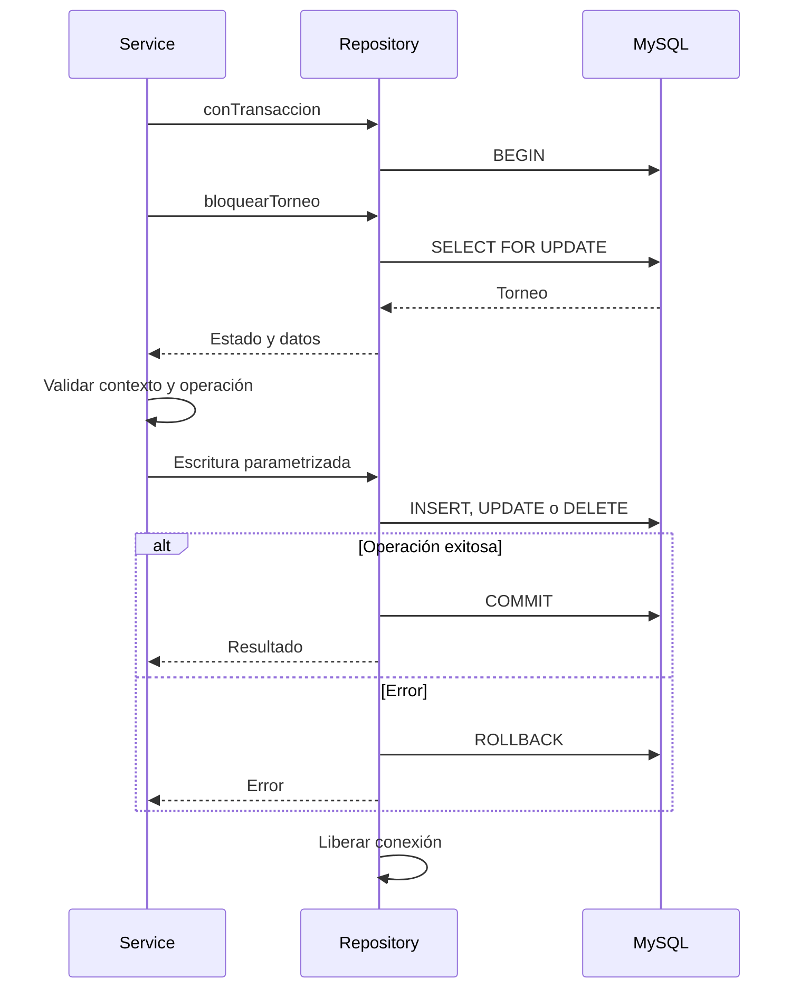

Las operaciones de edición individual se limitan
por `torneo_id` e `id`.

Consultar o modificar una edición mediante
el identificador de otro torneo no debe devolver
ni alterar sus datos.

La restricción UNIQUE mantiene la unicidad
también frente a solicitudes concurrentes.

La eliminación del torneo no se realiza
en cascada.

La eliminación definitiva de una edición requiere
confirmación explícita.

Desde HU-006, una edición con categorías
asociadas no puede eliminarse.

#### 8.17.8. Presentación y navegación

La pantalla utiliza `useParams` y `useNavigate`.

El componente de gestión se identifica con una
clave basada en el identificador del torneo,
evitando reutilizar su estado local al cambiar
de contexto.

La carga inicial se cancela mediante AbortController
al desmontar el componente o iniciar una nueva consulta.

El listado completo se filtra localmente por nombre,
descripción y estado.

La búsqueda local no distingue mayúsculas ni tildes.

Los indicadores se calculan sobre el listado completo,
no sobre los resultados filtrados.

Las mutaciones exitosas actualizan el estado local
con las respuestas del servidor.

No se eliminan tarjetas anticipadamente ante
solicitudes fallidas.

Los campos DATE se reciben como cadenas YYYY-MM-DD
y se muestran como DD/MM/AAAA, evitando conversiones
de zona horaria sobre fechas sin componente horario.

| Estado | Identidad visual |
|---|---|
| PLANIFICADA | Azul informativo |
| EN_CURSO | Verde de éxito |
| FINALIZADA | Gris neutro |

La pantalla ofrece indicadores, formularios
con fechas opcionales, confirmaciones de transición
y eliminación, mensajes de error y estado vacío.

No se añaden dependencias ni una opción nueva
al menú lateral.

En pantallas pequeñas se reorganizan los indicadores,
filtros, tarjetas y campos de fecha.

La validación responsive fue realizada mediante
simulación del navegador, no en un dispositivo físico.

#### 8.17.9. Integración con CATEGORÍAS (HU-006)

Cada tarjeta de edición incorpora:

- Indicador CATEGORÍAS.
- Indicador ACTIVAS.
- Botón GESTIONAR CATEGORÍAS.

El componente `CategoriasDeEdicion` reutiliza
el endpoint de listado de categorías.

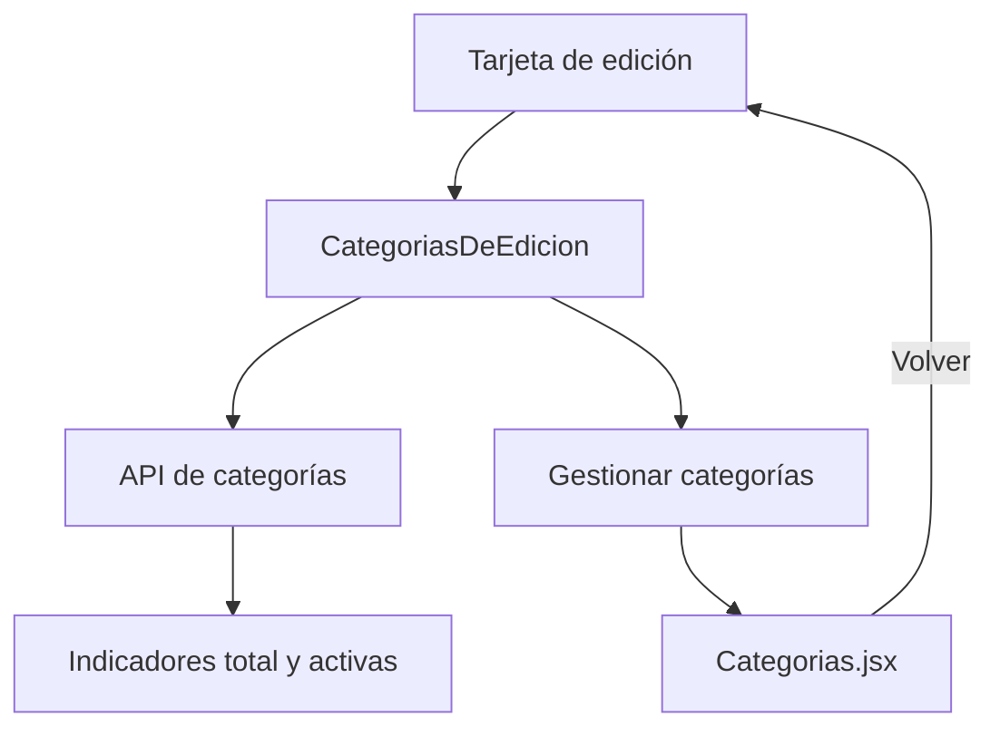

Cada tarjeta visible realiza una consulta
adicional para obtener los indicadores
de la edición correspondiente.

La consulta puede cancelarse al desmontar
el componente.

Cuando la consulta falla o devuelve datos
inválidos, se muestra un guion.

El valor cero representa una consulta
exitosa sin registros correspondientes.

El regreso desde CATEGORÍAS vuelve a cargar
los indicadores de EDICIONES.

El acceso al módulo permanece disponible
en ediciones finalizadas y torneos archivados.

Las restricciones sobre las operaciones
de categorías se aplican dentro de su
propio contexto.

La solución no modifica el contrato
del endpoint de listado de ediciones.

No se establece actualmente un límite
específico de concurrencia para las consultas
de categorías de las tarjetas visibles.

Su optimización podrá evaluarse mediante
consultas agregadas cuando el volumen de
ediciones lo justifique.

### 8.18. Módulo de categorías

| Propiedad | Valor |
|---|---|
| Historia de usuario | HU-006 |
| Versión de incorporación | 0.4.0 |
| Entidad | Categoría |
| Tabla | `categorias` |
| Migración | `004_categorias.sql` |
| Estado | Implementado y verificado; cierre formal pendiente |

La categoría representa una subdivisión
deportiva independiente de una edición.

Cada edición puede contener cero, una
o múltiples categorías.

No se establecen nombres predeterminados
ni una cantidad fija de categorías.

La denominación de una categoría no determina
automáticamente sus reglas deportivas.

Las restricciones de edad, formatos de competición,
identidad visual y demás configuraciones específicas
se incorporarán en las historias correspondientes.

#### 8.18.1. Componentes y responsabilidades

| Capa | Archivo | Responsabilidad |
|---|---|---|
| Presentación | `frontend/src/pages/Categorias.jsx` | Gestión de categorías de una edición |
| Estilos | `frontend/src/pages/Categorias.css` | Diseño específico y responsive |
| Enrutamiento | `frontend/src/App.jsx` | Ruta privada jerárquica |
| Integración | `Ediciones.jsx` y `Ediciones.css` | Acceso e indicadores por edición |
| Route | `backend/src/routes/categoria.routes.js` | Endpoints anidados y autenticación |
| Controller | `backend/src/controllers/categoria.controller.js` | Respuestas HTTP |
| Service | `backend/src/services/categoria.service.js` | Validaciones y reglas de negocio |
| Repository | `backend/src/repositories/categoria.repository.js` | Consultas, transacciones y bloqueos |
| Inicialización | `backend/src/server.js` | Registro del router |
| Persistencia | `database/migrations/004_categorias.sql` | Tabla, índices y restricciones |
| Migrador | `backend/src/migrate.js` | Verificación estructural de la migración |
| Pruebas unitarias | `backend/tests/categoria.service.test.js` | Reglas del servicio |
| Integración | `backend/tests/categoria.integration.test.js` | Validación HTTP y MySQL |

#### 8.18.2. Modelo de persistencia

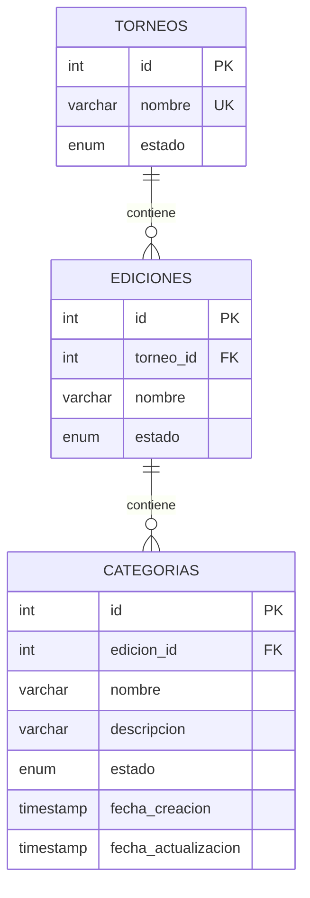

| Campo | Tipo | Restricción |
|---|---|---|
| id | INT | PK, autoincremental |
| edicion_id | INT | Obligatorio; FK a `ediciones.id` |
| nombre | VARCHAR(100) | Obligatorio; único dentro de la edición |
| descripcion | VARCHAR(500) | Opcional |
| estado | ENUM | ACTIVA o ARCHIVADA |
| fecha_creacion | TIMESTAMP | Obligatorio; valor inicial automático |
| fecha_actualizacion | TIMESTAMP | Obligatorio; actualización automática |

Configuración de almacenamiento:

- Motor InnoDB.
- Codificación utf8mb4.
- Intercalación utf8mb4_unicode_ci.

Restricciones e índices:

| Nombre | Definición |
|---|---|
| PRIMARY | Clave primaria sobre `id` |
| uq_categorias_edicion_nombre | UNIQUE (`edicion_id`, `nombre`) |
| idx_categorias_edicion_estado | INDEX (`edicion_id`, `estado`) |
| fk_categorias_edicion | FOREIGN KEY (`edicion_id`) REFERENCES `ediciones(id)` |

La clave foránea utiliza:

- ON DELETE RESTRICT.
- ON UPDATE RESTRICT.

La tabla no incluye un campo `torneo_id`.

El torneo se determina mediante
la relación con la edición.

Esta decisión evita duplicar el contexto
jerárquico y generar inconsistencias
entre los identificadores asociados.

#### 8.18.3. Unicidad e independencia

La restricción UNIQUE combina:

```text
edicion_id + nombre
```

Por ejemplo:

| Torneo | Edición | Categoría | Resultado |
|---|---|---|---|
| NOCTURNO | VERANO 2027 | LIBRE | Permitida |
| NOCTURNO | VERANO 2027 | SENIOR | Permitida |
| NOCTURNO | VERANO 2028 | LIBRE | Permitida |
| DIURNO | 2027 | LIBRE | Permitida |
| NOCTURNO | VERANO 2027 | libre | Duplicado |

La intercalación de MySQL protege
contra duplicados que únicamente
difieran en mayúsculas o acentos.

La normalización previa mediante Unicode NFC
y espacios contribuye a mantener consistencia
en los nombres almacenados.

El archivado conserva la reserva del nombre
dentro de la edición.

La eliminación definitiva libera el nombre.

Una categoría no puede cambiar de edición
mediante la actualización de sus datos.

#### 8.18.4. Ciclo de vida administrativo

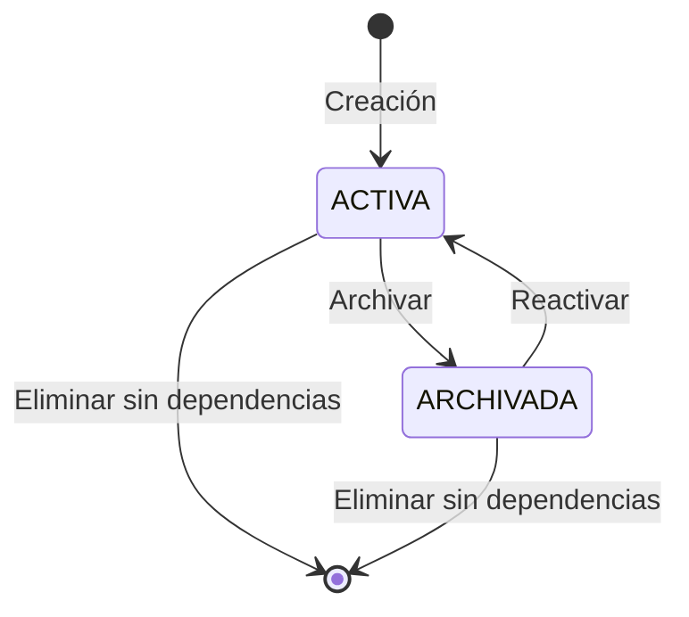

La categoría se crea en estado ACTIVA.

El archivado es reversible.

La reactivación conserva el identificador,
nombre, descripción y edición asociada.

Repetir el estado vigente no requiere
una nueva escritura.

ELIMINADA no constituye un estado
administrativo persistente.

La eliminación definitiva retira
físicamente el registro de MySQL.

#### 8.18.5. Restricciones del contexto deportivo

La creación y reactivación requieren
simultáneamente:

- Torneo ACTIVO.
- Edición PLANIFICADA o EN_CURSO.

| Operación | Contexto habilitado | Contexto restringido |
|---|---|---|
| Listar | Permitida | Permitida |
| Consultar | Permitida | Permitida |
| Crear | Permitida | Bloqueada |
| Editar | Permitida | Permitida |
| Archivar | Permitida | Permitida |
| Reactivar | Permitida | Bloqueada |
| Eliminar sin dependencias | Permitida | Permitida |

Un contexto restringido corresponde a:

- Torneo ARCHIVADO.
- Edición FINALIZADA.
- Ambas condiciones simultáneamente.

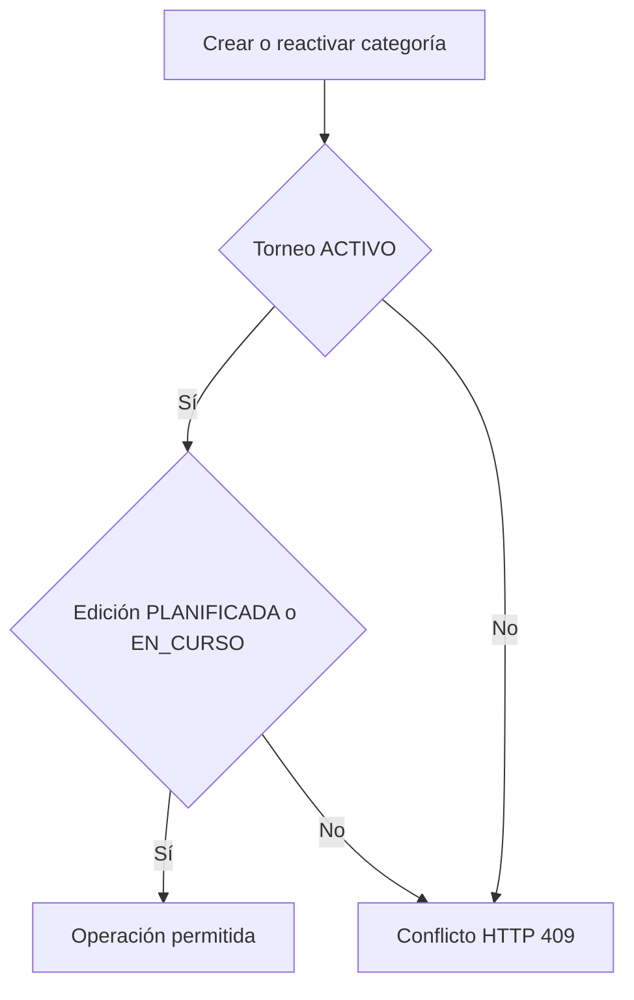

Las restricciones se aplican en el Service.

El frontend deshabilita las operaciones
incompatibles y muestra una advertencia.

La protección del frontend no sustituye
la validación del backend.

#### 8.18.6. Ausencia de cambios automáticos de estado

Archivar un torneo no archiva
automáticamente sus ediciones
ni sus categorías.

Finalizar una edición no archiva
automáticamente sus categorías.

Reactivar un torneo tampoco reactiva
automáticamente sus categorías.

Reabrir una edición recupera la posibilidad
de crear o reactivar categorías cuando
el torneo se encuentra activo.

Cada estado conserva su significado
dentro del nivel jerárquico correspondiente.

La aplicación de futuras reglas deportivas
transversales deberá definirse expresamente.

#### 8.18.7. Endpoints privados

Ruta base:

`/api/torneos/:torneoId/ediciones/:edicionId/categorias`

| Método | Ruta relativa | Operación |
|---|---|---|
| GET | `/` | Listar categorías e indicadores |
| GET | `/:categoriaId` | Consultar categoría |
| POST | `/` | Crear categoría |
| PUT | `/:categoriaId` | Actualizar datos |
| PATCH | `/:categoriaId/estado` | Cambiar estado |
| DELETE | `/:categoriaId` | Eliminar categoría |

El router utiliza `mergeParams: true`
y recupera los identificadores
del torneo y de la edición.

Todos los endpoints se protegen
mediante `requireAuth`.

Las escrituras utilizan el control
de origen del servidor.

El router se registra antes de EDICIONES
y TORNEOS para preservar el enrutamiento
jerárquico.

#### 8.18.8. Contrato de la API

Creación:

```json
{
    "nombre": "LIBRE",
    "descripcion": "Categoría libre"
}
```

El campo `nombre` es obligatorio.

El campo `descripcion` puede omitirse
o informarse como `null`.

No se admite definir manualmente
el estado inicial durante la creación.

Actualización parcial:

```json
{
    "nombre": "LIBRE A"
}
```

La actualización admite exclusivamente:

- `nombre`.
- `descripcion`.

Los restantes campos permanecen inalterados.

Cambio de estado:

```json
{
    "estado": "ARCHIVADA"
}
```

Estados permitidos:

- `ACTIVA`.
- `ARCHIVADA`.

Respuesta ilustrativa del listado:

```json
{
    "torneo": {
        "id": 1,
        "nombre": "NOCTURNO",
        "estado": "ACTIVO"
    },
    "edicion": {
        "id": 1,
        "torneo_id": 1,
        "nombre": "VERANO 2027",
        "estado": "PLANIFICADA"
    },
    "categorias": [],
    "total": 0,
    "indicadores": {
        "total": 0,
        "activas": 0,
        "archivadas": 0
    }
}
```

Los identificadores y nombres del ejemplo
son demostrativos.

La consulta individual devuelve `categoria`.

Las escrituras de creación, edición
y cambio de estado devuelven:

- `mensaje`.
- `categoria`.

La creación responde HTTP 201 e incluye
el encabezado Location del nuevo recurso.

La eliminación exitosa devuelve:

```json
{
    "mensaje": "Categoría eliminada correctamente."
}
```

#### 8.18.9. Validaciones de negocio

El Service valida:

- Identificadores enteros positivos.
- Identificadores dentro del rango INT.
- Existencia del torneo.
- Existencia de la edición.
- Pertenencia de la edición al torneo.
- Existencia de la categoría solicitada.
- Pertenencia de la categoría a la edición.
- Campos autorizados por operación.
- Nombre obligatorio.
- Nombre de hasta 100 caracteres.
- Descripción opcional.
- Descripción de hasta 500 caracteres.
- Normalización Unicode NFC.
- Normalización de espacios del nombre.
- Estados administrativos válidos.
- Filtros permitidos.
- Búsqueda de hasta 500 caracteres.
- Restricciones del contexto.
- Unicidad dentro de cada edición.

La descripción vacía se normaliza
como `null`.

La actualización parcial conserva los
campos que no fueron enviados.

No se admiten modificaciones del identificador
ni de la edición asociada.

#### 8.18.10. Gestión de errores

Los errores de negocio se representan
mediante `CategoriaError`.

| Código HTTP | Significado |
|---|---|
| 200 | Operación exitosa |
| 201 | Categoría creada |
| 400 | Identificadores, datos, filtros o estados inválidos |
| 401 | Autenticación requerida |
| 403 | Solicitud de origen no permitido |
| 404 | Contexto o categoría inexistente |
| 409 | Duplicado, dependencia o restricción de negocio |
| 500 | Error interno inesperado |

Los errores conocidos de MySQL
se traducen a errores de negocio.

Entre ellos:

- `ER_DUP_ENTRY`.
- `ER_ROW_IS_REFERENCED_2`.
- `ER_NO_REFERENCED_ROW_2`.
- `ER_LOCK_DEADLOCK`.
- `ER_LOCK_WAIT_TIMEOUT`.

Los errores inesperados se propagan
hacia el controlador y se traducen
a respuestas HTTP genéricas.

No deberán exponerse consultas SQL,
credenciales ni detalles internos
en las respuestas al frontend.

#### 8.18.11. Transacciones

El repositorio dispone del mecanismo
`conTransaccion`.

Su responsabilidad comprende:

1. Obtener una conexión del pool.
2. Iniciar la transacción.
3. Ejecutar la operación solicitada.
4. Confirmar mediante COMMIT.
5. Revertir mediante ROLLBACK ante errores.
6. Liberar la conexión.

El servicio utiliza este mecanismo
para operar sobre un contexto
deportivo consistente.

Las consultas recuperan el contexto
mediante `obtenerContexto`.

Las escrituras utilizan `bloquearContexto`
para bloquear el torneo y la edición
antes de modificar sus categorías.

#### 8.18.12. Orden de bloqueo

El orden de bloqueo establecido es:

```text
TORNEO
   ↓
EDICIÓN
   ↓
ESCRITURA SOBRE CATEGORÍA
```

El repositorio ejecuta SELECT FOR UPDATE
sobre el torneo y, posteriormente,
sobre la edición correspondiente.

Este orden mantiene compatibilidad
con el mecanismo de bloqueo del
módulo EDICIONES.

Las escrituras de categorías utilizan
la misma conexión de la transacción.

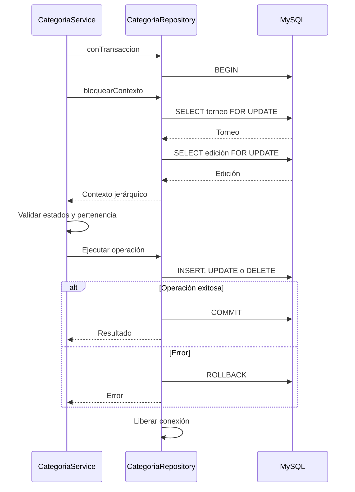

El bloqueo del contexto reduce el riesgo
de inconsistencias frente a operaciones
concurrentes sobre sus estados.

Las restricciones UNIQUE y FOREIGN KEY
actúan como protección complementaria
en MySQL.

No se considera que el bloqueo elimine
la posibilidad de todos los conflictos
transaccionales.

Los errores de bloqueo mutuo y tiempo
de espera se gestionan explícitamente.

La verificación realizada incluye pruebas
unitarias de invocación y orden de bloqueo,
pero no una prueba de carga concurrente.

#### 8.18.13. Funciones del repositorio

| Función | Responsabilidad |
|---|---|
| conTransaccion | Administración de la transacción |
| obtenerContexto | Consulta del torneo y edición asociados |
| bloquearContexto | Bloqueo jerárquico para escrituras |
| listar | Listado por edición con filtros |
| obtenerPorId | Consulta individual limitada a la edición |
| crear | Inserción de categoría |
| actualizar | Modificación de nombre y descripción |
| cambiarEstado | Actualización del estado administrativo |
| eliminar | Eliminación definitiva |
| obtenerIndicadores | Totales de categorías por edición |

Las operaciones individuales se limitan
mediante `edicion_id` e `id`.

La pertenencia de la edición al torneo
se comprueba previamente en el Service.

La modificación de registros de otra edición
no deberá devolver ni alterar sus datos.

#### 8.18.14. Búsqueda y filtros

El endpoint de listado admite:

- `busqueda`.
- `estado`.

La búsqueda se aplica sobre:

- Nombre.
- Descripción.

El filtro de estado admite:

- ACTIVA.
- ARCHIVADA.

La ausencia de filtros devuelve todas
las categorías de la edición solicitada.

El listado mantiene un orden estable
por estado, nombre e identificador.

#### 8.18.15. Búsqueda SQL y tratamiento de acentos

Durante la primera ejecución de integración
de HU-006 se detectó una diferencia entre
el comportamiento del repositorio simulado
y las consultas reales de MySQL.

La búsqueda por descripción:

```text
Texto: Competición amateur
Búsqueda: competicion
```

No devolvía el resultado esperado con
la implementación inicial basada en LOCATE.

Se descartó un problema de codificación
del archivo de pruebas.

La solución adoptada utiliza LIKE
con intercalación explícita:

```sql
nombre COLLATE utf8mb4_unicode_ci
    LIKE (
        CONVERT(? USING utf8mb4)
        COLLATE utf8mb4_unicode_ci
    ) ESCAPE '!'
```

El mismo criterio se aplica
a la descripción.

El repositorio construye el patrón
mediante parámetros SQL.

Los caracteres especiales:

- `%`
- `_`
- `!`

Se escapan mediante `!` para que
puedan buscarse literalmente.

El carácter `%` agregado al comienzo
y al final del patrón permite buscar
coincidencias dentro del texto.

La solución conserva las consultas
parametrizadas y el aislamiento
por edición.

No requiere modificar la estructura
de la base de datos.

La prueba de integración original
se ejecutó nuevamente sin alterar
sus criterios de aceptación.

Resultado final: satisfactorio.

La corrección se aplica al repositorio
de categorías.

No implica que los mecanismos de búsqueda
SQL de otros módulos hayan sido sustituidos
o auditados con los mismos casos de acentos.

El tratamiento literal de comodines está
implementado, aunque su comprobación específica
contra MySQL deberá ampliarse si resulta necesaria.

#### 8.18.16. Indicadores generales

El repositorio calcula:

- Total de categorías.
- Total de categorías activas.
- Total de categorías archivadas.

La consulta utiliza COUNT y SUM,
con tratamiento de resultados vacíos.

```sql
SELECT
    COUNT(*) AS total,
    COALESCE(
        SUM(estado = 'ACTIVA'),
        0
    ) AS activas,
    COALESCE(
        SUM(estado = 'ARCHIVADA'),
        0
    ) AS archivadas
FROM categorias
WHERE edicion_id = ?
```

Los valores se convierten a números
antes de devolver la respuesta.

El conjunto de indicadores es independiente
de los filtros aplicados al listado.

Debe mantenerse la relación:

```text
TOTAL = ACTIVAS + ARCHIVADAS
```

El campo `total` del listado representa
la cantidad de resultados obtenidos.

El objeto `indicadores` representa
el conjunto completo de categorías
de la edición.

#### 8.18.17. Integridad referencial

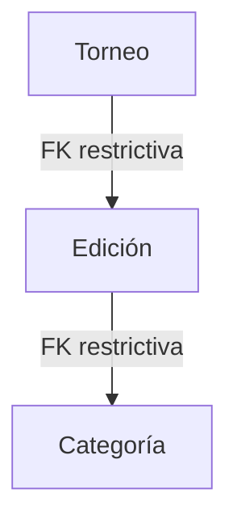

La eliminación de un torneo requiere
que no existan ediciones asociadas.

La eliminación de una edición requiere
que no existan categorías asociadas.

La categoría podrá eliminarse siempre
que no existan dependencias que
impidan la operación.

Actualmente no se encuentran implementadas
las entidades deportivas dependientes
de categorías.

El servicio contempla los errores de
integridad que podrán producir estas
futuras relaciones.

No deberá desactivarse la protección
de claves foráneas para permitir
eliminaciones administrativas.

Orden de eliminación de registros
sin otras dependencias:

```text
CATEGORÍAS
    ↓
EDICIONES
    ↓
TORNEOS
```

Las futuras entidades deberán ampliar
este orden conforme al modelo deportivo.

#### 8.18.18. Presentación y navegación

La pantalla de categorías se encuentra en:

`frontend/src/pages/Categorias.jsx`

Su ruta privada es:

`/torneos/:torneoId/ediciones/:edicionId/categorias`

La navegación utiliza los parámetros
de torneo y edición.

El componente de gestión utiliza una
clave basada en ambos identificadores
para distinguir los contextos.

La carga de información contempla
cancelación mediante AbortController.

La interfaz incorpora:

- Navegación de regreso a EDICIONES.
- Referencia jerárquica del contexto.
- Identificación del torneo.
- Identificación de la edición.
- Estados administrativos y deportivos.
- Indicadores generales.
- Búsqueda.
- Filtros.
- Formularios.
- Contadores de caracteres.
- Confirmaciones de operaciones.
- Mensajes de error.
- Mensajes de éxito.
- Estados vacíos.
- Advertencias de restricciones.

Las modificaciones exitosas actualizan
el listado local utilizando las respuestas
del servidor.

Las operaciones fallidas no modifican
anticipadamente los registros locales.

El formulario aplica validaciones
de nombre y descripción.

Las reglas definitivas se comprueban
nuevamente en el backend.

#### 8.18.19. Actualización del estado local

El frontend conserva el listado
completo de categorías cargadas.

La búsqueda local normaliza mayúsculas,
minúsculas, espacios y marcas diacríticas.

Los filtros operan sobre la información
cargada en la pantalla.

Los indicadores internos se calculan
sobre el listado completo.

Las operaciones de creación, edición,
archivado, reactivación y eliminación
actualizan la información local cuando
la respuesta del backend es exitosa.

El contexto de torneo y edición
se recupera mediante la API.

No se utiliza un contexto deportivo
global persistente en esta etapa.

#### 8.18.20. Adaptación responsive

El módulo reutiliza el Sistema de Diseño v1.0
y añade estilos específicos para sus tarjetas,
indicadores y formularios.

En pantallas amplias pueden visualizarse
categorías en dos columnas.

En pantallas pequeñas se reorganizan:

- Cabecera.
- Identificación del contexto.
- Indicadores.
- Buscador.
- Filtros.
- Tarjetas.
- Acciones administrativas.

La adaptación responsive fue comprobada
mediante las herramientas del navegador.

La validación en dispositivos físicos
permanece pendiente.

---

## 9. SEGURIDAD

### 9.1. Controles implementados

- Acceso privado mediante autenticación.
- Hash de contraseñas mediante bcrypt.
- Sesiones persistentes en MySQL.
- Regeneración de sesión al autenticar.
- Cookies HttpOnly.
- Cookies SameSite=Lax.
- Protección de origen en escrituras.
- Configuración CORS.
- Consultas SQL parametrizadas.
- Limitación de intentos de inicio de sesión.
- Credenciales mediante variables de entorno.
- Exclusión de archivos sensibles en Git.
- Protección de endpoints deportivos.
- Validaciones del lado del servidor.
- Validación de pertenencia jerárquica.
- Restricciones referenciales.

El endpoint DELETE se encuentra sujeto
a los mismos controles de autenticación
y origen que las restantes escrituras.

### 9.2. Información sensible

Los siguientes elementos no deberán
publicarse en el repositorio:

- Contraseñas.
- Secretos de sesión.
- Archivos de entorno privados.
- Respaldos de bases de datos.
- Registros con datos personales.

Las futuras listas de buena fe
contendrán información personal.

Su tratamiento deberá incorporar
controles específicos de privacidad.

Las capturas de pantalla deberán revisarse
antes de publicarse para evitar la exposición
innecesaria de información privada.

### 9.3. Pendientes para producción

- HTTPS.
- Configuración segura de producción.
- Revisión de cookies y dominios.
- Política de rotación de credenciales.
- Respaldos periódicos.
- Revisión del limitador de solicitudes.
- Gestión integral de expiración de sesión.
- Monitoreo operativo.
- Evaluación de seguridad.

### 9.4. Seguridad del contexto deportivo

Los identificadores incluidos en una ruta
no constituyen una prueba de pertenencia.

El backend debe comprobar las relaciones
entre torneo, edición y categoría.

Las operaciones sobre categorías ajenas
al contexto solicitado devuelven HTTP 404.

No deberá revelarse información deportiva
de otros contextos mediante combinaciones
incorrectas de identificadores.

Las pruebas de integración de HU-006
verificaron el aislamiento de:

- Consultas individuales.
- Actualizaciones.
- Cambios de estado.
- Eliminaciones.

---

## 10. PERSISTENCIA

### 10.1. Fuente de verdad

MySQL constituye la fuente de
verdad de los datos persistentes.

El estado almacenado en React
representa información utilizada
para la presentación.

Las validaciones definitivas
deberán realizarse en el backend
y mediante restricciones de
integridad de la base de datos.

### 10.2. Migraciones

Las modificaciones estructurales
deberán realizarse mediante
migraciones SQL versionadas.

```text
database/migrations/
├── 001_usuarios.sql
├── 002_torneos.sql
├── 003_ediciones.sql
└── 004_categorias.sql
```

| Versión | Responsabilidad |
|---|---|
| 001 | Usuarios administrativos |
| 002 | Gestión de torneos |
| 003 | Gestión de ediciones y relación con torneos |
| 004 | Gestión de categorías y relación con ediciones |

El migrador contempla:

- Orden de ejecución.
- Registro de migraciones.
- Verificación de checksums.
- Control de ejecución concurrente.
- Verificación estructural.
- Identificación de migraciones aplicadas.
- Identificación de ejecuciones incompletas.

Las migraciones aplicadas no deberán
modificarse posteriormente.

Toda modificación estructural
deberá incorporarse mediante
una nueva migración.

La incorporación de la eliminación
definitiva en HU-004 no requirió modificar
las migraciones existentes.

HU-005 añade `003_ediciones.sql` y amplía
la verificación estructural del migrador.

HU-006 añade `004_categorias.sql` e incorpora
su correspondiente verificador estructural.

Las migraciones 001, 002 y 003 se conservan.

### 10.3. Integridad

Las restricciones, relaciones
e índices deberán proteger
la consistencia de los datos.

Las operaciones que involucren
múltiples escrituras relacionadas
deberán utilizar transacciones
cuando corresponda.

MySQL puede efectuar confirmaciones
implícitas durante operaciones DDL.

El migrador no deberá presuponer
que todas las modificaciones
estructurales pueden revertirse
mediante una transacción convencional.

Las restricciones deportivas actualmente
implementadas incluyen:

- Unicidad de torneos.
- Unicidad de ediciones dentro de cada torneo.
- Unicidad de categorías dentro de cada edición.
- Coherencia cronológica de fechas de ediciones.
- Relación restrictiva torneo-edición.
- Relación restrictiva edición-categoría.

### 10.4. Conservación histórica

No deberán eliminarse datos
deportivos históricos sin una
política previamente definida.

El archivado constituye un mecanismo
administrativo reversible de conservación
de torneos y categorías.

La finalización representa el cierre
deportivo de una edición y admite
reapertura según las reglas vigentes.

La eliminación definitiva podrá
utilizarse para registros sin
dependencias incompatibles.

Las futuras relaciones deportivas
deberán proteger la información
histórica mediante restricciones
adecuadas.

### 10.5. Verificaciones históricas

#### HU-004 — v0.2.0

| Control | Resultado |
|---|---|
| Base de datos | alto_sistema |
| Migraciones registradas | 2 |
| Migraciones pendientes | 0 |
| Errores | 0 |
| Estado | Actualizada |

#### HU-005 — v0.3.0

| Base de datos | Migraciones aplicadas | Pendientes |
|---|---:|---:|
| alto_sistema | 3 | 0 |
| altosistemahu004test | 3 | 0 |
| altosistemahu005fresh | 3 | 0 |

La instalación limpia y la repetición
de las migraciones sobre una base nueva
fueron verificadas.

No se modificó la base principal durante
las pruebas aisladas de instalación.

### 10.6. Verificación de HU-006

La migración 004 fue aplicada
sobre las instalaciones existentes.

| Base de datos | Migraciones aplicadas |
|---|---:|
| alto_sistema | 4/4 |
| altosistemahu004test | 4/4 |

La aplicación de la migración
fue satisfactoria en ambos casos.

La base de pruebas se utilizó
posteriormente para la integración
de categorías y las regresiones
de torneos y ediciones.

Pendientes de cierre técnico:

- Instalación limpia de las cuatro migraciones.
- Comprobación de idempotencia de v0.4.0.
- Verificación final del inventario de migraciones.

### 10.7. Respaldo preventivo

Antes de iniciar HU-006 se realizó
un respaldo de la base principal
correspondiente a v0.3.0.

Los respaldos se conservan fuera
del repositorio Git.

La restauración de un respaldo
que incluya las entidades deportivas
deberá verificarse en un entorno
aislado.

La existencia del archivo de respaldo
no garantiza por sí sola la capacidad
de recuperación.

Los procedimientos operativos se encuentran
en [MANTENIMIENTO.md](MANTENIMIENTO.md).

---

## 11. ARQUITECTURA MULTITORNEO

### 11.1. Jerarquía objetivo

```text
Torneo
└── Edición
    └── Categoría
        ├── Fases
        ├── Zonas
        ├── Equipos inscritos
        ├── Jornadas
        ├── Partidos
        ├── Copas
        └── Estadísticas
```

La estructura representa la
jerarquía deportiva objetivo.

No implica que todas sus entidades
se encuentren implementadas actualmente.

### 11.2. Estado de implementación

| Entidad o contexto | Estado |
|---|---|
| Torneo | Implementado y consolidado |
| Edición | Implementada y consolidada |
| Categoría | Implementada y verificada en HU-006 |
| Identidad visual | Pendiente |
| Selección global del contexto deportivo | Pendiente |
| Restantes entidades deportivas | Pendiente |

Modelo relacional implementado:

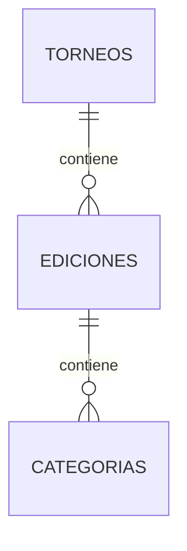

Cada torneo puede contener
múltiples ediciones.

Cada edición puede contener
múltiples categorías.

Cada categoría pertenece
a una única edición.

Cada edición pertenece
a un único torneo.

### 11.3. Independencia de datos

Los datos deportivos deberán
vincularse al contexto correcto.

La separación deberá garantizarse
en frontend, backend y persistencia.

No deberán existir en el código
de negocio valores predefinidos para:

- Nombres de torneos.
- Nombres de ediciones.
- Nombres de categorías.
- Cantidades de equipos.
- Cantidades de zonas.
- Formatos de competición.

Las competiciones deberán poder
configurarse según sus necesidades.

Los ejemplos utilizados en formularios,
documentación y pruebas no constituyen
reglas deportivas obligatorias.

### 11.4. Reglas transversales

Las reglas que involucren
múltiples categorías o torneos
deberán definirse expresamente.

Esto incluye las futuras reglas
de disciplina y habilitación.

Los datos deberán permanecer
independientes salvo cuando
una regla deportiva aprobada
establezca una relación transversal.

### 11.5. Evolución prevista

La ETAPA 02 contempla:

| Historia | Responsabilidad | Estado |
|---|---|---|
| HU-004 | Gestión de torneos | Consolidada en v0.2.0 |
| HU-005 | Gestión de ediciones | Consolidada en v0.3.0 |
| HU-006 | Gestión de categorías | Verificada en v0.4.0; cierre pendiente |
| HU-007 | Identidad visual de competiciones | Pendiente |
| HU-008 | Selección del contexto deportivo | Pendiente |

Las etapas posteriores deberán
utilizar el contexto deportivo
correspondiente.

### 11.6. Contexto deportivo implementado

La jerarquía actualmente permite
administrar los tres niveles
mediante navegación dependiente.

```text
TORNEOS
    ↓
EDICIONES DEL TORNEO
    ↓
CATEGORÍAS DE LA EDICIÓN
```

La identidad del contexto se conserva
mediante identificadores de ruta.

La selección global de una combinación
torneo-edición-categoría para operar
sobre otros módulos será responsabilidad
de HU-008.

No deberá introducirse anticipadamente
un mecanismo global que contradiga
las reglas de esa historia.

---

## 12. PRINCIPIOS DE DESARROLLO

Se establecen los siguientes
principios de diseño:

- SOLID.
- DRY.
- KISS.
- Separación de responsabilidades.
- Bajo acoplamiento.
- Alta cohesión.
- Reutilización de componentes.
- Normalización de datos.
- Validaciones del lado del servidor.
- Control de versiones mediante Git.
- Pruebas automatizadas.
- Documentación versionada.

El desarrollo deberá favorecer
soluciones simples y mantenibles.

No deberán incorporarse niveles
de abstracción innecesarios
sin una justificación funcional
o arquitectónica.

Cada historia de usuario deberá
respetar las decisiones previamente
aprobadas.

Las correcciones de errores deberán
preservar los criterios de aceptación.

No se deberán modificar las pruebas
exclusivamente para ocultar un fallo
de implementación.

---

## 13. ESCALABILIDAD

La arquitectura deberá permitir:

- Múltiples torneos simultáneos.
- Múltiples ediciones.
- Nuevas categorías.
- Nuevos formatos deportivos.
- Reglamentos configurables.
- Identidades visuales independientes.
- Conservación del historial.
- Incorporación de funcionalidades.

Se mantiene el monolito modular
como estrategia arquitectónica.

No se considera necesaria
actualmente una arquitectura
de microservicios.

La capacidad de carga real
deberá comprobarse mediante
mediciones y pruebas.

### 13.1. Evolución del acceso a datos

El listado completo de torneos, ediciones
y categorías, junto con su filtrado local,
resulta adecuado para el alcance
administrativo inicial.

Cuando el volumen de información
lo requiera, podrán incorporarse:

- Paginación del lado del servidor.
- Filtros especializados.
- Índices adicionales.
- Consultas optimizadas.
- Indicadores agregados por contexto.
- Carga diferida de información.

Estas mejoras deberán justificarse
mediante necesidades reales.

### 13.2. Rendimiento del frontend

Se priorizará:

- Reutilización de estilos.
- Reducción de duplicaciones.
- Distribución local de recursos.
- Cancelación de consultas innecesarias.
- Actualización del estado local mediante respuestas de la API.

La optimización de fuentes
y la división del código
podrán evaluarse posteriormente.

### 13.3. Indicadores jerárquicos

Actualmente:

| Pantalla | Indicadores internos | Indicadores de entidades hijas |
|---|---|---|
| TORNEOS | Calculados sobre listado cargado | Consultas adicionales de ediciones |
| EDICIONES | Calculados sobre listado cargado | Consultas adicionales de categorías |
| CATEGORÍAS | Calculados sobre listado cargado | No implementados |

Los indicadores de ediciones en TORNEOS
utilizan concurrencia limitada.

Los indicadores de categorías en EDICIONES
se consultan individualmente por tarjeta visible.

Este mecanismo puede incrementar la cantidad
de solicitudes a medida que aumenta el número
de registros.

La optimización futura podrá incluir:

- Indicadores agregados en las consultas principales.
- Agrupación SQL por contexto.
- Reducción de solicitudes HTTP.
- Limitación de concurrencia.
- Carga diferida según necesidades de presentación.

No se establece todavía una estrategia
definitiva de optimización sin mediciones
que justifiquen el cambio.

---

## 14. CALIDAD Y PRUEBAS

### 14.1. Estrategia

El proyecto contempla:

- Pruebas unitarias.
- Pruebas de integración.
- Verificación estructural.
- Pruebas de regresión.
- Análisis estático.
- Compilación de producción.
- Revisión visual.
- CHECK integral por historia de usuario.

### 14.2. Aislamiento de pruebas

Las pruebas de integración de torneos,
ediciones y categorías utilizan una base
de datos independiente.

Base de pruebas:

`altosistemahu004test`

Puerto del backend de pruebas:

`3001`

Las pruebas deberán evitar
modificaciones accidentales
de los datos principales.

Los registros temporales deberán
limpiarse de manera controlada.

HU-005 reutilizó la base de pruebas
con la migración 003 aplicada.

HU-006 reutiliza la misma base
con la migración 004 aplicada.

La instalación limpia de HU-005 se verificó
separadamente en `altosistemahu005fresh`.

La regresión de autenticación HTTP se realizó
contra el backend principal del puerto 3000.

### 14.3. Resultados definitivos de HU-004

| Control | Resultado |
|---|---|
| Pruebas unitarias de autenticación | 13/13 |
| Pruebas unitarias de torneos | 30/30 |
| Integración de autenticación | 1/1 |
| Integración de torneos | 1/1 |
| Total de pruebas automatizadas | 45/45 |
| Controles internos de integración | 20/20 |
| Pruebas fallidas | 0 |
| ESLint: errores | 0 |
| ESLint: advertencias | 0 |
| Compilación de producción | Exitosa |
| Tiempo de compilación final | 3,49 segundos |
| Revisión visual inicial | 8/8 |
| Validación funcional | Satisfactoria |
| Limpieza de torneos temporales | Completada |
| Migraciones pendientes | 0 |

Las 45 pruebas automatizadas contemplan:

- 43 pruebas unitarias.
- 2 pruebas de integración.

Los resultados se obtuvieron mediante
ejecuciones separadas.

Los 20 controles internos forman parte
de una única prueba de integración
y no se contabilizan como pruebas
automatizadas adicionales.

### 14.4. Verificaciones de persistencia

Durante las etapas anteriores
se realizaron controles de:

- Ejecución de migraciones.
- Idempotencia.
- Verificación estructural.
- Migraciones sobre una base nueva.
- Respaldo de base de datos.
- Restauración de respaldo de v0.1.3.
- Persistencia de registros.
- Unicidad de nombres.
- Eliminación física de registros.
- Reutilización de nombres.
- Independencia de contextos.

La incorporación de nuevas entidades
requiere ampliar las verificaciones
correspondientes.

### 14.5. Verificación de eliminación

La ampliación de HU-004 incorporó
seis pruebas unitarias adicionales
para la eliminación de torneos.

Se verificaron:

- Eliminación de torneos activos.
- Eliminación de torneos archivados.
- Rechazo de identificadores inválidos.
- Rechazo de registros inexistentes.
- Tratamiento de errores de dependencia.
- Propagación de errores inesperados.

HU-005 incorporó la verificación real
de integridad referencial torneo-edición.

HU-006 incorpora la verificación real
de integridad referencial edición-categoría.

La independencia de registros y las
restricciones de eliminación fueron
comprobadas mediante integración con MySQL.

La interfaz utiliza confirmaciones
explícitas para operaciones destructivas.

### 14.6. Verificaciones pendientes generales

- Pruebas automatizadas del frontend.
- Pruebas visuales automatizadas.
- Auditoría formal de accesibilidad.
- Pruebas de rendimiento y carga.
- Validación en dispositivos móviles físicos.
- Restauración de respaldos con las tablas deportivas implementadas.
- Verificación real de claves foráneas de entidades deportivas futuras.
- Evaluación de seguridad de producción.
- Despliegue en producción.

Estos controles corresponden a
validaciones futuras o a entidades
todavía no implementadas.

### 14.7. Resultados de HU-005 — v0.3.0

| Control | Resultado |
|---|---|
| Pruebas unitarias de ediciones | 59/59 |
| Regresión unitaria de torneos | 30/30 |
| Regresión unitaria de autenticación | 13/13 |
| Integración de ediciones | 1/1 |
| Integración de torneos | 1/1 |
| Integración de autenticación | 1/1 |
| Total de pruebas automatizadas | 105/105 |
| Fallidas en las ejecuciones satisfactorias | 0 |
| ESLint | Sin errores informados |
| Compilación de producción | Exitosa |
| Validaciones funcionales | 17/17 |
| Migración sobre instalación existente | Exitosa |
| Migración desde cero | 3/3 aplicadas |
| Idempotencia de instalación nueva | 3 registradas, 0 pendientes |
| Integridad referencial torneo-edición | Verificada |
| Limpieza de registros temporales | Completada |
| Coherencia de versiones | 8/8 valores en 0.3.0 |
| Capturas oficiales | 12 |
| Cierre y publicación | Completados |

Las 105 pruebas corresponden a
102 unitarias y tres integraciones
ejecutadas por separado.

La integración de EDICIONES contempla
14 bloques internos de verificación,
que no se suman al total de pruebas.

Las validaciones funcionales incluyeron:

- Creación.
- Edición.
- Fechas opcionales.
- Inicio.
- Finalización.
- Reapertura.
- Simultaneidad.
- Búsqueda.
- Filtros.
- Indicadores.
- Archivado.
- Eliminación.
- Integridad referencial.
- Adaptación responsive.

La validación móvil se documentó
mediante la captura histórica
`28-movil-ediciones-v030.png`.

HU-005 se encuentra consolidada
en la versión 0.3.0.

### 14.8. Resultados de HU-006 — v0.4.0

#### 14.8.1. Pruebas automatizadas

| Tipo | Resultado |
|---|---:|
| Unitarias de autenticación | 13/13 |
| Unitarias de torneos | 30/30 |
| Unitarias de ediciones | 59/59 |
| Unitarias de categorías | 111/111 |
| Integración de autenticación | 1/1 |
| Integración de torneos | 1/1 |
| Integración de ediciones | 1/1 |
| Integración de categorías | 1/1 |
| **Total acumulado aprobado** | **217/217** |

El total corresponde a:

- 213 pruebas unitarias.
- 4 pruebas de integración.

Las integraciones se ejecutan
mediante habilitación explícita.

Las repeticiones de pruebas de regresión
no se contabilizan como pruebas nuevas.

#### 14.8.2. Pruebas unitarias de categorías

El archivo `categoria.service.test.js`
contempla 111 pruebas unitarias.

Grupos de verificación:

1. Listado y contexto.
2. Filtros y búsqueda.
3. Identificadores.
4. Consulta individual.
5. Creación.
6. Actualización.
7. Cambios de estado.
8. Eliminación definitiva.
9. Errores de persistencia.
10. Transacciones y bloqueos.
11. Consistencia de indicadores.

El repositorio se sustituye por una
implementación simulada durante
las pruebas del servicio.

Esta estrategia permite verificar
las reglas de negocio sin modificar
una base de datos real.

Resultado de la primera ejecución:

| Control | Resultado |
|---|---:|
| Pruebas | 111 |
| Aprobadas | 111 |
| Fallidas | 0 |
| Canceladas | 0 |
| Omitidas | 0 |
| Duración | 151,5432 ms |

#### 14.8.3. Prueba integral de categorías

El archivo `categoria.integration.test.js`
contiene una prueba integral que
agrupa 28 controles internos.

| N.º | Control |
|---:|---|
| 01 | Verificación de base aislada |
| 02 | Disponibilidad del servidor |
| 03 | Protección sin autenticación |
| 04 | Autenticación y aislamiento de sesión |
| 05 | Creación del contexto de prueba |
| 06 | Estado inicial vacío |
| 07 | Control de origen |
| 08 | Validaciones de creación |
| 09 | Creación correcta |
| 10 | Unicidad por edición |
| 11 | Independencia entre contextos |
| 12 | Consulta individual |
| 13 | Validación de identificadores |
| 14 | Aislamiento de operaciones |
| 15 | Edición de categorías |
| 16 | Archivado y reactivación |
| 17 | Filtros y búsqueda |
| 18 | Estados inválidos |
| 19 | Edición en curso |
| 20 | Edición finalizada |
| 21 | Reapertura de edición |
| 22 | Torneo archivado |
| 23 | Reactivación del torneo |
| 24 | Integridad referencial |
| 25 | Persistencia real |
| 26 | Eliminación definitiva |
| 27 | Eliminación de contextos vacíos |
| 28 | Cierre de sesión |

Durante la primera ejecución
se superaron los primeros 16 controles.

El control 17 detectó un fallo
en la búsqueda de descripciones
con caracteres acentuados.

Se corrigió el repositorio de categorías
sin modificar la prueba de integración.

Resultado de la segunda ejecución:

| Control | Resultado |
|---|---:|
| Pruebas de integración | 1 |
| Aprobadas | 1 |
| Fallidas | 0 |
| Canceladas | 0 |
| Omitidas | 0 |
| Controles internos superados | 28/28 |
| Duración | 2723,073 ms |

La prueba integra solicitudes HTTP
y operaciones reales sobre MySQL.

Los controles internos no representan
28 pruebas independientes para el
ejecutor de Node.js.

#### 14.8.4. Aislamiento y limpieza

La integración utiliza:

- Base `altosistemahu004test`.
- Backend en el puerto 3001.
- Administrador ficticio `admin_pruebas`.
- Identificadores de prueba mediante UUID.

Antes de crear registros se verifica
la base seleccionada y la pertenencia
de la sesión al entorno aislado.

La limpieza se ejecuta mediante
una transacción sobre los contextos
ficticios identificados.

Orden de limpieza:

1. Categorías.
2. Ediciones.
3. Torneos.

No se desactivan las restricciones
de integridad referencial.

La limpieza fue satisfactoria
tanto en la ejecución fallida
como en la ejecución aprobada.

#### 14.8.5. Regresión final

La última ejecución documentada
mediante `npm test` registró:

| Control | Resultado |
|---|---:|
| Pruebas detectadas | 217 |
| Aprobadas | 213 |
| Omitidas intencionalmente | 4 |
| Fallidas | 0 |
| Canceladas | 0 |
| TODO | 0 |
| Duración | 586,1809 ms |

Las cuatro integraciones fueron
ejecutadas y aprobadas por separado.

El resultado acumulado es 217/217.

Las duraciones corresponden
al entorno local de desarrollo.

No constituyen pruebas de rendimiento
o carga del sistema.

#### 14.8.6. Validación funcional

| N.º | Control |
|---:|---|
| 01 | Integración con EDICIONES |
| 02 | Estado inicial vacío |
| 03 | Creación sin descripción |
| 04 | Creación con descripción |
| 05 | Prevención de duplicados |
| 06 | Edición |
| 07 | Archivado |
| 08 | Reactivación |
| 09 | Búsqueda y filtros |
| 10 | Actualización de indicadores |
| 11 | Independencia entre ediciones |
| 12 | Restricciones de edición finalizada |
| 13 | Reapertura de edición |
| 14 | Restricciones de torneo archivado |
| 15 | Integridad referencial |
| 16 | Eliminación de registros |
| 17 | Adaptación responsive |

Los controles funcionales fueron
revisados y confirmados por el
administrador durante el desarrollo.

La eliminación ordenada y la conservación
de contextos independientes cuentan
además con respaldo de la prueba
automatizada de integración.

La adaptación responsive corresponde
a emulación mediante el navegador.

#### 14.8.7. Evidencias visuales

HU-006 incorpora cinco capturas esenciales.

| Archivo | Evidencia |
|---|---|
| `30-ediciones-categorias-v040.png` | Integración con EDICIONES |
| `31-categorias-listado-v040.png` | Listado y estados administrativos |
| `32-categorias-formulario-v040.png` | Formulario de creación |
| `33-movil-categorias-v040.png` | Adaptación móvil |
| `34-pruebas-v040.png` | Regresión automatizada |

Las capturas se documentan
en el README principal.

Las evidencias históricas se conservan.

No se requiere repetir capturas
de funcionalidades anteriores
que no hayan sufrido cambios relevantes.

#### 14.8.8. Estado del cierre técnico

| Control | Resultado |
|---|---|
| Implementación del backend | Completada |
| Implementación del frontend | Completada |
| Migración de base principal | Satisfactoria |
| Migración de base de pruebas | Satisfactoria |
| Pruebas unitarias | 213/213 |
| Pruebas de integración | 4/4 |
| Controles de integración de categorías | 28/28 |
| Validaciones funcionales | Revisadas |
| Validación responsive | Confirmada mediante emulación |
| Backend v0.4.0 | Operativo |
| Frontend v0.4.0 | Operativo |
| Capturas esenciales | 5/5 revisadas |
| Instalación limpia de cuatro migraciones | Pendiente |
| Idempotencia final | Pendiente |
| ESLint final | Pendiente |
| Compilación de producción final | Pendiente |
| Limpieza final de datos demostrativos | Pendiente de confirmación |
| CHECK integral | Pendiente |
| Publicación en Git | Pendiente |

---

## 15. CONTROL ARQUITECTÓNICO

Cada historia de usuario deberá:

1. Respetar la arquitectura definida.
2. Mantener la separación de responsabilidades.
3. Reutilizar los servicios existentes.
4. Respetar el Sistema de Diseño.
5. Proteger los datos privados.
6. Incorporar migraciones cuando corresponda.
7. Incorporar pruebas automatizadas.
8. Superar su CHECK integral.
9. Actualizar la documentación.
10. Registrar los cambios mediante Git.

Las modificaciones arquitectónicas
significativas deberán documentarse
antes de consolidarse.

La aprobación de una historia
de usuario requerirá verificar
sus criterios de aceptación.

La existencia de código implementado
no constituye por sí misma una
aprobación funcional.

### 15.1. Control de integridad jerárquica

Toda futura entidad dependiente
deberá definir expresamente:

- Contexto deportivo al que pertenece.
- Claves primarias y foráneas.
- Restricciones de unicidad.
- Operaciones permitidas.
- Comportamiento ante archivado.
- Comportamiento ante finalización.
- Reglas de eliminación.
- Necesidad de transacciones.
- Aislamiento entre contextos.

No deberán incorporarse relaciones
ambiguas que permitan mezclar
registros de distintas competiciones.

### 15.2. Criterio de documentación

Cada incremento deberá documentar:

- Funcionalidades incorporadas.
- Componentes creados o modificados.
- Decisiones arquitectónicas.
- Restricciones de negocio.
- Migraciones.
- Pruebas realizadas.
- Limitaciones conocidas.
- Evidencias visuales relevantes.

Las verificaciones pendientes
deberán identificarse expresamente.

No deberán registrarse como aprobados
controles que todavía no fueron
ejecutados o confirmados.

---

## 16. EVOLUCIÓN ARQUITECTÓNICA

| Versión | Incorporación principal |
|---|---|
| 0.1.0 | Infraestructura inicial |
| 0.1.1 | Autenticación privada |
| 0.1.2 | Interfaz administrativa |
| 0.1.3 | Consolidación arquitectónica |
| 0.2.0 | Gestión integral de torneos y Sistema de Diseño v1.0 |
| 0.3.0 | Gestión de ediciones, integridad referencial y navegación dependiente del torneo |
| 0.4.0 | Gestión de categorías, navegación jerárquica y consolidación del tercer nivel deportivo |

La versión 0.2.0 incorpora el primer
módulo deportivo con un ciclo de vida
administrativo completo.

La versión 0.3.0 incorpora el segundo nivel
jerárquico del modelo multitorneo y el ciclo
de vida deportivo de sus ediciones.

La versión 0.4.0 incorpora el tercer nivel
jerárquico del modelo multitorneo.

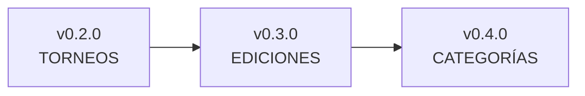

### 16.1. Decisiones arquitectónicas de HU-006

| Decisión | Justificación |
|---|---|
| Mantener el monolito modular | Preservar la arquitectura existente |
| Vincular categorías exclusivamente a ediciones | Evitar duplicación de contexto |
| Utilizar unicidad compuesta | Permitir nombres repetidos en distintos contextos |
| Mantener claves foráneas restrictivas | Proteger la información deportiva |
| No realizar cambios de estado en cascada | Preservar los ciclos de vida independientes |
| Bloquear primero el torneo y después la edición | Mantener un orden jerárquico de escrituras |
| Reutilizar el servicio API | Evitar duplicación de infraestructura |
| Reutilizar el Sistema de Diseño | Mantener coherencia visual |
| Consultar indicadores desde cada tarjeta visible | Evitar modificar el contrato de EDICIONES |
| Aplicar LIKE con intercalación explícita en categorías | Corregir el fallo de búsqueda detectado |
| Conservar la navegación dependiente | Evitar anticipar la selección global de contexto |

### 16.2. Próxima evolución

HU-007 incorporará la identidad visual
de las competiciones.

HU-008 incorporará la selección
global del contexto deportivo.

Las funcionalidades posteriores
deberán apoyarse sobre la jerarquía
de torneos, ediciones y categorías.

La arquitectura deberá evolucionar
junto con las funcionalidades
aprobadas del proyecto.

No se iniciará HU-007 hasta completar
formalmente el cierre de HU-006.

---

**ALTO-SISTEMA**

Sistema integral de gestión deportiva.