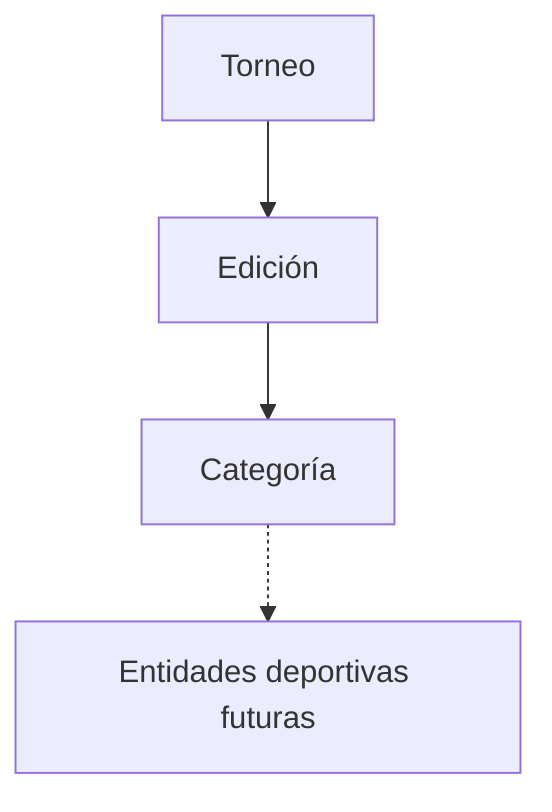
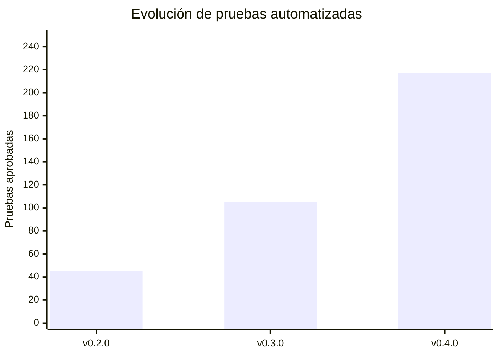

# ALTO-SISTEMA — Normas de desarrollo

Versión de referencia: 0.4.0

Estado: HU-004 y HU-005 aprobadas y consolidadas.

HU-006 implementada y verificada técnica y funcionalmente.
Consolidación documental, verificaciones finales,
CHECK integral y publicación pendientes.

---

## 1. OBJETIVO

Establecer una metodología de desarrollo que permita
evolucionar ALTO-SISTEMA de manera organizada,
segura, mantenible y escalable.

Las presentes normas serán aplicables durante
todo el ciclo de vida del proyecto.

La calidad técnica deberá mantenerse desde
las primeras etapas de implementación.

El proceso de desarrollo deberá favorecer
la claridad, la eficiencia y la reducción
de operaciones administrativas innecesarias.

---

## 2. METODOLOGÍA DE TRABAJO

El proyecto se desarrollará mediante incrementos
funcionales organizados en etapas e historias
de usuario.

Cada historia de usuario deberá contar con:

- Identificador.
- Objetivo funcional.
- Alcance definido.
- Requisitos.
- Criterios de aceptación.
- Diseño técnico.
- Implementación.
- Pruebas.
- Documentación.
- CHECK integral.

Las historias de usuario deberán desarrollarse
de manera secuencial.

No se comenzará una nueva historia de usuario
hasta aprobar y consolidar la anterior.

### 2.1. Unidad de trabajo

La unidad funcional de desarrollo será
la historia de usuario completa.

Los pasos técnicos permitirán organizar
su implementación, pero no constituirán
historias de usuario independientes.

Se evitará fragmentar innecesariamente
el proceso de validación.

Cada historia de usuario tendrá un único
CHECK integral de aprobación.

### 2.2. Alcance

Las funcionalidades deberán corresponder
al alcance previamente aprobado.

Las modificaciones que amplíen dicho alcance
deberán evaluarse antes de implementarse.

Los cambios complementarios deberán quedar
identificados y documentados.

### 2.3. Ampliaciones durante la validación

Una historia de usuario podrá incorporar
funcionalidades adicionales antes de su
aprobación definitiva.

Toda ampliación deberá contemplar:

- Aprobación funcional.
- Evaluación del impacto técnico.
- Nuevos criterios de aceptación.
- Actualización de pruebas.
- Regresión de funcionalidades existentes.
- Actualización de documentación.

La ampliación no deberá considerarse aprobada
hasta completar el CHECK integral correspondiente.

Durante HU-004 se incorporó la eliminación
definitiva de torneos mediante este procedimiento.

### 2.4. Secuencia operativa

El desarrollo se realizará de a un archivo
o paso operativo por vez.

Cada instrucción deberá identificar claramente:

- Qué debe realizarse.
- Dónde debe realizarse.
- Qué archivo se encuentra involucrado.
- Qué resultado se espera.

No deberán acumularse instrucciones
correspondientes a pasos posteriores
cuando dependan del resultado actual.

Podrán realizarse conjuntamente aquellas
operaciones que necesariamente involucren
archivos relacionados, como la actualización
de package.json y package-lock.json mediante npm.

Las confirmaciones operativas intermedias
permiten continuar la implementación,
pero no sustituyen el CHECK integral.

---

## 3. PUERTA DE CONTROL

Cada incremento atravesará las siguientes fases:

1. Definición funcional.
2. Aprobación del alcance.
3. Diseño técnico.
4. Implementación.
5. Pruebas automatizadas.
6. Verificación funcional.
7. Actualización de documentación.
8. CHECK integral.
9. Aprobación.
10. Consolidación mediante Git.

### 3.1. CHECK integral

Cada historia de usuario dispondrá de un
CHECK integral que abarque todos sus
criterios de aceptación.

Los controles técnicos intermedios no
sustituyen esta instancia.

El CHECK deberá contemplar:

- Requisitos funcionales.
- Validaciones.
- Persistencia.
- Integridad de datos.
- Seguridad.
- Interfaz.
- Adaptación responsive.
- Pruebas automatizadas.
- Regresión de funcionalidades anteriores.
- Documentación.
- Coherencia de versiones.
- Limpieza de registros temporales.

### 3.2. Gestión de errores

Cuando se detecte un error bloqueante:

1. Se interrumpirá el avance.
2. Se identificará su origen.
3. Se determinará su alcance.
4. Se implementará la corrección.
5. Se repetirán las pruebas afectadas.
6. Se verificará que no existan regresiones.

No se aprobará una historia de usuario
mientras existan errores que impidan
satisfacer sus criterios de aceptación.

Los posibles errores deberán comprobarse
antes de modificar el código fuente.

No deberán modificarse las pruebas
únicamente para ocultar un defecto
de implementación.

### 3.3. Estados de implementación

| Estado | Significado |
|---|---|
| Pendiente | Sin implementación |
| En desarrollo | Implementación en curso |
| Implementado | Código incorporado |
| Verificado | Pruebas correspondientes realizadas |
| Aprobado | CHECK integral satisfactorio |
| Consolidado | Cambios registrados y publicados mediante Git |

La existencia de código no implica
automáticamente su aprobación.

### 3.4. Correcciones durante una historia abierta

Las correcciones de errores detectados
durante el desarrollo de una historia
forman parte del mismo incremento.

No requieren necesariamente una nueva
versión de parche mientras el incremento
todavía no haya sido consolidado.

Durante HU-006 se corrigió un fallo
de búsqueda SQL manteniendo la versión
prevista 0.4.0 y los criterios originales
de la prueba de integración.

---

## 4. ENTREGA DE ARCHIVOS E INSTRUCCIONES

### 4.1. Archivos completos

Los archivos nuevos o modificados deberán
entregarse con su contenido completo.

No se utilizarán fragmentos aislados que
puedan provocar errores de integración.

Cada entrega deberá indicar:

- Ruta exacta.
- Nombre del archivo.
- Responsabilidad.
- Cambios incorporados.
- Dependencias, cuando corresponda.
- Procedimiento de implementación.

Se conservarán las funcionalidades
existentes que no formen parte
de la modificación solicitada.

### 4.2. Editor de código

Las operaciones de creación y modificación
de código fuente se realizarán mediante
el editor de VS Code.

Esto comprende:

- Archivos JavaScript.
- Componentes JSX.
- Estilos CSS.
- Configuraciones.
- Migraciones SQL.
- Archivos Markdown.

La documentación deberá actualizarse
directamente desde el editor.

No se utilizarán scripts de terminal para
reescribir documentos Markdown cuando
puedan editarse directamente.

### 4.3. Terminal

La terminal se utilizará principalmente para:

- Instalación de dependencias.
- Ejecución de servidores.
- Compilación.
- Análisis estático.
- Pruebas automatizadas.
- Ejecución de migraciones.
- Operaciones de base de datos.
- Respaldos y restauraciones.
- Actualización de versiones de paquetes.
- Control de versiones mediante Git.

Las instrucciones deberán identificar
la terminal y el directorio de trabajo.

No deberán solicitarse comandos de terminal
para recuperar el contenido completo de archivos
cuando puedan compartirse directamente desde
el árbol del proyecto de VS Code.

La terminal podrá utilizarse para inspeccionar
líneas específicas, diagnósticos o información
técnica cuando exista una necesidad concreta.

### 4.4. Operaciones controladas

Las operaciones que puedan modificar
información persistente deberán indicar
su alcance y sus posibles consecuencias.

Se evitarán instrucciones innecesariamente
complejas cuando exista una alternativa
directa, comprensible y segura.

Las operaciones destructivas deberán
identificar expresamente los registros
o archivos afectados.

### 4.5. Entrega directa de código

A partir de HU-006 se establece como
modalidad preferente la entrega de código
completo directamente en la conversación.

El administrador podrá copiar el contenido
y reemplazar el archivo correspondiente
mediante el editor de VS Code.

Esta modalidad sustituye la entrega
habitual mediante paquetes ZIP cuando
se modifica un archivo individual.

Sus objetivos son:

- Reducir tiempos de implementación.
- Evitar descargas innecesarias.
- Evitar operaciones de extracción.
- Evitar traslados de archivos.
- Facilitar la revisión del contenido.
- Mantener el control de cada modificación.

El contenido deberá entregarse en bloques
de código completos y adecuados al tipo
de archivo correspondiente.

### 4.6. Solicitud de archivos existentes

Cuando resulte necesario conocer el contenido
actual de un archivo, se indicará su ruta
dentro del árbol del proyecto.

Ejemplo:

```text
docs/ARQUITECTURA.md
```

El administrador podrá compartirlo directamente
desde VS Code.

No deberá solicitarse innecesariamente
la ejecución de Get-Content, cat u otros
comandos equivalentes para obtener archivos
completos.

Las modificaciones deberán basarse en
el contenido vigente del archivo.

No se deberá reconstruir un archivo existente
a partir de suposiciones cuando resulte
necesario preservar su implementación.

### 4.7. Actualizaciones mediante paquetes ZIP

Los paquetes ZIP podrán utilizarse cuando:

- El administrador los solicite expresamente.
- Existan recursos que no puedan entregarse como código.
- Se requiera una distribución conjunta justificada.
- La modalidad haya sido acordada previamente.

El paquete deberá:

- Respetar la estructura del proyecto.
- Contener únicamente los archivos necesarios.
- Verificar la integridad del paquete y sus archivos.
- Indicar el destino exacto de extracción.
- Identificar los cambios incorporados.
- Excluir credenciales y configuraciones privadas.
- Excluir dependencias instaladas.
- Excluir respaldos de bases de datos.

La instalación podrá realizarse desde
el Explorador de Windows.

No deberán eliminarse carpetas originales
completas para instalar una actualización parcial.

Toda actualización deberá superar las pruebas
correspondientes en el entorno local.

### 4.8. Reinicio de procesos

Los servidores deberán reiniciarse cuando
las modificaciones afecten archivos cargados
por procesos que no se actualizan automáticamente.

Se evitará detener servidores innecesariamente
durante la edición de archivos.

Los cambios del backend deberán incorporarse
al proceso en ejecución mediante un reinicio
controlado cuando corresponda.

Las modificaciones del frontend podrán
aprovechar la actualización automática
del entorno Vite.

Los cambios de versión y configuración
deberán comprobarse mediante el reinicio
correspondiente.

### 4.9. Comunicación de errores

El administrador informará los errores
detectados durante la implementación.

No será necesario solicitar reiteradamente
confirmaciones de ausencia de errores
del editor después de cada modificación.

Cuando exista un problema, se procederá
con su diagnóstico y corrección antes
de continuar con los pasos dependientes.

---

## 5. PRINCIPIOS DE PROGRAMACIÓN

El desarrollo adoptará:

- SOLID.
- DRY.
- KISS.
- Alta cohesión.
- Bajo acoplamiento.
- Responsabilidades delimitadas.
- Reutilización.
- Validación de entradas.
- Tratamiento explícito de errores.

Las soluciones deberán responder
a necesidades concretas del sistema.

No se incorporarán abstracciones,
dependencias o mecanismos complejos
sin una justificación técnica.

---

## 6. CONVENCIONES DE NOMBRES

### 6.1. Backend

Los archivos se identificarán según
su entidad y responsabilidad.

Ejemplos:

- `torneo.routes.js`
- `torneo.controller.js`
- `torneo.service.js`
- `torneo.repository.js`
- `edicion.routes.js`
- `edicion.controller.js`
- `edicion.service.js`
- `edicion.repository.js`
- `categoria.routes.js`
- `categoria.controller.js`
- `categoria.service.js`
- `categoria.repository.js`

Funciones y variables:

`camelCase`

Ejemplos:

- `crearTorneo`
- `buscarPorId`
- `actualizarEstado`
- `eliminarTorneo`
- `obtenerContexto`
- `bloquearContexto`
- `crearCategoria`
- `obtenerIndicadores`

Clases:

`PascalCase`

Ejemplos:

- `AuthError`
- `TorneoError`
- `EdicionError`
- `CategoriaError`

Constantes:

`MAYUSCULAS_CON_GUIONES_BAJOS`

Ejemplos:

- `APP_CONFIG`
- `ESTADOS_TORNEO`
- `COLUMNAS_CATEGORIA`

### 6.2. Frontend

Componentes React y sus estilos particulares:

`PascalCase`

Ejemplos:

- `Torneos.jsx`
- `Torneos.css`
- `Ediciones.jsx`
- `Ediciones.css`
- `Categorias.jsx`
- `Categorias.css`
- `Dashboard.jsx`
- `AppLayout.jsx`

Funciones y variables:

`camelCase`

Archivos de configuración:

- `app.config.js`
- `modulos.config.js`
- `iconos.config.js`

### 6.3. Estilos CSS

Las clases específicas deberán identificar
el módulo al que pertenecen.

Ejemplos:

- `torneos-pagina`
- `torneos-indicadores`
- `dashboard-bienvenida`
- `app-sidebar`

Los estilos específicos de CATEGORÍAS
utilizarán el prefijo correspondiente
a su módulo.

Las clases reutilizables del Sistema de Diseño
utilizarán el prefijo `as-`.

Ejemplos:

- `as-button`
- `as-card`
- `as-input`
- `as-alert`

Las variables CSS deberán utilizar nombres
descriptivos y consistentes.

Ejemplos:

- `--color-primary`
- `--font-heading`
- `--space-4`
- `--radius-md`

### 6.4. Base de datos

Las tablas y columnas utilizarán:

- `snake_case`.
- Letras minúsculas.
- Nombres sin espacios.
- Nombres sin caracteres especiales.

Ejemplos:

- `torneos`
- `ediciones`
- `categorias`
- `fecha_creacion`
- `fecha_actualizacion`
- `torneo_id`
- `edicion_id`
- `equipos_inscritos`

### 6.5. Pruebas

Los archivos de pruebas deberán identificar
el componente y el tipo de verificación.

Ejemplos:

- `torneo.service.test.js`
- `torneo.integration.test.js`
- `edicion.service.test.js`
- `edicion.integration.test.js`
- `categoria.service.test.js`
- `categoria.integration.test.js`

### 6.6. Restricciones e índices

Se conservarán denominaciones
descriptivas y consistentes.

Ejemplos:

| Prefijo | Responsabilidad |
|---|---|
| uq_ | Restricción de unicidad |
| idx_ | Índice |
| fk_ | Clave foránea |
| chk_ | Restricción CHECK |

Restricciones incorporadas en HU-006:

- `uq_categorias_edicion_nombre`
- `idx_categorias_edicion_estado`
- `fk_categorias_edicion`

---

## 7. IDIOMA Y CONFIGURACIÓN REGIONAL

El idioma principal de ALTO-SISTEMA
será español.

La terminología deberá corresponder
al dominio del fútbol amateur.

Se conservarán las denominaciones técnicas
originales cuando corresponda.

La configuración regional inicial será:

| Propiedad | Valor |
|---|---|
| Idioma | es-AR |
| Zona horaria | America/Argentina/Cordoba |
| Codificación de archivos | UTF-8 |

La presentación de fechas y valores
numéricos deberá respetar la configuración
regional de la aplicación.

### 7.1. Tratamiento de texto

Los nombres deportivos deberán conservar
los caracteres propios del idioma español.

La normalización de texto deberá evitar
duplicados accidentales sin alterar
innecesariamente la denominación ingresada.

Se contemplará:

- Normalización Unicode NFC.
- Eliminación de espacios exteriores.
- Normalización de espacios internos del nombre.
- Comparaciones insensibles a mayúsculas.
- Comparaciones insensibles a acentos,
  según las reglas del dominio.

La normalización para búsqueda no implica
eliminar los acentos del texto almacenado.

### 7.2. Diagnóstico de codificación

Los problemas visuales de codificación
deberán distinguirse de los errores
reales del archivo o de la base de datos.

Durante HU-006, Windows PowerShell mostró
incorrectamente caracteres UTF-8 al consultar
un archivo sin especificar su codificación.

La inspección explícita en UTF-8 permitió
descartar un defecto del archivo.

No deberá modificarse un texto correctamente
codificado únicamente por una representación
incorrecta de la terminal.

---

## 8. NORMAS DEL FRONTEND

### 8.1. Organización

El frontend utilizará componentes React
con responsabilidades identificables.

Se deberá:

- Reutilizar componentes.
- Centralizar las comunicaciones HTTP.
- Centralizar la configuración.
- Evitar catálogos de navegación duplicados.
- Gestionar estados de carga y error.
- Mostrar mensajes comprensibles.
- Mantener la adaptación responsive.
- Evitar datos estadísticos ficticios.

### 8.2. Sistema de Diseño

Todos los módulos deberán respetar
el Sistema de Diseño v1.0.

Archivos compartidos:

- `styles/tokens.css`
- `styles/typography.css`
- `styles/components.css`

Se priorizará el uso de variables CSS
y componentes visuales reutilizables.

No deberán duplicarse estilos globales
dentro de módulos particulares.

### 8.3. Tipografía e iconografía

Tipografías oficiales:

- Barlow Condensed.
- Inter.

Biblioteca de iconos:

- Lucide React.

Los módulos deberán utilizar
la iconografía centralizada cuando
representen funcionalidades del sistema.

No se utilizarán emojis como sustitutos
de los iconos estructurales.

### 8.4. Formularios

Los formularios deberán contemplar:

- Identificación de campos obligatorios.
- Validación de entradas.
- Mensajes de error.
- Estados de guardado.
- Acciones de confirmación y cancelación.

Deberán evitarse envíos duplicados
mientras una operación esté en curso.

Las validaciones de interfaz no reemplazan
las validaciones del servidor.

### 8.5. Estados de pantalla

Las pantallas deberán contemplar,
cuando corresponda:

- Carga inicial.
- Ausencia de registros.
- Búsquedas sin coincidencias.
- Errores de conexión.
- Confirmaciones.
- Reintentos.
- Datos disponibles.

Un error de consulta no deberá
representarse como una cantidad cero.

### 8.6. Accesibilidad

La interfaz deberá incorporar:

- Navegación por teclado.
- Indicadores de foco.
- Etiquetas accesibles.
- Controles táctiles adecuados.
- Mensajes de estado.
- Contraste suficiente.
- Compatibilidad con movimiento reducido.

La incorporación de estos mecanismos
no reemplaza una auditoría formal
de accesibilidad.

### 8.7. Contexto deportivo

Las funcionalidades deportivas deberán
identificar claramente el contexto
seleccionado.

El cambio de contexto deberá evitar
el uso accidental de información
perteneciente a otra competición.

HU-005 incorpora la selección del torneo
mediante la ruta privada parametrizada:

`/torneos/:torneoId/ediciones`

HU-006 incorpora la selección de la edición
mediante la ruta privada:

`/torneos/:torneoId/ediciones/:edicionId/categorias`

La selección global del contexto deportivo
para operar sobre los demás módulos
permanece pendiente de HU-008.

### 8.8. Identidad visual

La identidad institucional deberá
permanecer separada de las identidades
personalizadas de las competiciones.

Consultar:

[SISTEMA_DE_DISENO.md](SISTEMA_DE_DISENO.md)

### 8.9. Operaciones destructivas

Las acciones de eliminación definitiva
deberán diferenciarse visualmente de
las operaciones convencionales.

Se utilizará la variante semántica:

`as-button-danger`

La interfaz deberá:

- Identificar el registro afectado.
- Solicitar confirmación explícita.
- Advertir cuando la operación sea irreversible.
- Permitir cancelar sin modificar datos.
- Bloquear acciones incompatibles durante la ejecución.
- Mostrar el resultado de la operación.
- Actualizar los indicadores correspondientes.

La eliminación no deberá reflejarse
como exitosa antes de recibir la
confirmación del backend.

### 8.10. Confirmaciones

Desde la versión 0.2.0 se utilizan confirmaciones
nativas del navegador para las acciones
de archivado, reactivación y eliminación.

HU-005 conserva este mecanismo e incorpora
confirmaciones para iniciar, finalizar,
reabrir y eliminar ediciones.

HU-006 reutiliza el mecanismo para
archivar, reactivar y eliminar categorías.

Este mecanismo podrá sustituirse en el futuro
por un componente de diálogo reutilizable.

La modificación no deberá reducir
las garantías de confirmación existentes.

### 8.11. EDICIONES — convenciones de interfaz

- Utilizar el cliente HTTP existente.
- Mantener la navegación privada bajo AppLayout.
- No agregar una opción al menú lateral.
- Identificar el torneo correspondiente.
- Reiniciar los estados locales al cambiar de contexto.
- Diferenciar las fechas opcionales de los estados manuales.
- Mostrar fechas de calendario como DD/MM/AAAA.
- Evitar conversiones de zona horaria sobre fechas sin horario.
- Calcular indicadores sobre el listado completo.
- Mostrar un guion ante indicadores no disponibles.
- Deshabilitar acciones incompatibles durante una operación.

La implementación reutiliza los estilos
compartidos y agrega estilos específicos
sin modificar el Sistema de Diseño v1.0.

### 8.12. CATEGORÍAS — convenciones de interfaz

- Reutilizar el cliente HTTP existente.
- Mantener la navegación privada bajo AppLayout.
- Identificar el torneo y la edición.
- Presentar una referencia jerárquica del contexto.
- Permitir el regreso directo a EDICIONES.
- Reiniciar los estados locales al cambiar de contexto.
- Diferenciar categorías activas y archivadas.
- Mostrar indicadores de total, activas y archivadas.
- Mantener los indicadores independientes de los filtros.
- Normalizar las búsquedas locales.
- Validar nombre y descripción.
- Incorporar contadores de caracteres.
- Informar que el estado inicial será ACTIVA.
- Deshabilitar creación y reactivación en contextos restringidos.
- Mostrar advertencias sobre las restricciones aplicables.
- Conservar los registros ante operaciones fallidas.
- Actualizar el listado después de recibir respuestas exitosas.

La pantalla deberá conservar su utilidad
aunque el torneo se encuentre archivado
o la edición se encuentre finalizada.

Las restricciones del frontend no deberán
impedir las operaciones que continúan
permitidas por las reglas de negocio.

### 8.13. Indicadores jerárquicos

Las tarjetas de TORNEOS muestran:

- Total de ediciones.
- Ediciones en curso.

Las tarjetas de EDICIONES muestran:

- Total de categorías.
- Categorías activas.

Los indicadores deberán representar
información obtenida de la API.

Los errores de consulta no deberán
informarse como cantidades cero.

La navegación de regreso desde una pantalla
dependiente deberá recuperar los indicadores
correspondientes.

### 8.14. Adaptación responsive

Las pantallas administrativas deberán
mantener disponibles sus funciones
esenciales en dispositivos pequeños.

La adaptación deberá considerar:

- Distribución de indicadores.
- Tamaño de botones.
- Campos de formularios.
- Buscadores.
- Filtros.
- Navegación.
- Tarjetas.
- Acciones administrativas.

La interfaz móvil no deberá ser
una simple reducción proporcional
del diseño de escritorio.

---

## 9. NORMAS DEL BACKEND

### 9.1. Distribución de responsabilidades

| Capa | Función |
|---|---|
| Routes | Definición de endpoints |
| Controllers | Tratamiento HTTP |
| Services | Reglas y validaciones de negocio |
| Repositories | Persistencia |
| Middlewares | Controles transversales |
| Config | Configuración e infraestructura |

### 9.2. Validaciones

Los servicios deberán validar:

- Identificadores.
- Campos obligatorios.
- Tipos de datos.
- Longitudes.
- Estados.
- Relaciones.
- Restricciones de negocio.
- Campos autorizados en cada operación.

Las escrituras deberán realizarse
únicamente después de validar
la operación correspondiente.

### 9.3. Acceso a datos

Las consultas SQL deberán concentrarse
en los repositorios.

Los controladores no deberán implementar
directamente operaciones SQL.

Los valores provenientes de solicitudes
deberán utilizarse mediante parámetros SQL.

### 9.4. Tratamiento de errores

Los errores previstos deberán contar
con mensajes comprensibles y códigos
HTTP adecuados.

Los errores inesperados deberán evitar
la exposición de información interna,
credenciales o detalles sensibles.

### 9.5. Autenticación

Los endpoints administrativos y
deportivos privados deberán exigir
una sesión autenticada.

La navegación privada del frontend
no sustituye este control.

### 9.6. Eliminación de registros

Las operaciones de eliminación deberán:

- Validar el identificador recibido.
- Utilizar consultas parametrizadas.
- Limitar la operación al registro solicitado.
- Validar el contexto deportivo.
- Interpretar la cantidad de filas afectadas.
- Gestionar registros inexistentes.
- Gestionar restricciones de integridad.
- Preservar los registros independientes.

Los errores de dependencias deberán
traducirse en respuestas comprensibles.

La eliminación no deberá utilizarse
como mecanismo para evitar validaciones
o resolver inconsistencias de datos.

### 9.7. Operaciones contextualizadas y transaccionales

Las operaciones sobre EDICIONES deberán validar
el identificador del torneo y, cuando corresponda,
el identificador de la edición.

El repositorio delimitará las consultas individuales
por ambos identificadores.

Una edición de otro torneo no deberá poder
consultarse, actualizarse ni eliminarse
mediante una ruta ajena.

Las escrituras utilizan una transacción y
el bloqueo del torneo padre mediante
SELECT ... FOR UPDATE.

El servicio comprueba su existencia y estado
dentro de la operación.

El repositorio confirma o revierte
la transacción y libera la conexión.

La unicidad por torneo y nombre se garantiza
mediante MySQL, incluso ante solicitudes concurrentes.

Los conflictos conocidos se traducen a HTTP 409;
los errores inesperados se propagan al controlador.

### 9.8. Validación jerárquica de categorías

Las operaciones sobre CATEGORÍAS deberán validar:

1. El identificador del torneo.
2. El identificador de la edición.
3. La pertenencia de la edición al torneo.
4. El identificador de la categoría, cuando corresponda.
5. La pertenencia de la categoría a la edición.
6. Las restricciones administrativas aplicables.

No será suficiente verificar de manera aislada
la existencia de cada identificador.

Una combinación de identificadores existentes
pero pertenecientes a contextos distintos
deberá rechazarse.

Las consultas individuales de categorías
se limitarán por `edicion_id` e `id`.

### 9.9. Transacciones y orden de bloqueo

Las escrituras de categorías utilizan
un mecanismo transaccional.

El orden de bloqueo será:

```text
TORNEO
   ↓
EDICIÓN
   ↓
OPERACIÓN SOBRE CATEGORÍA
```

El repositorio bloqueará el torneo padre
y posteriormente la edición mediante
SELECT ... FOR UPDATE.

La operación utilizará la misma conexión
durante toda la transacción.

Ante una operación exitosa se ejecutará COMMIT.

Ante un error se ejecutará ROLLBACK.

La conexión deberá liberarse al finalizar.

Las futuras operaciones relacionadas
deberán mantener un orden de bloqueo
compatible con la jerarquía existente.

### 9.10. Errores de persistencia

Los errores conocidos de MySQL
deberán traducirse a errores de negocio
cuando corresponda.

En CATEGORÍAS se contemplan:

- Duplicación de registros.
- Restricciones de claves foráneas.
- Referencias inexistentes.
- Bloqueos mutuos.
- Tiempo de espera de bloqueos.

Los conflictos conocidos se informan
mediante respuestas HTTP 409.

No deberán exponerse detalles internos
de MySQL mediante la API.

### 9.11. Búsquedas SQL

Las búsquedas deberán respetar
las reglas funcionales aprobadas.

En particular:

- Comparación insensible a mayúsculas.
- Comparación insensible a acentos.
- Búsqueda dentro del nombre.
- Búsqueda dentro de la descripción.
- Tratamiento literal de caracteres especiales.
- Consultas parametrizadas.

HU-006 utiliza LIKE con intercalación
explícita `utf8mb4_unicode_ci`.

Los caracteres `%`, `_` y `!` se escapan
mediante el carácter de escape `!`.

La corrección se encuentra implementada
en el repositorio de categorías.

No implica una modificación automática
de los repositorios de historias anteriores.

Las búsquedas deberán verificarse
contra el motor real de base de datos
cuando su comportamiento dependa
de la intercalación o del dialecto SQL.

---

## 10. NORMAS DE LA API REST

### 10.1. Métodos HTTP

| Método | Responsabilidad |
|---|---|
| GET | Consulta de recursos |
| POST | Creación o ejecución de acciones |
| PUT | Actualización de datos del recurso |
| PATCH | Actualización parcial |
| DELETE | Eliminación autorizada por el dominio |

La existencia de un método HTTP no
implica que todos los módulos deban
implementarlo.

### 10.2. Códigos de respuesta

| Código | Significado |
|---|---|
| 200 | Operación exitosa |
| 201 | Recurso creado |
| 204 | Operación sin contenido |
| 400 | Solicitud inválida |
| 401 | Autenticación requerida |
| 403 | Operación no permitida |
| 404 | Recurso inexistente en el contexto |
| 409 | Conflicto de datos o dependencias |
| 500 | Error interno |
| 503 | Servicio no disponible |

### 10.3. Contratos

Las solicitudes y respuestas deberán
mantener estructuras comprensibles
y documentadas.

Los cambios incompatibles deberán
evaluarse para evitar regresiones
en los consumidores existentes.

### 10.4. Archivado y eliminación

La eliminación definitiva de una entidad
deberá responder a una regla de negocio
expresamente definida.

El archivado y la eliminación deberán
considerarse operaciones diferentes.

El archivado conserva la información
y permite una reactivación posterior
cuando las reglas del contexto lo permitan.

La eliminación física retira el registro
definitivamente de la base de datos.

### 10.5. Contrato de eliminación de torneos

Endpoint:

`DELETE /api/torneos/:id`

Respuesta exitosa:

HTTP 200.

```json
{
    "mensaje": "Torneo eliminado correctamente."
}
```

Respuestas de error previstas:

| Código | Causa |
|---|---|
| 400 | Identificador inválido |
| 401 | Autenticación requerida |
| 403 | Solicitud no permitida |
| 404 | Torneo inexistente |
| 409 | Dependencias que impiden eliminar |
| 500 | Error inesperado |

El endpoint deberá respetar los controles
de autenticación y origen.

La eliminación de un torneo permite
reutilizar su nombre posteriormente.

### 10.6. Contratos de EDICIONES

Todos los endpoints requieren sesión autenticada.

Ruta base:

`/api/torneos/:torneoId/ediciones`

| Método | Ruta relativa | Operación |
|---|---|---|
| GET | `/` | Listado, torneo e indicadores |
| GET | `/:edicionId` | Consulta individual |
| POST | `/` | Creación |
| PUT | `/:edicionId` | Actualización de datos |
| PATCH | `/:edicionId/estado` | Transición de estado |
| DELETE | `/:edicionId` | Eliminación definitiva |

El listado devuelve:

- `torneo`
- `ediciones`
- `total`
- `indicadores`

Admite los filtros `busqueda` y `estado`.

El total corresponde al listado filtrado.

Los indicadores representan todas
las ediciones del torneo.

La creación devuelve HTTP 201,
encabezado Location, `mensaje` y `edicion`.

La actualización y el cambio de estado
devuelven HTTP 200 con `mensaje` y `edicion`.

La consulta individual devuelve `edicion`.

La eliminación exitosa devuelve HTTP 200:

```json
{
    "mensaje": "Edición eliminada correctamente."
}
```

Los datos admitidos para crear y editar son:

- `nombre`
- `descripcion`
- `fecha_inicio`
- `fecha_finalizacion`

La actualización admite campos parciales.

El estado se administra en su endpoint específico.

El nombre incluye el año cuando corresponda;
no existe un campo independiente de año.

Los conflictos de unicidad, dependencias
o transición no permitida se informan
con HTTP 409.

Los datos inválidos se informan con HTTP 400.

Los recursos inexistentes o pertenecientes
a otro torneo se informan con HTTP 404.

### 10.7. Contratos de CATEGORÍAS

Todos los endpoints requieren
una sesión autenticada.

Ruta base:

`/api/torneos/:torneoId/ediciones/:edicionId/categorias`

| Método | Ruta relativa | Operación |
|---|---|---|
| GET | `/` | Listado e indicadores |
| GET | `/:categoriaId` | Consulta individual |
| POST | `/` | Creación |
| PUT | `/:categoriaId` | Actualización de datos |
| PATCH | `/:categoriaId/estado` | Cambio de estado |
| DELETE | `/:categoriaId` | Eliminación definitiva |

El listado devuelve:

- `torneo`
- `edicion`
- `categorias`
- `total`
- `indicadores`

Indicadores:

- `total`
- `activas`
- `archivadas`

Los indicadores deberán representar
la totalidad de categorías de la edición,
independientemente de los filtros.

Filtros admitidos:

- `busqueda`
- `estado`

La creación admite:

```json
{
    "nombre": "LIBRE",
    "descripcion": "Categoría libre"
}
```

El nombre es obligatorio.

La descripción puede omitirse o ser nula.

La actualización admite exclusivamente
los campos `nombre` y `descripcion`.

La edición asociada no puede modificarse.

Los estados se administran mediante
el endpoint específico:

```json
{
    "estado": "ARCHIVADA"
}
```

Estados permitidos:

- ACTIVA.
- ARCHIVADA.

La creación responde HTTP 201,
encabezado Location, `mensaje` y `categoria`.

La actualización y el cambio de estado
devuelven HTTP 200 con `mensaje` y `categoria`.

La consulta individual devuelve `categoria`.

La eliminación exitosa devuelve HTTP 200:

```json
{
    "mensaje": "Categoría eliminada correctamente."
}
```

Las solicitudes inválidas se informan
mediante HTTP 400.

Los contextos inexistentes o incorrectos
se informan mediante HTTP 404.

Los duplicados, restricciones administrativas
y conflictos de dependencias se informan
mediante HTTP 409.

---

## 11. NORMAS DE PERSISTENCIA

### 11.1. Integridad

MySQL constituye la fuente de verdad
de los datos persistentes.

El modelo deberá utilizar:

- Claves primarias.
- Claves foráneas cuando corresponda.
- Restricciones de unicidad.
- Índices justificados.
- Consultas parametrizadas.
- Transacciones para operaciones relacionadas.
- Validaciones de integridad referencial.

### 11.2. Migraciones

Las modificaciones estructurales deberán
incorporarse mediante archivos SQL
versionados.

Convención:

`NNN_descripcion.sql`

Migraciones implementadas:

| Versión | Archivo |
|---|---|
| 001 | `001_usuarios.sql` |
| 002 | `002_torneos.sql` |
| 003 | `003_ediciones.sql` |
| 004 | `004_categorias.sql` |

Una migración aplicada deberá permanecer
sin modificaciones posteriores.

Los cambios estructurales adicionales
requerirán una nueva migración.

### 11.3. Integridad de migraciones

El migrador deberá controlar:

- Orden de ejecución.
- Historial.
- Checksums.
- Ejecuciones concurrentes.
- Verificación estructural.
- Migraciones incompletas.

Cada nueva migración deberá contar
con su verificador estructural correspondiente.

No deberán alterarse los checksums
registrados para ocultar modificaciones
accidentales de archivos SQL.

### 11.4. Verificación

Las migraciones deberán comprobarse
en entornos controlados.

Se verificará, cuando corresponda:

- Ejecución sobre una base existente.
- Ejecución sobre una base nueva.
- Idempotencia.
- Restricciones.
- Integridad estructural.
- Conservación de los datos existentes.

### 11.5. Respaldos

Antes de realizar modificaciones
estructurales relevantes deberá existir
un respaldo de la base correspondiente.

Los procedimientos deberán contemplar
la posibilidad de restauración.

Los respaldos deberán conservarse
fuera del repositorio Git.

La existencia de un respaldo no sustituye
la comprobación de su restauración.

### 11.6. Dialecto SQL

Los archivos SQL deberán interpretarse
utilizando el dialecto de MySQL.

Las advertencias del editor deberán
analizarse antes de modificar una
migración aplicada.

No deberá alterarse una instrucción
válida de MySQL únicamente para
satisfacer un analizador de otro
motor de base de datos.

### 11.7. Protección de entidades dependientes

Las relaciones deportivas deberán impedir
eliminaciones que comprometan la integridad
de los datos.

Relaciones implementadas:

| Entidad padre | Entidad dependiente | Restricción |
|---|---|---|
| torneos | ediciones | fk_ediciones_torneo |
| ediciones | categorias | fk_categorias_edicion |

Ambas relaciones utilizan:

- ON DELETE RESTRICT.
- ON UPDATE RESTRICT.

No deberán utilizarse eliminaciones en cascada
que destruyan información deportiva histórica.

La protección deberá verificarse mediante
pruebas de integración con MySQL real.

No deberá desactivarse la verificación de claves
foráneas para facilitar eliminaciones administrativas.

### 11.8. Verificación de la versión 0.2.0

| Control | Resultado |
|---|---|
| Base de datos | alto_sistema |
| Migraciones registradas | 2 |
| Migraciones pendientes | 0 |
| Errores | 0 |
| Estado | Actualizada |

La incorporación de la eliminación definitiva
de torneos no requirió modificaciones
en las migraciones existentes.

### 11.9. Verificación de la versión 0.3.0

La migración `003_ediciones.sql` incorpora:

- Tabla ediciones.
- Nombre único dentro de cada torneo.
- Índice por torneo y estado.
- Fechas opcionales.
- Restricción CHECK de coherencia cronológica.
- Clave foránea restrictiva hacia torneos.

| Entorno | Verificación | Resultado |
|---|---|---|
| alto_sistema | Actualización de 002 a 003 | Satisfactorio |
| altosistemahu004test | Actualización de 002 a 003 | Satisfactorio |
| altosistemahu005fresh | Instalación de 001 a 003 | Satisfactorio |
| altosistemahu005fresh | Segunda ejecución | 3 registradas, 0 pendientes |

Se conservaron las migraciones anteriores.

Antes de aplicar HU-005 se generó
un respaldo preventivo.

### 11.10. Verificación de la versión 0.4.0

La migración `004_categorias.sql` incorpora:

- Tabla categorias.
- Nombre único dentro de cada edición.
- Estado administrativo ACTIVA o ARCHIVADA.
- Índice por edición y estado.
- Fechas de creación y actualización.
- Clave foránea restrictiva hacia ediciones.

| Entorno | Verificación | Resultado |
|---|---|---|
| alto_sistema | Actualización de 003 a 004 | Satisfactorio |
| altosistemahu004test | Actualización de 003 a 004 | Satisfactorio |
| Base limpia | Instalación de 001 a 004 | Pendiente |
| Base limpia | Segunda ejecución e idempotencia | Pendiente |

Antes de aplicar la migración se realizó
un respaldo preventivo de v0.3.0.

Durante la primera ejecución del migrador
se detectó la ausencia del correspondiente
verificador estructural para la migración 004.

Se actualizó el migrador y se repitió
la ejecución satisfactoriamente.

No se modificaron las migraciones anteriores.

### 11.11. Unicidad contextual

Las entidades deberán definir su alcance
de unicidad según las reglas del dominio.

| Entidad | Unicidad |
|---|---|
| Torneo | nombre |
| Edición | torneo_id + nombre |
| Categoría | edicion_id + nombre |

Los nombres podrán repetirse en contextos
distintos cuando la regla correspondiente
lo permita.

El archivado conserva la reserva del nombre.

La eliminación definitiva libera el nombre
para nuevas creaciones.

---

## 12. ARQUITECTURA MULTITORNEO

Las funcionalidades deportivas deberán
respetar los niveles de contexto:

- Torneo.
- Edición.
- Categoría.

Las relaciones deberán verificarse
antes de consultar o modificar
información deportiva.

Los resultados, equipos, estadísticas
y demás registros deberán mantenerse
dentro de su contexto correspondiente.

No se utilizarán nombres de torneos
o categorías como condiciones fijas
de la lógica de negocio.

Las excepciones reglamentarias deberán
estar previamente definidas.

Las sanciones disciplinarias de alcance
transversal deberán contar con reglas
y pruebas específicas.

La eliminación de entidades no deberá
comprometer la independencia ni
la conservación del historial deportivo.

### 12.1. Estado de implementación

| Nivel | Historia | Versión | Estado |
|---|---|---|---|
| Torneo | HU-004 | 0.2.0 | Consolidado |
| Edición | HU-005 | 0.3.0 | Consolidado |
| Categoría | HU-006 | 0.4.0 | Implementado y verificado |



Los tres niveles principales se encuentran
implementados y vinculados mediante
restricciones de integridad.

Las entidades dependientes de categorías
se incorporarán en las etapas posteriores.

### 12.2. Independencia administrativa

Los estados administrativos de los torneos
y categorías son independientes de los estados
deportivos de las ediciones.

No deberán producirse modificaciones
automáticas en cascada sin una regla
de negocio expresamente aprobada.

El archivado de un torneo no archiva
automáticamente sus categorías.

La finalización de una edición no modifica
automáticamente los estados de sus categorías.

### 12.3. Contexto habilitado para categorías

La creación y reactivación de categorías
requieren simultáneamente:

- Torneo ACTIVO.
- Edición PLANIFICADA o EN_CURSO.

Las operaciones de consulta, edición,
archivado y eliminación sin dependencias
continúan disponibles en contextos restringidos.

Estas reglas deberán conservarse
en futuras ampliaciones.

Consultar:

[MODELO_MULTITORNEO.md](MODELO_MULTITORNEO.md)

---

## 13. SEGURIDAD Y PRIVACIDAD

### 13.1. Credenciales

No deberán incorporarse al repositorio:

- Contraseñas.
- Secretos de sesión.
- Credenciales de MySQL.
- Archivos de entorno privados.
- Respaldos con información sensible.

Las contraseñas deberán almacenarse
mediante mecanismos de hash adecuados.

No deberán registrarse contraseñas
en logs ni exponerse sus hashes
mediante la API.

### 13.2. Solicitudes

El backend deberá mantener:

- Validación de datos.
- Autenticación.
- Controles de origen.
- Consultas parametrizadas.
- Gestión segura de sesiones.
- Validación de pertenencia jerárquica.

Las operaciones DELETE deberán respetar
los mismos controles de seguridad
que las restantes escrituras.

### 13.3. Dependencias

Las dependencias deberán revisarse
periódicamente para detectar posibles
vulnerabilidades.

No deberán aplicarse actualizaciones
forzadas sin evaluar su impacto.

### 13.4. Privilegios

Las cuentas utilizadas por la aplicación
deberán disponer únicamente de los
permisos necesarios.

### 13.5. Datos personales

Los datos personales registrados en
las futuras listas de buena fe deberán
mantenerse dentro del entorno privado.

No deberán incluirse automáticamente
en publicaciones deportivas.

### 13.6. Producción

Antes del despliegue se deberá evaluar:

- Rotación de credenciales de desarrollo.
- Configuración de producción.
- Protección de sesiones.
- HTTPS.
- Permisos.
- Respaldos.
- Exposición de información.

### 13.7. Credenciales durante las pruebas

Las pruebas que requieran autenticación
deberán utilizar credenciales proporcionadas
de manera privada.

Las contraseñas no deberán incorporarse
a archivos de pruebas ni a comandos
que permanezcan visibles en el historial.

Se utilizarán variables de entorno
temporales cuando corresponda.

Las variables deberán restaurarse
o eliminarse al finalizar la ejecución.

Los administradores de pruebas deberán
mantenerse separados del acceso principal
cuando se realicen escrituras deportivas.

### 13.8. Evidencias públicas

Antes de publicar capturas se revisará
la presencia de:

- Credenciales.
- Identificadores administrativos.
- Rutas personales del sistema operativo.
- Secretos de sesión.
- Datos personales.
- Información deportiva privada.

La información innecesaria deberá
omitirse, recortarse o anonimizarse
cuando corresponda.

No deberán alterarse los resultados
de pruebas ni las evidencias funcionales
durante este procedimiento.

---

## 14. DEPENDENCIAS

Cada nueva dependencia deberá evaluarse
considerando:

- Necesidad funcional.
- Compatibilidad.
- Seguridad.
- Mantenimiento.
- Licencia.
- Rendimiento.
- Costo.

Se priorizarán las funcionalidades
nativas cuando resulten suficientes.

Los archivos `package-lock.json`
deberán mantenerse versionados.

### 14.1. Instalación reproducible

Para instalar las dependencias existentes
se utilizará preferentemente:

```bash
npm ci
```

La incorporación de nuevas dependencias
se realizará mediante npm.

### 14.2. Dependencias visuales

La versión 0.2.0 incorpora:

- `@fontsource/inter`
- `@fontsource/barlow-condensed`
- `lucide-react`

Estas dependencias forman parte del
Sistema de Diseño v1.0.

HU-005 y HU-006 reutilizan la infraestructura
visual y tecnológica existente.

### 14.3. Auditorías

Las auditorías de dependencias deberán
interpretarse según el momento de
su ejecución.

La ausencia de vulnerabilidades detectadas
no constituye una garantía permanente
de seguridad.

---

## 15. PRUEBAS

### 15.1. Estrategia

Cada historia de usuario deberá incluir
las pruebas necesarias para verificar
su comportamiento.

Tipos de pruebas:

- Unitarias.
- Integración.
- Funcionales.
- Regresión.
- Integridad de datos.
- Revisión visual.
- Adaptación responsive.
- Rendimiento, cuando corresponda.

### 15.2. Pruebas unitarias

Las pruebas unitarias deberán comprobar
las reglas de negocio y validaciones
de los servicios correspondientes.

Se contemplarán casos válidos,
inválidos y condiciones límite.

Los componentes dependientes deberán
aislarse cuando resulte necesario.

### 15.3. Pruebas de integración

Las pruebas de integración deberán
verificar la comunicación entre
componentes reales del sistema.

Podrán involucrar:

- API REST.
- Autenticación.
- Sesiones.
- MySQL.
- Persistencia.
- Restricciones de integridad.

Las pruebas deberán evitar modificaciones
destructivas sobre los datos reales.

Las pruebas unitarias satisfactorias
no garantizan por sí solas el comportamiento
de las consultas SQL ejecutadas en MySQL.

### 15.4. Aislamiento de datos

Las pruebas de integración que realicen
escrituras deportivas deberán utilizar
entornos controlados.

HU-004, HU-005 y HU-006 utilizan:

| Propiedad | Valor |
|---|---|
| Base de pruebas | altosistemahu004test |
| Puerto de backend de pruebas | 3001 |

Las integraciones deportivas no deberán
ejecutarse contra la base principal.

HU-005 reutiliza la base aislada después
de aplicar la migración 003.

HU-006 reutiliza la misma base después
de aplicar la migración 004.

La base `altosistemahu005fresh` se utilizó
para verificar la instalación limpia
de las primeras tres migraciones.

Los registros temporales deberán
identificarse y limpiarse de forma
controlada.

La separación entre entornos deberá
comprobarse antes de realizar escrituras.

### 15.5. Pruebas del frontend

Las verificaciones técnicas incluirán:

```bash
npm run lint
npm run build
```

Los errores de análisis estático
deberán corregirse sin deshabilitar
reglas únicamente para ocultarlos.

La compilación exitosa no reemplaza
las pruebas funcionales.

### 15.6. Revisión visual

La incorporación de nuevas pantallas
deberá verificar:

- Coherencia con el Sistema de Diseño.
- Jerarquía tipográfica.
- Iconografía.
- Alineaciones.
- Formularios.
- Estados.
- Distribución de contenido.
- Adaptación a pantallas pequeñas.

La simulación móvil mediante el navegador
deberá distinguirse de una prueba realizada
en un dispositivo físico.

No será obligatorio obtener una captura
por cada comprobación funcional cuando
existan confirmaciones suficientes.

Las capturas oficiales se concentrarán
en las novedades relevantes.

### 15.7. Regresión

Cada incremento deberá comprobar que
las funcionalidades anteriores continúan
operativas.

Se deberá verificar especialmente:

- Autenticación.
- Sesiones.
- Navegación.
- Conexión con MySQL.
- Persistencia.
- Integridad de migraciones.
- Independencia entre competiciones.
- Operaciones administrativas existentes.

### 15.8. Registro de resultados

Los resultados deberán distinguir:

- Pruebas aprobadas.
- Pruebas fallidas.
- Pruebas canceladas.
- Pruebas omitidas.
- Pruebas pendientes.
- Controles internos.

Una prueba de integración que incluya
varias verificaciones internas deberá
contabilizarse como una única prueba
automatizada.

Los resultados obtenidos mediante ejecuciones
separadas podrán consolidarse siempre que
correspondan a la implementación evaluada.

Las integraciones omitidas intencionalmente
deberán identificarse como tales.

No deberán contabilizarse como aprobadas
sin haber sido ejecutadas satisfactoriamente.

### 15.9. Resultados definitivos de HU-004

| Control | Resultado |
|---|---|
| Pruebas unitarias de autenticación | 13/13 |
| Pruebas unitarias de torneos | 30/30 |
| Total de pruebas unitarias | 43/43 |
| Integración de autenticación | 1/1 |
| Integración de torneos | 1/1 |
| Total de pruebas automatizadas | 45/45 |
| Controles internos de integración | 20/20 |
| Pruebas fallidas | 0 |
| ESLint: errores | 0 |
| ESLint: advertencias | 0 |
| Compilación de producción | Exitosa |
| Tiempo de compilación final | 3,49 segundos |
| Revisión visual inicial | 8/8 |
| Validación funcional | Satisfactoria |
| Migraciones pendientes | 0 |
| Limpieza de registros temporales | Completada |

La totalidad de las pruebas fue verificada
mediante ejecuciones separadas.

Los 20 controles internos corresponden
a una única prueba de integración.

### 15.10. Ejecuciones históricas de regresión

| Ejecución | Totales | Aprobadas | Omitidas | Fallidas |
|---|---:|---:|---:|---:|
| Unitarias v0.2.0 | 45 | 43 | 2 | 0 |
| Regresión con autenticación v0.2.0 | 45 | 44 | 1 | 0 |
| Integración aislada de torneos | 1 | 1 | 0 | 0 |

Tiempos históricos:

| Ejecución | Duración |
|---|---:|
| Pruebas unitarias | 523,10 ms |
| Regresión con autenticación | 716,46 ms |
| Integración aislada de torneos | 1414,30 ms |
| Compilación del frontend | 3,49 s |

Los tiempos corresponden al entorno local
y no constituyen mediciones de rendimiento
en producción.

### 15.11. Pruebas de eliminación

Las operaciones destructivas deberán
contemplar verificaciones específicas.

En HU-004 se incorporaron seis pruebas
unitarias adicionales para comprobar:

- Eliminación de torneos activos.
- Eliminación de torneos archivados.
- Identificadores inválidos.
- Registros inexistentes.
- Errores de dependencia.
- Errores inesperados de persistencia.

Las pruebas de integración verifican
la eliminación física, la independencia
entre torneos y la reutilización de nombres.

La cancelación de eliminación fue comprobada
mediante la interfaz administrativa.

En HU-004 el tratamiento de errores de dependencia
fue verificado mediante simulación.

En HU-005 se incorporó y verificó la restricción
referencial real entre torneos y ediciones.

En HU-006 se incorporó y verificó la restricción
referencial real entre ediciones y categorías.

### 15.12. Criterios de aceptación de HU-004

| Grupo | Resultado |
|---|---|
| CA-01 a CA-14 | Verificados |
| CA-15: eliminación definitiva | Verificado |
| CA-16: cancelación de eliminación | Verificado |
| CA-17: independencia tras eliminación | Verificado |
| CA-18: reutilización del nombre | Verificado |

Los 18 criterios funcionales fueron
verificados durante el desarrollo.

HU-004 fue aprobada y consolidada
en el commit `27654c0`,
correspondiente a v0.2.0.

### 15.13. Verificaciones futuras

Permanecen pendientes:

- Pruebas automatizadas del frontend.
- Pruebas visuales automatizadas.
- Auditoría formal de accesibilidad.
- Validación en dispositivos móviles físicos.
- Pruebas de rendimiento y carga.
- Restauración de respaldos con tablas deportivas.
- Verificación de claves foráneas de entidades futuras.
- Evaluación de seguridad de producción.

Estas verificaciones deberán incorporarse
en las etapas correspondientes.

### 15.14. HU-005 — alcance funcional y verificaciones

Historia de usuario: gestión de ediciones (v0.3.0).

Como administrador, se requiere registrar, consultar,
modificar y administrar las ediciones de cada torneo,
manteniendo su independencia y su ciclo de vida deportivo.

Reglas implementadas:

- Cada edición pertenece a un único torneo.
- Nombre libre, obligatorio y de hasta 100 caracteres.
- Nombre único dentro de cada torneo.
- El año forma parte del nombre cuando corresponda.
- Descripción opcional de hasta 500 caracteres.
- Fechas opcionales, independientes y editables.
- Las fechas pueden eliminarse.
- La finalización no puede ser anterior al inicio.
- Estado inicial PLANIFICADA.
- Transición PLANIFICADA a EN_CURSO.
- Transición EN_CURSO a FINALIZADA.
- Transición FINALIZADA a EN_CURSO.
- Las fechas no cambian automáticamente el estado.
- Repetir el estado vigente no requiere una escritura.
- Se admiten varias ediciones simultáneas.
- Los torneos archivados restringen la creación, inicio y reapertura.
- Se permite consultar, editar, finalizar y eliminar sin dependencias en torneos archivados.
- No se puede eliminar un torneo con ediciones asociadas.
- La eliminación definitiva requiere confirmación.

Validaciones funcionales:

| N.º | Control | Resultado |
|---:|---|---|
| 01 | Integración visual con TORNEOS | Verificado |
| 02 | Navegación hacia EDICIONES | Verificado |
| 03 | Creación de ediciones | Verificado |
| 04 | Fechas opcionales | Verificado |
| 05 | Modificación de fechas | Verificado |
| 06 | Inicio | Verificado |
| 07 | Finalización | Verificado |
| 08 | Reapertura | Verificado |
| 09 | Indicadores internos | Verificado |
| 10 | Ediciones simultáneas | Verificado |
| 11 | Modificación de nombre y descripción | Verificado |
| 12 | Eliminación de fechas | Verificado |
| 13 | Búsqueda y filtros | Verificado |
| 14 | Indicadores externos | Verificado |
| 15 | Restricciones de torneos archivados | Verificado |
| 16 | Eliminación e integridad referencial | Verificado |
| 17 | Adaptación responsive | Verificado mediante emulación |

La validación móvil se documentó
mediante la captura 28 de v0.3.0.

Resultado: 17/17 controles funcionales.

### 15.15. HU-005 — secuencia de implementación

| Orden | Trabajo | Resultado |
|---:|---|---|
| 1 | Alcance, reglas y modelo de datos | Completado |
| 2 | Respaldo preventivo y migración 003 | Completado |
| 3 | Repository, Service, Controller y Routes | Completado |
| 4 | Integración de rutas y migrador | Completado |
| 5 | Ediciones.jsx y Ediciones.css | Completado |
| 6 | Integración con App.jsx y TORNEOS | Completado |
| 7 | ESLint y compilación | Satisfactorio |
| 8 | Pruebas automatizadas | Satisfactorio |
| 9 | Instalación limpia e idempotencia | Satisfactorio |
| 10 | Validación funcional y responsive | Satisfactorio |
| 11 | Limpieza de registros de prueba | Completado |
| 12 | Versionado y reinicio | Completado |
| 13 | Documentación y capturas | Completado |
| 14 | CHECK integral | Aprobado |
| 15 | Commit y publicación | Completado |

### 15.16. HU-005 — resultados de pruebas automatizadas

| Prueba | Aprobadas | Duración |
|---|---:|---:|
| Unitarias de EDICIONES | 59/59 | 445,5618 ms |
| Regresión unitaria de AUTENTICACIÓN y TORNEOS | 43/43 | 302,3158 ms |
| Integración de EDICIONES | 1/1 | 1860,0626 ms |
| Integración de TORNEOS | 1/1 | 1394,3234 ms |
| Integración de AUTENTICACIÓN | 1/1 | 503,2238 ms |
| Total de pruebas únicas | 105/105 | — |

Totales:

- 102 pruebas unitarias.
- 3 pruebas de integración.

La integración de EDICIONES contempla 14 bloques
internos de verificación.

Los bloques internos no se contabilizan
como pruebas automatizadas adicionales.

El resultado global informado fue 1/1 aprobado.

Se conserva el alcance de los 14 bloques,
sin afirmar que se recibió el detalle
individual de sus diagnósticos.

### 15.17. Ejecución específica de HU-005

Desde `backend`:

```bash
node --test tests/edicion.service.test.js
```

Para la integración de EDICIONES se utiliza
el servidor aislado del puerto 3001,
las migraciones correspondientes y
un administrador de pruebas habilitado.

Variables temporales:

- `DB_NAME=altosistemahu004test`
- `ALTO_EDICION_INTEGRATION_TEST=1`
- `ALTO_TEST_USER`
- `ALTO_TEST_PASSWORD`

```bash
node --test tests/edicion.integration.test.js
```

No ejecutar las escrituras deportivas
contra la base principal.

Consultar MANTENIMIENTO.md para
la preparación del entorno.

### 15.18. Límites de las verificaciones de HU-005

Las pruebas unitarias simulan repositorios.

La integración utiliza HTTP y MySQL reales.

El resultado satisfactorio de ambas
no equivale a una auditoría formal
de seguridad, accesibilidad, carga
o producción.

HU-005 fue aprobada y consolidada
mediante el commit `ccfb4d2`.

### 15.19. HU-006 — alcance funcional

Historia de usuario: gestión de categorías (v0.4.0).

Como administrador, se requiere crear,
consultar, modificar y administrar
las categorías de cada edición,
manteniendo su independencia y las
restricciones del contexto deportivo.

Reglas implementadas:

- Cada categoría pertenece a una única edición.
- No existen categorías predeterminadas.
- No existe una cantidad fija de categorías.
- El nombre es configurable.
- El nombre es obligatorio.
- El nombre admite hasta 100 caracteres.
- La descripción es opcional.
- La descripción admite hasta 500 caracteres.
- El nombre es único dentro de cada edición.
- La unicidad no distingue mayúsculas ni acentos.
- El mismo nombre puede existir en ediciones diferentes.
- El mismo nombre puede existir en torneos diferentes.
- El estado inicial es ACTIVA.
- Se permite archivar categorías.
- Se permite reactivar categorías en contextos habilitados.
- El archivado conserva el nombre y los datos.
- La eliminación definitiva libera el nombre.
- La categoría no puede cambiar de edición.
- Se registran fechas de creación y actualización.
- No se puede eliminar una edición con categorías asociadas.

La creación y reactivación requieren
un torneo activo y una edición
planificada o en curso.

Las restantes operaciones podrán realizarse
en contextos restringidos conforme
a las reglas aprobadas.

No se incorporan todavía:

- Restricciones de edad.
- Formatos deportivos.
- Identidad visual particular de categorías.
- Equipos inscritos.
- Zonas.
- Jornadas.
- Partidos.
- Estadísticas.
- Selector global de contexto deportivo.

### 15.20. HU-006 — secuencia de implementación

| Orden | Trabajo | Resultado |
|---:|---|---|
| 1 | Definición y aprobación del alcance | Completado |
| 2 | Respaldo preventivo de v0.3.0 | Completado |
| 3 | Creación de migración 004 | Completado |
| 4 | Actualización del migrador | Completado |
| 5 | Aplicación de migración principal | Completado |
| 6 | Repository, Service, Controller y Routes | Completado |
| 7 | Integración de rutas y servidor | Completado |
| 8 | Categorias.jsx y Categorias.css | Completado |
| 9 | Integración con App.jsx | Completado |
| 10 | Integración con EDICIONES | Completado |
| 11 | Pruebas unitarias | 111/111 |
| 12 | Migración de base de pruebas | Completado |
| 13 | Prueba inicial de integración | Fallo detectado |
| 14 | Diagnóstico y corrección de búsqueda SQL | Completado |
| 15 | Reejecución de integración | Satisfactorio |
| 16 | Regresión general | 217/217 acumuladas |
| 17 | Validaciones funcionales | Revisadas |
| 18 | Adaptación responsive | Confirmada |
| 19 | Versionado a 0.4.0 | Completado |
| 20 | Reinicio de servidores | Completado |
| 21 | Capturas esenciales | 5/5 revisadas |
| 22 | Consolidación documental | En curso |
| 23 | Verificaciones técnicas finales | Pendiente |
| 24 | CHECK integral | Pendiente |
| 25 | Commit y publicación | Pendiente |

### 15.21. HU-006 — pruebas unitarias

Archivo:

`backend/tests/categoria.service.test.js`

La prueba unitaria del servicio utiliza
un repositorio simulado.

Se contemplan las reglas de:

- Listado.
- Contexto.
- Filtros.
- Búsqueda.
- Identificadores.
- Consulta individual.
- Creación.
- Actualización.
- Archivado.
- Reactivación.
- Eliminación.
- Errores de persistencia.
- Transacciones.
- Bloqueos.
- Indicadores.

Resultado de la primera ejecución:

| Control | Resultado |
|---|---:|
| Pruebas | 111 |
| Aprobadas | 111 |
| Fallidas | 0 |
| Canceladas | 0 |
| Omitidas | 0 |
| Duración | 151,5432 ms |

Comando:

```bash
node --test tests/categoria.service.test.js
```

### 15.22. HU-006 — prueba integral

Archivo:

`backend/tests/categoria.integration.test.js`

La prueba integral contempla 28 controles:

| N.º | Control |
|---:|---|
| 01 | Verificación de base aislada |
| 02 | Disponibilidad del servidor |
| 03 | Protección sin autenticación |
| 04 | Autenticación y aislamiento de sesión |
| 05 | Creación del contexto de prueba |
| 06 | Estado inicial vacío |
| 07 | Control de origen |
| 08 | Validaciones de creación |
| 09 | Creación correcta |
| 10 | Unicidad por edición |
| 11 | Independencia entre contextos |
| 12 | Consulta individual |
| 13 | Validación de identificadores |
| 14 | Aislamiento de operaciones |
| 15 | Edición de categorías |
| 16 | Archivado y reactivación |
| 17 | Filtros y búsqueda |
| 18 | Estados inválidos |
| 19 | Edición en curso |
| 20 | Edición finalizada |
| 21 | Reapertura de edición |
| 22 | Torneo archivado |
| 23 | Reactivación del torneo |
| 24 | Integridad referencial |
| 25 | Persistencia real |
| 26 | Eliminación definitiva |
| 27 | Eliminación de contextos vacíos |
| 28 | Cierre de sesión |

Los 28 controles forman parte de
una única prueba integral de Node.js.

No deberán sumarse individualmente
al total de pruebas automatizadas.

### 15.23. HU-006 — diagnóstico y corrección

Durante la primera ejecución de integración
se superaron los controles 01 a 16.

El control 17 detectó un fallo de búsqueda.

Caso detectado:

```text
Descripción almacenada: Competición amateur
Búsqueda solicitada: competicion
Resultado esperado: 1
Resultado obtenido: 0
```

El procedimiento de diagnóstico fue:

1. Localizar la comprobación que falló.
2. Inspeccionar las líneas correspondientes.
3. Descartar un error de codificación UTF-8.
4. Auditar el repositorio de categorías.
5. Identificar la implementación basada en LOCATE.
6. Aplicar LIKE con intercalación explícita.
7. Escapar los caracteres especiales.
8. Reiniciar el servidor aislado.
9. Ejecutar nuevamente la prueba original.

No se modificaron los criterios de aceptación.

No se modificó la prueba integral.

No se requirió modificar la migración 004.

Resultado de la segunda ejecución:

| Control | Resultado |
|---|---:|
| Pruebas | 1 |
| Aprobadas | 1 |
| Fallidas | 0 |
| Canceladas | 0 |
| Omitidas | 0 |
| Controles internos superados | 28/28 |
| Duración | 2723,073 ms |

La corrección permitió superar
la prueba integral completa.

Este caso demuestra la importancia
de combinar pruebas unitarias con
integraciones sobre MySQL real.

### 15.24. HU-006 — entorno de integración

Propiedades del entorno:

| Propiedad | Valor |
|---|---|
| Base de datos | altosistemahu004test |
| Puerto del backend | 3001 |
| Administrador | admin_pruebas |
| Migraciones aplicadas | 001 a 004 |

Variables temporales:

- `DB_NAME=altosistemahu004test`
- `ALTO_CATEGORIA_INTEGRATION_TEST=1`
- `ALTO_TEST_USER=admin_pruebas`
- `ALTO_TEST_PASSWORD`

Comando:

```bash
node --test tests/categoria.integration.test.js
```

La prueba verifica la base seleccionada
y la pertenencia de la sesión al entorno
aislado antes de realizar escrituras deportivas.

Los registros ficticios se identifican
mediante UUID.

La limpieza utiliza una transacción
limitada a los contextos de prueba.

Orden de limpieza:

1. Categorías.
2. Ediciones.
3. Torneos.

Las restricciones referenciales
permanecen habilitadas.

La limpieza fue satisfactoria tanto
en la ejecución fallida como en
la ejecución aprobada.

### 15.25. HU-006 — regresión de historias anteriores

| Prueba | Resultado | Duración |
|---|---|---:|
| Regresión unitaria general | 213/213 | 651,1334 ms |
| Integración de EDICIONES | 1/1 | 1891,3573 ms |
| Integración de TORNEOS | 1/1 | 1277,2883 ms |
| Integración de AUTENTICACIÓN | 1/1 | 522,3231 ms |

Las integraciones de EDICIONES y TORNEOS
se ejecutaron contra el servidor aislado.

La integración de AUTENTICACIÓN se ejecutó
contra el backend principal.

El servidor de pruebas fue detenido
al finalizar las integraciones.

### 15.26. HU-006 — resultado acumulado

| Tipo | Resultado |
|---|---:|
| Unitarias de AUTENTICACIÓN | 13/13 |
| Unitarias de TORNEOS | 30/30 |
| Unitarias de EDICIONES | 59/59 |
| Unitarias de CATEGORÍAS | 111/111 |
| Integración de AUTENTICACIÓN | 1/1 |
| Integración de TORNEOS | 1/1 |
| Integración de EDICIONES | 1/1 |
| Integración de CATEGORÍAS | 1/1 |
| Total acumulado aprobado | 217/217 |

Totales:

- 213 pruebas unitarias.
- 4 pruebas de integración.

Última ejecución documentada:

```bash
npm test
```

| Control | Resultado |
|---|---:|
| Pruebas detectadas | 217 |
| Aprobadas | 213 |
| Fallidas | 0 |
| Canceladas | 0 |
| Omitidas intencionalmente | 4 |
| TODO | 0 |
| Duración | 586,1809 ms |

Las cuatro integraciones fueron
aprobadas en ejecuciones separadas.

La ejecución general no vuelve
a habilitar automáticamente
las integraciones deportivas.

### 15.27. HU-006 — validaciones funcionales

| N.º | Control |
|---:|---|
| 01 | Integración con EDICIONES |
| 02 | Estado inicial vacío |
| 03 | Creación sin descripción |
| 04 | Creación con descripción |
| 05 | Prevención de duplicados |
| 06 | Edición |
| 07 | Archivado |
| 08 | Reactivación |
| 09 | Búsqueda y filtros |
| 10 | Actualización de indicadores externos |
| 11 | Independencia entre ediciones |
| 12 | Restricciones de edición finalizada |
| 13 | Reapertura de edición |
| 14 | Restricciones de torneo archivado |
| 15 | Integridad referencial |
| 16 | Eliminación de registros |
| 17 | Adaptación responsive |

Se realizaron 17 controles funcionales,
con confirmaciones satisfactorias
del administrador.

Durante las comprobaciones se eliminaron
algunos registros antes de completar
la secuencia manual prevista.

La independencia durante la eliminación
y la reactivación después de reabrir una
edición cuentan además con la verificación
automatizada correspondiente.

La validación responsive se realizó
mediante emulación del navegador.

### 15.28. HU-006 — evidencias visuales

Se establecieron cinco capturas esenciales:

| N.º | Archivo |
|---:|---|
| 30 | `30-ediciones-categorias-v040.png` |
| 31 | `31-categorias-listado-v040.png` |
| 32 | `32-categorias-formulario-v040.png` |
| 33 | `33-movil-categorias-v040.png` |
| 34 | `34-pruebas-v040.png` |

Las cinco imágenes fueron revisadas.

La comprobación de su presencia y nombres
definitivos en el repositorio local
se realizará antes del commit.

### 15.29. HU-006 — verificaciones pendientes

- Instalación limpia de las cuatro migraciones.
- Idempotencia de las cuatro migraciones.
- ESLint final.
- Compilación de producción final.
- Verificación de coherencia de versiones.
- Limpieza final de registros demostrativos.
- Revisión de archivos para Git.
- Consolidación documental definitiva.
- CHECK integral.
- Aprobación formal.
- Commit y publicación.

Estas verificaciones pertenecen
al cierre técnico de HU-006.

No deberán registrarse como aprobadas
hasta obtener sus resultados correspondientes.

### 15.30. Evolución de las pruebas

| Versión | Unitarias | Integración | Total aprobado |
|---|---:|---:|---:|
| 0.2.0 | 43 | 2 | 45 |
| 0.3.0 | 102 | 3 | 105 |
| 0.4.0 | 213 | 4 | 217 |



La cantidad de pruebas constituye
un indicador de evolución del proyecto.

No representa por sí sola una medición
completa de cobertura o calidad.

---

## 16. CONTROL DE VERSIONES

### 16.1. Git

Git constituye el mecanismo de
control de versiones del proyecto.

Cada incremento aprobado deberá
registrarse mediante un commit
identificable.

### 16.2. Convenciones de commits

Ejemplos históricos de identificación:

```text
HU-001 - Infraestructura funcional v0.1.0
HU-002 - Autenticacion y acceso privado v0.1.1
HU-003 - Interfaz base y navegacion v0.1.2
HU-004 - Gestion integral de torneos y Sistema de Diseno v0.2.0
```

Commit consolidado de HU-005:

```text
feat: HU-005 - Gestion de ediciones de torneos (v0.3.0)
```

Identificador:

`ccfb4d2`

Mensaje propuesto para HU-006:

```text
feat: HU-006 - Gestion de categorias (v0.4.0)
```

El mensaje definitivo deberá corresponder
a los cambios efectivamente incorporados.

### 16.3. Archivos excluidos

No deberán versionarse:

- `node_modules`.
- Archivos `.env` privados.
- Credenciales.
- Secretos.
- Respaldos sensibles.
- Directorios de compilación generados.
- Archivos temporales.
- Logs innecesarios.

### 16.4. Verificación previa

Antes de registrar un commit deberán
revisarse los archivos modificados
y preparados mediante Git.

Se deberá comprobar:

- Correspondencia con el incremento.
- Ausencia de archivos sensibles.
- Documentación actualizada.
- Versiones consistentes.
- Capturas correctamente identificadas.
- Resultado del CHECK integral.
- Ausencia de modificaciones accidentales.
- Integridad del contenido preparado.

### 16.5. Publicación

Los incrementos aprobados deberán
consolidarse en el repositorio remoto.

La publicación en GitHub deberá
realizarse después de comprobar
el contenido del commit.

No se publicarán incrementos como
aprobados sin completar su validación.

### 16.6. Registro de consolidaciones

| Historia | Versión | Commit |
|---|---|---|
| HU-001 | 0.1.0 | `5fb6c90` |
| HU-002 | 0.1.1 | `a233dc5` |
| HU-003 | 0.1.2 | `26fb088` |
| Consolidación arquitectónica | 0.1.3 | `f2475a7` |
| HU-004 | 0.2.0 | `27654c0` |
| HU-005 | 0.3.0 | `ccfb4d2` |
| HU-006 | 0.4.0 | Pendiente |

---

## 17. VERSIONADO

### 17.1. Formato

Se utilizará la estructura:

`MAYOR.MENOR.PARCHE`

| Componente | Significado |
|---|---|
| MAYOR | Transformaciones incompatibles o de gran alcance |
| MENOR | Incorporación de funcionalidades |
| PARCHE | Correcciones y mejoras compatibles |

Durante la fase 0.x.x, la numeración
también identificará los incrementos
del desarrollo inicial.

### 17.2. Sincronización

La versión de la aplicación deberá
mantenerse consistente entre:

- Configuración del backend.
- Configuración del frontend.
- `backend/package.json`.
- `backend/package-lock.json`.
- `frontend/package.json`.
- `frontend/package-lock.json`.
- Documentación vigente.
- Identificación visual de versión.

### 17.3. Actualización de paquetes

La actualización de la versión npm
podrá realizarse mediante:

```bash
npm version 0.4.0 --no-git-tag-version
```

Podrá utilizarse `--ignore-scripts`
cuando corresponda evitar la ejecución
de scripts asociados al versionado.

La versión utilizada deberá corresponder
al incremento que se esté preparando.

El comando no sustituye la actualización
de las configuraciones propias
de la aplicación.

No se generarán automáticamente commits
ni etiquetas Git durante esta operación.

### 17.4. Versionado del Sistema de Diseño

El Sistema de Diseño dispone de su
propia identificación interna.

Su versión inicial es 1.0.

Esta numeración no constituye una
versión independiente de ALTO-SISTEMA.

El Sistema de Diseño v1.0 se incorporó
con la versión 0.2.0 y HU-004.

HU-005 y HU-006 lo conservan sin
incrementar su versión interna.

### 17.5. Versión estable

La versión 1.0.0 identificará la primera
versión estable destinada a la operación
real del sistema.

Su aprobación dependerá del cumplimiento
de los requisitos establecidos.

### 17.6. Ampliaciones antes de consolidar

Las funcionalidades adicionales incorporadas
a una historia de usuario todavía abierta
podrán conservar la versión prevista
para ese incremento.

La eliminación definitiva incorporada
durante HU-004 conserva la versión 0.2.0.

La corrección de búsqueda de categorías
durante HU-006 forma parte de v0.4.0.

### 17.7. Coherencia de v0.3.0

Se actualizaron los seis archivos
de configuración y paquetes de backend
y frontend.

El control de lectura confirmó ocho
valores 0.3.0, incluyendo las versiones
raíz dentro de ambos package-lock.json.

El backend principal inició correctamente
con v0.3.0 en el puerto 3000.

El reinicio del frontend fue confirmado.

La versión fue aprobada y consolidada
mediante Git.

### 17.8. Coherencia de v0.4.0

Se realizaron las siguientes actualizaciones:

| Archivo | Versión prevista |
|---|---|
| backend/package.json | 0.4.0 |
| backend/package-lock.json | 0.4.0 |
| backend/src/config/app.config.js | 0.4.0 |
| frontend/package.json | 0.4.0 |
| frontend/package-lock.json | 0.4.0 |
| frontend/src/config/app.config.js | 0.4.0 |

El backend confirmó su inicio
con la versión 0.4.0.

El frontend confirmó su inicio
con la versión de paquete 0.4.0.

La verificación conjunta de los ocho
valores internos de versión permanece
pendiente del cierre técnico.

---

## 18. DOCUMENTACIÓN

### 18.1. Documentos oficiales

| Archivo | Responsabilidad |
|---|---|
| README.md | Presentación y estado del proyecto |
| docs/ARQUITECTURA.md | Organización técnica |
| docs/MODELO_MULTITORNEO.md | Modelo y reglas deportivas |
| docs/DESARROLLO.md | Metodología de desarrollo |
| docs/MANTENIMIENTO.md | Procedimientos operativos |
| docs/SISTEMA_DE_DISENO.md | Estándares visuales |
| frontend/README.md | Documentación específica del frontend |

### 18.2. Actualización

La documentación deberá actualizarse
cuando existan cambios relevantes en:

- Arquitectura.
- Modelo de datos.
- Reglas deportivas.
- API REST.
- Dependencias.
- Sistema de Diseño.
- Procedimientos operativos.
- Seguridad.
- Resultados de pruebas.
- Requisitos de despliegue.
- Metodología de trabajo.

### 18.3. Edición

Los documentos Markdown deberán
editarse directamente desde VS Code.

Las actualizaciones deberán conservar
las decisiones previamente aprobadas.

No deberán introducirse nuevas reglas
de negocio mediante cambios de
documentación no autorizados.

Los documentos modificados se entregarán
con su contenido completo.

### 18.4. Estado de las funcionalidades

La documentación deberá distinguir
entre elementos:

- Planificados.
- Implementados.
- Verificados.
- Aprobados.
- Consolidados.

Las funcionalidades futuras no deberán
presentarse como operativas.

Los resultados pendientes no deberán
informarse como verificados.

### 18.5. Capturas de pantalla

Las capturas deberán corresponder
a la versión indicada.

No deberán exponer:

- Contraseñas.
- Secretos.
- Datos personales sensibles.
- Información privada innecesaria.

Las capturas de versiones anteriores
podrán conservarse como registro
histórico si están identificadas.

### 18.6. Consolidación documental

Antes de finalizar una historia de usuario
deberán revisarse los documentos afectados
por las funcionalidades incorporadas.

Las ampliaciones realizadas durante
la validación deberán reflejarse
en la documentación definitiva.

Los resultados provisionales deberán
reemplazarse por los resultados
efectivamente obtenidos.

### 18.7. Política de capturas esenciales

A partir de HU-006, las capturas oficiales
deberán documentar principalmente
las novedades de cada incremento.

No deberá repetirse sistemáticamente
la captura de funcionalidades que
no hayan sufrido cambios relevantes.

Se evitarán nuevas capturas de:

- Dashboard sin modificaciones relevantes.
- Pantalla de autenticación sin modificaciones.
- Menú lateral sin modificaciones.
- Módulos ya documentados que no hayan cambiado.
- Cada operación administrativa individual.
- Estados vacíos repetitivos.
- Mensajes de validación que puedan documentarse mediante pruebas.

Se priorizarán:

- Nuevas pantallas.
- Integraciones entre módulos.
- Formularios nuevos o significativamente modificados.
- Estados administrativos relevantes.
- Adaptaciones responsive nuevas.
- Resultados generales de pruebas.

La cantidad de capturas deberá responder
a las novedades reales del incremento.

No se establece una cantidad fija
obligatoria para todas las historias.

### 18.8. Registro histórico de capturas

| Versión | Capturas nuevas | Total acumulado |
|---|---:|---:|
| 0.1.3 | 6 | 6 |
| 0.2.0 | 11 | 17 |
| 0.3.0 | 12 | 29 |
| 0.4.0 | 5 | 34 |

Las capturas históricas deberán conservarse
en el repositorio.

El README principal podrá agruparlas
mediante secciones desplegables.

La versión actual deberá presentar
sus evidencias más relevantes
de manera directa.

### 18.9. Capturas de HU-006

| Archivo | Responsabilidad |
|---|---|
| `30-ediciones-categorias-v040.png` | Integración con EDICIONES |
| `31-categorias-listado-v040.png` | Listado y estados administrativos |
| `32-categorias-formulario-v040.png` | Formulario de creación |
| `33-movil-categorias-v040.png` | Adaptación responsive |
| `34-pruebas-v040.png` | Regresión automatizada |

Estas cinco capturas sustituyen
la necesidad de documentar visualmente
cada operación individual de HU-006.

Las pruebas automatizadas y las
verificaciones funcionales complementan
las evidencias visuales.

---

## 19. RENDIMIENTO

Las optimizaciones deberán justificarse
mediante observaciones o mediciones.

Se evitarán:

- Consultas innecesarias.
- Consultas repetidas dentro de bucles.
- Recálculos deportivos redundantes.
- Carga injustificada de información.
- Renderizados innecesarios.
- Dependencias sobredimensionadas.
- Duplicación de estilos.

Se evaluará, cuando corresponda:

- Paginación.
- Índices adicionales.
- Optimización de consultas.
- Carga diferida.
- División de código.
- Optimización de recursos visuales.
- Cancelación de solicitudes innecesarias.

La incorporación de una optimización
deberá mantener la corrección funcional
y la integridad de los datos.

La optimización de variantes tipográficas
innecesarias permanece pendiente.

### 19.1. Indicadores de ediciones

HU-005 utiliza la API de EDICIONES
para obtener los indicadores presentes
en las tarjetas de TORNEOS.

El mecanismo realiza una consulta
adicional por torneo, con un máximo
de cuatro consultas simultáneas.

Si aumenta el volumen de registros,
se evaluará una consulta agregada
o un endpoint específico.

### 19.2. Indicadores de categorías

HU-006 utiliza la API de CATEGORÍAS
para obtener los indicadores presentes
en las tarjetas de EDICIONES.

El mecanismo realiza una consulta
adicional por tarjeta visible.

Las solicitudes contemplan cancelación
cuando el componente deja de utilizarse.

La solución conserva los contratos
existentes de la API.

La cantidad de solicitudes aumenta
con el número de tarjetas visibles.

La incorporación de indicadores agregados
o un control adicional de concurrencia
podrá evaluarse cuando resulte necesario.

No se consideran optimizaciones
ya implementadas ni medidas.

### 19.3. Interpretación de tiempos

Las duraciones de pruebas automatizadas
y compilaciones corresponden al entorno
local donde se realizaron.

No representan mediciones directas
de rendimiento en producción.

Las pruebas de carga deberán diseñarse
específicamente para ese propósito.

---

## 20. SOSTENIBILIDAD ECONÓMICA

ALTO-SISTEMA deberá priorizar soluciones
económicamente sostenibles y adecuadas
a sus necesidades operativas.

Se evaluará:

- Costo de infraestructura.
- Límites de almacenamiento.
- Disponibilidad.
- Mantenimiento.
- Consumo de recursos.
- Posibilidad de crecimiento.

No se contratarán servicios pagos
sin evaluar su necesidad y contar
con autorización.

Las condiciones de los servicios
gratuitos deberán comprobarse antes
de su utilización en producción.

---

## 21. CRITERIO DE FINALIZACIÓN

Una historia de usuario estará finalizada
cuando cumpla todos los requisitos
correspondientes.

### 21.1. Lista de control general

- [ ] Alcance funcional implementado.
- [ ] Arquitectura respetada.
- [ ] Reglas de negocio satisfechas.
- [ ] Validaciones incorporadas.
- [ ] Persistencia verificada.
- [ ] Seguridad comprobada.
- [ ] Sistema de Diseño respetado.
- [ ] Pruebas automatizadas aprobadas.
- [ ] Pruebas funcionales aprobadas.
- [ ] Regresión verificada.
- [ ] Análisis estático satisfactorio.
- [ ] Compilación de producción satisfactoria.
- [ ] Migraciones verificadas.
- [ ] Documentación actualizada.
- [ ] Capturas esenciales revisadas.
- [ ] Registros temporales limpiados.
- [ ] Versionado consistente.
- [ ] CHECK integral aprobado.
- [ ] Commit registrado.
- [ ] Repositorio remoto actualizado.

Los controles que no correspondan
al alcance de una historia deberán
identificarse como no aplicables.

### 21.2. Aprobación

La aprobación deberá realizarse de
manera expresa después de verificar
los criterios de aceptación.

No se avanzará hacia una nueva
historia de usuario antes de completar
la consolidación del incremento anterior.

### 21.3. Calidad permanente

La calidad técnica y funcional constituye
una responsabilidad permanente durante
todo el desarrollo de ALTO-SISTEMA.

### 21.4. Estado de cierre de HU-004

- [x] Implementación de gestión integral de torneos.
- [x] Sistema de Diseño v1.0.
- [x] Eliminación definitiva incorporada.
- [x] Validación funcional.
- [x] Pruebas automatizadas: 45/45.
- [x] Controles internos de integración: 20/20.
- [x] ESLint sin errores ni advertencias.
- [x] Compilación exitosa.
- [x] Integridad de migraciones.
- [x] Limpieza de registros temporales.
- [x] Actualización de versión a 0.2.0.
- [x] Consolidación documental definitiva.
- [x] Capturas oficiales.
- [x] Aprobación formal del CHECK integral.
- [x] Commit.
- [x] Publicación en GitHub.

HU-004 quedó aprobada y consolidada
en v0.2.0 mediante el commit `27654c0`.

### 21.5. Estado de cierre de HU-005

- [x] Alcance funcional definido e implementado.
- [x] Migración 003 aplicada y estructura verificada.
- [x] Instalación desde cero e idempotencia.
- [x] Backend y frontend integrados.
- [x] Pruebas automatizadas: 105/105.
- [x] Regresión de historias anteriores.
- [x] ESLint y compilación de producción.
- [x] Validaciones funcionales: 17/17.
- [x] Integridad referencial real.
- [x] Responsive confirmado mediante emulación.
- [x] Limpieza de registros deportivos temporales.
- [x] Actualización a v0.3.0.
- [x] Coherencia de versiones.
- [x] Reinicio controlado de servidores.
- [x] Consolidación documental.
- [x] Capturas oficiales: 12.
- [x] CHECK integral y aprobación formal.
- [x] Commit.
- [x] Publicación en GitHub.

HU-005 quedó aprobada y consolidada
en v0.3.0 mediante el commit `ccfb4d2`.

### 21.6. Estado de cierre de HU-006

- [x] Alcance funcional definido y aprobado.
- [x] Modelo de categorías implementado.
- [x] Respaldo preventivo.
- [x] Migración 004 creada.
- [x] Migrador actualizado.
- [x] Migración de base principal.
- [x] Migración de base de pruebas.
- [x] Backend implementado.
- [x] Frontend implementado.
- [x] Navegación jerárquica integrada.
- [x] Indicadores externos en EDICIONES.
- [x] Pruebas unitarias de categorías: 111/111.
- [x] Prueba integral de categorías: 1/1.
- [x] Controles internos de integración: 28/28.
- [x] Corrección del fallo de búsqueda SQL.
- [x] Regresión unitaria general: 213/213.
- [x] Regresión de integraciones anteriores.
- [x] Total acumulado: 217/217 pruebas.
- [x] Integridad referencial real.
- [x] Validaciones funcionales realizadas.
- [x] Adaptación responsive confirmada.
- [x] Versionado de paquetes a 0.4.0.
- [x] Configuraciones internas actualizadas.
- [x] Backend v0.4.0 operativo.
- [x] Frontend v0.4.0 operativo.
- [x] Servidor aislado detenido.
- [x] Cinco capturas esenciales revisadas.
- [ ] Instalación limpia de migraciones 001 a 004.
- [ ] Idempotencia de migraciones.
- [ ] ESLint final.
- [ ] Compilación final de producción.
- [ ] Control conjunto de coherencia de versiones.
- [ ] Limpieza final de registros demostrativos.
- [ ] Consolidación documental definitiva.
- [ ] Verificación de archivos de capturas.
- [ ] Revisión de archivos Git.
- [ ] CHECK integral.
- [ ] Aprobación formal.
- [ ] Commit.
- [ ] Publicación en GitHub.

### 21.7. Estado actual del proyecto

Versión local:

**0.4.0**

Última versión consolidada:

**0.3.0**

Historia de usuario en proceso de cierre:

**HU-006 — Gestión de categorías**

Próxima historia de usuario:

**HU-007 — Identidad visual de competiciones**

HU-007 no se iniciará hasta completar
la aprobación integral y consolidación
de HU-006.

Las verificaciones futuras fuera del
alcance actual permanecen registradas
en las secciones de calidad,
persistencia y seguridad.

---

**ALTO-SISTEMA**

Sistema integral de gestión deportiva.