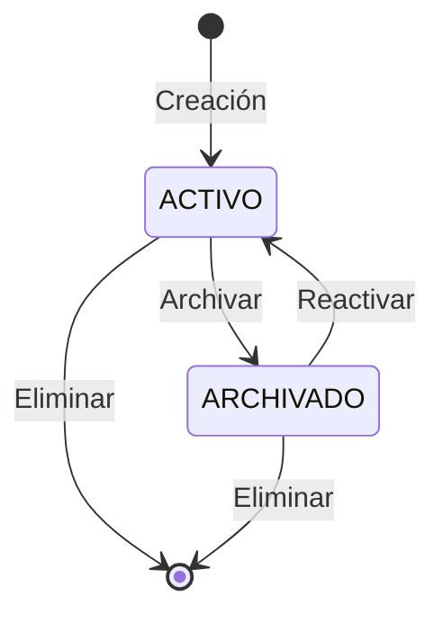
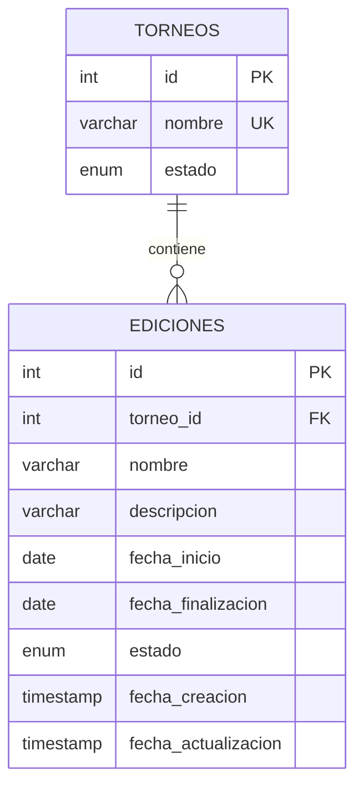
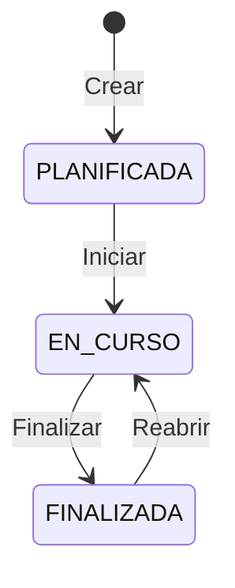

# ALTO-SISTEMA — Modelo multitorneo

Versión de referencia: 0.3.0

Estado: implementación parcial.
HU-004 consolidada. HU-005 implementada y verificada,
pendiente de CHECK integral y consolidación definitiva.

---

## 1. OBJETIVO

Administrar múltiples torneos de fútbol amateur
simultáneamente desde una única aplicación y una
única base de datos.

Cada torneo deberá conservar su independencia
deportiva, administrativa y estadística.

La independencia disciplinaria tendrá como
excepción las sanciones DEFINITIVAS, conforme
al reglamento establecido.

---

## 2. PRINCIPIOS GENERALES

- Una única aplicación.
- Una única base de datos.
- Un administrador inicial.
- Múltiples torneos simultáneos.
- Múltiples ediciones por torneo.
- Múltiples categorías por edición.
- Reglamentos configurables.
- Identidad visual configurable.
- Conservación del historial.
- Independencia de los datos deportivos.

No deberán establecerse cantidades máximas de
torneos, ediciones, categorías, zonas o equipos
mediante constantes arbitrarias en el código.

Las competiciones deberán poder administrarse
sin requerir modificaciones del código fuente.

---

## 3. JERARQUÍA DEPORTIVA

```text
ALTO-SISTEMA
└── Torneo
    └── Edición
        └── Categoría de la edición
            ├── Reglamento
            ├── Configuración visual
            ├── Equipos inscritos
            ├── Listas de buena fe
            ├── Fases
            ├── Zonas
            ├── Jornadas
            ├── Partidos
            ├── Copas
            ├── Estadísticas
            ├── Disciplina
            └── Publicaciones
```

Esta jerarquía representa el modelo conceptual
del sistema.

Las tablas y relaciones definitivas se diseñarán
durante las historias de usuario correspondientes.

En la versión 0.3.0 se encuentran implementados
y verificados los dos primeros niveles de esta
jerarquía: TORNEO y EDICIÓN.

CATEGORÍA y las restantes entidades deportivas
permanecen pendientes de implementación.

---

## 4. TORNEOS

Un torneo representa una competición institucional
con identidad propia y continuidad en el tiempo.

Ejemplos:

- NOCTURNO.
- DIURNO.

Cada torneo podrá disponer de:

- Identificador único.
- Nombre.
- Descripción.
- Estado administrativo.
- Identidad visual.
- Ediciones.
- Configuraciones particulares.

Los nombres de los torneos no deberán formar
parte de las condiciones fijas del código.

### 4.1. Implementación inicial

| Propiedad | Valor |
|---|---|
| Historia de usuario | HU-004 |
| Versión | 0.2.0 |
| Entidad | Torneo |
| Tabla | `torneos` |
| Migración | `002_torneos.sql` |
| Estado | Aprobado y consolidado |

La HU-004 establece la identidad administrativa
básica de cada competición y su ciclo de vida.

### 4.2. Modelo de persistencia

| Campo | Tipo | Restricción |
|---|---|---|
| id | INT | Clave primaria autoincremental |
| nombre | VARCHAR(100) | Obligatorio y único |
| descripcion | VARCHAR(500) | Opcional |
| estado | ENUM | ACTIVO o ARCHIVADO |
| fecha_creacion | TIMESTAMP | Creación automática |
| fecha_actualizacion | TIMESTAMP | Actualización automática |

El nombre dispone de una restricción de unicidad.

El estado administrativo dispone de un índice
para facilitar las consultas correspondientes.

### 4.3. Funcionalidades implementadas

- Creación de torneos.
- Consulta individual.
- Listado general.
- Edición de nombre y descripción.
- Búsqueda.
- Filtrado por estado.
- Archivado reversible.
- Reactivación.
- Eliminación definitiva.
- Confirmación de operaciones destructivas.
- Indicadores administrativos.
- Persistencia en MySQL.
- Protección mediante autenticación.

### 4.4. Estados administrativos

Los estados disponibles son:

- ACTIVO.
- ARCHIVADO.

Todo torneo nuevo se registra como ACTIVO.



El archivado permite conservar una competición
sin mantenerla administrativamente activa.

El archivado no implica la eliminación de datos
ni equivale a la finalización de una edición.

Los torneos archivados conservan:

- Identificador.
- Nombre.
- Descripción.
- Fechas registradas.
- Ediciones asociadas, incluidos sus datos y estados.
- Información histórica que se incorpore
  en futuras historias de usuario.

La edición de sus datos básicos permanece
disponible.

Las operaciones de EDICIONES ya comprueban
el estado del torneo correspondiente.

Archivar un torneo no finaliza automáticamente
sus ediciones ni modifica sus fechas. Las restricciones
de operación se detallan en la sección 5.6.

Las futuras operaciones deportivas deberán respetar
las reglas de contexto que se aprueben.

### 4.5. Eliminación definitiva

La eliminación definitiva de torneos se encuentra
disponible desde la interfaz y la API.

Puede utilizarse sobre torneos activos y archivados,
siempre que no existan registros dependientes que
impidan su eliminación.

La operación elimina físicamente el registro
correspondiente de MySQL.

No existe un estado administrativo ELIMINADO
ni una papelera de recuperación.

La interfaz deberá solicitar confirmación expresa,
identificando el nombre del torneo y advirtiendo
que la operación no puede deshacerse.

Si el administrador cancela la confirmación,
el registro deberá permanecer intacto.

Una eliminación exitosa deberá:

- Retirar el torneo del listado.
- Actualizar los indicadores administrativos.
- Liberar el nombre anteriormente reservado.
- Preservar los restantes torneos.

La creación posterior de un torneo con el mismo
nombre generará una nueva identidad persistente.

No constituirá una restauración del torneo anterior.

### 4.6. Validaciones

El nombre del torneo deberá:

- Ser obligatorio.
- Tener hasta 100 caracteres.
- Ser único dentro del sistema.
- Utilizar normalización Unicode NFC.
- Eliminar espacios externos.
- Reducir espacios consecutivos.

No se permitirán nombres duplicados que
solamente difieran en mayúsculas, minúsculas
o espacios normalizados.

La descripción es opcional y admite hasta
500 caracteres.

Los nombres de torneos archivados continúan
reservados.

Los nombres de torneos eliminados podrán
utilizarse nuevamente.

### 4.7. Independencia administrativa

Cada torneo posee un identificador persistente.

La creación, edición, archivado, reactivación
o eliminación de una competición no deberá
alterar los datos de otra competición.

NOCTURNO y DIURNO son ejemplos de torneos
administrables.

No constituyen registros obligatorios ni
deberán crearse automáticamente durante
la instalación del sistema.

### 4.8. Alcance de HU-004

La versión 0.2.0 implementa exclusivamente
la gestión administrativa básica de torneos.

Al cierre de HU-004, las ediciones permanecían
pendientes. HU-005 las incorpora en v0.3.0.

Permanecen pendientes en la versión actual:

- Categorías.
- Identidad visual de competiciones.
- Reglamentos deportivos.
- Selección del contexto deportivo.
- Relaciones con entidades deportivas posteriores a ediciones.

### 4.9. Protección de registros dependientes

La relación TORNEO–EDICIÓN se encuentra implementada
mediante la migración `003_ediciones.sql`.

La clave foránea `fk_ediciones_torneo` impide eliminar
un torneo con ediciones asociadas, independientemente
de su estado administrativo o deportivo.

La restricción utiliza `ON DELETE RESTRICT` y
`ON UPDATE RESTRICT`. No existe eliminación en cascada.

El backend traduce el error de dependencia en una
respuesta HTTP 409. La interfaz conserva el torneo
y permite utilizar el archivado como alternativa.

La protección real se verificó durante HU-005 con MySQL
y mediante la interfaz administrativa. Las restricciones
de entidades deportivas futuras deberán implementarse
y comprobarse en sus respectivas historias de usuario.

No deberán eliminarse ediciones históricas únicamente
para permitir la eliminación de su torneo.

### 4.10. Comparación de operaciones

| Característica | Archivar | Eliminar |
|---|---|---|
| Conserva el registro | Sí | No |
| Es reversible desde la aplicación | Sí | No |
| Conserva el nombre reservado | Sí | No |
| Retira el torneo de los activos | Sí | Sí |
| Requiere confirmación en la interfaz | Sí | Sí |
| Permite recuperar el mismo registro | Sí | No |
| Preserva los demás torneos | Sí | Sí |
| Disponible con ediciones asociadas | Sí | No |

---

## 5. EDICIONES

Una edición representa una realización determinada
de un torneo.

Ejemplos ilustrativos:

- NOCTURNO 2027.
- DIURNO 2027.
- NOCTURNO 2028.
- DIURNO 2028.

Cada edición pertenece a un único torneo.

Podrán existir ediciones simultáneas.

La finalización de una edición no deberá eliminar
sus datos ni afectar otras ediciones.

Una edición no deberá identificarse exclusivamente
mediante el año, ya que un torneo podría disponer
de más de una edición durante un mismo año.

### 5.1. Estado de implementación

| Propiedad | Valor |
|---|---|
| Historia de usuario | HU-005 |
| Versión | 0.3.0 |
| Entidad | Edición |
| Tabla | `ediciones` |
| Migración | `003_ediciones.sql` |
| Estado | Implementado y verificado; cierre formal pendiente |

El módulo permite gestionar las ediciones de cada torneo
sin introducir categorías ni modificar las reglas deportivas
previstas para etapas posteriores.

### 5.2. Identidad y denominación

Cada edición posee un identificador persistente propio y
pertenece a un único torneo. La relación es de uno a muchos:



El nombre es libre, obligatorio y admite hasta 100 caracteres.
El año, cuando corresponda, forma parte del nombre. No existe
un campo `anio` independiente ni se exige incluir un año.

La unicidad del nombre se limita al torneo correspondiente.
Se permiten nombres iguales en torneos diferentes, pero no
nombres duplicados dentro del mismo torneo. Se aplica la
normalización Unicode NFC y de espacios, y la unicidad se
protege con la intercalación `utf8mb4_unicode_ci` de MySQL,
que no distingue mayúsculas, minúsculas ni acentos para
estas comparaciones.

La descripción es opcional y admite hasta 500 caracteres.
Un nombre reservado por una edición finalizada sigue reservado.
La eliminación definitiva libera el nombre dentro de su torneo;
una creación posterior con ese nombre tendrá otro identificador.

Ejemplos de ediciones de un mismo torneo:

- NOCTURNO 2027.
- COPA DE VERANO 2027.
- NOCTURNO 2028.

Son nombres ilustrativos, no registros obligatorios ni valores
fijos del código. Se permiten múltiples ediciones en el mismo año.

### 5.3. Modelo de persistencia

| Campo | Tipo | Restricción |
|---|---|---|
| id | INT | PK, autoincremental |
| torneo_id | INT | Obligatorio, FK a `torneos.id` |
| nombre | VARCHAR(100) | Obligatorio; único dentro del torneo |
| descripcion | VARCHAR(500) | Opcional, admite NULL |
| fecha_inicio | DATE | Opcional, admite NULL |
| fecha_finalizacion | DATE | Opcional, admite NULL |
| estado | ENUM | PLANIFICADA, EN_CURSO, FINALIZADA; inicial PLANIFICADA |
| fecha_creacion | TIMESTAMP | Creación automática |
| fecha_actualizacion | TIMESTAMP | Actualización automática |

Restricciones e índices implementados:

| Nombre | Responsabilidad |
|---|---|
| `uq_ediciones_torneo_nombre` | UNIQUE (`torneo_id`, `nombre`) |
| `idx_ediciones_torneo_estado` | Índice (`torneo_id`, `estado`) |
| `fk_ediciones_torneo` | FK a `torneos.id`; RESTRICT en eliminación y actualización |
| `chk_ediciones_fechas` | Finalización igual o posterior al inicio cuando ambas existen |

El motor de almacenamiento es InnoDB, con codificación
`utf8mb4` e intercalación `utf8mb4_unicode_ci`.
No existe eliminación automática de ediciones al archivar
ni al intentar eliminar el torneo asociado.

### 5.4. Fechas de la edición

Las fechas de inicio y finalización son independientes,
opcionales y editables. Pueden incorporarse, modificarse
o retirarse sin cambiar automáticamente el estado deportivo.

- Se admiten ambas fechas vacías, una sola fecha o ambas.
- Las fechas informadas deben ser fechas reales y válidas.
- Si ambas están informadas, la fecha de finalización no puede
  ser anterior a la de inicio; se permite que sean iguales.
- Se almacenan como DATE y se intercambian con la API en
  formato `YYYY-MM-DD`, sin conversiones de zona horaria.
- La interfaz permite limpiar cualquiera de las fechas.

Estas fechas representan datos de planificación o registro.
No son condiciones automáticas para iniciar, finalizar o
reabrir una edición. Tampoco impiden la coexistencia de
ediciones cuyas fechas se superpongan.

### 5.5. Ciclo de vida deportivo

| Estado | Significado |
|---|---|
| PLANIFICADA | Edición registrada, aún no iniciada |
| EN_CURSO | Edición iniciada o reabierta |
| FINALIZADA | Edición cerrada deportivamente; conserva sus datos |



Las transiciones de estado son manuales y se validan en el
backend. El estado inicial siempre es PLANIFICADA.
No se permite finalizar directamente una edición planificada
ni volver a PLANIFICADA desde EN_CURSO o FINALIZADA.
Reiterar el estado actual no requiere modificar el registro.

Pueden existir múltiples ediciones EN_CURSO del mismo torneo.
Finalizar una edición no finaliza otras ediciones, no archiva
el torneo ni elimina la información registrada.

Reabrir una edición finalizada conserva su identidad y sus
fechas. HU-005 no ejecuta procesos deportivos automáticos
al cambiar el estado; las consecuencias sobre categorías,
partidos, estadísticas y disciplina se resolverán conforme
a las reglas aprobadas en las etapas correspondientes.

### 5.6. Relación con el estado administrativo del torneo

El estado ACTIVO o ARCHIVADO del torneo es independiente
del estado deportivo de cada edición.

| Operación sobre edición | Torneo ACTIVO | Torneo ARCHIVADO |
|---|---|---|
| Consultar y listar | Permitida | Permitida |
| Buscar y filtrar | Permitida | Permitida |
| Crear | Permitida | No permitida |
| Editar nombre, descripción y fechas | Permitida | Permitida |
| Iniciar una PLANIFICADA | Permitida | No permitida |
| Finalizar una EN_CURSO | Permitida | Permitida |
| Reabrir una FINALIZADA | Permitida | No permitida |
| Eliminar sin dependencias incompatibles | Permitida | Permitida |

La interfaz informa las restricciones del torneo archivado.
El backend las hace cumplir independientemente de la interfaz.
La reactivación de un torneo recupera la posibilidad de crear,
iniciar y reabrir ediciones conforme a su estado deportivo.
Archivar o reactivar no cambia automáticamente las ediciones.

### 5.7. Operaciones administrativas y navegación

Desde cada tarjeta de TORNEOS se accede a GESTIONAR EDICIONES.
La pantalla identifica el torneo seleccionado, permite volver
al listado y muestra exclusivamente sus ediciones.

Funcionalidades:

- Creación y consulta de ediciones.
- Listado, búsqueda por nombre y descripción y filtros por estado.
- Edición de datos básicos y fechas.
- Inicio, finalización y reapertura con confirmación.
- Eliminación definitiva con confirmación.
- Indicadores administrativos de la edición y de su torneo.
- Estados de carga, ausencia de registros y mensajes de error.
- Adaptación responsive.

No se incorpora un nuevo módulo independiente en el menú lateral.
La gestión de ediciones depende del torneo seleccionado y no
constituye todavía el selector integral de contexto deportivo
previsto para HU-008.

### 5.8. Eliminación y conservación histórica

La eliminación de una edición es física, no un cambio de estado.
Está disponible para ediciones PLANIFICADAS, EN_CURSO y
FINALIZADAS, siempre que no existan dependencias incompatibles.
No existe una papelera ni un estado ELIMINADA.

La interfaz identifica el registro, advierte que la operación
es irreversible y permite cancelar. El backend verifica el
identificador, la pertenencia al torneo y las restricciones
aplicables antes de eliminar el registro.

El resultado exitoso actualiza el listado y los indicadores.
La eliminación de una edición no afecta otras ediciones.
La eliminación de un torneo con al menos una edición asociada
se rechaza por integridad referencial.

La finalización de ediciones no equivale a su eliminación.
Las futuras categorías y demás entidades dependientes deberán
utilizar restricciones que protejan la información histórica.
HU-005 aún no incorpora esas tablas ni sus claves foráneas.

### 5.9. Independencia de datos y operaciones concurrentes

Las consultas y escrituras de una edición verifican tanto el
identificador del torneo como el de la edición cuando corresponde.
Una edición de otro torneo no deberá devolverse ni modificarse
mediante la ruta de un torneo distinto.

Las operaciones de escritura se ejecutan mediante transacciones
que bloquean el registro del torneo (`SELECT ... FOR UPDATE`)
antes de comprobar su estado y realizar la operación de negocio.
Los conflictos de unicidad, dependencias y concurrencia se
tratan como conflictos de datos; la transacción se revierte
ante errores. Las restricciones de MySQL complementan las
validaciones del servicio.

### 5.10. Contrato de acceso

| Método | Endpoint | Operación |
|---|---|---|
| GET | `/api/torneos/:torneoId/ediciones` | Listado e indicadores |
| GET | `/api/torneos/:torneoId/ediciones/:edicionId` | Consulta individual |
| POST | `/api/torneos/:torneoId/ediciones` | Crear |
| PUT | `/api/torneos/:torneoId/ediciones/:edicionId` | Editar datos |
| PATCH | `/api/torneos/:torneoId/ediciones/:edicionId/estado` | Cambiar estado |
| DELETE | `/api/torneos/:torneoId/ediciones/:edicionId` | Eliminar |

Todos requieren autenticación y las escrituras respetan
los controles de origen de solicitudes. El listado admite
los filtros `busqueda` y `estado` y devuelve los indicadores
del torneo independientemente del filtrado del listado.
El contrato técnico completo se detalla en ARQUITECTURA.md.

### 5.11. Límites de HU-005

No se incorporan categorías, equipos, inscripciones, zonas,
jornadas, partidos, copas, estadísticas deportivas, disciplina,
identidades visuales personalizadas ni el selector global
de contexto. Las reglas ya documentadas para esas funcionalidades
se conservan sin modificaciones.

La futura HU-006 deberá definir e implementar la relación
entre edición y categoría conforme al modelo conceptual,
sin anticipar sus campos, acciones o criterios de aceptación.

---

## 6. CATEGORÍAS

Las categorías deberán ser configurables.

Ejemplos:

- LIBRE.
- SENIOR.
- FEMENINO.
- MAYORES DE 40.

Cada torneo y edición podrá disponer de diferentes
categorías, sin estar obligado a utilizar todas
las existentes.

Cada categoría dentro de una edición podrá tener:

- Reglamento de edad.
- Equipos participantes.
- Formato de competición.
- Zonas.
- Calendario.
- Copas.
- Identidad visual.
- Estadísticas independientes.

### 6.1. Estado de implementación

| Propiedad | Valor |
|---|---|
| Historia de usuario | HU-006 |
| Estado | Pendiente |

No deberán incorporarse categorías obligatorias
mediante condiciones fijas del código.

---

## 7. CONTEXTO DEPORTIVO

El contexto deportivo se determinará mediante:

- Identificador del torneo.
- Identificador de la edición.
- Identificador de la categoría de la edición.

### 7.1. Selector de contexto

El frontend deberá ofrecer un selector que permita
cambiar de competición sin cerrar la sesión
del administrador.

El contexto seleccionado deberá permanecer
visible durante las operaciones deportivas.

### 7.2. Validación del contexto

El backend deberá verificar que los identificadores
recibidos correspondan a relaciones válidas.

No se deberá confiar exclusivamente en los filtros
aplicados por el frontend.

El cambio de contexto deberá impedir que datos
cargados anteriormente se utilicen accidentalmente
en operaciones de otra competición.

### 7.3. Estado de implementación

| Propiedad | Valor |
|---|---|
| Historia de usuario | HU-008 |
| Estado | Pendiente |

La gestión administrativa de torneos de HU-004 y la
navegación parametrizada de ediciones de HU-005 no
constituyen todavía un selector integral de contexto deportivo.

HU-005 ya verifica la relación torneo–edición en el backend.
El nivel de categoría y la selección global permanecen pendientes.

---

## 8. EQUIPOS E INSCRIPCIONES

La participación de un equipo deberá vincularse
a una edición y categoría determinadas.

Un mismo nombre de equipo podrá existir
en diferentes competiciones.

El nombre de un equipo no constituye un
identificador único global del sistema.

Las inscripciones deberán mantener su identidad
histórica para preservar resultados y estadísticas
de cada competición.

### 8.1. Estado de implementación

Pendiente de la ETAPA 03.

---

## 9. JUGADORES Y LISTAS DE BUENA FE

Las listas de buena fe constituyen registros
administrativos independientes de las estadísticas
de goleadores.

Un jugador podrá participar en distintas categorías
conforme al reglamento aplicable.

No podrá representar a diferentes equipos dentro
de una misma edición y categoría.

Los datos personales deberán protegerse y no
formar parte de las publicaciones deportivas.

Las reglas de identidad y habilitación deberán
permitir el control disciplinario transversal.

La identidad disciplinaria del jugador deberá
permitir reconocerlo aunque participe en diferentes
torneos, categorías, ediciones o equipos.

### 9.1. Estado de implementación

Pendiente de la ETAPA 04.

---

## 10. FORMATOS DE COMPETICIÓN

Cada categoría podrá disponer de formatos propios.

El modelo deberá permitir:

- Fases clasificatorias.
- Zonas.
- Partidos interzonales.
- Jornadas distribuidas en diferentes días.
- Copas.
- Eliminatorias a partido único.
- Eliminatorias de ida y vuelta.
- Definiciones mediante penales.

La programación de los partidos será manual.

No deberán establecerse días de juego obligatorios
mediante constantes en el código.

La implementación de los formatos deberá respetar
las reglas particulares de cada competición.

### 10.1. Estado de implementación

Pendiente de las etapas deportivas correspondientes.

---

## 11. ESTADÍSTICAS

Las estadísticas deberán calcularse utilizando
exclusivamente los partidos correspondientes
al contexto deportivo consultado.

Las tablas de posiciones, goleadores y valla menos
vencida no deberán mezclar información de
diferentes torneos, ediciones o categorías.

### 11.1. Partidos interzonales

Los partidos interzonales deberán computarse
según las reglas deportivas aprobadas.

### 11.2. Acumulación estadística

Las estadísticas acumuladas entre fases y copas
deberán respetar el reglamento de la competición.

### 11.3. Fuente de verdad

Los resultados y eventos registrados constituirán
la fuente de verdad para los cálculos deportivos.

Las correcciones deberán evitar duplicaciones
y permitir recalcular las estadísticas afectadas.

### 11.4. Indicadores administrativos

La versión 0.2.0 incorpora los siguientes
indicadores administrativos de torneos:

- Total de torneos registrados.
- Total de torneos activos.
- Total de torneos archivados.

El Dashboard incorpora un contador de torneos
activos obtenido mediante la API.

Las creaciones, cambios de estado y eliminaciones
deberán reflejarse en los indicadores correspondientes.

En v0.3.0 se incorporan los siguientes indicadores por torneo:

- Total de ediciones.
- Ediciones PLANIFICADAS.
- Ediciones EN CURSO.
- Ediciones FINALIZADAS.

La pantalla EDICIONES presenta los cuatro indicadores.
Las tarjetas de TORNEOS muestran el total de ediciones y
la cantidad de ediciones EN CURSO de cada torneo.
Los indicadores reflejan el conjunto completo del torneo,
no únicamente los registros visibles tras aplicar filtros.

Las modificaciones exitosas actualizan los indicadores.
Una consulta fallida no debe interpretarse como ausencia de
ediciones ni sustituirse por valores ficticios.

Estos indicadores no constituyen estadísticas
de rendimiento deportivo.

### 11.5. Estado de implementación

Las estadísticas deportivas permanecen pendientes.

---

## 12. DISCIPLINA

### 12.1. Independencia disciplinaria

El NOCTURNO y el DIURNO dispondrán de sistemas
disciplinarios paralelos e independientes.

Las sanciones temporales aplicadas en un torneo
no afectarán la habilitación del jugador en el otro.

La única excepción será la sanción DEFINITIVA.

### 12.2. Tipos de sanciones

El sistema contemplará:

- Sanciones por cantidad de fechas.
- Sanciones FIN DE TORNEO.
- Sanciones DEFINITIVAS.

Cada sanción deberá conservar su contexto
deportivo de origen.

### 12.3. Sanciones por fechas

Una sanción por cantidad de fechas afectará
exclusivamente al torneo donde fue aplicada.

Dentro de ese torneo, el jugador quedará
inhabilitado en todas sus categorías mientras
la sanción permanezca vigente.

El cumplimiento se computará exclusivamente
en la categoría de origen.

Los partidos disputados en otras categorías
o en otro torneo no descontarán fechas.

Cada partido posterior finalizado del equipo
correspondiente en la categoría de origen
descontará una fecha, incluyendo partidos
resueltos por incomparecencia.

No descontarán fechas:

- El partido donde se produjo la expulsión.
- Las jornadas libres.
- Los partidos pendientes.
- Los partidos de otras categorías.
- Los partidos de otros torneos.

### 12.4. Sanciones FIN DE TORNEO

El jugador quedará inhabilitado en todas las
categorías del torneo donde recibió la sanción
hasta la finalización de la edición correspondiente.

Esta sanción no afectará su habilitación
en el otro torneo.

### 12.5. Sanciones DEFINITIVAS

Una sanción DEFINITIVA aplicada en el NOCTURNO
o en el DIURNO producirá la inhabilitación
permanente del jugador en ambos torneos.

La inhabilitación comprenderá:

- Todas las categorías.
- Todas las ediciones presentes y futuras.
- Todos los equipos.

La sanción no expirará por:

- El transcurso del tiempo.
- La finalización de una edición.
- El cambio de categoría.
- El cambio de equipo.

### 12.6. Identidad disciplinaria

Las sanciones deberán vincularse a la identidad
del jugador y no exclusivamente a su inscripción
en un equipo determinado.

El sistema deberá evitar que un cambio de equipo,
categoría o edición permita eludir una sanción
vigente dentro de su alcance reglamentario.

La identificación disciplinaria deberá contemplar
el DNI como identificador personal, protegiendo
su confidencialidad.

### 12.7. Ejemplos reglamentarios

#### Ejemplo A — Sanción de tres fechas

Origen: NOCTURNO LIBRE.

| Competición | Situación |
|---|---|
| NOCTURNO LIBRE | Suspendido |
| NOCTURNO SENIOR | Suspendido |
| DIURNO | No afectado por esta sanción |

Las fechas se descontarán exclusivamente
mediante los partidos correspondientes a
la categoría de origen.

#### Ejemplo B — FIN DE TORNEO

Origen: NOCTURNO LIBRE.

| Competición | Situación |
|---|---|
| NOCTURNO LIBRE | Suspendido |
| NOCTURNO SENIOR | Suspendido |
| DIURNO | No afectado por esta sanción |

La sanción expirará al finalizar la edición
correspondiente.

#### Ejemplo C — DEFINITIVA

Origen: NOCTURNO LIBRE.

| Competición | Situación |
|---|---|
| NOCTURNO LIBRE | Inhabilitado permanentemente |
| NOCTURNO SENIOR | Inhabilitado permanentemente |
| DIURNO | Inhabilitado permanentemente |

Las mismas reglas se aplicarán de manera
recíproca cuando la sanción se origine
en el DIURNO.

La habilitación efectiva del jugador dependerá
también de otras sanciones vigentes y de los
requisitos reglamentarios correspondientes.

### 12.8. Resumen del alcance disciplinario

| Sanción | Categoría de origen | Otras categorías del torneo | Otro torneo |
|---|---|---|---|
| Por fechas | Afectada | Afectadas | No afectado |
| FIN DE TORNEO | Afectada | Afectadas | No afectado |
| DEFINITIVA | Afectada | Afectadas | Afectado |

El resumen representa las reglas aprobadas
para NOCTURNO y DIURNO.

### 12.9. Escalabilidad disciplinaria

El alcance de las sanciones deberá formar parte
del modelo de configuración reglamentaria.

No se deberán utilizar los nombres NOCTURNO
y DIURNO como condiciones fijas del código.

La incorporación de futuros torneos requerirá
definir expresamente su vinculación con los
regímenes disciplinarios existentes.

No se extenderá automáticamente el alcance
de las sanciones DEFINITIVAS a nuevos torneos
sin una definición reglamentaria aprobada.

### 12.10. Pruebas disciplinarias obligatorias

La futura implementación deberá comprobar:

- Independencia de sanciones temporales entre torneos.
- Bloqueo transversal entre categorías del mismo torneo.
- Cumplimiento de fechas en la categoría de origen.
- Ausencia de descuentos por partidos de otro torneo.
- Expiración correcta de sanciones FIN DE TORNEO.
- Inhabilitación DEFINITIVA en ambos torneos.
- Persistencia de la inhabilitación DEFINITIVA.
- Control de identidad ante cambios de equipo.
- Conservación del historial disciplinario.

No deberán implementarse excepciones disciplinarias
sin una regla previamente aprobada.

### 12.11. Estado de implementación

Pendiente de la ETAPA 09.

Las reglas de esta sección constituyen una
definición reglamentaria para su futura
implementación.

---

## 13. IDENTIDAD VISUAL

### 13.1. Identidad de las competiciones

La identidad visual de las competiciones no deberá
estar fijada directamente en el código.

El sistema deberá permitir configurar:

- Logotipos.
- Colores mediante valores HEX.
- Identidad del torneo.
- Identidad de la edición.
- Identidad de las categorías.
- Identidad de las copas.

Las publicaciones deberán utilizar la identidad
visual del contexto deportivo correspondiente.

### 13.2. Sistema de Diseño institucional

La versión 0.2.0 incorpora el Sistema de Diseño
v1.0 de ALTO-SISTEMA.

Sus características principales son:

- Azul institucional `#3333FF`.
- Fondo general `#080808`.
- Tipografía Barlow Condensed.
- Tipografía Inter.
- Iconografía Lucide React.
- Design Tokens.
- Componentes reutilizables.
- Diseño responsive.
- Estados visuales semánticos.

La definición completa se encuentra en:

[SISTEMA_DE_DISENO.md](SISTEMA_DE_DISENO.md)

### 13.3. Independencia de identidades visuales

Se distinguen dos sistemas visuales:

1. Identidad institucional de ALTO-SISTEMA.
2. Identidad personalizable de las competiciones.

La identidad institucional define la apariencia
general de la aplicación administrativa.

La identidad de las competiciones determinará
sus propios logotipos, colores y publicaciones.

Los colores y logotipos de las competiciones
no deberán modificar accidentalmente la identidad
institucional de ALTO-SISTEMA.

### 13.4. Publicaciones deportivas

La exportación de placas deberá realizarse
en formato PNG, con ancho uniforme y altura
adaptable al contenido.

Los estándares específicos de las publicaciones
se definirán durante la etapa correspondiente.

### 13.5. Estado de implementación

| Funcionalidad | Estado |
|---|---|
| Sistema de Diseño institucional | Implementado y verificado |
| Identidad visual de torneos | Pendiente |
| Identidad visual de ediciones | Pendiente |
| Identidad visual de categorías | Pendiente |
| Identidad visual de copas | Pendiente |
| Publicaciones deportivas PNG | Pendiente |

La identidad visual de competiciones corresponde
a HU-007.

La generación de publicaciones corresponde
a la ETAPA 10.

---

## 14. INTEGRIDAD DE LOS DATOS

El diseño de la base de datos deberá utilizar:

- Claves primarias.
- Claves foráneas.
- Restricciones de unicidad contextual.
- Índices apropiados.
- Transacciones cuando corresponda.
- Validaciones de relaciones.
- Migraciones versionadas.

### 14.1. Independencia de operaciones

Las operaciones de escritura deberán verificar
el contexto deportivo de todos los registros
involucrados.

Una operación sobre un torneo no deberá modificar
accidentalmente los datos de otro torneo.

Las excepciones disciplinarias expresamente
aprobadas deberán aplicarse mediante operaciones
controladas, verificables y documentadas.

### 14.2. Migraciones implementadas

| Migración | Responsabilidad |
|---|---|
| `001_usuarios.sql` | Usuarios administrativos |
| `002_torneos.sql` | Gestión de torneos |
| `003_ediciones.sql` | Gestión de ediciones e integridad TORNEO–EDICIÓN |

Las migraciones aplicadas deberán conservarse
sin modificaciones posteriores.

Toda evolución estructural deberá incorporarse
mediante una nueva migración versionada.

La eliminación definitiva de torneos no requirió
modificar la estructura existente.

### 14.3. Fuente de verdad

MySQL constituye la fuente de verdad
de los datos persistentes.

Las validaciones del frontend deberán
complementarse con validaciones del backend
y restricciones de integridad de la base de datos.

### 14.4. Integridad referencial actual y futura

La relación TORNEO–EDICIÓN dispone de una clave foránea
obligatoria con restricciones RESTRICT. Se verificó el rechazo
de la eliminación de un torneo con ediciones asociadas.
La unicidad contextual y la coherencia de fechas disponen
de restricciones UNIQUE y CHECK, respectivamente.

Las futuras entidades dependientes deberán disponer
de restricciones que impidan operaciones incompatibles
con la conservación de los datos.

No deberán existir registros deportivos huérfanos como
consecuencia de operaciones administrativas.

### 14.5. Verificación final de migraciones

| Control | Resultado |
|---|---|
| Base de datos | alto_sistema |
| Migraciones registradas | 3 |
| Migraciones pendientes | 0 |
| Errores | 0 |
| Estado | Actualizada |

Se verificó la migración desde v0.2.0, su aplicación en
el entorno aislado de integración y una instalación desde
una base nueva con las tres migraciones. Una nueva ejecución
sobre la base recién instalada registró cero pendientes.

---

## 15. HISTORIAL

La finalización de un torneo o edición no deberá
implicar la eliminación automática de sus datos.

El sistema deberá permitir consultar:

- Ediciones anteriores.
- Equipos participantes.
- Resultados.
- Clasificaciones.
- Goleadores.
- Campeones.
- Sanciones.
- Publicaciones históricas.

### 15.1. Conservación disciplinaria

Las sanciones DEFINITIVAS deberán conservarse
independientemente del estado de la edición
donde fueron aplicadas.

### 15.2. Archivado administrativo

El archivado de torneos implementado en HU-004
constituye el primer mecanismo administrativo
de conservación.

Los torneos archivados podrán consultarse
y reactivarse.

La política definitiva de archivo y conservación
de las restantes entidades se definirá durante
las historias de usuario correspondientes.

### 15.3. Eliminación y conservación histórica

La eliminación definitiva deberá utilizarse
para retirar registros que puedan eliminarse
sin comprometer información deportiva asociada.

El archivado será la alternativa correspondiente
cuando existan dependencias que deban conservarse.

Una competición eliminada y posteriormente
creada con el mismo nombre constituirá
un registro diferente.

Las futuras relaciones deberán utilizar
identificadores persistentes, no nombres
como referencias de identidad.

### 15.4. Estado de implementación

El archivado y la eliminación administrativa
de torneos se encuentran implementados y verificados.
La consulta, finalización, reapertura y eliminación de
ediciones también están implementadas. La finalización
conserva los registros; no genera todavía un historial
de resultados, campeones ni sanciones.

El historial deportivo integral permanece
pendiente de la ETAPA 12.

---

## 16. ESCALABILIDAD FUNCIONAL

La incorporación de un nuevo torneo, edición
o categoría deberá realizarse mediante operaciones
administrativas de la aplicación.

No deberá requerir:

- Duplicar el proyecto.
- Crear otra base de datos.
- Modificar el código fuente.
- Crear una nueva instalación.
- Reiniciar el sistema por cada torneo creado.

La arquitectura deberá permitir nuevas modalidades
de competición mediante ampliaciones controladas.

### 16.1. Capacidad incorporada en HU-004

La versión 0.2.0 permite administrar múltiples
torneos desde la interfaz administrativa
sin modificar el código fuente.

Cada torneo dispone de una identidad persistente
y un estado administrativo independiente.

Su ciclo de vida comprende:

- Creación.
- Edición.
- Archivado.
- Reactivación.
- Eliminación definitiva.

### 16.2. Evolución prevista

Las siguientes historias de usuario incorporarán
las entidades dependientes restantes de cada competición.

El desarrollo deberá conservar la independencia
de los datos y evitar límites arbitrarios.

### 16.3. Capacidad incorporada en HU-005

La versión 0.3.0 permite crear y administrar múltiples
ediciones por torneo sin modificar el código fuente ni
reiniciar los servicios por cada edición. Se permiten nombres
libres, fechas opcionales y ediciones simultáneas EN_CURSO.

Las ediciones se mantienen dentro de su propio torneo.
La gestión de categorías continuará en HU-006, después
de aprobar y consolidar HU-005.

---

## 17. CRITERIOS DE ACEPTACIÓN ARQUITECTÓNICA

Las futuras implementaciones deberán demostrar:

- Creación de múltiples torneos.
- Gestión simultánea del Nocturno y el Diurno.
- Independencia de sus ediciones.
- Independencia de sus categorías.
- Separación de equipos inscritos.
- Separación de resultados y estadísticas.
- Selección segura del contexto deportivo.
- Conservación del historial.
- Rechazo de relaciones deportivas incompatibles.
- Independencia disciplinaria temporal.
- Aplicación transversal de sanciones DEFINITIVAS.

Deberán incorporarse pruebas automatizadas que
comprueben expresamente que las operaciones
sobre un torneo no alteran indebidamente otro.

Las sanciones DEFINITIVAS constituirán una
excepción reglamentaria controlada y deberán
contar con pruebas específicas.

### 17.1. Criterios específicos de HU-004

| ID | Criterio | Verificación |
|---|---|---|
| CA-01 | Creación de torneos | Satisfactoria |
| CA-02 | Validación de campos obligatorios | Satisfactoria |
| CA-03 | Prevención de nombres duplicados | Satisfactoria |
| CA-04 | Listado de torneos | Satisfactoria |
| CA-05 | Búsqueda y filtros | Satisfactoria |
| CA-06 | Edición de nombre y descripción | Satisfactoria |
| CA-07 | Archivado con confirmación | Satisfactoria |
| CA-08 | Reactivación | Satisfactoria |
| CA-09 | Persistencia después del reinicio | Satisfactoria |
| CA-10 | Independencia entre torneos | Satisfactoria |
| CA-11 | Protección mediante autenticación | Satisfactoria |
| CA-12 | Adaptación responsive | Satisfactoria |
| CA-13 | Pruebas automatizadas | Satisfactoria |
| CA-14 | Regresión de funcionalidades anteriores | Satisfactoria |
| CA-15 | Eliminación definitiva | Satisfactoria |
| CA-16 | Cancelación de eliminación | Satisfactoria |
| CA-17 | Independencia tras eliminación | Satisfactoria |
| CA-18 | Reutilización de nombres eliminados | Satisfactoria |

Los resultados corresponden a las comprobaciones
técnicas y funcionales realizadas durante HU-004.

La adaptación responsive se verificó mediante
el navegador.

HU-004 fue aprobada y consolidada en el commit
`27654c0`, correspondiente a v0.2.0.

### 17.2. Controles complementarios

| Control | Resultado |
|---|---|
| Sistema de Diseño v1.0 | Verificado |
| Integridad de migraciones | Verificada |
| Consistencia de versión | Verificada |
| Limpieza de torneos temporales | Completada |
| Documentación definitiva de HU-004 | Consolidada |

### 17.3. Verificaciones funcionales de HU-005

La validación funcional y visual se organizó en 17 controles,
según las comprobaciones y confirmaciones efectuadas en el
entorno local. Estos controles no sustituyen la aprobación
formal del CHECK integral.

| Nº | Control | Resultado |
|---:|---|---|
| 01 | Integración visual con TORNEOS | Verificado |
| 02 | Navegación hacia EDICIONES | Verificado |
| 03 | Creación de ediciones | Verificado |
| 04 | Fechas opcionales | Verificado |
| 05 | Modificación de fechas | Verificado |
| 06 | Inicio | Verificado |
| 07 | Finalización | Verificado |
| 08 | Reapertura | Verificado |
| 09 | Indicadores internos | Verificado |
| 10 | Ediciones simultáneas | Verificado |
| 11 | Modificación de nombre y descripción | Verificado |
| 12 | Eliminación de fechas | Verificado |
| 13 | Búsqueda y filtros | Verificado |
| 14 | Indicadores externos de TORNEOS | Verificado |
| 15 | Restricciones de torneos archivados | Verificado |
| 16 | Eliminación e integridad referencial | Verificado |
| 17 | Adaptación responsive | Verificado por confirmación del administrador |

Resultado funcional: 17/17 controles validados.
La adaptación responsive se confirmó mediante simulación
indicada de 390 × 844 píxeles en el navegador; no equivale
a una prueba en un dispositivo físico.

Las pruebas automatizadas complementan estas comprobaciones
con casos de unicidad, fechas válidas, transiciones no permitidas,
identificadores, pertenencia al torneo, autenticación,
concurrencia y restricciones de MySQL.

---

## 18. ESTADO DE IMPLEMENTACIÓN

### 18.1. Evolución del modelo

| Versión | Incorporación |
|---|---|
| 0.1.0 | Infraestructura inicial |
| 0.1.1 | Autenticación |
| 0.1.2 | Interfaz administrativa |
| 0.1.3 | Consolidación arquitectónica |
| 0.2.0 | Gestión integral de torneos y Sistema de Diseño v1.0 |
| 0.3.0 | Gestión de ediciones e integridad TORNEO–EDICIÓN |

### 18.2. Entidades y funcionalidades

| Entidad o funcionalidad | Estado |
|---|---|
| Torneos | Implementado, aprobado y consolidado |
| Ediciones | Implementado y verificado; cierre formal pendiente |
| Categorías | Pendiente |
| Reglamentos deportivos | Pendiente |
| Identidad visual de competiciones | Pendiente |
| Selector de contexto deportivo | Pendiente |
| Equipos e inscripciones | Pendiente |
| Listas de buena fe | Pendiente |
| Fases y zonas | Pendiente |
| Jornadas y partidos | Pendiente |
| Tablas de posiciones | Pendiente |
| Goleadores | Pendiente |
| Valla menos vencida | Pendiente |
| Copas y playoffs | Pendiente |
| Disciplina | Pendiente |
| Publicaciones deportivas | Pendiente |
| Historial deportivo | Pendiente |

### 18.3. Verificación definitiva de torneos

| Control | Resultado |
|---|---|
| Pruebas unitarias de autenticación | 13/13 |
| Pruebas unitarias de torneos | 30/30 |
| Integración de autenticación | 1/1 |
| Integración de torneos | 1/1 |
| Total de pruebas automatizadas | 45/45 |
| Controles internos de integración de torneos | 20/20 |
| Pruebas fallidas | 0 |
| Migración de torneos | Ejecutada |
| Idempotencia del migrador | Verificada |
| Migraciones sobre una base nueva | Verificadas |
| Migraciones pendientes | 0 |
| ESLint | 0 errores y 0 advertencias |
| Compilación de producción | Exitosa |
| Tiempo de compilación final | 3,49 segundos |
| Revisión visual inicial | 8/8 |
| Validación funcional | Satisfactoria |
| Eliminación de torneos temporales | Completada |
| CHECK integral HU-004 | Aprobado y consolidado |

Los controles internos de integración forman
parte de una única prueba automatizada.

Las 45 pruebas corresponden a 43 pruebas
unitarias y dos pruebas de integración,
verificadas mediante ejecuciones separadas.

Las pruebas de integración de torneos utilizan
una base de datos independiente de la base principal.

La revisión responsive se realizó mediante
simulación desde el navegador.

La validación en dispositivos móviles físicos
permanece pendiente.

Durante HU-004 la protección de dependencias se verificó
mediante simulación. HU-005 incorporó y comprobó la
restricción real entre torneos y ediciones. Las claves
foráneas de entidades posteriores siguen pendientes.

### 18.4. Evolución de la ETAPA 02

| Historia | Responsabilidad | Estado |
|---|---|---|
| HU-004 | Gestión integral de torneos | Aprobada y consolidada |
| HU-005 | Gestión de ediciones | Verificada, pendiente de CHECK y consolidación |
| HU-006 | Gestión de categorías | Pendiente |
| HU-007 | Identidad visual | Pendiente |
| HU-008 | Selección del contexto deportivo | Pendiente |

La ETAPA 02 permanecerá abierta hasta completar
todas sus historias de usuario.

### 18.5. Conservación de las reglas deportivas

La implementación de la gestión integral
de torneos y ediciones no modifica las reglas previamente
establecidas sobre:

- Independencia deportiva.
- Independencia estadística.
- Identidad de jugadores.
- Habilitaciones.
- Formatos de competición.
- Disciplina.
- Conservación del historial.

El reglamento disciplinario será implementado
durante la etapa correspondiente.

Este documento constituye una referencia
obligatoria para las futuras historias de usuario.

### 18.6. Verificación de ediciones — v0.3.0

| Control | Resultado |
|---|---|
| Pruebas unitarias de autenticación | 13/13 |
| Pruebas unitarias de torneos | 30/30 |
| Pruebas unitarias de ediciones | 59/59 |
| Integración de autenticación | 1/1 |
| Integración de torneos | 1/1 |
| Integración de ediciones | 1/1 |
| Total de pruebas automatizadas únicas | 105/105 |
| Pruebas fallidas en las ejecuciones específicas | 0 |
| Migraciones registradas | 3 |
| Migraciones pendientes | 0 |
| Instalación desde cero e idempotencia | Verificadas |
| Integridad TORNEO–EDICIÓN | Verificada |
| ESLint | Sin errores informados |
| Compilación de producción | Exitosa (2,52 segundos) |
| Validaciones funcionales | 17/17 |
| Limpieza de registros deportivos temporales | Completada |
| Coherencia de versión | 8/8 valores verificados |
| CHECK integral HU-005 | Pendiente de aprobación formal |

Las 105 pruebas corresponden a 102 unitarias y tres de
integración, aprobadas mediante ejecuciones separadas.
La integración de EDICIONES comprende 14 bloques internos;
se recibió el resultado global satisfactorio de la prueba,
no los diagnósticos individuales de cada bloque. No se
contabilizan dichos bloques como pruebas independientes.

La integración de torneos y ediciones se realizó en la base
`altosistemahu004test`. La instalación limpia se verificó en
`altosistemahu005fresh`. Ambas se conservan para futuras
verificaciones, sin utilizarse como bases principales.

Las pruebas precedieron a la actualización de versión; la
coherencia de los archivos de versión y el reinicio de los
servidores se verificaron posteriormente. La restauración de
un respaldo con TORNEOS y EDICIONES, las pruebas de carga y
la validación móvil física permanecen pendientes.

La versión local es v0.3.0. La última versión consolidada
es v0.2.0. La documentación y las capturas de HU-005,
su CHECK integral y la publicación en GitHub forman parte
del cierre pendiente. HU-006 no se iniciará antes de su
aprobación y consolidación.

---

**ALTO-SISTEMA**

Sistema integral de gestión deportiva.
