# ALTO-SISTEMA — Modelo multitorneo

Versión de referencia: 0.4.0

Estado: implementación parcial.

HU-004 y HU-005 aprobadas y consolidadas.
HU-006 implementada y verificada técnica y funcionalmente,
pendiente de CHECK integral y consolidación definitiva.

---

## 1. OBJETIVO

Administrar múltiples torneos de fútbol amateur
simultáneamente desde una única aplicación y una
única base de datos.

Cada torneo deberá conservar su independencia
deportiva, administrativa y estadística.

La independencia disciplinaria tendrá como
excepción las sanciones DEFINITIVAS, conforme
al reglamento establecido.

---

## 2. PRINCIPIOS GENERALES

- Una única aplicación.
- Una única base de datos operativa.
- Un administrador inicial.
- Múltiples torneos simultáneos.
- Múltiples ediciones por torneo.
- Múltiples categorías por edición.
- Reglamentos configurables.
- Identidad visual configurable.
- Conservación del historial.
- Independencia de los datos deportivos.

No deberán establecerse cantidades máximas de
torneos, ediciones, categorías, zonas o equipos
mediante constantes arbitrarias en el código.

Las competiciones deberán poder administrarse
sin requerir modificaciones del código fuente.

Las bases aisladas de pruebas, instalación
y restauración no constituyen instalaciones
deportivas independientes.

---

## 3. JERARQUÍA DEPORTIVA

### 3.1. Modelo conceptual

```text
ALTO-SISTEMA
└── Torneo
    └── Edición
        └── Categoría de la edición
            ├── Reglamento
            ├── Configuración visual
            ├── Equipos inscritos
            ├── Listas de buena fe
            ├── Fases
            ├── Zonas
            ├── Jornadas
            ├── Partidos
            ├── Copas
            ├── Estadísticas
            ├── Disciplina
            └── Publicaciones
```

Esta jerarquía representa el modelo conceptual
del sistema.

Las tablas y relaciones definitivas de las
entidades pendientes se diseñarán durante
las historias de usuario correspondientes.

### 3.2. Jerarquía implementada

En v0.4.0 se encuentran implementados
los tres niveles principales:

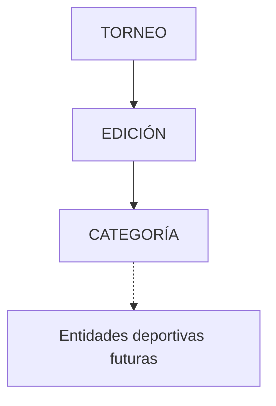

| Nivel | Historia | Versión | Estado |
|---|---|---|---|
| Torneo | HU-004 | 0.2.0 | Consolidado |
| Edición | HU-005 | 0.3.0 | Consolidado |
| Categoría | HU-006 | 0.4.0 | Implementado y verificado |

### 3.3. Relaciones implementadas

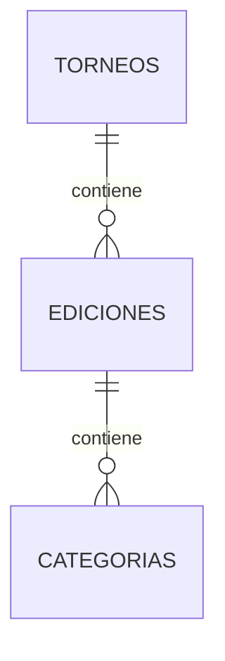

Cada torneo puede contener cero, una
o múltiples ediciones.

Cada edición pertenece a un único torneo.

Cada edición puede contener cero, una
o múltiples categorías.

Cada categoría pertenece a una única edición.

Las relaciones utilizan claves foráneas
restrictivas para proteger la integridad
de los datos deportivos.

### 3.4. Ejemplo de independencia

```text
NOCTURNO
├── NOCTURNO 2027
│   ├── LIBRE
│   ├── SENIOR
│   └── FEMENINO
└── NOCTURNO 2028
    ├── LIBRE
    └── SENIOR

DIURNO
└── DIURNO 2027
    ├── LIBRE
    └── MAYORES DE 40
```

Los nombres utilizados son ilustrativos.

No representan registros obligatorios
ni configuraciones predeterminadas.

Cada categoría constituye un registro
independiente dentro de su edición,
aunque comparta nombre con categorías
de otras ediciones o torneos.

---

## 4. TORNEOS

Un torneo representa una competición institucional
con identidad propia y continuidad en el tiempo.

Ejemplos:

- NOCTURNO.
- DIURNO.

Cada torneo podrá disponer de:

- Identificador único.
- Nombre.
- Descripción.
- Estado administrativo.
- Identidad visual.
- Ediciones.
- Configuraciones particulares.

Los nombres de los torneos no deberán formar
parte de las condiciones fijas del código.

### 4.1. Implementación inicial

| Propiedad | Valor |
|---|---|
| Historia de usuario | HU-004 |
| Versión | 0.2.0 |
| Entidad | Torneo |
| Tabla | `torneos` |
| Migración | `002_torneos.sql` |
| Estado | Aprobado y consolidado |

HU-004 establece la identidad administrativa
básica de cada competición y su ciclo de vida.

### 4.2. Modelo de persistencia

| Campo | Tipo | Restricción |
|---|---|---|
| id | INT | Clave primaria autoincremental |
| nombre | VARCHAR(100) | Obligatorio y único |
| descripcion | VARCHAR(500) | Opcional |
| estado | ENUM | ACTIVO o ARCHIVADO |
| fecha_creacion | TIMESTAMP | Creación automática |
| fecha_actualizacion | TIMESTAMP | Actualización automática |

El nombre dispone de una restricción de unicidad.

El estado administrativo dispone de un índice
para facilitar las consultas correspondientes.

### 4.3. Funcionalidades implementadas

- Creación de torneos.
- Consulta individual.
- Listado general.
- Edición de nombre y descripción.
- Búsqueda.
- Filtrado por estado.
- Archivado reversible.
- Reactivación.
- Eliminación definitiva.
- Confirmación de operaciones destructivas.
- Indicadores administrativos.
- Persistencia en MySQL.
- Protección mediante autenticación.

### 4.4. Estados administrativos

Los estados disponibles son:

- ACTIVO.
- ARCHIVADO.

Todo torneo nuevo se registra como ACTIVO.

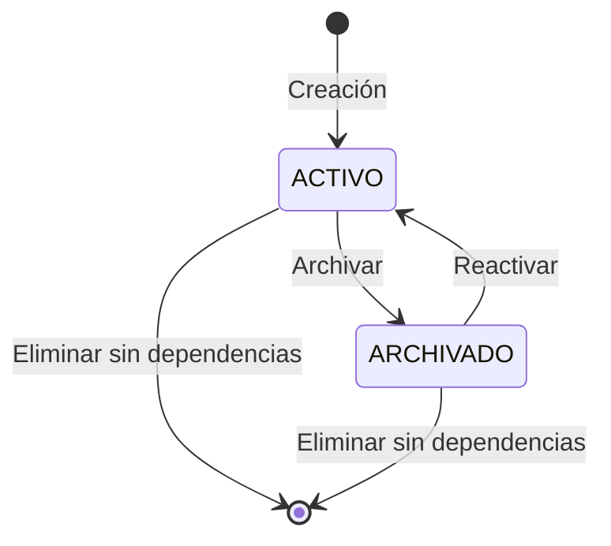

El archivado permite conservar una competición
sin mantenerla administrativamente activa.

El archivado no implica la eliminación de datos
ni equivale a la finalización de una edición.

Los torneos archivados conservan:

- Identificador.
- Nombre.
- Descripción.
- Fechas registradas.
- Ediciones asociadas.
- Categorías de sus ediciones.
- Estados administrativos y deportivos de sus entidades.
- Información histórica que se incorpore posteriormente.

La edición de sus datos básicos permanece
disponible.

Archivar un torneo no finaliza automáticamente
sus ediciones ni modifica sus fechas.

Tampoco archiva automáticamente las categorías
asociadas a sus ediciones.

Las restricciones de operación se detallan
en las secciones 5.6 y 6.6.

### 4.5. Eliminación definitiva

La eliminación definitiva de torneos se encuentra
disponible desde la interfaz y la API.

Puede utilizarse sobre torneos activos y archivados,
siempre que no existan registros dependientes
que impidan su eliminación.

La operación elimina físicamente el registro
correspondiente de MySQL.

No existe un estado administrativo ELIMINADO
ni una papelera de recuperación.

La interfaz deberá solicitar confirmación expresa,
identificando el nombre del torneo y advirtiendo
que la operación no puede deshacerse.

Si el administrador cancela la confirmación,
el registro deberá permanecer intacto.

Una eliminación exitosa deberá:

- Retirar el torneo del listado.
- Actualizar los indicadores administrativos.
- Liberar el nombre anteriormente reservado.
- Preservar los restantes torneos.

La creación posterior de un torneo con el mismo
nombre generará una nueva identidad persistente.

No constituirá una restauración del torneo anterior.

### 4.6. Validaciones

El nombre del torneo deberá:

- Ser obligatorio.
- Tener hasta 100 caracteres.
- Ser único dentro del sistema.
- Utilizar normalización Unicode NFC.
- Eliminar espacios externos.
- Reducir espacios consecutivos.

No se permitirán nombres duplicados que solamente
difieran en mayúsculas, minúsculas o espacios
normalizados.

La descripción es opcional y admite hasta
500 caracteres.

Los nombres de torneos archivados continúan
reservados.

Los nombres de torneos eliminados podrán
utilizarse nuevamente.

### 4.7. Independencia administrativa

Cada torneo posee un identificador persistente.

La creación, edición, archivado, reactivación
o eliminación de una competición no deberá
alterar los datos de otra competición.

NOCTURNO y DIURNO son ejemplos de torneos
administrables.

No constituyen registros obligatorios ni
deberán crearse automáticamente durante
la instalación del sistema.

### 4.8. Alcance de HU-004

La versión 0.2.0 implementa la gestión
administrativa básica de torneos.

HU-005 incorpora EDICIONES en v0.3.0.

HU-006 incorpora CATEGORÍAS en v0.4.0.

Permanecen pendientes:

- Identidad visual de competiciones.
- Reglamentos deportivos.
- Selección global del contexto deportivo.
- Equipos inscritos.
- Restantes entidades deportivas dependientes.

### 4.9. Protección de registros dependientes

La relación TORNEO–EDICIÓN se encuentra implementada
mediante la migración `003_ediciones.sql`.

La clave foránea `fk_ediciones_torneo` impide eliminar
un torneo con ediciones asociadas, independientemente
de su estado administrativo o deportivo.

La restricción utiliza:

- ON DELETE RESTRICT.
- ON UPDATE RESTRICT.

No existe eliminación en cascada.

El backend traduce el error de dependencia
en una respuesta HTTP 409.

La interfaz conserva el torneo y permite
utilizar el archivado como alternativa.

La protección real fue verificada durante HU-005.

Desde HU-006, las ediciones también se encuentran
protegidas frente a eliminaciones incompatibles
con sus categorías.

No deberán eliminarse ediciones o categorías
históricas únicamente para permitir la
eliminación de su torneo.

### 4.10. Comparación de operaciones

| Característica | Archivar | Eliminar |
|---|---|---|
| Conserva el registro | Sí | No |
| Es reversible desde la aplicación | Sí | No |
| Conserva el nombre reservado | Sí | No |
| Retira el torneo de los activos | Sí | Sí |
| Requiere confirmación | Sí | Sí |
| Permite recuperar el mismo registro | Sí | No |
| Preserva los demás torneos | Sí | Sí |
| Disponible con ediciones asociadas | Sí | No |

---

## 5. EDICIONES

Una edición representa una realización determinada
de un torneo.

Ejemplos ilustrativos:

- NOCTURNO 2027.
- DIURNO 2027.
- NOCTURNO 2028.
- DIURNO 2028.

Cada edición pertenece a un único torneo.

Podrán existir ediciones simultáneas.

La finalización de una edición no deberá eliminar
sus datos ni afectar otras ediciones.

Una edición no deberá identificarse exclusivamente
mediante el año, ya que un torneo podría disponer
de más de una edición durante un mismo año.

### 5.1. Estado de implementación

| Propiedad | Valor |
|---|---|
| Historia de usuario | HU-005 |
| Versión | 0.3.0 |
| Entidad | Edición |
| Tabla | `ediciones` |
| Migración | `003_ediciones.sql` |
| Estado | Aprobado y consolidado |

HU-005 permite gestionar las ediciones
de cada torneo.

Desde HU-006, cada edición también permite
administrar sus propias categorías.

### 5.2. Identidad y denominación

Cada edición posee un identificador persistente
propio y pertenece a un único torneo.

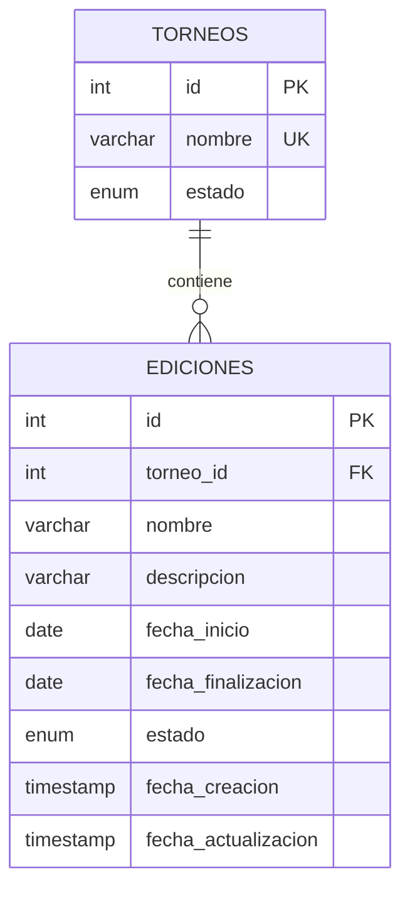

El nombre es libre, obligatorio y admite
hasta 100 caracteres.

El año, cuando corresponda, forma parte del nombre.

No existe un campo `anio` independiente
ni se exige incluir un año.

La unicidad del nombre se limita
al torneo correspondiente.

Se permiten nombres iguales en torneos diferentes,
pero no nombres duplicados dentro del mismo torneo.

Se aplica normalización Unicode NFC y de espacios.

La unicidad se protege mediante la intercalación
`utf8mb4_unicode_ci` de MySQL, que no distingue
mayúsculas, minúsculas ni acentos para estas
comparaciones.

La descripción es opcional y admite
hasta 500 caracteres.

Un nombre reservado por una edición finalizada
continúa reservado.

La eliminación definitiva libera el nombre
dentro de su torneo.

Una creación posterior con ese nombre
tendrá otro identificador.

Ejemplos de ediciones de un mismo torneo:

- NOCTURNO 2027.
- COPA DE VERANO 2027.
- NOCTURNO 2028.

Se permiten múltiples ediciones en el mismo año.

### 5.3. Modelo de persistencia

| Campo | Tipo | Restricción |
|---|---|---|
| id | INT | PK, autoincremental |
| torneo_id | INT | Obligatorio, FK a torneos.id |
| nombre | VARCHAR(100) | Obligatorio; único dentro del torneo |
| descripcion | VARCHAR(500) | Opcional, admite NULL |
| fecha_inicio | DATE | Opcional, admite NULL |
| fecha_finalizacion | DATE | Opcional, admite NULL |
| estado | ENUM | PLANIFICADA, EN_CURSO, FINALIZADA |
| fecha_creacion | TIMESTAMP | Creación automática |
| fecha_actualizacion | TIMESTAMP | Actualización automática |

El estado inicial es PLANIFICADA.

Restricciones e índices:

| Nombre | Responsabilidad |
|---|---|
| uq_ediciones_torneo_nombre | UNIQUE (torneo_id, nombre) |
| idx_ediciones_torneo_estado | Índice (torneo_id, estado) |
| fk_ediciones_torneo | FK restrictiva a torneos.id |
| chk_ediciones_fechas | Finalización igual o posterior al inicio cuando ambas existen |

Motor InnoDB, codificación utf8mb4
e intercalación utf8mb4_unicode_ci.

No existe eliminación automática de ediciones
al archivar el torneo asociado.

### 5.4. Fechas de la edición

Las fechas de inicio y finalización son
independientes, opcionales y editables.

Pueden incorporarse, modificarse o retirarse
sin cambiar automáticamente el estado deportivo.

Reglas:

- Se admiten ambas fechas vacías.
- Se admite una sola fecha informada.
- Se admiten ambas fechas informadas.
- Las fechas deben ser reales y válidas.
- La finalización no puede ser anterior al inicio.
- Se permite que ambas fechas sean iguales.
- Se almacenan como DATE.
- Se intercambian con la API en formato YYYY-MM-DD.
- No requieren conversiones de zona horaria.
- La interfaz permite retirar cualquiera de ellas.

Estas fechas representan datos de planificación
o registro.

No son condiciones automáticas para iniciar,
finalizar o reabrir una edición.

Tampoco impiden la coexistencia de ediciones
cuyas fechas se superpongan.

### 5.5. Ciclo de vida deportivo

| Estado | Significado |
|---|---|
| PLANIFICADA | Edición registrada, aún no iniciada |
| EN_CURSO | Edición iniciada o reabierta |
| FINALIZADA | Edición cerrada deportivamente; conserva sus datos |

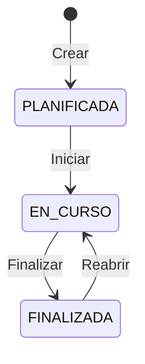

Las transiciones de estado son manuales
y se validan en el backend.

El estado inicial siempre es PLANIFICADA.

No se permite finalizar directamente
una edición planificada ni volver
a PLANIFICADA desde los otros estados.

Reiterar el estado actual no requiere
modificar el registro.

Pueden existir múltiples ediciones EN_CURSO
del mismo torneo.

Finalizar una edición:

- No finaliza otras ediciones.
- No archiva el torneo.
- No elimina información registrada.
- No archiva automáticamente sus categorías.

Reabrir una edición finalizada conserva
su identidad y sus fechas.

Si el torneo está activo, la reapertura
recupera la posibilidad de crear
o reactivar categorías.

Las consecuencias sobre partidos, estadísticas
y disciplina se resolverán conforme a las
reglas aprobadas en las etapas correspondientes.

### 5.6. Relación con el estado administrativo del torneo

El estado ACTIVO o ARCHIVADO del torneo
es independiente del estado deportivo
de cada edición.

| Operación sobre edición | Torneo ACTIVO | Torneo ARCHIVADO |
|---|---|---|
| Consultar y listar | Permitida | Permitida |
| Buscar y filtrar | Permitida | Permitida |
| Crear | Permitida | No permitida |
| Editar datos y fechas | Permitida | Permitida |
| Iniciar una PLANIFICADA | Permitida | No permitida |
| Finalizar una EN_CURSO | Permitida | Permitida |
| Reabrir una FINALIZADA | Permitida | No permitida |
| Eliminar sin dependencias | Permitida | Permitida |

La interfaz informa las restricciones
del torneo archivado.

El backend las hace cumplir independientemente
de la interfaz.

La reactivación de un torneo recupera
la posibilidad de crear, iniciar y reabrir
ediciones conforme a su estado deportivo.

Archivar o reactivar no cambia automáticamente
los estados de sus ediciones.

### 5.7. Operaciones administrativas y navegación

Desde cada tarjeta de TORNEOS se accede
a GESTIONAR EDICIONES.

La pantalla identifica el torneo seleccionado
y muestra exclusivamente sus ediciones.

Funcionalidades:

- Creación y consulta de ediciones.
- Listado.
- Búsqueda por nombre y descripción.
- Filtros por estado.
- Edición de datos básicos y fechas.
- Inicio, finalización y reapertura.
- Eliminación definitiva con confirmación.
- Indicadores administrativos.
- Estados de carga.
- Estados vacíos.
- Mensajes de error.
- Adaptación responsive.
- Acceso a la gestión de categorías.

Cada tarjeta de edición incorpora:

- Indicador CATEGORÍAS.
- Indicador ACTIVAS.
- Botón GESTIONAR CATEGORÍAS.

No existe una opción independiente
en el menú lateral.

La gestión de ediciones depende
del torneo seleccionado.

Esta navegación no constituye todavía
el selector integral de contexto deportivo
previsto para HU-008.

### 5.8. Eliminación y conservación histórica

La eliminación de una edición es física,
no un cambio de estado.

Está disponible para ediciones:

- PLANIFICADAS.
- EN_CURSO.
- FINALIZADAS.

Siempre que no existan dependencias incompatibles.

No existe una papelera ni un estado ELIMINADA.

La interfaz identifica el registro,
advierte que la operación es irreversible
y permite cancelar.

El backend verifica el identificador,
la pertenencia al torneo y las restricciones
aplicables antes de eliminar el registro.

El resultado exitoso actualiza
el listado y los indicadores.

La eliminación de una edición
no afecta otras ediciones.

Desde HU-006, una edición con categorías
asociadas no puede eliminarse.

La restricción se aplica independientemente
del estado de las categorías.

Una categoría archivada también constituye
una dependencia.

La finalización de ediciones no equivale
a su eliminación.

Las futuras entidades dependientes deberán
proteger la información deportiva histórica.

### 5.9. Independencia y operaciones concurrentes

Las consultas y escrituras verifican:

- Identificador del torneo.
- Identificador de la edición.
- Pertenencia de la edición al torneo.

Una edición de otro torneo no deberá
devolverse ni modificarse mediante
una ruta ajena.

Las escrituras se ejecutan mediante
transacciones que bloquean el torneo padre
utilizando SELECT ... FOR UPDATE.

Los conflictos de unicidad, dependencias
y concurrencia se gestionan como errores
controlados de negocio.

La transacción se revierte ante errores.

Las restricciones de MySQL complementan
las validaciones del servicio.

### 5.10. Contrato de acceso

Ruta base:

`/api/torneos/:torneoId/ediciones`

| Método | Ruta relativa | Operación |
|---|---|---|
| GET | / | Listado e indicadores |
| GET | /:edicionId | Consulta individual |
| POST | / | Crear |
| PUT | /:edicionId | Editar datos |
| PATCH | /:edicionId/estado | Cambiar estado |
| DELETE | /:edicionId | Eliminar |

Todos requieren autenticación.

Las escrituras respetan los controles
de origen de solicitudes.

El listado admite los filtros:

- busqueda.
- estado.

Los indicadores representan el conjunto
completo de ediciones del torneo,
independientemente del filtrado.

El contrato técnico completo se detalla en:

[ARQUITECTURA.md](ARQUITECTURA.md)

### 5.11. Límites de HU-005

HU-005 incorpora exclusivamente la gestión
de ediciones y su relación con torneos.

La gestión de categorías fue incorporada
posteriormente mediante HU-006.

No se encuentran implementados todavía:

- Equipos inscritos.
- Listas de buena fe.
- Zonas.
- Jornadas.
- Partidos.
- Copas.
- Estadísticas deportivas.
- Disciplina.
- Identidades visuales personalizadas.
- Selector global de contexto deportivo.

Las reglas previamente documentadas para
estas funcionalidades se conservan.

---

## 6. CATEGORÍAS

Las categorías deberán ser configurables.

Ejemplos:

- LIBRE.
- SENIOR.
- FEMENINO.
- MAYORES DE 40.

Cada torneo y edición podrá disponer
de diferentes categorías, sin estar
obligado a utilizar todas las existentes.

Cada categoría dentro de una edición
podrá disponer posteriormente de:

- Reglamento de edad.
- Equipos participantes.
- Formato de competición.
- Zonas.
- Calendario.
- Copas.
- Identidad visual.
- Estadísticas independientes.

El nombre de una categoría no determina
automáticamente sus reglas deportivas.

### 6.1. Estado de implementación

| Propiedad | Valor |
|---|---|
| Historia de usuario | HU-006 |
| Versión | 0.4.0 |
| Entidad | Categoría |
| Tabla | `categorias` |
| Migración | `004_categorias.sql` |
| Estado | Implementado y verificado; cierre formal pendiente |

HU-006 incorpora el tercer nivel
de la arquitectura multitorneo.

No deberán incorporarse categorías obligatorias
mediante condiciones fijas del código.

### 6.2. Identidad y pertenencia

Cada categoría posee un identificador
persistente propio.

Cada categoría pertenece a una única edición.

Su torneo se determina mediante
la edición asociada.

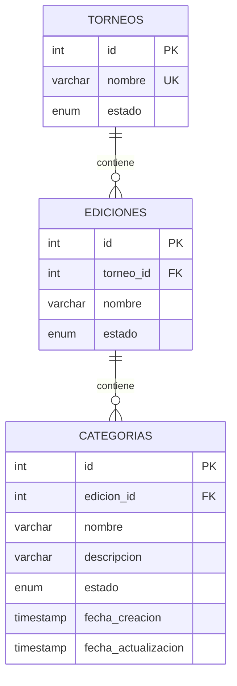

No existe un catálogo global obligatorio
de categorías que condicione la creación
de categorías particulares.

Cada edición administra sus propias categorías.

La categoría no puede trasladarse a otra edición
mediante una modificación de sus datos.

### 6.3. Denominación y unicidad

El nombre de la categoría es libre.

Validaciones:

- Nombre obligatorio.
- Hasta 100 caracteres.
- Normalización Unicode NFC.
- Eliminación de espacios externos.
- Reducción de espacios consecutivos.
- Unicidad dentro de la edición.

La descripción:

- Es opcional.
- Admite hasta 500 caracteres.
- Puede modificarse o eliminarse.

La unicidad se protege mediante:

```text
edicion_id + nombre
```

La comparación no distingue mayúsculas,
minúsculas ni acentos, conforme a la
intercalación utf8mb4_unicode_ci.

Ejemplos:

| Torneo | Edición | Categoría | Resultado |
|---|---|---|---|
| NOCTURNO | 2027 | LIBRE | Permitido |
| NOCTURNO | 2027 | SENIOR | Permitido |
| NOCTURNO | 2028 | LIBRE | Permitido |
| DIURNO | 2027 | LIBRE | Permitido |
| NOCTURNO | 2027 | libre | Duplicado |

El archivado conserva la reserva del nombre.

La eliminación definitiva libera el nombre
dentro de la edición correspondiente.

Una nueva categoría con el mismo nombre
poseerá una identidad persistente diferente.

### 6.4. Modelo de persistencia

| Campo | Tipo | Restricción |
|---|---|---|
| id | INT | PK, autoincremental |
| edicion_id | INT | Obligatorio, FK a ediciones.id |
| nombre | VARCHAR(100) | Obligatorio; único dentro de la edición |
| descripcion | VARCHAR(500) | Opcional, admite NULL |
| estado | ENUM | ACTIVA o ARCHIVADA |
| fecha_creacion | TIMESTAMP | Creación automática |
| fecha_actualizacion | TIMESTAMP | Actualización automática |

El estado inicial es ACTIVA.

Restricciones e índices:

| Nombre | Responsabilidad |
|---|---|
| uq_categorias_edicion_nombre | UNIQUE (edicion_id, nombre) |
| idx_categorias_edicion_estado | Índice (edicion_id, estado) |
| fk_categorias_edicion | FK restrictiva a ediciones.id |

La clave foránea utiliza:

- ON DELETE RESTRICT.
- ON UPDATE RESTRICT.

Configuración de almacenamiento:

- Motor InnoDB.
- Codificación utf8mb4.
- Intercalación utf8mb4_unicode_ci.

La tabla no incorpora un campo torneo_id.

El torneo se obtiene mediante la edición,
evitando duplicar el contexto jerárquico.

### 6.5. Estados administrativos

| Estado | Significado |
|---|---|
| ACTIVA | Categoría administrativamente habilitada |
| ARCHIVADA | Categoría conservada, pero desactivada |

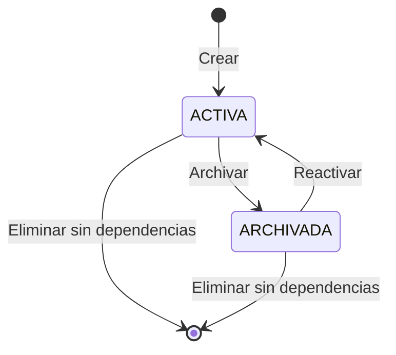

Toda categoría nueva se registra como ACTIVA.

El archivado conserva:

- Identificador.
- Nombre.
- Descripción.
- Edición asociada.
- Fecha de creación.
- Información deportiva asociada que se incorpore posteriormente.

La reactivación recupera el mismo registro.

Repetir el estado vigente no requiere
una nueva escritura.

ACTIVA y ARCHIVADA constituyen estados
administrativos de la categoría.

No representan estados deportivos
de sus futuras fases o competiciones.

### 6.6. Restricciones del contexto deportivo

La creación y reactivación de categorías
requieren simultáneamente:

- Torneo ACTIVO.
- Edición PLANIFICADA o EN_CURSO.

| Operación sobre categoría | Contexto habilitado | Contexto restringido |
|---|---|---|
| Listar | Permitida | Permitida |
| Consultar | Permitida | Permitida |
| Buscar y filtrar | Permitida | Permitida |
| Crear | Permitida | No permitida |
| Editar datos | Permitida | Permitida |
| Archivar | Permitida | Permitida |
| Reactivar | Permitida | No permitida |
| Eliminar sin dependencias | Permitida | Permitida |

Un contexto restringido corresponde a:

- Torneo ARCHIVADO.
- Edición FINALIZADA.
- Ambas condiciones simultáneamente.

La interfaz informa las restricciones
aplicables y deshabilita las acciones
incompatibles.

El backend hace cumplir las mismas reglas
independientemente de la interfaz.

### 6.7. Matriz de creación y reactivación

| Estado del torneo | Estado de la edición | Crear categoría | Reactivar categoría |
|---|---|---|---|
| ACTIVO | PLANIFICADA | Sí | Sí |
| ACTIVO | EN_CURSO | Sí | Sí |
| ACTIVO | FINALIZADA | No | No |
| ARCHIVADO | PLANIFICADA | No | No |
| ARCHIVADO | EN_CURSO | No | No |
| ARCHIVADO | FINALIZADA | No | No |

La reactivación indicada corresponde
al cambio efectivo de ARCHIVADA a ACTIVA.

Una solicitud que repite el estado
vigente no constituye una nueva transición.

### 6.8. Independencia de estados

Los estados administrativos y deportivos
de los tres niveles son independientes.

Archivar un torneo:

- No finaliza sus ediciones.
- No archiva sus categorías.
- Restringe determinadas operaciones.

Finalizar una edición:

- No archiva el torneo.
- No archiva sus categorías.
- Restringe la creación y reactivación de categorías.

Reactivar un torneo:

- No inicia automáticamente sus ediciones.
- No reabre automáticamente sus ediciones.
- No reactiva automáticamente sus categorías.

Reabrir una edición:

- No reactiva categorías archivadas.
- Recupera las operaciones permitidas cuando el torneo está activo.

No existen cambios automáticos
de estado en cascada.

### 6.9. Operaciones administrativas y navegación

Desde cada tarjeta de EDICIONES se accede
mediante GESTIONAR CATEGORÍAS.

Ruta privada:

`/torneos/:torneoId/ediciones/:edicionId/categorias`

La pantalla permite:

- Identificar el torneo correspondiente.
- Identificar la edición correspondiente.
- Consultar los estados del contexto.
- Listar las categorías.
- Crear categorías.
- Editar nombre y descripción.
- Archivar categorías.
- Reactivar categorías.
- Eliminar categorías sin dependencias.
- Buscar por nombre y descripción.
- Filtrar por estado.
- Consultar indicadores.
- Regresar a EDICIONES.

La pantalla incorpora formularios,
contadores de caracteres, mensajes
de confirmación, errores y advertencias.

No existe una opción independiente
en el menú lateral.

La gestión permanece disponible
en torneos archivados y ediciones
finalizadas, respetando sus restricciones.

### 6.10. Indicadores administrativos

Cada edición dispone de tres indicadores:

- Total de categorías.
- Categorías activas.
- Categorías archivadas.

La relación esperada es:

```text
TOTAL = ACTIVAS + ARCHIVADAS
```

Los indicadores representan el conjunto
completo de categorías de la edición.

No dependen de los filtros aplicados.

Cada tarjeta de EDICIONES muestra
los indicadores:

- CATEGORÍAS.
- ACTIVAS.

Al regresar desde CATEGORÍAS,
los indicadores externos se actualizan.

Una consulta fallida no deberá
representarse mediante un cero ficticio.

### 6.11. Búsqueda y filtros

La búsqueda permite consultar categorías
por nombre y descripción.

La comparación es insensible
a mayúsculas y acentos.

Filtros administrativos:

- Todas.
- Activas.
- Archivadas.

La API admite los parámetros:

- busqueda.
- estado.

La implementación SQL de categorías
utiliza LIKE con intercalación explícita
y consultas parametrizadas.

Los caracteres especiales del patrón
se escapan para permitir búsquedas literales.

Durante HU-006 se corrigió un defecto
detectado mediante integración con MySQL
en la búsqueda de descripciones acentuadas.

La prueba original fue aprobada
después de la corrección.

### 6.12. Eliminación definitiva

La eliminación de una categoría es física.

No constituye un archivado ni una
transición administrativa reversible.

Puede utilizarse sobre categorías
activas y archivadas cuando no existan
dependencias incompatibles.

La interfaz deberá:

- Identificar el registro.
- Solicitar confirmación.
- Advertir sobre su irreversibilidad.
- Permitir cancelar.
- Actualizar el listado después de una respuesta exitosa.
- Actualizar los indicadores.

El backend deberá verificar:

- Identificadores válidos.
- Existencia del contexto.
- Pertenencia de la categoría a la edición.
- Restricciones referenciales.

Una eliminación exitosa:

- Retira físicamente la categoría.
- Libera su nombre.
- Preserva las restantes categorías.
- Preserva las demás ediciones y torneos.

No existe una papelera de recuperación.

### 6.13. Protección de la edición

Una edición no podrá eliminarse
mientras posea categorías asociadas.

Esta protección se aplica a:

- Categorías activas.
- Categorías archivadas.

No depende del estado deportivo
de la edición.

La eliminación incompatible produce
una respuesta HTTP 409.

No existe eliminación en cascada.

Las futuras entidades dependientes
de categorías deberán incorporar
sus propias restricciones de integridad.

La protección real entre categorías
y sus futuras entidades dependientes
todavía no puede verificarse porque
dichas entidades no están implementadas.

### 6.14. Independencia entre categorías

Cada categoría deberá administrar
sus propios datos deportivos.

Crear una categoría LIBRE en una edición
no deberá modificar una categoría LIBRE
existente en otra edición.

Archivar, editar, reactivar o eliminar
una categoría no deberá afectar
los registros de otros contextos.

Las coincidencias de nombre no constituyen
relaciones entre categorías.

Las futuras reglas disciplinarias
transversales serán excepciones controladas,
conforme a la sección 12.

### 6.15. Validación jerárquica y transacciones

Las operaciones de categorías comprueban:

1. Identificador del torneo.
2. Identificador de la edición.
3. Pertenencia de la edición al torneo.
4. Identificador de la categoría, cuando corresponda.
5. Pertenencia de la categoría a la edición.
6. Restricciones administrativas aplicables.

Las escrituras utilizan transacciones
con un orden jerárquico de bloqueo:

```text
TORNEO
    ↓
EDICIÓN
    ↓
OPERACIÓN SOBRE CATEGORÍA
```

El repositorio bloquea primero el torneo
y posteriormente la edición.

Las operaciones utilizan la misma
conexión de la transacción.

Los errores conocidos de unicidad,
dependencias y concurrencia se traducen
a respuestas controladas.

La unicidad y las claves foráneas
constituyen mecanismos adicionales
de protección en MySQL.

No se considera que estas medidas
sustituyan futuras pruebas de carga
o concurrencia intensiva.

### 6.16. Contrato de acceso

Ruta base:

`/api/torneos/:torneoId/ediciones/:edicionId/categorias`

| Método | Ruta relativa | Operación |
|---|---|---|
| GET | / | Listado e indicadores |
| GET | /:categoriaId | Consulta individual |
| POST | / | Creación |
| PUT | /:categoriaId | Actualización |
| PATCH | /:categoriaId/estado | Cambio de estado |
| DELETE | /:categoriaId | Eliminación |

Todos los endpoints requieren autenticación.

Las escrituras respetan los controles
de origen del servidor.

El listado devuelve:

- torneo.
- edicion.
- categorias.
- total.
- indicadores.

Los indicadores incluyen:

- total.
- activas.
- archivadas.

Los campos editables de una categoría son:

- nombre.
- descripcion.

El estado se administra mediante
su endpoint específico.

El contrato técnico completo se detalla en:

[ARQUITECTURA.md](ARQUITECTURA.md)

### 6.17. Límites de HU-006

HU-006 incorpora la gestión administrativa
de categorías y su relación con ediciones.

No establece todavía:

- Edades mínimas o máximas.
- Excepciones reglamentarias de edad.
- Formatos deportivos.
- Cantidades de equipos.
- Cantidades de zonas.
- Fases clasificatorias.
- Calendarios.
- Sistemas de puntuación.
- Identidades visuales personalizadas.
- Reglas particulares de copas.
- Estadísticas.
- Sanciones.
- Selección global de contexto.

Estas funcionalidades se incorporarán
en las historias correspondientes.

No deberán introducirse reglas deportivas
implícitas basadas únicamente en nombres
como LIBRE, SENIOR o FEMENINO.

---

## 7. CONTEXTO DEPORTIVO

El contexto deportivo se determinará mediante:

- Identificador del torneo.
- Identificador de la edición.
- Identificador de la categoría de la edición.

### 7.1. Selector de contexto

El frontend deberá ofrecer un selector
que permita cambiar de competición
sin cerrar la sesión del administrador.

El contexto seleccionado deberá permanecer
visible durante las operaciones deportivas.

### 7.2. Validación del contexto

El backend deberá verificar que los identificadores
recibidos correspondan a relaciones válidas.

No se deberá confiar exclusivamente en los filtros
aplicados por el frontend.

El cambio de contexto deberá impedir que datos
cargados anteriormente se utilicen accidentalmente
en operaciones de otra competición.

### 7.3. Estado de implementación

| Propiedad | Valor |
|---|---|
| Historia de usuario | HU-008 |
| Estado | Pendiente |

La navegación administrativa existente
permite recorrer TORNEOS, EDICIONES
y CATEGORÍAS.

Sin embargo, no constituye todavía
el selector integral de contexto deportivo.

HU-005 verifica la relación torneo-edición.

HU-006 verifica la relación
torneo-edición-categoría.

### 7.4. Navegación jerárquica actual

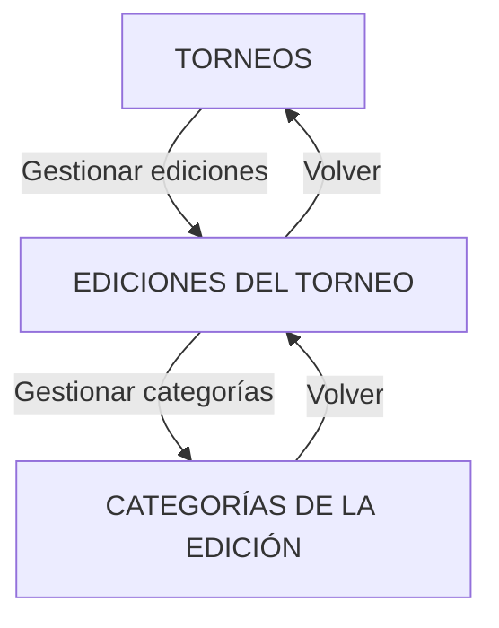

Las rutas parametrizadas permiten
identificar el contexto correspondiente.

El backend rechaza combinaciones
de identificadores que no pertenezcan
a relaciones válidas.

### 7.5. Evolución prevista

HU-008 deberá definir la selección
global de una combinación válida
de torneo, edición y categoría.

Los futuros módulos deportivos
utilizarán el contexto correspondiente.

Las decisiones sobre su persistencia,
presentación y comportamiento deberán
establecerse durante HU-008.

No se considera implementado este selector
por la existencia de la navegación jerárquica.

---

## 8. EQUIPOS E INSCRIPCIONES

La participación de un equipo deberá vincularse
a una edición y categoría determinadas.

Un mismo nombre de equipo podrá existir
en diferentes competiciones.

El nombre de un equipo no constituye
un identificador único global del sistema.

Las inscripciones deberán mantener
su identidad histórica para preservar
resultados y estadísticas de cada competición.

### 8.1. Estado de implementación

Pendiente de la ETAPA 03.

La implementación de categorías proporciona
el contexto jerárquico sobre el cual
se incorporarán las inscripciones.

La estructura definitiva de equipos
y sus relaciones deberá diseñarse
durante las historias correspondientes.

---

## 9. JUGADORES Y LISTAS DE BUENA FE

Las listas de buena fe constituyen registros
administrativos independientes de las estadísticas
de goleadores.

Un jugador podrá participar en distintas categorías
conforme al reglamento aplicable.

No podrá representar a diferentes equipos dentro
de una misma edición y categoría.

Los datos personales deberán protegerse y no
formar parte de las publicaciones deportivas.

Las reglas de identidad y habilitación deberán
permitir el control disciplinario transversal.

La identidad disciplinaria del jugador deberá
permitir reconocerlo aunque participe en diferentes
torneos, categorías, ediciones o equipos.

### 9.1. Estado de implementación

Pendiente de la ETAPA 04.

Las reglas de edad, identidad, inscripción
y habilitación deberán implementarse
durante las historias correspondientes.

HU-006 no introduce validaciones
automáticas de edad.

---

## 10. FORMATOS DE COMPETICIÓN

Cada categoría podrá disponer de formatos propios.

El modelo deberá permitir:

- Fases clasificatorias.
- Zonas.
- Partidos interzonales.
- Jornadas distribuidas en diferentes días.
- Copas.
- Eliminatorias a partido único.
- Eliminatorias de ida y vuelta.
- Definiciones mediante penales.

La programación de los partidos será manual.

No deberán establecerse días de juego obligatorios
mediante constantes en el código.

La implementación de los formatos deberá respetar
las reglas particulares de cada competición.

### 10.1. Estado de implementación

Pendiente de las etapas deportivas correspondientes.

La existencia de categorías independientes
no implica que sus formatos de competición
se encuentren definidos automáticamente.

---

## 11. ESTADÍSTICAS

Las estadísticas deberán calcularse utilizando
exclusivamente los partidos correspondientes
al contexto deportivo consultado.

Las tablas de posiciones, goleadores y valla menos
vencida no deberán mezclar información de
diferentes torneos, ediciones o categorías.

### 11.1. Partidos interzonales

Los partidos interzonales deberán computarse
según las reglas deportivas aprobadas.

### 11.2. Acumulación estadística

Las estadísticas acumuladas entre fases y copas
deberán respetar el reglamento de la competición.

### 11.3. Fuente de verdad

Los resultados y eventos registrados constituirán
la fuente de verdad para los cálculos deportivos.

Las correcciones deberán evitar duplicaciones
y permitir recalcular las estadísticas afectadas.

### 11.4. Indicadores administrativos

Los indicadores administrativos no constituyen
estadísticas de rendimiento deportivo.

#### TORNEOS — v0.2.0

- Total de torneos registrados.
- Total de torneos activos.
- Total de torneos archivados.

El Dashboard incorpora un contador
de torneos activos obtenido mediante la API.

#### EDICIONES — v0.3.0

- Total de ediciones.
- Ediciones PLANIFICADAS.
- Ediciones EN CURSO.
- Ediciones FINALIZADAS.

La pantalla EDICIONES presenta
los cuatro indicadores.

Las tarjetas de TORNEOS muestran
el total de ediciones y las que
se encuentran EN CURSO.

#### CATEGORÍAS — v0.4.0

- Total de categorías.
- Categorías ACTIVA.
- Categorías ARCHIVADA.

La pantalla CATEGORÍAS presenta
los tres indicadores.

Las tarjetas de EDICIONES muestran
el total de categorías y las activas.

### 11.5. Consistencia de indicadores

Los indicadores deberán representar
el conjunto completo de registros
de su contexto correspondiente.

No dependerán de los filtros
aplicados sobre el listado.

Las creaciones, cambios de estado
y eliminaciones deberán reflejarse
en los indicadores correspondientes.

Una consulta fallida no deberá
interpretarse como ausencia de registros.

Los valores deberán obtenerse
de información real del sistema.

### 11.6. Estado de implementación

Los indicadores administrativos de torneos,
ediciones y categorías están implementados.

Las estadísticas deportivas
permanecen pendientes.

---

## 12. DISCIPLINA

### 12.1. Independencia disciplinaria

El NOCTURNO y el DIURNO dispondrán de sistemas
disciplinarios paralelos e independientes.

Las sanciones temporales aplicadas en un torneo
no afectarán la habilitación del jugador en el otro.

La única excepción será la sanción DEFINITIVA.

### 12.2. Tipos de sanciones

El sistema contemplará:

- Sanciones por cantidad de fechas.
- Sanciones FIN DE TORNEO.
- Sanciones DEFINITIVAS.

Cada sanción deberá conservar
su contexto deportivo de origen.

### 12.3. Sanciones por fechas

Una sanción por cantidad de fechas afectará
exclusivamente al torneo donde fue aplicada.

Dentro de ese torneo, el jugador quedará
inhabilitado en todas sus categorías mientras
la sanción permanezca vigente.

El cumplimiento se computará exclusivamente
en la categoría de origen.

Los partidos disputados en otras categorías
o en otro torneo no descontarán fechas.

Cada partido posterior finalizado del equipo
correspondiente en la categoría de origen
descontará una fecha, incluyendo partidos
resueltos por incomparecencia.

No descontarán fechas:

- El partido donde se produjo la expulsión.
- Las jornadas libres.
- Los partidos pendientes.
- Los partidos de otras categorías.
- Los partidos de otros torneos.

### 12.4. Sanciones FIN DE TORNEO

El jugador quedará inhabilitado en todas las
categorías del torneo donde recibió la sanción
hasta la finalización de la edición correspondiente.

Esta sanción no afectará su habilitación
en el otro torneo.

### 12.5. Sanciones DEFINITIVAS

Una sanción DEFINITIVA aplicada en el NOCTURNO
o en el DIURNO producirá la inhabilitación
permanente del jugador en ambos torneos.

La inhabilitación comprenderá:

- Todas las categorías.
- Todas las ediciones presentes y futuras.
- Todos los equipos.

La sanción no expirará por:

- El transcurso del tiempo.
- La finalización de una edición.
- El cambio de categoría.
- El cambio de equipo.

### 12.6. Identidad disciplinaria

Las sanciones deberán vincularse a la identidad
del jugador y no exclusivamente a su inscripción
en un equipo determinado.

El sistema deberá evitar que un cambio de equipo,
categoría o edición permita eludir una sanción
vigente dentro de su alcance reglamentario.

La identificación disciplinaria deberá contemplar
el DNI como identificador personal, protegiendo
su confidencialidad.

### 12.7. Ejemplos reglamentarios

#### Ejemplo A — Sanción de tres fechas

Origen: NOCTURNO LIBRE.

| Competición | Situación |
|---|---|
| NOCTURNO LIBRE | Suspendido |
| NOCTURNO SENIOR | Suspendido |
| DIURNO | No afectado por esta sanción |

Las fechas se descontarán exclusivamente
mediante los partidos correspondientes
a la categoría de origen.

#### Ejemplo B — FIN DE TORNEO

Origen: NOCTURNO LIBRE.

| Competición | Situación |
|---|---|
| NOCTURNO LIBRE | Suspendido |
| NOCTURNO SENIOR | Suspendido |
| DIURNO | No afectado por esta sanción |

La sanción expirará al finalizar
la edición correspondiente.

#### Ejemplo C — DEFINITIVA

Origen: NOCTURNO LIBRE.

| Competición | Situación |
|---|---|
| NOCTURNO LIBRE | Inhabilitado permanentemente |
| NOCTURNO SENIOR | Inhabilitado permanentemente |
| DIURNO | Inhabilitado permanentemente |

Las mismas reglas se aplicarán de manera
recíproca cuando la sanción se origine
en el DIURNO.

La habilitación efectiva del jugador dependerá
también de otras sanciones vigentes y de los
requisitos reglamentarios correspondientes.

### 12.8. Resumen del alcance disciplinario

| Sanción | Categoría de origen | Otras categorías del torneo | Otro torneo |
|---|---|---|---|
| Por fechas | Afectada | Afectadas | No afectado |
| FIN DE TORNEO | Afectada | Afectadas | No afectado |
| DEFINITIVA | Afectada | Afectadas | Afectado |

El resumen representa las reglas aprobadas
para NOCTURNO y DIURNO.

### 12.9. Escalabilidad disciplinaria

El alcance de las sanciones deberá formar parte
del modelo de configuración reglamentaria.

No se deberán utilizar los nombres NOCTURNO
y DIURNO como condiciones fijas del código.

La incorporación de futuros torneos requerirá
definir expresamente su vinculación con los
regímenes disciplinarios existentes.

No se extenderá automáticamente el alcance
de las sanciones DEFINITIVAS a nuevos torneos
sin una definición reglamentaria aprobada.

### 12.10. Pruebas disciplinarias obligatorias

La futura implementación deberá comprobar:

- Independencia de sanciones temporales entre torneos.
- Bloqueo transversal entre categorías del mismo torneo.
- Cumplimiento de fechas en la categoría de origen.
- Ausencia de descuentos por partidos de otro torneo.
- Expiración correcta de sanciones FIN DE TORNEO.
- Inhabilitación DEFINITIVA en ambos torneos.
- Persistencia de la inhabilitación DEFINITIVA.
- Control de identidad ante cambios de equipo.
- Conservación del historial disciplinario.

No deberán implementarse excepciones disciplinarias
sin una regla previamente aprobada.

### 12.11. Estado de implementación

Pendiente de la ETAPA 09.

Las reglas de esta sección constituyen
una definición reglamentaria para
su futura implementación.

HU-006 no incorpora el motor disciplinario
ni modifica las reglas previamente aprobadas.

---

## 13. IDENTIDAD VISUAL

### 13.1. Identidad de las competiciones

La identidad visual de las competiciones
no deberá estar fijada directamente
en el código.

El sistema deberá permitir configurar:

- Logotipos.
- Colores mediante valores HEX.
- Identidad del torneo.
- Identidad de la edición.
- Identidad de las categorías.
- Identidad de las copas.

Las publicaciones deberán utilizar
la identidad visual del contexto
deportivo correspondiente.

### 13.2. Sistema de Diseño institucional

La versión 0.2.0 incorpora el Sistema
de Diseño v1.0 de ALTO-SISTEMA.

Características principales:

- Azul institucional `#3333FF`.
- Fondo general `#080808`.
- Tipografía Barlow Condensed.
- Tipografía Inter.
- Iconografía Lucide React.
- Design Tokens.
- Componentes reutilizables.
- Diseño responsive.
- Estados visuales semánticos.

HU-005 y HU-006 reutilizan el Sistema
de Diseño v1.0 sin modificar
su identidad institucional.

La definición completa se encuentra en:

[SISTEMA_DE_DISENO.md](SISTEMA_DE_DISENO.md)

### 13.3. Independencia de identidades visuales

Se distinguen dos sistemas visuales:

1. Identidad institucional de ALTO-SISTEMA.
2. Identidad personalizable de las competiciones.

La identidad institucional define
la apariencia general de la aplicación.

La identidad de las competiciones determinará
sus propios logotipos, colores y publicaciones.

Los colores y logotipos de las competiciones
no deberán modificar accidentalmente
la identidad institucional de ALTO-SISTEMA.

### 13.4. Publicaciones deportivas

La exportación de placas deberá realizarse
en formato PNG, con ancho uniforme
y altura adaptable al contenido.

Los estándares específicos de las publicaciones
se definirán durante la etapa correspondiente.

### 13.5. Estado de implementación

| Funcionalidad | Estado |
|---|---|
| Sistema de Diseño institucional | Implementado y verificado |
| Identidad visual de torneos | Pendiente |
| Identidad visual de ediciones | Pendiente |
| Identidad visual de categorías | Pendiente |
| Identidad visual de copas | Pendiente |
| Publicaciones deportivas PNG | Pendiente |

La identidad visual de competiciones
corresponde a HU-007.

La generación de publicaciones
corresponde a la ETAPA 10.

### 13.6. Relación con HU-006

La implementación de los tres niveles
jerárquicos permite avanzar posteriormente
hacia la configuración visual de competiciones.

HU-006 no incorpora todavía campos
de logotipos, colores o configuraciones
visuales particulares.

Los criterios de almacenamiento,
personalización y eventual herencia
de identidades visuales deberán
definirse expresamente en HU-007.

---

## 14. INTEGRIDAD DE LOS DATOS

El diseño de la base de datos deberá utilizar:

- Claves primarias.
- Claves foráneas.
- Restricciones de unicidad contextual.
- Índices apropiados.
- Transacciones cuando corresponda.
- Validaciones de relaciones.
- Migraciones versionadas.

### 14.1. Independencia de operaciones

Las operaciones de escritura deberán verificar
el contexto deportivo de todos los registros
involucrados.

Una operación sobre un torneo no deberá modificar
accidentalmente los datos de otro torneo.

Una operación sobre una edición no deberá afectar
categorías de otras ediciones.

Las excepciones disciplinarias expresamente
aprobadas deberán aplicarse mediante operaciones
controladas, verificables y documentadas.

### 14.2. Migraciones implementadas

| Migración | Responsabilidad |
|---|---|
| 001_usuarios.sql | Usuarios administrativos |
| 002_torneos.sql | Gestión de torneos |
| 003_ediciones.sql | Gestión de ediciones e integridad TORNEO–EDICIÓN |
| 004_categorias.sql | Gestión de categorías e integridad EDICIÓN–CATEGORÍA |

Las migraciones aplicadas deberán conservarse
sin modificaciones posteriores.

Toda evolución estructural deberá incorporarse
mediante una nueva migración versionada.

La eliminación definitiva de torneos no requirió
modificar la estructura existente.

### 14.3. Fuente de verdad

MySQL constituye la fuente de verdad
de los datos persistentes.

Las validaciones del frontend deberán
complementarse con validaciones
del backend y restricciones
de integridad de la base de datos.

### 14.4. Integridad referencial actual

| Entidad padre | Entidad dependiente | Clave foránea |
|---|---|---|
| torneos | ediciones | fk_ediciones_torneo |
| ediciones | categorias | fk_categorias_edicion |

Ambas relaciones utilizan:

- ON DELETE RESTRICT.
- ON UPDATE RESTRICT.

No se permite eliminar un torneo
con ediciones asociadas.

No se permite eliminar una edición
con categorías asociadas.

Las restricciones fueron verificadas
mediante integraciones con MySQL.

No deberán existir registros deportivos
huérfanos como consecuencia de
operaciones administrativas.

### 14.5. Unicidad contextual

| Entidad | Restricción de unicidad |
|---|---|
| Torneo | nombre |
| Edición | torneo_id + nombre |
| Categoría | edicion_id + nombre |

La unicidad deberá responder al alcance
de cada entidad deportiva.

No deberán utilizarse nombres como
identificadores globales cuando
el dominio permita su repetición
en contextos diferentes.

### 14.6. Restricciones adicionales

Las ediciones disponen de una restricción
CHECK que protege la coherencia de sus fechas.

Los estados administrativos y deportivos
se limitan a los valores correspondientes
a cada entidad.

Las futuras entidades deberán definir
sus propias restricciones de negocio
e integridad referencial.

### 14.7. Orden de eliminación

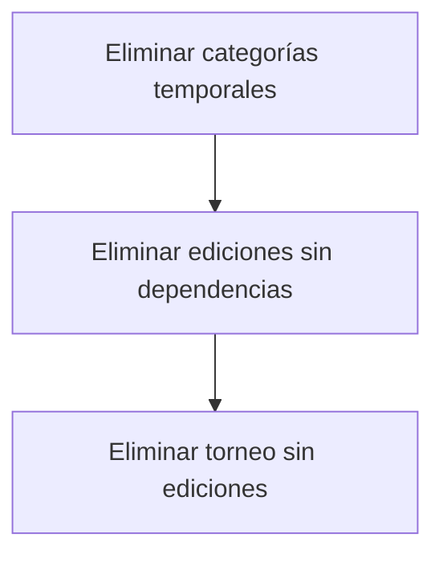

El orden anterior corresponde
a contextos que pueden eliminarse
legítimamente sin comprometer
información deportiva histórica.

No autoriza la eliminación indiscriminada
de registros reales.

Las futuras entidades deportivas
deberán ampliar este orden conforme
a sus relaciones.

### 14.8. Verificación histórica de migraciones

En HU-005 se verificó:

- Actualización desde v0.2.0.
- Aplicación en la base principal.
- Aplicación en el entorno aislado.
- Instalación desde cero.
- Tres migraciones aplicadas.
- Segunda ejecución sin pendientes.

La base de instalación limpia utilizada fue:

`altosistemahu005fresh`

### 14.9. Verificación de migraciones en HU-006

| Entorno | Migraciones aplicadas |
|---|---:|
| alto_sistema | 4/4 |
| altosistemahu004test | 4/4 |

La migración 004 fue aplicada
correctamente sobre ambas instalaciones
existentes.

Se verificó posteriormente la relación
EDICIÓN–CATEGORÍA mediante integración.

Permanecen pendientes del cierre técnico:

- Instalación limpia de las cuatro migraciones.
- Idempotencia de las cuatro migraciones.
- Verificación final del inventario de migraciones.

La restauración de respaldos deportivos
continúa pendiente de verificación específica.

---

## 15. HISTORIAL

La finalización de un torneo o edición
no deberá implicar la eliminación
automática de sus datos.

El sistema deberá permitir consultar:

- Ediciones anteriores.
- Equipos participantes.
- Resultados.
- Clasificaciones.
- Goleadores.
- Campeones.
- Sanciones.
- Publicaciones históricas.

### 15.1. Conservación disciplinaria

Las sanciones DEFINITIVAS deberán conservarse
independientemente del estado de la edición
donde fueron aplicadas.

### 15.2. Archivado administrativo

El archivado de torneos implementado
en HU-004 constituye el primer mecanismo
administrativo de conservación.

HU-005 incorpora la finalización
y reapertura de ediciones.

HU-006 incorpora el archivado
y reactivación de categorías.

Estas operaciones conservan
las identidades de los registros.

Los torneos archivados, las ediciones
finalizadas y las categorías archivadas
permanecen disponibles para consulta.

La política definitiva de archivo
y conservación de las restantes
entidades se definirá posteriormente.

### 15.3. Eliminación y conservación histórica

La eliminación definitiva deberá utilizarse
para retirar registros que puedan eliminarse
sin comprometer información deportiva asociada.

El archivado será la alternativa correspondiente
cuando existan dependencias que deban conservarse.

Una competición eliminada y posteriormente
creada con el mismo nombre constituirá
un registro diferente.

Las futuras relaciones deberán utilizar
identificadores persistentes y no nombres
como referencias de identidad.

### 15.4. Independencia histórica

Una nueva edición no deberá reemplazar
los registros de una edición anterior.

Una nueva categoría no deberá reutilizar
la identidad de una categoría eliminada.

Las coincidencias de denominación
no deberán utilizarse para fusionar
información deportiva histórica.

### 15.5. Estado de implementación

Se encuentran implementados:

- Archivado y eliminación de torneos.
- Finalización y reapertura de ediciones.
- Eliminación de ediciones sin dependencias.
- Archivado y reactivación de categorías.
- Eliminación de categorías sin dependencias.

La finalización de una edición todavía
no genera un historial de resultados,
campeones, estadísticas o sanciones.

El historial deportivo integral
permanece pendiente de la ETAPA 12.

---

## 16. ESCALABILIDAD FUNCIONAL

La incorporación de un nuevo torneo,
edición o categoría deberá realizarse
mediante operaciones administrativas.

No deberá requerir:

- Duplicar el proyecto.
- Crear otra base de datos operativa.
- Modificar el código fuente.
- Crear una nueva instalación.
- Reiniciar el sistema por cada registro creado.

La arquitectura deberá permitir
nuevas modalidades de competición
mediante ampliaciones controladas.

### 16.1. Capacidad incorporada en HU-004

La versión 0.2.0 permite administrar
múltiples torneos desde la interfaz.

Cada torneo dispone de una identidad
persistente y un estado administrativo
independiente.

Su ciclo de vida comprende:

- Creación.
- Edición.
- Archivado.
- Reactivación.
- Eliminación definitiva.

### 16.2. Evolución prevista

Las siguientes historias de usuario
incorporarán las entidades dependientes
restantes de cada competición.

El desarrollo deberá conservar
la independencia de los datos
y evitar límites arbitrarios.

### 16.3. Capacidad incorporada en HU-005

La versión 0.3.0 permite crear
y administrar múltiples ediciones
por torneo.

Se permiten:

- Nombres configurables.
- Fechas opcionales.
- Ediciones simultáneas.
- Ediciones EN_CURSO del mismo torneo.

Las ediciones se mantienen
dentro de su propio torneo.

### 16.4. Capacidad incorporada en HU-006

La versión 0.4.0 permite crear
y administrar múltiples categorías
por edición.

No existen cantidades fijas
ni denominaciones obligatorias.

La creación de categorías:

- No requiere modificar código.
- No requiere reiniciar servidores.
- No requiere nuevas bases operativas.
- No modifica otras categorías.
- No modifica otros contextos deportivos.

### 16.5. Escalabilidad de indicadores

Los indicadores de entidades dependientes
se consultan actualmente mediante
solicitudes adicionales.

TORNEOS consulta indicadores de EDICIONES.

EDICIONES consulta indicadores de CATEGORÍAS.

La estrategia podrá optimizarse
mediante consultas agregadas
cuando el volumen de registros
o las mediciones lo justifiquen.

No se han establecido todavía
límites de rendimiento comprobados
mediante pruebas de carga.

---

## 17. CRITERIOS DE ACEPTACIÓN ARQUITECTÓNICA

Las implementaciones deberán demostrar:

- Creación de múltiples torneos.
- Gestión simultánea del NOCTURNO y DIURNO.
- Independencia de sus ediciones.
- Independencia de sus categorías.
- Separación de equipos inscritos.
- Separación de resultados y estadísticas.
- Selección segura del contexto deportivo.
- Conservación del historial.
- Rechazo de relaciones deportivas incompatibles.
- Independencia disciplinaria temporal.
- Aplicación transversal de sanciones DEFINITIVAS.

Deberán incorporarse pruebas automatizadas
que comprueben expresamente que las operaciones
sobre un torneo no alteran indebidamente otro.

Las sanciones DEFINITIVAS constituirán
una excepción reglamentaria controlada
y deberán contar con pruebas específicas.

Los criterios correspondientes a módulos
todavía no implementados permanecen pendientes.

### 17.1. Criterios específicos de HU-004

| ID | Criterio | Verificación |
|---|---|---|
| CA-01 | Creación de torneos | Satisfactoria |
| CA-02 | Validación de campos obligatorios | Satisfactoria |
| CA-03 | Prevención de nombres duplicados | Satisfactoria |
| CA-04 | Listado de torneos | Satisfactoria |
| CA-05 | Búsqueda y filtros | Satisfactoria |
| CA-06 | Edición de nombre y descripción | Satisfactoria |
| CA-07 | Archivado con confirmación | Satisfactoria |
| CA-08 | Reactivación | Satisfactoria |
| CA-09 | Persistencia después del reinicio | Satisfactoria |
| CA-10 | Independencia entre torneos | Satisfactoria |
| CA-11 | Protección mediante autenticación | Satisfactoria |
| CA-12 | Adaptación responsive | Satisfactoria |
| CA-13 | Pruebas automatizadas | Satisfactoria |
| CA-14 | Regresión | Satisfactoria |
| CA-15 | Eliminación definitiva | Satisfactoria |
| CA-16 | Cancelación de eliminación | Satisfactoria |
| CA-17 | Independencia tras eliminación | Satisfactoria |
| CA-18 | Reutilización de nombres eliminados | Satisfactoria |

HU-004 fue aprobada y consolidada
mediante el commit `27654c0`.

### 17.2. Controles complementarios de HU-004

| Control | Resultado |
|---|---|
| Sistema de Diseño v1.0 | Verificado |
| Integridad de migraciones | Verificada |
| Consistencia de versión | Verificada |
| Limpieza de torneos temporales | Completada |
| Documentación | Consolidada |
| CHECK integral | Aprobado |

### 17.3. Verificaciones funcionales de HU-005

| N.º | Control | Resultado |
|---:|---|---|
| 01 | Integración visual con TORNEOS | Verificado |
| 02 | Navegación hacia EDICIONES | Verificado |
| 03 | Creación de ediciones | Verificado |
| 04 | Fechas opcionales | Verificado |
| 05 | Modificación de fechas | Verificado |
| 06 | Inicio | Verificado |
| 07 | Finalización | Verificado |
| 08 | Reapertura | Verificado |
| 09 | Indicadores internos | Verificado |
| 10 | Ediciones simultáneas | Verificado |
| 11 | Modificación de nombre y descripción | Verificado |
| 12 | Eliminación de fechas | Verificado |
| 13 | Búsqueda y filtros | Verificado |
| 14 | Indicadores externos | Verificado |
| 15 | Restricciones de torneos archivados | Verificado |
| 16 | Eliminación e integridad referencial | Verificado |
| 17 | Adaptación responsive | Verificado mediante emulación |

Resultado funcional: 17/17.

HU-005 fue aprobada y consolidada
mediante el commit `ccfb4d2`.

### 17.4. Reglas funcionales implementadas en HU-006

La gestión de categorías deberá satisfacer:

| Requisito | Estado |
|---|---|
| Categorías configurables | Implementado |
| Categorías sin denominaciones obligatorias | Implementado |
| Pertenencia a una edición | Implementado |
| Nombre obligatorio | Implementado |
| Descripción opcional | Implementado |
| Unicidad dentro de la edición | Implementado |
| Unicidad insensible a mayúsculas y acentos | Implementado |
| Independencia entre contextos | Implementado |
| Estado inicial ACTIVA | Implementado |
| Archivado reversible | Implementado |
| Reactivación condicionada | Implementado |
| Edición de datos básicos | Implementado |
| Eliminación definitiva | Implementado |
| Confirmación de operaciones | Implementado |
| Restricciones del contexto | Implementado |
| Integridad EDICIÓN–CATEGORÍA | Implementado |
| Indicadores administrativos | Implementado |
| Búsqueda y filtros | Implementado |
| Integración con EDICIONES | Implementado |
| Autenticación | Implementado |
| Adaptación responsive | Implementado |

La aprobación formal del conjunto
corresponde al CHECK integral de HU-006.

Esta tabla describe las reglas implementadas;
no establece nuevos criterios de aceptación.

### 17.5. Verificaciones funcionales de HU-006

| N.º | Control |
|---:|---|
| 01 | Integración con EDICIONES |
| 02 | Estado inicial vacío |
| 03 | Creación sin descripción |
| 04 | Creación con descripción |
| 05 | Prevención de duplicados |
| 06 | Edición de categoría |
| 07 | Archivado |
| 08 | Reactivación |
| 09 | Búsqueda y filtros |
| 10 | Actualización de indicadores externos |
| 11 | Independencia entre ediciones |
| 12 | Restricciones de edición finalizada |
| 13 | Reapertura de edición |
| 14 | Restricciones de torneo archivado |
| 15 | Integridad referencial |
| 16 | Eliminación de registros |
| 17 | Adaptación responsive |

Los 17 controles fueron revisados durante
la validación funcional.

Se recibieron confirmaciones satisfactorias
del administrador.

La secuencia de eliminación fue parcialmente
abreviada debido a la eliminación anticipada
de registros temporales.

La independencia de contextos, reapertura
y eliminación ordenada cuentan también
con verificación automatizada.

La adaptación responsive fue confirmada
mediante emulación del navegador.

No constituye una validación física
en un dispositivo móvil.

### 17.6. Verificación automatizada de HU-006

Las pruebas unitarias de categorías
registraron 111 aprobaciones.

La integración de categorías fue aprobada
después de corregir el defecto de búsqueda
SQL detectado en su primera ejecución.

La prueba integral comprende 28 controles
internos relacionados con:

- Autenticación.
- Aislamiento de datos.
- Validaciones.
- Unicidad contextual.
- Creación.
- Consulta.
- Edición.
- Estados administrativos.
- Restricciones del contexto.
- Búsqueda.
- Indicadores.
- Persistencia.
- Integridad referencial.
- Eliminación.
- Limpieza de registros.

Los controles internos forman parte
de una única prueba de integración.

No se contabilizan como pruebas
automatizadas independientes.

### 17.7. Controles pendientes de HU-006

- Instalación limpia de cuatro migraciones.
- Idempotencia.
- ESLint final.
- Compilación de producción final.
- Verificación conjunta de versiones.
- Limpieza de registros demostrativos.
- Consolidación documental.
- Verificación de evidencias.
- CHECK integral.
- Aprobación formal.
- Commit y publicación.

---

## 18. ESTADO DE IMPLEMENTACIÓN

### 18.1. Evolución del modelo

| Versión | Incorporación |
|---|---|
| 0.1.0 | Infraestructura inicial |
| 0.1.1 | Autenticación |
| 0.1.2 | Interfaz administrativa |
| 0.1.3 | Consolidación arquitectónica |
| 0.2.0 | Gestión integral de torneos y Sistema de Diseño v1.0 |
| 0.3.0 | Gestión de ediciones e integridad TORNEO–EDICIÓN |
| 0.4.0 | Gestión de categorías e integridad EDICIÓN–CATEGORÍA |

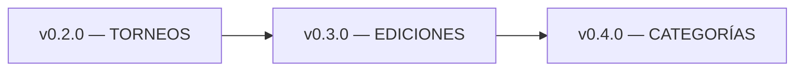

### 18.2. Entidades y funcionalidades

| Entidad o funcionalidad | Estado |
|---|---|
| Torneos | Implementado y consolidado |
| Ediciones | Implementado y consolidado |
| Categorías | Implementado y verificado; cierre pendiente |
| Reglamentos deportivos | Pendiente |
| Identidad visual de competiciones | Pendiente |
| Selector de contexto deportivo | Pendiente |
| Equipos e inscripciones | Pendiente |
| Listas de buena fe | Pendiente |
| Fases y zonas | Pendiente |
| Jornadas y partidos | Pendiente |
| Tablas de posiciones | Pendiente |
| Goleadores | Pendiente |
| Valla menos vencida | Pendiente |
| Copas y playoffs | Pendiente |
| Disciplina | Pendiente |
| Publicaciones deportivas | Pendiente |
| Historial deportivo | Pendiente |

### 18.3. Verificación histórica de torneos

| Control | Resultado |
|---|---|
| Unitarias de autenticación | 13/13 |
| Unitarias de torneos | 30/30 |
| Integración de autenticación | 1/1 |
| Integración de torneos | 1/1 |
| Total de pruebas automatizadas | 45/45 |
| Controles internos de integración | 20/20 |
| Pruebas fallidas | 0 |
| Migraciones aplicadas | 2 |
| Idempotencia | Verificada |
| Instalación desde cero | Verificada |
| ESLint | 0 errores y 0 advertencias |
| Compilación de producción | Exitosa |
| Tiempo de compilación final | 3,49 segundos |
| Revisión visual inicial | 8/8 |
| Validación funcional | Satisfactoria |
| Limpieza de registros temporales | Completada |
| CHECK integral | Aprobado |
| Consolidación | Commit 27654c0 |

Las 45 pruebas corresponden a 43 unitarias
y dos integraciones.

Durante HU-004 la protección de dependencias
se verificó mediante simulación.

HU-005 incorporó la restricción real
entre torneos y ediciones.

HU-006 incorporó la restricción real
entre ediciones y categorías.

### 18.4. Evolución de la ETAPA 02

| Historia | Responsabilidad | Estado |
|---|---|---|
| HU-004 | Gestión integral de torneos | Aprobada y consolidada |
| HU-005 | Gestión de ediciones | Aprobada y consolidada |
| HU-006 | Gestión de categorías | Verificada; cierre pendiente |
| HU-007 | Identidad visual | Pendiente |
| HU-008 | Selección del contexto deportivo | Pendiente |

La ETAPA 02 permanecerá abierta
hasta completar todas sus historias.

### 18.5. Conservación de las reglas deportivas

La implementación de torneos, ediciones
y categorías no modifica las reglas
previamente establecidas sobre:

- Independencia deportiva.
- Independencia estadística.
- Identidad de jugadores.
- Habilitaciones.
- Formatos de competición.
- Disciplina.
- Conservación del historial.

El reglamento disciplinario será implementado
durante la etapa correspondiente.

Este documento constituye una referencia
obligatoria para las futuras historias.

### 18.6. Verificación histórica de ediciones — v0.3.0

| Control | Resultado |
|---|---|
| Unitarias de autenticación | 13/13 |
| Unitarias de torneos | 30/30 |
| Unitarias de ediciones | 59/59 |
| Integración de autenticación | 1/1 |
| Integración de torneos | 1/1 |
| Integración de ediciones | 1/1 |
| Total de pruebas automatizadas | 105/105 |
| Pruebas fallidas en ejecuciones satisfactorias | 0 |
| Migraciones registradas | 3 |
| Migraciones pendientes | 0 |
| Instalación desde cero e idempotencia | Verificadas |
| Integridad TORNEO–EDICIÓN | Verificada |
| ESLint | Sin errores informados |
| Compilación de producción | Exitosa |
| Validaciones funcionales | 17/17 |
| Limpieza de registros temporales | Completada |
| Coherencia de versiones | 8/8 |
| CHECK integral | Aprobado |
| Consolidación | Commit ccfb4d2 |

Las 105 pruebas corresponden a 102 unitarias
y tres integraciones ejecutadas por separado.

La integración de EDICIONES comprende
14 bloques internos de verificación.

Se recibió el resultado global satisfactorio,
no el detalle individual de cada diagnóstico.

Los bloques no se contabilizan
como pruebas independientes.

### 18.7. Verificación de categorías — v0.4.0

| Grupo | Resultado |
|---|---:|
| Unitarias de autenticación | 13/13 |
| Unitarias de torneos | 30/30 |
| Unitarias de ediciones | 59/59 |
| Unitarias de categorías | 111/111 |
| Total de pruebas unitarias | 213/213 |
| Integración de autenticación | 1/1 |
| Integración de torneos | 1/1 |
| Integración de ediciones | 1/1 |
| Integración de categorías | 1/1 |
| Total de integraciones | 4/4 |
| Total acumulado aprobado | 217/217 |

Las integraciones se ejecutaron
de manera separada.

La ejecución general de npm test
registra 217 pruebas detectadas,
213 aprobadas y cuatro integraciones
omitidas intencionalmente.

Las cuatro integraciones fueron
ejecutadas y aprobadas por separado.

### 18.8. Controles complementarios de categorías

| Control | Resultado |
|---|---|
| Migración 004 sobre base principal | Satisfactoria |
| Migración 004 sobre base de pruebas | Satisfactoria |
| Unicidad por edición | Verificada |
| Independencia entre contextos | Verificada |
| Restricciones por estado del torneo | Verificadas |
| Restricciones por estado de la edición | Verificadas |
| Integridad EDICIÓN–CATEGORÍA | Verificada |
| Búsqueda de categorías | Corregida y verificada |
| Integración de categorías | 1/1 |
| Controles internos de integración | 28/28 |
| Validaciones funcionales | 17 controles revisados |
| Adaptación responsive | Confirmada mediante emulación |
| Limpieza automática de integración | Completada |
| Backend v0.4.0 | Operativo |
| Frontend v0.4.0 | Operativo |
| Capturas esenciales | 5/5 revisadas |
| Instalación limpia | Pendiente |
| Idempotencia final | Pendiente |
| ESLint final | Pendiente |
| Compilación final | Pendiente |
| CHECK integral | Pendiente |

### 18.9. Evidencias visuales de HU-006

| Archivo | Evidencia |
|---|---|
| 30-ediciones-categorias-v040.png | Integración con EDICIONES |
| 31-categorias-listado-v040.png | Gestión de categorías |
| 32-categorias-formulario-v040.png | Formulario |
| 33-movil-categorias-v040.png | Adaptación móvil |
| 34-pruebas-v040.png | Regresión automatizada |

Las evidencias se encuentran referenciadas
en el README principal.

Las capturas históricas se conservan.

La política de documentación visual
prioriza las novedades de cada versión.

### 18.10. Evolución de las pruebas

| Versión | Unitarias | Integraciones | Total aprobado |
|---|---:|---:|---:|
| 0.2.0 | 43 | 2 | 45 |
| 0.3.0 | 102 | 3 | 105 |
| 0.4.0 | 213 | 4 | 217 |

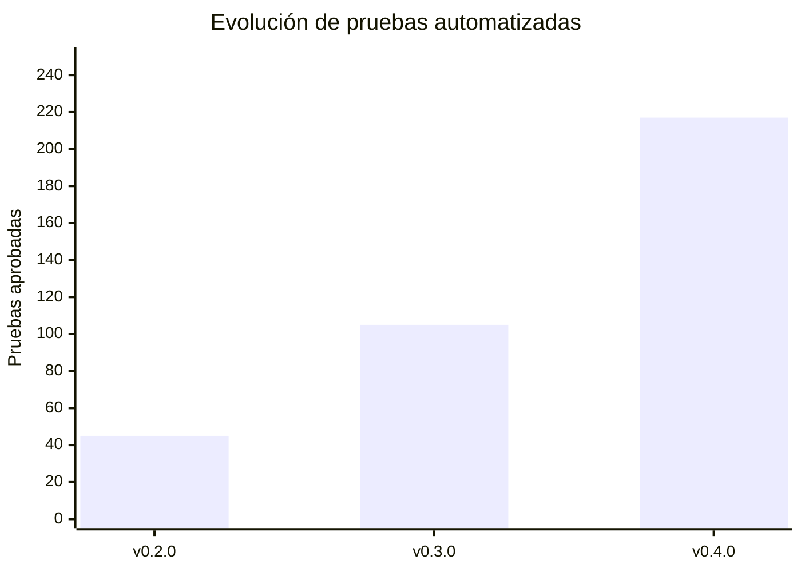

La cantidad de pruebas constituye
un indicador de evolución.

No representa por sí sola una medición
completa de cobertura o calidad.

### 18.11. Limitaciones actuales

- Identidades visuales particulares pendientes.
- Selector global de contexto pendiente.
- Equipos e inscripciones pendientes.
- Reglamentos de edad pendientes.
- Entidades deportivas restantes pendientes.
- Motor disciplinario pendiente.
- Historial deportivo integral pendiente.
- Publicaciones PNG pendientes.
- Restauración de respaldos deportivos pendiente.
- Pruebas de carga pendientes.
- Pruebas físicas en dispositivos móviles pendientes.
- Optimización de indicadores jerárquicos pendiente si resulta necesaria.
- Despliegue en producción pendiente.

### 18.12. Estado actual

Versión local:

**v0.4.0**

Última versión consolidada:

**v0.3.0**

Historia en proceso de cierre:

**HU-006 — Gestión de categorías**

Jerarquía deportiva implementada:

```text
TORNEO
  └── EDICIÓN
        └── CATEGORÍA
```

Próxima historia:

**HU-007 — Identidad visual de competiciones**

La implementación de HU-007 no comenzará
hasta completar las verificaciones finales,
aprobar el CHECK integral y consolidar
HU-006 mediante Git.

---

**ALTO-SISTEMA**

Sistema integral de gestión deportiva.