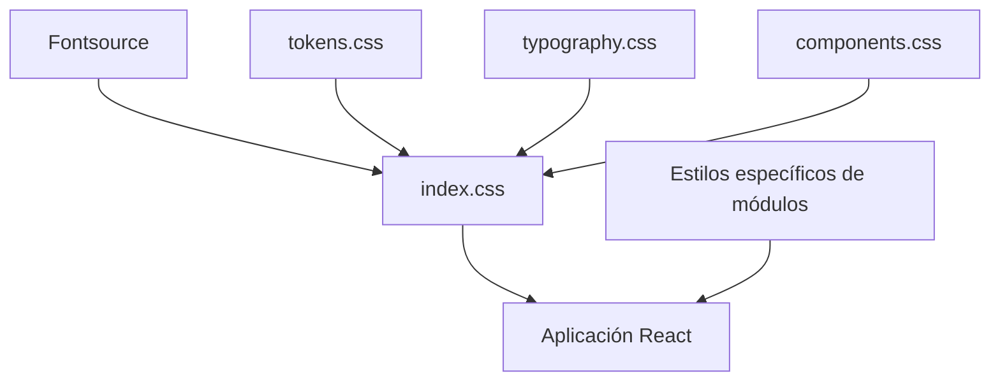

# ALTO-SISTEMA — Sistema de Diseño

Versión del Sistema de Diseño: 1.0

Versión de ALTO-SISTEMA: 0.2.0

Historia de usuario: HU-004.

Estado: implementado y verificado.
Pendiente de consolidación definitiva.

---

## 1. OBJETIVO

Establecer una identidad visual institucional
coherente, profesional, moderna y reutilizable
para todos los módulos de ALTO-SISTEMA.

El Sistema de Diseño deberá garantizar:

- Consistencia visual.
- Identidad institucional.
- Claridad de información.
- Jerarquía tipográfica.
- Reutilización de componentes.
- Adaptación responsive.
- Accesibilidad.
- Mantenibilidad.
- Escalabilidad visual.

Su aplicación será transversal a todos
los módulos administrativos y deportivos
del sistema.

---

## 2. PRINCIPIOS DE DISEÑO

### 2.1. Identidad

ALTO-SISTEMA deberá mantener una apariencia
institucional reconocible.

La estética adoptada combina fondos oscuros
con un azul eléctrico como color principal.

### 2.2. Claridad

La información deberá presentarse mediante
estructuras comprensibles y jerarquizadas.

Los elementos decorativos no deberán
dificultar la operación administrativa.

### 2.3. Consistencia

Los elementos que compartan una misma
responsabilidad deberán mantener una
apariencia y comportamiento equivalentes.

### 2.4. Reutilización

Los componentes visuales deberán
reutilizar estilos compartidos.

Se evitará reproducir innecesariamente
las mismas definiciones CSS.

### 2.5. Funcionalidad

La interfaz deberá priorizar la operación
eficiente del administrador.

Especialmente durante:

- Registro de resultados.
- Consulta de información.
- Administración de competiciones.
- Operaciones desde dispositivos móviles.

### 2.6. Seguridad visual

Las acciones destructivas deberán
distinguirse claramente de las
operaciones convencionales.

La apariencia de una acción deberá
corresponder a sus consecuencias.

### 2.7. Escalabilidad

Los futuros módulos deberán poder
incorporarse sin reconstruir la
identidad visual general.

---

## 3. IDENTIDAD INSTITUCIONAL

### 3.1. Nombre

ALTO-SISTEMA.

### 3.2. Descripción

Sistema integral de gestión deportiva.

### 3.3. Estética

- Interfaz predominantemente oscura.
- Azul eléctrico institucional.
- Encabezados deportivos.
- Tipografía administrativa legible.
- Paneles con bordes discretos.
- Iconografía consistente.
- Contrastes semánticos.

### 3.4. Independencia institucional

La identidad institucional de ALTO-SISTEMA
deberá mantenerse independiente de
las identidades visuales particulares
de las competiciones.

Los colores de un torneo no deberán
modificar automáticamente la apariencia
general de la aplicación.

---

## 4. PALETA CROMÁTICA

### 4.1. Colores institucionales

| Token | Valor |
|---|---|
| Primary | #3333FF |
| Primary hover | #4848FF |
| Primary active | #2929D9 |
| Primary light | #9999FF |
| Primary muted | rgba(51, 51, 255, 0.12) |

El azul institucional deberá utilizarse
principalmente para:

- Acciones principales.
- Navegación seleccionada.
- Identificación institucional.
- Elementos destacados.
- Indicadores de foco cuando corresponda.

### 4.2. Fondos

| Elemento | Color |
|---|---|
| Fondo general | #080808 |
| Menú lateral | #111111 |
| Superficie | #181818 |
| Superficie hover | #202020 |
| Superficie activa | #282828 |
| Campos de formulario | #151515 |
| Superposición | rgba(0, 0, 0, 0.65) |

### 4.3. Bordes

| Elemento | Color |
|---|---|
| Borde estándar | #303030 |
| Borde hover | #484848 |
| Borde de foco | #9999FF |

### 4.4. Textos

| Elemento | Color |
|---|---|
| Texto principal | #F5F5F5 |
| Texto secundario | #A3A3A3 |
| Texto atenuado | #858585 |
| Texto deshabilitado | #707070 |

### 4.5. Colores semánticos

| Semántica | Color |
|---|---|
| Éxito | #22C55E |
| Advertencia | #F59E0B |
| Peligro | #EF4444 |
| Texto de peligro | #FCA5A5 |
| Información | #60A5FA |

### 4.6. Utilización semántica

Los colores deberán comunicar
información funcional.

El verde se utilizará para estados
satisfactorios o favorables.

El amarillo o naranja se utilizará
para advertencias.

El rojo se utilizará para errores,
riesgos y operaciones destructivas.

El azul informativo se utilizará
para mensajes de información.

El significado de un elemento no
deberá depender exclusivamente
de su color.

Los estados deberán complementarse
con texto o iconografía.

---

## 5. TIPOGRAFÍA

### 5.1. Tipografía de encabezados

Barlow Condensed.

Utilización:

- Identidad institucional.
- Títulos principales.
- Encabezados de módulos.
- Encabezados destacados.
- Marcadores deportivos cuando corresponda.

### 5.2. Tipografía de interfaz

Inter.

Utilización:

- Formularios.
- Botones.
- Navegación.
- Textos descriptivos.
- Tablas.
- Indicadores.
- Mensajes administrativos.
- Información numérica.

### 5.3. Escala tipográfica

| Escala | Tamaño |
|---|---:|
| XS | 12 px |
| SM | 14 px |
| BASE | 15 px |
| MD | 16 px |
| LG | 18 px |
| XL | 24 px |
| 2XL | 32 px |
| 3XL | 40 px |
| 4XL | 48 px |

Los tamaños deberán utilizarse
según la jerarquía del contenido.

No deberán incorporarse tamaños
arbitrarios cuando exista un valor
equivalente dentro de los tokens.

### 5.4. Distribución local

Las fuentes se incorporan mediante:

- @fontsource/inter
- @fontsource/barlow-condensed

Esta estrategia permite distribuir
las fuentes junto con la aplicación.

No se requiere depender de una
consulta externa a Google Fonts
durante la utilización habitual.

### 5.5. Información numérica

Las tablas e indicadores deberán
favorecer una lectura clara de
los valores numéricos.

Cuando corresponda se utilizarán
números tabulares para facilitar
la comparación entre registros.

### 5.6. Optimización futura

La selección de subconjuntos y
variantes tipográficas podrá
optimizarse posteriormente.

La reducción de recursos deberá
preservar los caracteres utilizados
por el idioma español y los nombres
de participantes.

---

## 6. ESPACIADOS Y DIMENSIONES

### 6.1. Escala de espaciado

| Escala | Valor |
|---|---:|
| 0 | 0 px |
| 1 | 4 px |
| 2 | 8 px |
| 3 | 12 px |
| 4 | 16 px |
| 5 | 20 px |
| 6 | 24 px |
| 7 | 32 px |
| 8 | 40 px |
| 9 | 48 px |
| 10 | 64 px |

La distribución de elementos deberá
priorizar los valores disponibles
en los tokens.

### 6.2. Radios

| Escala | Valor |
|---|---:|
| SM | 4 px |
| MD | 6 px |
| LG | 10 px |
| XL | 16 px |
| FULL | 999 px |

Los radios deberán mantener una
apariencia consistente entre
componentes equivalentes.

### 6.3. Dimensiones principales

| Elemento | Dimensión |
|---|---:|
| Altura mínima de botones | 44 px |
| Altura mínima de campos | 44 px |
| Encabezado principal | 76 px |
| Menú lateral de escritorio | 260 px |
| Menú lateral móvil | 280 px |
| Ancho máximo del menú móvil | 85 vw |

### 6.4. Sombras y transiciones

Las sombras y transiciones deberán
utilizar las definiciones compartidas
del Sistema de Diseño.

No deberán producir efectos
excesivos que dificulten la
operación habitual.

### 6.5. Distribución de contenido

Los componentes deberán conservar
espacios suficientes para:

- Identificar acciones.
- Leer información.
- Evitar pulsaciones accidentales.
- Diferenciar grupos funcionales.
- Mantener una jerarquía visual.

---

## 7. ICONOGRAFÍA

### 7.1. Biblioteca oficial

Lucide React.

Dependencia:

`lucide-react`

### 7.2. Criterios generales

Los iconos deberán:

- Mantener una apariencia consistente.
- Representar una acción comprensible.
- Utilizar tamaños proporcionados.
- Complementar los textos cuando corresponda.
- Evitar duplicaciones innecesarias.

No se utilizarán emojis como
sustitutos de la iconografía
estructural de la aplicación.

### 7.3. Iconografía de módulos

| Módulo | Icono |
|---|---|
| Inicio | House |
| Torneos | Trophy |
| Equipos | Shield |
| Listas de buena fe | ClipboardList |
| Partidos | CalendarDays |
| Posiciones | ChartNoAxesColumn |
| Goleadores | Medal |
| Valla menos vencida | ShieldCheck |
| Playoffs | GitMerge |
| Disciplina | Gavel |
| Publicaciones | Image |
| Historial | History |
| Configuración | Settings |

### 7.4. Iconografía de acciones

| Acción | Icono |
|---|---|
| Crear | Plus |
| Buscar | Search |
| Editar | Pencil |
| Archivar | Archive |
| Reactivar | ArchiveRestore |
| Eliminar | Trash2 |
| Guardar | Save |
| Cancelar o cerrar | X |
| Actualizar | RefreshCw |
| Confirmación exitosa | CircleCheck |
| Advertencia o error | CircleAlert |
| Fecha | CalendarDays |
| Actualización temporal | Clock |

### 7.5. Centralización

La iconografía estructural se
encuentra centralizada en:

`frontend/src/config/iconos.config.js`

Los módulos deberán reutilizar
la configuración cuando representen
los mismos elementos estructurales.

Los iconos específicos de una
operación podrán utilizarse
directamente en el componente
correspondiente.

---

## 8. ARQUITECTURA CSS

### 8.1. Archivos compartidos

```text
frontend/src/
├── styles/
│   ├── tokens.css
│   ├── typography.css
│   └── components.css
└── index.css
```

### 8.2. Responsabilidades

| Archivo | Responsabilidad |
|---|---|
| tokens.css | Variables visuales |
| typography.css | Definiciones tipográficas |
| components.css | Componentes reutilizables |
| index.css | Integración global de estilos |

### 8.3. Flujo de estilos



### 8.4. Estilos específicos

Cada módulo podrá disponer
de estilos particulares.

Ejemplos:

- AppLayout.css
- Login.css
- Dashboard.css
- Torneos.css
- ModuloPendiente.css

Los estilos particulares deberán
resolver necesidades específicas
sin redefinir innecesariamente
los componentes compartidos.

### 8.5. Prefijo institucional

Los componentes reutilizables
utilizarán el prefijo:

`as-`

Esto permite identificar las clases
pertenecientes al Sistema de Diseño.

### 8.6. Evolución

La incorporación de un componente
reutilizable deberá evaluarse cuando
una misma necesidad aparezca en
distintos módulos.

No deberá convertirse automáticamente
cada estilo particular en un
componente global.

---

## 9. DESIGN TOKENS

### 9.1. Definición

Los Design Tokens representan valores
visuales reutilizables.

Su centralización permite mantener
consistencia y facilita futuras
modificaciones globales.

### 9.2. Grupos de tokens

El Sistema de Diseño contempla:

- Colores institucionales.
- Colores semánticos.
- Fondos.
- Bordes.
- Textos.
- Familias tipográficas.
- Tamaños tipográficos.
- Espaciados.
- Radios.
- Sombras.
- Transiciones.
- Dimensiones.
- Capas visuales.

### 9.3. Ejemplos de variables

```css
--color-primary
--font-heading
--space-4
--radius-md
```

Los valores y nombres efectivos
se encuentran definidos en:

`frontend/src/styles/tokens.css`

El archivo constituye la referencia
técnica de los tokens implementados.

### 9.4. Utilización

Los componentes deberán consultar
las variables compartidas cuando
exista un token correspondiente.

Se evitarán valores visuales
duplicados dentro de distintos
archivos CSS.

### 9.5. Modificación

Una modificación de un token
global deberá evaluarse considerando
su impacto sobre toda la aplicación.

Los cambios significativos deberán
verificarse mediante una regresión
visual de los módulos existentes.

---

## 10. COMPONENTES REUTILIZABLES

### 10.1. Botones

Clase base:

`as-button`

Variantes:

| Clase | Responsabilidad |
|---|---|
| as-button-primary | Acción principal |
| as-button-secondary | Acción secundaria |
| as-button-danger | Acción destructiva |
| as-button-success | Acción favorable |
| as-button-warning | Acción de advertencia |
| as-button-ghost | Acción de bajo énfasis |
| as-button-icon | Acción mediante icono |
| as-button-block | Botón de ancho completo |

Los botones deberán conservar
una altura interactiva adecuada.

### 10.2. Paneles

Clase principal:

`as-panel`

Los paneles permiten agrupar
contenido administrativo relacionado.

### 10.3. Tarjetas

Clase principal:

`as-card`

Las tarjetas permiten representar
registros, entidades o grupos
de información.

Podrán contener:

- Encabezado.
- Identificación.
- Estado.
- Descripción.
- Información complementaria.
- Acciones administrativas.

### 10.4. Indicadores

Familia de estilos:

`as-stat`

Los indicadores deberán mostrar
valores comprensibles y claramente
identificados.

No deberán utilizarse valores
ficticios como información real.

### 10.5. Formularios

Familias de estilos compartidos:

- as-form
- as-field
- as-input

Los formularios deberán contemplar
etiquetas, ayudas, errores y acciones.

### 10.6. Buscadores y filtros

Los buscadores y filtros deberán
utilizar los componentes compartidos
disponibles.

Sus estados seleccionados deberán
identificarse claramente.

### 10.7. Estados administrativos

Los estados deberán representarse
mediante texto y estilos semánticos.

Ejemplos:

- ACTIVO.
- ARCHIVADO.
- DISPONIBLE.
- NO DISPONIBLE.

### 10.8. Mensajes

Familia de estilos:

`as-alert`

Los mensajes deberán diferenciar:

- Éxito.
- Error.
- Advertencia.
- Información.

### 10.9. Tablas

La estructura visual de las tablas
deberá facilitar la comparación
de registros y valores.

Las futuras tablas deportivas
deberán respetar los formatos
funcionales aprobados.

### 10.10. Estados vacíos

Un estado vacío deberá comunicar
la ausencia de información.

Cuando corresponda deberá ofrecer
una acción para iniciar el registro.

### 10.11. Carga

Los indicadores de carga deberán
comunicar que una operación
se encuentra en ejecución.

No deberán confundirse con un
estado vacío o un error.

### 10.12. Estructuras de página

Los módulos deberán reutilizar
las estructuras compartidas
para encabezados, herramientas,
contenido e indicadores.

### 10.13. Referencia técnica

Las familias de componentes
descritas en esta sección se
encuentran implementadas en:

`frontend/src/styles/components.css`

Los nombres exactos de sus clases
auxiliares deberán consultarse
en dicho archivo.

---

## 11. NAVEGACIÓN Y ESTRUCTURA GENERAL

### 11.1. Menú lateral

El menú lateral constituye el
principal mecanismo de navegación
administrativa.

Deberá identificar:

- Identidad institucional.
- Módulos disponibles.
- Módulo seleccionado.
- Acciones relacionadas con la sesión.

### 11.2. Encabezado principal

El encabezado deberá proporcionar
información relevante para la
operación del sistema.

La incorporación futura del
selector de contexto deportivo
deberá respetar esta estructura.

### 11.3. Área de contenido

El área principal deberá permitir
la presentación de información
administrativa y deportiva.

Su distribución deberá adaptarse
al tamaño disponible.

### 11.4. Dashboard

El Dashboard deberá utilizar
componentes compartidos para:

- Identificación del sistema.
- Accesos rápidos.
- Indicadores.
- Información de disponibilidad.
- Estado administrativo.

### 11.5. Módulos pendientes

Los módulos todavía no implementados
deberán presentar una pantalla
provisional identificada.

No deberán simular funcionalidades
que aún no se encuentren operativas.

---

## 12. FORMULARIOS Y OPERACIONES ADMINISTRATIVAS

### 12.1. Campos

Los campos deberán mantener:

- Etiquetas identificables.
- Valores legibles.
- Indicadores de foco.
- Mensajes de validación.
- Estados deshabilitados.
- Dimensiones táctiles apropiadas.

### 12.2. Campos obligatorios

Los campos obligatorios deberán
identificarse claramente.

Su ausencia deberá generar
mensajes comprensibles.

### 12.3. Acciones principales

Las acciones de creación y
guardado deberán utilizar
la jerarquía visual correspondiente.

### 12.4. Acciones secundarias

Las acciones de cancelación,
edición y consulta deberán
diferenciarse de las acciones
principales cuando corresponda.

### 12.5. Archivado

El archivado constituye una
operación administrativa reversible.

La interfaz deberá distinguirlo
de la eliminación definitiva.

La acción utiliza el icono Archive.

### 12.6. Reactivación

La reactivación permite recuperar
el estado activo de un registro
previamente archivado.

La acción utiliza el icono
ArchiveRestore.

### 12.7. Eliminación definitiva

La acción ELIMINAR constituye
una operación destructiva.

Deberá utilizar:

- Variante as-button-danger.
- Icono Trash2.
- Etiqueta de acción comprensible.
- Confirmación explícita.
- Advertencia de irreversibilidad.

No deberá utilizarse la misma
apariencia de las acciones
principales para representar
una eliminación definitiva.

### 12.8. Confirmación

La confirmación deberá identificar
el registro afectado.

El administrador deberá poder
cancelar sin modificar información.

La versión 0.2.0 utiliza el
mecanismo nativo de confirmación
del navegador.

Su apariencia depende del
navegador y del sistema operativo.

No constituye un diálogo visual
personalizado del Sistema de Diseño.

### 12.9. Operaciones en ejecución

Mientras una operación administrativa
se encuentre en ejecución deberán
bloquearse las acciones incompatibles.

La interfaz deberá evitar envíos
duplicados y modificaciones
simultáneas innecesarias.

### 12.10. Resultado de operaciones

Las operaciones exitosas deberán
producir una actualización coherente
de la información visible.

Los errores deberán comunicarse
sin presentar como exitosa
una operación rechazada.

La eliminación deberá actualizar
el listado y los indicadores
únicamente después de recibir
la respuesta satisfactoria
del backend.

---

## 13. ESTADOS VISUALES Y MENSAJES

### 13.1. Estados administrativos

El módulo TORNEOS utiliza:

- ACTIVO.
- ARCHIVADO.

ACTIVO deberá comunicar una
competición administrativamente
habilitada.

ARCHIVADO deberá comunicar una
competición conservada, pero
no administrativamente activa.

### 13.2. Registro eliminado

ELIMINADO no constituye un estado
administrativo persistente.

Un torneo eliminado correctamente
deberá retirarse del listado.

No deberá conservarse una tarjeta
simulada de un registro inexistente.

### 13.3. Confirmaciones exitosas

Los mensajes de éxito deberán
informar el resultado de la
operación realizada.

Ejemplos:

- Torneo creado correctamente.
- Torneo actualizado correctamente.
- Torneo archivado correctamente.
- Torneo reactivado correctamente.
- Torneo eliminado correctamente.

### 13.4. Errores

Los mensajes de error deberán:

- Ser comprensibles.
- Identificar el problema.
- Evitar detalles internos sensibles.
- Facilitar la corrección cuando corresponda.

### 13.5. Ausencia de datos

La ausencia de registros deberá
diferenciarse de una consulta fallida.

No deberá mostrarse un contador
cero cuando no fue posible
obtener los datos correspondientes.

### 13.6. Búsqueda sin resultados

La ausencia de coincidencias
deberá diferenciarse de la
ausencia total de registros.

La interfaz deberá permitir
modificar o limpiar los filtros.

### 13.7. Cancelaciones

La cancelación de una confirmación
no deberá representarse como un
error de persistencia.

El estado anterior deberá conservarse.

---

## 14. DISEÑO RESPONSIVE

### 14.1. Objetivo

ALTO-SISTEMA deberá permitir
la operación administrativa
desde computadoras y dispositivos
móviles.

La adaptación responsive constituye
un requisito permanente del proyecto.

### 14.2. Puntos de corte

| Contexto | Ancho |
|---|---|
| Móvil compacto | Hasta 480 px |
| Navegación móvil | Hasta 900 px |
| Escritorio | Desde 901 px |
| Escritorio amplio | Desde 1440 px |

### 14.3. Navegación móvil

El menú lateral deberá adaptarse
al espacio disponible.

Deberá permitir:

- Apertura.
- Cierre.
- Selección de módulos.
- Identificación de la opción activa.
- Retorno al contenido principal.

### 14.4. Formularios móviles

Los formularios deberán conservar
campos legibles y acciones
fácilmente identificables.

No deberán depender de una
distribución horizontal fija.

### 14.5. Tarjetas móviles

Las tarjetas deberán reorganizar
su contenido según el ancho disponible.

Los textos deberán adaptarse
sin perder información relevante.

### 14.6. Acciones de torneos

Cada tarjeta de torneo dispone
de tres acciones administrativas:

- EDITAR.
- ARCHIVAR o REACTIVAR.
- ELIMINAR.

La incorporación de ELIMINAR
no deberá provocar:

- Desbordamiento horizontal.
- Superposición de botones.
- Ocultamiento de acciones.
- Reducción excesiva de los controles.
- Dificultades para identificar
  la operación destructiva.

### 14.7. Indicadores móviles

Los indicadores deberán reorganizarse
según el espacio disponible.

La adaptación no deberá modificar
sus valores ni su significado.

### 14.8. Tablas deportivas futuras

Las futuras tablas deberán
mantener legibilidad y acceso
a su información.

La estrategia responsive podrá
depender de la naturaleza de
cada tabla.

### 14.9. Verificación realizada

La adaptación responsive de HU-004
fue comprobada mediante el navegador.

La incorporación de la eliminación
definitiva superó la verificación
funcional de la interfaz.

La validación en dispositivos
móviles físicos permanece pendiente.

---

## 15. ACCESIBILIDAD

### 15.1. Principios

La interfaz deberá favorecer
una operación comprensible
mediante diferentes mecanismos
de interacción.

### 15.2. Foco

Los elementos interactivos
deberán disponer de indicadores
visibles de foco.

### 15.3. Navegación mediante teclado

Los controles deberán permitir
la interacción mediante teclado
cuando corresponda.

Los elementos no interactivos
no deberán utilizarse como
sustitutos innecesarios de
botones o enlaces.

### 15.4. Etiquetas accesibles

Los controles deberán disponer
de nombres comprensibles.

Las acciones sobre registros
deberán identificar adecuadamente
el elemento afectado.

### 15.5. Contraste

Los textos y componentes deberán
mantener contraste suficiente
respecto de sus fondos.

Los colores semánticos deberán
complementarse mediante texto
o iconografía.

### 15.6. Controles táctiles

Se establece una altura mínima
de 44 px para botones y campos
de formulario estándar.

La distribución deberá evitar
pulsaciones accidentales.

### 15.7. Movimiento reducido

Las animaciones y transiciones
deberán respetar las preferencias
de movimiento reducido cuando
corresponda.

### 15.8. Acciones destructivas

La eliminación definitiva deberá
identificarse mediante mecanismos
adicionales al color.

La etiqueta ELIMINAR, el icono
correspondiente y la confirmación
constituyen elementos complementarios.

### 15.9. Alcance de verificación

La incorporación de mecanismos
de accesibilidad no implica
una certificación formal.

Permanecen pendientes:

- Auditoría integral de accesibilidad.
- Verificación sistemática con lectores de pantalla.
- Evaluación completa de contraste.
- Revisión exhaustiva de navegación por teclado.
- Pruebas en dispositivos físicos.

---

## 16. IDENTIDAD VISUAL DE COMPETICIONES

### 16.1. Separación de identidades

Se distinguen:

1. Identidad institucional de ALTO-SISTEMA.
2. Identidad visual de las competiciones.

Ambas deberán conservar
responsabilidades independientes.

### 16.2. Configuración deportiva

Las futuras competiciones podrán
disponer de:

- Logotipos.
- Colores.
- Identidad por edición.
- Identidad por categoría.
- Identidad por copa.
- Configuración de publicaciones.

### 16.3. Colores configurables

Los colores particulares de las
competiciones deberán configurarse
mediante valores apropiados.

No deberán requerir modificaciones
directas de los tokens institucionales.

### 16.4. Logotipos

Los futuros logotipos deberán
mantener proporciones correctas.

No deberán deformarse para
adaptarse a contenedores.

### 16.5. Publicaciones deportivas

El sistema de publicaciones deberá
utilizar la identidad del contexto
deportivo correspondiente.

Las placas deportivas dispondrán
de estándares propios.

La tipografía administrativa del
Sistema de Diseño no determina
automáticamente la tipografía
definitiva de las publicaciones.

### 16.6. Estado

| Funcionalidad | Estado |
|---|---|
| Identidad institucional | Implementada |
| Identidad visual de torneos | Pendiente |
| Identidad visual de ediciones | Pendiente |
| Identidad visual de categorías | Pendiente |
| Identidad visual de copas | Pendiente |
| Exportación PNG | Pendiente |

La configuración de identidades
deportivas corresponde a HU-007.

La exportación de publicaciones
corresponde a la ETAPA 10.

---

## 17. APLICACIÓN DEL SISTEMA DE DISEÑO

### 17.1. Acceso privado

La pantalla de autenticación
utiliza la identidad institucional,
tipografías, formularios y botones
del Sistema de Diseño.

### 17.2. Estructura administrativa

AppLayout incorpora:

- Menú lateral.
- Encabezado.
- Navegación.
- Identidad institucional.
- Adaptación responsive.

### 17.3. Dashboard

El Dashboard utiliza:

- Indicadores administrativos.
- Accesos rápidos.
- Iconografía.
- Paneles.
- Estados de disponibilidad.
- Jerarquía tipográfica.

### 17.4. Módulos pendientes

Los módulos pendientes utilizan
una presentación provisional
compatible con la identidad
institucional.

### 17.5. Módulo TORNEOS

TORNEOS constituye el primer
módulo deportivo implementado
mediante el Sistema de Diseño.

Incorpora:

- Encabezado de módulo.
- Acciones principales.
- Indicadores.
- Formularios.
- Buscador.
- Filtros.
- Tarjetas.
- Estados administrativos.
- Mensajes de éxito.
- Mensajes de error.
- Estados vacíos.
- Indicadores de carga.
- Acciones destructivas.

### 17.6. Indicadores de TORNEOS

| Indicador | Responsabilidad |
|---|---|
| Total | Cantidad de torneos registrados |
| Activos | Cantidad de torneos activos |
| Archivados | Cantidad de torneos archivados |

Los indicadores deberán actualizarse
tras las operaciones administrativas.

### 17.7. Tarjeta de torneo

La tarjeta permite identificar:

- Nombre.
- Descripción.
- Estado.
- Fecha de creación.
- Fecha de actualización.
- Acciones disponibles.

### 17.8. Acciones de tarjeta

| Acción | Tratamiento visual |
|---|---|
| EDITAR | Acción administrativa secundaria |
| ARCHIVAR | Acción de cambio de estado |
| REACTIVAR | Acción favorable |
| ELIMINAR | Acción destructiva |

La incorporación de ELIMINAR
mantiene la identidad general
de la tarjeta.

### 17.9. Estado vacío de TORNEOS

Cuando no existan torneos,
la interfaz deberá mostrar
un estado vacío identificado.

Los indicadores deberán reflejar
la ausencia real de registros.

Deberá ofrecerse una acción
para crear una competición.

### 17.10. Aplicación futura

Los siguientes módulos deberán
reutilizar el Sistema de Diseño
v1.0 y ampliar sus componentes
cuando exista una necesidad
justificada.

---

## 18. CALIDAD Y VERIFICACIÓN VISUAL

### 18.1. Revisión visual inicial

Durante HU-004 se verificaron
ocho controles visuales iniciales
del Sistema de Diseño.

Resultado:

8/8 controles satisfactorios.

### 18.2. Regresión técnica

| Control | Resultado |
|---|---|
| ESLint: errores | 0 |
| ESLint: advertencias | 0 |
| Compilación de producción | Exitosa |
| Tiempo de compilación final | 3,49 segundos |

### 18.3. Regresión funcional general

| Control | Resultado |
|---|---|
| Pruebas unitarias | 43/43 |
| Pruebas de integración | 2/2 |
| Total de pruebas automatizadas | 45/45 |
| Pruebas fallidas | 0 |
| Validación funcional de interfaz | Satisfactoria |

Las pruebas automatizadas indicadas
corresponden al backend.

No constituyen pruebas visuales
automatizadas del frontend.

### 18.4. Verificación de eliminación

La incorporación de ELIMINAR
fue comprobada mediante la
interfaz administrativa.

La verificación funcional comprendió:

- Disponibilidad de la acción.
- Confirmación.
- Cancelación.
- Eliminación de torneos activos.
- Eliminación de torneos archivados.
- Conservación de otros registros.
- Actualización del listado.
- Actualización de indicadores.
- Adaptación responsive.
- Limpieza de registros temporales.

### 18.5. Integridad de diseño

La ampliación de HU-004 no
requirió modificar la identidad
institucional ni incorporar
nuevas dependencias visuales.

La acción destructiva reutiliza
la variante de peligro existente.

### 18.6. Verificaciones pendientes

- Pruebas visuales automatizadas.
- Pruebas automatizadas de interacción.
- Auditoría formal de accesibilidad.
- Validación móvil física.
- Optimización de recursos tipográficos.
- Evaluación visual en diferentes navegadores.
- Componente personalizado de confirmación,
  sujeto a una futura definición.

Estas verificaciones deberán
evaluarse en las etapas
correspondientes.

---

## 19. MANTENIMIENTO Y EVOLUCIÓN

### 19.1. Incorporación de componentes

Antes de crear un nuevo
componente deberá comprobarse
si existe una alternativa
reutilizable.

### 19.2. Modificación de tokens

Los cambios de tokens globales
deberán evaluarse considerando
su impacto sobre todos los módulos.

### 19.3. Estilos particulares

Los estilos particulares deberán
mantener responsabilidades
específicas.

No deberán utilizarse para
redefinir sin justificación
la identidad institucional.

### 19.4. Dependencias

Las dependencias visuales deberán
mantenerse controladas mediante
los archivos de configuración npm.

No deberán actualizarse sin
evaluar compatibilidad e impacto.

### 19.5. Control de regresión

Toda modificación visual relevante
deberá comprobar:

- Acceso privado.
- Navegación.
- Dashboard.
- Módulos existentes.
- Formularios.
- Tarjetas.
- Indicadores.
- Mensajes.
- Estados.
- Acciones destructivas.
- Adaptación responsive.

### 19.6. Documentación

Las modificaciones aprobadas
deberán reflejarse en este
documento cuando afecten
los estándares compartidos.

### 19.7. Versionado independiente

El Sistema de Diseño dispone
de una versión interna.

Su versión inicial es 1.0.

Esta versión forma parte de
ALTO-SISTEMA 0.2.0.

No constituye un producto
independiente de la aplicación.

### 19.8. Evolución de confirmaciones

La versión 0.2.0 utiliza
confirmaciones nativas del
navegador.

La eventual incorporación de
un diálogo personalizado deberá:

- Reutilizar tokens existentes.
- Identificar el registro afectado.
- Diferenciar acciones destructivas.
- Permitir cancelar.
- Gestionar el foco.
- Gestionar la interacción por teclado.
- Mantener las garantías funcionales.

Esta evolución no forma parte
del alcance definitivo de HU-004.

---

## 20. ESTADO DEL SISTEMA DE DISEÑO

### 20.1. Componentes implementados

| Componente | Estado |
|---|---|
| Paleta institucional | Implementada |
| Design Tokens | Implementados |
| Tipografía | Implementada |
| Iconografía | Implementada |
| Botones | Implementados |
| Paneles | Implementados |
| Tarjetas | Implementadas |
| Indicadores | Implementados |
| Formularios | Implementados |
| Buscadores | Implementados |
| Filtros | Implementados |
| Mensajes | Implementados |
| Estados administrativos | Implementados |
| Estados vacíos | Implementados |
| Indicadores de carga | Implementados |
| Estilos de tablas | Implementados |
| Navegación responsive | Implementada |
| Acciones destructivas | Implementadas |
| Mecanismos de accesibilidad | Implementados parcialmente |

### 20.2. Aplicación por módulo

| Módulo | Estado |
|---|---|
| Acceso privado | Aplicado |
| Estructura administrativa | Aplicado |
| Dashboard | Aplicado |
| Módulos provisionales | Aplicado |
| Torneos | Aplicado y verificado |
| Ediciones | Pendiente |
| Categorías | Pendiente |
| Equipos | Pendiente |
| Listas de buena fe | Pendiente |
| Partidos | Pendiente |
| Posiciones | Pendiente |
| Goleadores | Pendiente |
| Valla menos vencida | Pendiente |
| Playoffs | Pendiente |
| Disciplina | Pendiente |
| Publicaciones | Pendiente |
| Historial | Pendiente |
| Configuración | Pendiente |

### 20.3. Lista de control de HU-004

- [x] Identidad institucional definida.
- [x] Paleta cromática implementada.
- [x] Design Tokens centralizados.
- [x] Tipografía Barlow Condensed.
- [x] Tipografía Inter.
- [x] Iconografía Lucide React.
- [x] Componentes CSS reutilizables.
- [x] Acceso privado adaptado.
- [x] Dashboard adaptado.
- [x] Navegación adaptada.
- [x] Pantallas provisionales adaptadas.
- [x] Módulo TORNEOS implementado.
- [x] Acciones administrativas diferenciadas.
- [x] Eliminación definitiva integrada.
- [x] Confirmación y cancelación verificadas.
- [x] Adaptación responsive verificada.
- [x] Revisión visual inicial: 8/8.
- [x] Validación funcional satisfactoria.
- [x] ESLint sin errores ni advertencias.
- [x] Compilación de producción exitosa.
- [ ] Capturas oficiales v0.2.0.
- [ ] Aprobación formal del CHECK integral.
- [ ] Consolidación mediante Git.

### 20.4. Limitaciones actuales

El Sistema de Diseño v1.0 constituye
la primera implementación institucional.

No contempla todavía:

- Identidades visuales configurables
  de competiciones.
- Diseño definitivo de placas deportivas.
- Exportación de publicaciones PNG.
- Diálogos personalizados de confirmación.
- Auditoría formal de accesibilidad.
- Automatización de pruebas visuales.
- Optimización tipográfica definitiva.

### 20.5. Identificación definitiva

| Propiedad | Valor |
|---|---|
| Sistema de Diseño | 1.0 |
| ALTO-SISTEMA | 0.2.0 |
| Historia de usuario | HU-004 |
| Color institucional | #3333FF |
| Tipografía de encabezados | Barlow Condensed |
| Tipografía administrativa | Inter |
| Iconografía | Lucide React |
| Estado técnico | Verificado |
| Estado funcional | Verificado |
| Aprobación formal | Pendiente de CHECK integral |

El Sistema de Diseño v1.0 constituye
la referencia visual institucional
para las siguientes historias de usuario.

Su evolución deberá respetar
las decisiones previamente aprobadas
y mantener la coherencia general
de ALTO-SISTEMA.

---

**ALTO-SISTEMA**

Sistema integral de gestión deportiva.

Sistema de Diseño v1.0.
