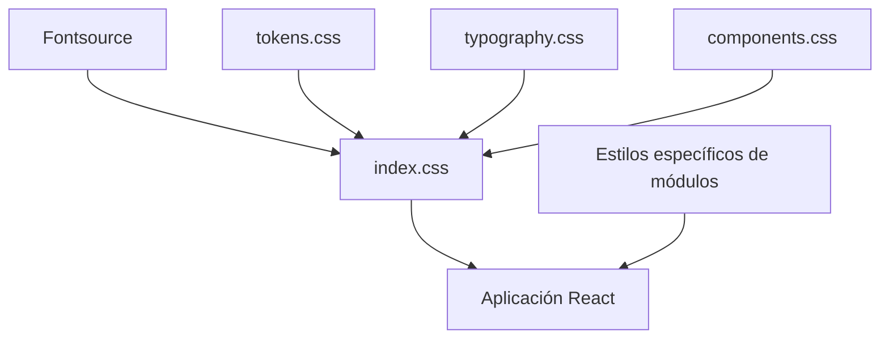
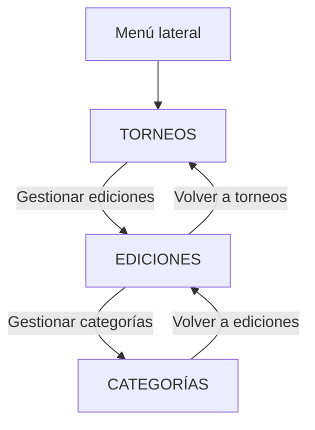
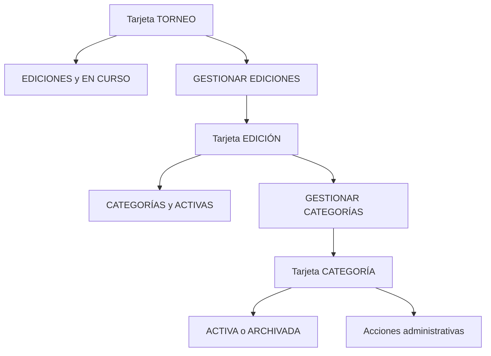
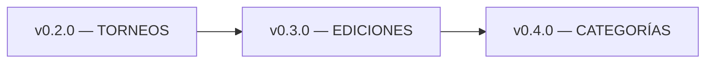

# ALTO-SISTEMA — Sistema de Diseño

Versión del Sistema de Diseño: 1.0

Versión de ALTO-SISTEMA: 0.4.0

Historia de usuario de origen: HU-004.

Incremento actual: HU-006 — Gestión de categorías.

Estado: Sistema de Diseño v1.0 consolidado en HU-004.
Aplicación a EDICIONES consolidada en HU-005.
Aplicación a CATEGORÍAS implementada y verificada.
Pendiente de CHECK integral y consolidación de HU-006.

---

## 1. OBJETIVO

Establecer una identidad visual institucional coherente,
profesional, moderna y reutilizable para todos los
módulos de ALTO-SISTEMA.

El Sistema de Diseño deberá garantizar:

- Consistencia visual.
- Identidad institucional.
- Claridad de información.
- Jerarquía tipográfica.
- Reutilización de componentes.
- Adaptación responsive.
- Accesibilidad.
- Mantenibilidad.
- Escalabilidad visual.

Su aplicación será transversal a todos los módulos
administrativos y deportivos del sistema.

---

## 2. PRINCIPIOS DE DISEÑO

### 2.1. Identidad

ALTO-SISTEMA deberá mantener una apariencia
institucional reconocible.

La estética adoptada combina fondos oscuros
con un azul eléctrico como color principal.

### 2.2. Claridad

La información deberá presentarse mediante
estructuras comprensibles y jerarquizadas.

Los elementos decorativos no deberán dificultar
la operación administrativa.

### 2.3. Consistencia

Los elementos que compartan una misma responsabilidad
deberán mantener una apariencia y comportamiento
equivalentes.

### 2.4. Reutilización

Los componentes visuales deberán reutilizar
estilos compartidos.

Se evitará reproducir innecesariamente
las mismas definiciones CSS.

### 2.5. Funcionalidad

La interfaz deberá priorizar la operación
eficiente del administrador.

Especialmente durante:

- Registro de resultados.
- Consulta de información.
- Administración de competiciones.
- Operaciones desde dispositivos móviles.

### 2.6. Seguridad visual

Las acciones destructivas deberán distinguirse
claramente de las operaciones convencionales.

La apariencia de una acción deberá corresponder
a sus consecuencias.

### 2.7. Escalabilidad

Los futuros módulos deberán poder incorporarse
sin reconstruir la identidad visual general.

### 2.8. Claridad del contexto deportivo

Las pantallas dependientes deberán identificar
el contexto deportivo que se está administrando.

La navegación entre torneos, ediciones y categorías
deberá permitir reconocer claramente el nivel
jerárquico seleccionado.

Los estados de cada entidad deberán distinguirse
sin generar confusión entre estados administrativos
y deportivos.

---

## 3. IDENTIDAD INSTITUCIONAL

### 3.1. Nombre

ALTO-SISTEMA.

### 3.2. Descripción

Sistema integral de gestión deportiva.

### 3.3. Estética

- Interfaz predominantemente oscura.
- Azul eléctrico institucional.
- Encabezados deportivos.
- Tipografía administrativa legible.
- Paneles con bordes discretos.
- Iconografía consistente.
- Contrastes semánticos.

### 3.4. Independencia institucional

La identidad institucional de ALTO-SISTEMA deberá
mantenerse independiente de las identidades visuales
particulares de las competiciones.

Los colores de un torneo, edición o categoría
no deberán modificar automáticamente la apariencia
general de la aplicación.

### 3.5. Continuidad visual

| Versión | Aplicación del Sistema de Diseño |
|---|---|
| 0.2.0 | Incorporación del Sistema de Diseño v1.0 y TORNEOS |
| 0.3.0 | Aplicación a EDICIONES |
| 0.4.0 | Aplicación a CATEGORÍAS |

Los incrementos posteriores a HU-004 amplían
la aplicación del Sistema de Diseño sin redefinir
su identidad institucional.

---

## 4. PALETA CROMÁTICA

### 4.1. Colores institucionales

| Token | Valor |
|---|---|
| Primary | #3333FF |
| Primary hover | #4848FF |
| Primary active | #2929D9 |
| Primary light | #9999FF |
| Primary muted | rgba(51, 51, 255, 0.12) |

El azul institucional deberá utilizarse principalmente para:

- Acciones principales.
- Navegación seleccionada.
- Identificación institucional.
- Elementos destacados.
- Indicadores de foco cuando corresponda.

### 4.2. Fondos

| Elemento | Color |
|---|---|
| Fondo general | #080808 |
| Menú lateral | #111111 |
| Superficie | #181818 |
| Superficie hover | #202020 |
| Superficie activa | #282828 |
| Campos de formulario | #151515 |
| Superposición | rgba(0, 0, 0, 0.65) |

### 4.3. Bordes

| Elemento | Color |
|---|---|
| Borde estándar | #303030 |
| Borde hover | #484848 |
| Borde de foco | #9999FF |

### 4.4. Textos

| Elemento | Color |
|---|---|
| Texto principal | #F5F5F5 |
| Texto secundario | #A3A3A3 |
| Texto atenuado | #858585 |
| Texto deshabilitado | #707070 |

### 4.5. Colores semánticos

| Semántica | Color |
|---|---|
| Éxito | #22C55E |
| Advertencia | #F59E0B |
| Peligro | #EF4444 |
| Texto de peligro | #FCA5A5 |
| Información | #60A5FA |

### 4.6. Utilización semántica

Los colores deberán comunicar información funcional.

El verde se utilizará para estados satisfactorios
o favorables.

El amarillo o naranja se utilizará para advertencias.

El rojo se utilizará para errores, riesgos
y operaciones destructivas.

El azul informativo se utilizará para mensajes
de información.

El significado de un elemento no deberá depender
exclusivamente de su color.

Los estados deberán complementarse con texto
o iconografía.

### 4.7. Colores de los estados deportivos

La versión 0.3.0 aplica la semántica existente
al ciclo de vida de las ediciones.

| Estado persistente | Etiqueta visible | Tratamiento visual |
|---|---|---|
| PLANIFICADA | PLANIFICADA | Azul informativo (#60A5FA) |
| EN_CURSO | EN CURSO | Verde (#22C55E) |
| FINALIZADA | FINALIZADA | Gris neutro |

La finalización no constituye un error ni una
operación de eliminación.

Su representación visual no deberá confundirse
con una alerta.

Estos estados deportivos son independientes
de los estados administrativos de torneos y categorías.

Se mantiene el uso de etiquetas de texto
además del color.

### 4.8. Colores de los estados administrativos

HU-006 reutiliza los criterios semánticos de TORNEOS
para representar los estados administrativos
de CATEGORÍAS.

| Entidad | Estado | Tratamiento visual |
|---|---|---|
| Torneo | ACTIVO | Verde |
| Torneo | ARCHIVADO | Gris neutro |
| Categoría | ACTIVA | Verde |
| Categoría | ARCHIVADA | Gris neutro |

La categoría archivada no constituye un error.

Su estado deberá distinguirse de una operación
rechazada o una eliminación definitiva.

Las etiquetas deberán respetar el género
gramatical de la entidad correspondiente.

### 4.9. Semántica de las acciones administrativas

| Acción | Tratamiento visual |
|---|---|
| NUEVO TORNEO | Azul institucional |
| NUEVA EDICIÓN | Azul institucional |
| NUEVA CATEGORÍA | Azul institucional |
| GESTIONAR EDICIONES | Azul institucional |
| GESTIONAR CATEGORÍAS | Azul institucional |
| GUARDAR | Acción principal |
| EDITAR | Neutro |
| CANCELAR | Secundario |
| ARCHIVAR | Advertencia |
| REACTIVAR | Éxito |
| INICIAR | Éxito |
| FINALIZAR | Advertencia |
| REABRIR | Éxito |
| ELIMINAR | Peligro |

La semántica de una acción deberá distinguirse
de la semántica del estado persistente.

Por ejemplo, FINALIZAR constituye una acción
de advertencia, mientras FINALIZADA se representa
mediante un estado neutro.

---

## 5. TIPOGRAFÍA

### 5.1. Tipografía de encabezados

Barlow Condensed.

Utilización:

- Identidad institucional.
- Títulos principales.
- Encabezados de módulos.
- Encabezados destacados.
- Marcadores deportivos cuando corresponda.

### 5.2. Tipografía de interfaz

Inter.

Utilización:

- Formularios.
- Botones.
- Navegación.
- Textos descriptivos.
- Tablas.
- Indicadores.
- Mensajes administrativos.
- Información numérica.

### 5.3. Escala tipográfica

| Escala | Tamaño |
|---|---:|
| XS | 12 px |
| SM | 14 px |
| BASE | 15 px |
| MD | 16 px |
| LG | 18 px |
| XL | 24 px |
| 2XL | 32 px |
| 3XL | 40 px |
| 4XL | 48 px |

Los tamaños deberán utilizarse según
la jerarquía del contenido.

No deberán incorporarse tamaños arbitrarios
cuando exista un valor equivalente dentro
de los tokens.

### 5.4. Distribución local

Las fuentes se incorporan mediante:

- @fontsource/inter
- @fontsource/barlow-condensed

Esta estrategia permite distribuir las fuentes
junto con la aplicación.

No se requiere depender de una consulta
externa a Google Fonts durante la utilización habitual.

### 5.5. Información numérica

Las tablas e indicadores deberán favorecer
una lectura clara de los valores numéricos.

Cuando corresponda se utilizarán números tabulares
para facilitar la comparación entre registros.

### 5.6. Optimización futura

La selección de subconjuntos y variantes
tipográficas podrá optimizarse posteriormente.

La reducción de recursos deberá preservar
los caracteres utilizados por el idioma español
y los nombres de participantes.

---

## 6. ESPACIADOS Y DIMENSIONES

### 6.1. Escala de espaciado

| Escala | Valor |
|---|---:|
| 0 | 0 px |
| 1 | 4 px |
| 2 | 8 px |
| 3 | 12 px |
| 4 | 16 px |
| 5 | 20 px |
| 6 | 24 px |
| 7 | 32 px |
| 8 | 40 px |
| 9 | 48 px |
| 10 | 64 px |

La distribución de elementos deberá priorizar
los valores disponibles en los tokens.

### 6.2. Radios

| Escala | Valor |
|---|---:|
| SM | 4 px |
| MD | 6 px |
| LG | 10 px |
| XL | 16 px |
| FULL | 999 px |

Los radios deberán mantener una apariencia
consistente entre componentes equivalentes.

### 6.3. Dimensiones principales

| Elemento | Dimensión |
|---|---:|
| Altura mínima de botones | 44 px |
| Altura mínima de campos | 44 px |
| Encabezado principal | 76 px |
| Menú lateral de escritorio | 260 px |
| Menú lateral móvil | 280 px |
| Ancho máximo del menú móvil | 85 vw |

### 6.4. Sombras y transiciones

Las sombras y transiciones deberán utilizar
las definiciones compartidas del Sistema de Diseño.

No deberán producir efectos excesivos
que dificulten la operación habitual.

### 6.5. Distribución de contenido

Los componentes deberán conservar espacios
suficientes para:

- Identificar acciones.
- Leer información.
- Evitar pulsaciones accidentales.
- Diferenciar grupos funcionales.
- Mantener una jerarquía visual.

---

## 7. ICONOGRAFÍA

### 7.1. Biblioteca oficial

Lucide React.

Dependencia:

`lucide-react`

### 7.2. Criterios generales

Los iconos deberán:

- Mantener una apariencia consistente.
- Representar una acción comprensible.
- Utilizar tamaños proporcionados.
- Complementar los textos cuando corresponda.
- Evitar duplicaciones innecesarias.

No se utilizarán emojis como sustitutos
de la iconografía estructural de la aplicación.

### 7.3. Iconografía de módulos

| Módulo | Icono |
|---|---|
| Inicio | House |
| Torneos | Trophy |
| Equipos | Shield |
| Listas de buena fe | ClipboardList |
| Partidos | CalendarDays |
| Posiciones | ChartNoAxesColumn |
| Goleadores | Medal |
| Valla menos vencida | ShieldCheck |
| Playoffs | GitMerge |
| Disciplina | Gavel |
| Publicaciones | Image |
| Historial | History |
| Configuración | Settings |

### 7.4. Iconografía de acciones

| Acción | Icono |
|---|---|
| Crear | Plus |
| Buscar | Search |
| Editar | Pencil |
| Archivar | Archive |
| Reactivar | ArchiveRestore |
| Eliminar | Trash2 |
| Guardar | Save |
| Cancelar o cerrar | X |
| Actualizar | RefreshCw |
| Confirmación exitosa | CircleCheck |
| Advertencia o error | CircleAlert |
| Fecha | CalendarDays |
| Actualización temporal | Clock |

### 7.5. Centralización

La iconografía estructural se encuentra
centralizada en:

`frontend/src/config/iconos.config.js`

Los módulos deberán reutilizar la configuración
cuando representen los mismos elementos estructurales.

Los iconos específicos de una operación podrán
utilizarse directamente en el componente correspondiente.

### 7.6. Iconografía de navegación contextual

| Elemento | Icono |
|---|---|
| Gestionar ediciones | CalendarDays |
| Gestionar categorías | Layers |
| Regresar al nivel anterior | ArrowLeft |

EDICIONES y CATEGORÍAS utilizan iconografía
contextual dentro de sus pantallas y acciones
de acceso.

No se incorporan nuevas opciones
al menú lateral institucional.

### 7.7. Iconografía de CATEGORÍAS

El módulo reutiliza los iconos administrativos
existentes:

- Layers.
- ArrowLeft.
- Plus.
- Search.
- Pencil.
- Archive.
- ArchiveRestore.
- Trash2.
- CircleCheck.
- CircleAlert.
- RefreshCw.
- Save.
- X.

HU-006 no requiere incorporar una nueva
biblioteca de iconos.

---

## 8. ARQUITECTURA CSS

### 8.1. Archivos compartidos

```text
frontend/src/
├── styles/
│   ├── tokens.css
│   ├── typography.css
│   └── components.css
└── index.css
```

### 8.2. Responsabilidades

| Archivo | Responsabilidad |
|---|---|
| tokens.css | Variables visuales |
| typography.css | Definiciones tipográficas |
| components.css | Componentes reutilizables |
| index.css | Integración global de estilos |

### 8.3. Flujo de estilos



### 8.4. Estilos específicos

Cada módulo podrá disponer de estilos particulares.

Ejemplos:

- AppLayout.css
- Login.css
- Dashboard.css
- Torneos.css
- Ediciones.css
- Categorias.css
- ModuloPendiente.css

Los estilos particulares deberán resolver
necesidades específicas sin redefinir
innecesariamente los componentes compartidos.

### 8.5. Prefijo institucional

Los componentes reutilizables utilizarán
el prefijo:

`as-`

Esto permite identificar las clases
pertenecientes al Sistema de Diseño.

### 8.6. Evolución

La incorporación de un componente reutilizable
deberá evaluarse cuando una misma necesidad
aparezca en distintos módulos.

No deberá convertirse automáticamente
cada estilo particular en un componente global.

### 8.7. Archivos visuales de HU-006

| Archivo | Responsabilidad |
|---|---|
| Categorias.jsx | Estructura e interacción de CATEGORÍAS |
| Categorias.css | Estilos específicos de CATEGORÍAS |
| Ediciones.jsx | Integración de indicadores y acceso a categorías |
| Ediciones.css | Distribución visual de la integración |
| App.jsx | Incorporación de la ruta privada de categorías |

Los archivos compartidos del Sistema de Diseño
mantienen su responsabilidad original.

No se establece una identidad visual independiente
para CATEGORÍAS.

### 8.8. Prefijos específicos

Los estilos particulares deberán identificar
el módulo al que pertenecen.

| Prefijo | Responsabilidad |
|---|---|
| as- | Componentes institucionales |
| torneos- | Estilos particulares de TORNEOS |
| ediciones- | Estilos particulares de EDICIONES |
| categorias- | Estilos particulares de CATEGORÍAS |

La integración visual de categorías dentro
de las tarjetas de EDICIONES utiliza
el prefijo `ediciones-categorias-`
y la clase contenedora `ediciones-categorias`.

---

## 9. DESIGN TOKENS

### 9.1. Definición

Los Design Tokens representan valores
visuales reutilizables.

Su centralización permite mantener consistencia
y facilita futuras modificaciones globales.

### 9.2. Grupos de tokens

El Sistema de Diseño contempla:

- Colores institucionales.
- Colores semánticos.
- Fondos.
- Bordes.
- Textos.
- Familias tipográficas.
- Tamaños tipográficos.
- Espaciados.
- Radios.
- Sombras.
- Transiciones.
- Dimensiones.
- Capas visuales.

### 9.3. Ejemplos de variables

```css
--color-primary
--font-heading
--space-4
--radius-md
```

Los valores y nombres efectivos se encuentran
definidos en:

`frontend/src/styles/tokens.css`

El archivo constituye la referencia técnica
de los tokens implementados.

### 9.4. Utilización

Los componentes deberán consultar las variables
compartidas cuando exista un token correspondiente.

Se evitarán valores visuales duplicados
dentro de distintos archivos CSS.

### 9.5. Modificación

Una modificación de un token global deberá
evaluarse considerando su impacto sobre
toda la aplicación.

Los cambios significativos deberán verificarse
mediante una regresión visual de los módulos existentes.

### 9.6. Continuidad en v0.4.0

HU-006 conserva la paleta, tipografías,
espaciados, radios y dimensiones institucionales.

Los estilos particulares de categorías deberán
reutilizar los tokens existentes cuando corresponda.

La ampliación del Sistema de Diseño a un nuevo
módulo no requiere incrementar automáticamente
su versión interna.

---

## 10. COMPONENTES REUTILIZABLES

### 10.1. Botones

Clase base:

`as-button`

Variantes:

| Clase | Responsabilidad |
|---|---|
| as-button-primary | Acción principal |
| as-button-secondary | Acción secundaria |
| as-button-danger | Acción destructiva |
| as-button-success | Acción favorable |
| as-button-warning | Acción de advertencia |
| as-button-ghost | Acción de bajo énfasis |
| as-button-icon | Acción mediante icono |
| as-button-block | Botón de ancho completo |

Los botones deberán conservar una altura
interactiva adecuada.

### 10.2. Paneles

Clase principal:

`as-panel`

Los paneles permiten agrupar contenido
administrativo relacionado.

### 10.3. Tarjetas

Clase principal:

`as-card`

Las tarjetas permiten representar registros,
entidades o grupos de información.

Podrán contener:

- Encabezado.
- Identificación.
- Estado.
- Descripción.
- Información complementaria.
- Acciones administrativas.

### 10.4. Indicadores

Familia de estilos:

`as-stat`

Los indicadores deberán mostrar valores
comprensibles y claramente identificados.

No deberán utilizarse valores ficticios
como información real.

### 10.5. Formularios

Familias de estilos compartidos:

- as-form
- as-field
- as-input

Los formularios deberán contemplar etiquetas,
ayudas, errores y acciones.

### 10.6. Buscadores y filtros

Los buscadores y filtros deberán utilizar
los componentes compartidos disponibles.

Sus estados seleccionados deberán
identificarse claramente.

### 10.7. Estados administrativos

Los estados deberán representarse
mediante texto y estilos semánticos.

Ejemplos:

- ACTIVO.
- ARCHIVADO.
- ACTIVA.
- ARCHIVADA.
- DISPONIBLE.
- NO DISPONIBLE.

### 10.8. Mensajes

Familia de estilos:

`as-alert`

Los mensajes deberán diferenciar:

- Éxito.
- Error.
- Advertencia.
- Información.

### 10.9. Tablas

La estructura visual de las tablas deberá facilitar
la comparación de registros y valores.

Las futuras tablas deportivas deberán respetar
los formatos funcionales aprobados.

### 10.10. Estados vacíos

Un estado vacío deberá comunicar
la ausencia de información.

Cuando corresponda deberá ofrecer una acción
para iniciar el registro.

### 10.11. Carga

Los indicadores de carga deberán comunicar
que una operación se encuentra en ejecución.

No deberán confundirse con un estado vacío
o un error.

### 10.12. Estructuras de página

Los módulos deberán reutilizar las estructuras
compartidas para encabezados, herramientas,
contenido e indicadores.

### 10.13. Referencia técnica

Las familias de componentes descritas
en esta sección se encuentran implementadas en:

`frontend/src/styles/components.css`

Los nombres exactos de sus clases auxiliares
deberán consultarse en dicho archivo.

### 10.14. Reutilización en CATEGORÍAS

HU-006 reutiliza los patrones existentes de:

- Encabezados.
- Botones principales y secundarios.
- Botones semánticos.
- Tarjetas.
- Indicadores.
- Formularios.
- Buscadores.
- Filtros.
- Mensajes.
- Estados de carga.
- Estados vacíos.
- Acciones destructivas.

Los estilos específicos se incorporan
en Categorias.css sin sustituir los
componentes institucionales.

---

## 11. NAVEGACIÓN Y ESTRUCTURA GENERAL

### 11.1. Menú lateral

El menú lateral constituye el principal
mecanismo de navegación administrativa.

Deberá identificar:

- Identidad institucional.
- Módulos disponibles.
- Módulo seleccionado.
- Acciones relacionadas con la sesión.

### 11.2. Encabezado principal

El encabezado deberá proporcionar información
relevante para la operación del sistema.

La incorporación futura del selector de contexto
deportivo deberá respetar esta estructura.

### 11.3. Área de contenido

El área principal deberá permitir la presentación
de información administrativa y deportiva.

Su distribución deberá adaptarse
al tamaño disponible.

### 11.4. Dashboard

El Dashboard deberá utilizar componentes
compartidos para:

- Identificación del sistema.
- Accesos rápidos.
- Indicadores.
- Información de disponibilidad.
- Estado administrativo.

### 11.5. Módulos pendientes

Los módulos todavía no implementados deberán
presentar una pantalla provisional identificada.

No deberán simular funcionalidades que aún
no se encuentren operativas.

### 11.6. Navegación contextual de EDICIONES

EDICIONES se incorpora como pantalla privada
subordinada a TORNEOS, sin agregar un nuevo
módulo al menú lateral.

Ruta de frontend:

`/torneos/:torneoId/ediciones`

El acceso se realiza desde el botón
GESTIONAR EDICIONES de la tarjeta del torneo.

La pantalla identifica la competición seleccionada,
proporciona una referencia de navegación contextual
y permite volver al listado de TORNEOS.

La identificación contextual de HU-005 no sustituye
el futuro selector global de HU-008.

### 11.7. Navegación contextual de CATEGORÍAS

CATEGORÍAS se incorpora como pantalla privada
subordinada a EDICIONES.

Ruta de frontend:

`/torneos/:torneoId/ediciones/:edicionId/categorias`

El acceso se realiza mediante el botón
GESTIONAR CATEGORÍAS de cada tarjeta de edición.

La pantalla identifica:

- Torneo seleccionado.
- Edición seleccionada.
- Estado administrativo del torneo.
- Estado deportivo de la edición.
- Nivel de gestión actual.

La referencia jerárquica sigue el orden:

```text
TORNEOS / TORNEO / EDICIÓN / CATEGORÍAS
```

La acción VOLVER A EDICIONES permite regresar
al contexto padre.

CATEGORÍAS no constituye una nueva opción
independiente en el menú lateral.

### 11.8. Jerarquía de navegación implementada



Las pantallas dependientes conservan
la identidad institucional y el AppLayout.

La navegación jerárquica no constituye todavía
un selector deportivo global.

### 11.9. Contextos restringidos

El acceso a EDICIONES y CATEGORÍAS deberá
permanecer disponible cuando el contexto
admita operaciones de consulta.

Las restricciones administrativas deberán
comunicarse dentro de la pantalla correspondiente.

No deberá impedirse el acceso completo
a una pantalla cuando solamente existan
restricciones sobre algunas de sus acciones.

---

## 12. FORMULARIOS Y OPERACIONES ADMINISTRATIVAS

### 12.1. Campos

Los campos deberán mantener:

- Etiquetas identificables.
- Valores legibles.
- Indicadores de foco.
- Mensajes de validación.
- Estados deshabilitados.
- Dimensiones táctiles apropiadas.

### 12.2. Campos obligatorios

Los campos obligatorios deberán identificarse claramente.

Su ausencia deberá generar mensajes comprensibles.

### 12.3. Acciones principales

Las acciones de creación y guardado deberán
utilizar la jerarquía visual correspondiente.

### 12.4. Acciones secundarias

Las acciones de cancelación, edición y consulta
deberán diferenciarse de las acciones principales
cuando corresponda.

### 12.5. Archivado

El archivado constituye una operación
administrativa reversible.

La interfaz deberá distinguirlo de
la eliminación definitiva.

La acción utiliza el icono Archive.

### 12.6. Reactivación

La reactivación permite recuperar el estado activo
de un registro previamente archivado.

La acción utiliza el icono ArchiveRestore.

### 12.7. Eliminación definitiva

La acción ELIMINAR constituye una operación destructiva.

Deberá utilizar:

- Variante as-button-danger.
- Icono Trash2.
- Etiqueta de acción comprensible.
- Confirmación explícita.
- Advertencia de irreversibilidad.

No deberá utilizarse la misma apariencia
de las acciones principales para representar
una eliminación definitiva.

### 12.8. Confirmación

La confirmación deberá identificar el registro afectado.

El administrador deberá poder cancelar
sin modificar información.

Las versiones 0.2.0, 0.3.0 y 0.4.0 utilizan
el mecanismo nativo de confirmación del navegador.

Su apariencia depende del navegador
y del sistema operativo.

No constituye un diálogo visual personalizado
del Sistema de Diseño.

### 12.9. Operaciones en ejecución

Mientras una operación administrativa se encuentre
en ejecución deberán bloquearse las acciones
incompatibles.

La interfaz deberá evitar envíos duplicados
y modificaciones simultáneas innecesarias.

### 12.10. Resultado de operaciones

Las operaciones exitosas deberán producir una
actualización coherente de la información visible.

Los errores deberán comunicarse sin presentar
como exitosa una operación rechazada.

La eliminación deberá actualizar el listado
y los indicadores únicamente después de
recibir la respuesta satisfactoria del backend.

### 12.11. Formulario de EDICIONES

La creación y edición utilizan los patrones
institucionales de formularios, botones y mensajes.

| Campo | Presentación |
|---|---|
| Nombre | Obligatorio; hasta 100 caracteres |
| Descripción | Opcional; hasta 500 caracteres |
| Fecha de inicio | Opcional y editable |
| Fecha de finalización | Opcional y editable |

El año forma parte del nombre cuando el administrador
decide incluirlo. No existe un campo independiente
para el año.

Los campos de fecha utilizan controles nativos
adaptados a la interfaz oscura y permiten retirar
los valores previamente registrados.

La visualización de las fechas utiliza
el formato DD/MM/AAAA, sin conversiones de zona
horaria que puedan alterar el día registrado.

Cuando ambas fechas están presentes, la de
finalización no puede ser anterior a la de inicio.

Los cambios de fechas no modifican automáticamente
el estado deportivo de la edición.

El formulario identifica campos obligatorios,
contadores de caracteres y errores de validación.

La navegación de regreso contempla la confirmación
cuando existen cambios sin guardar.

### 12.12. Operaciones sobre ediciones

| Acción | Disponibilidad según estado de edición |
|---|---|
| EDITAR | Todos los estados |
| INICIAR | PLANIFICADA |
| FINALIZAR | EN_CURSO |
| REABRIR | FINALIZADA |
| ELIMINAR | Todos los estados, si no existen dependencias incompatibles |

Las transiciones de estado y la eliminación requieren
confirmación mediante el navegador.

La eliminación utiliza el tratamiento semántico
de peligro y advierte sobre su irreversibilidad.

Si el torneo se encuentra ARCHIVADO, la pantalla
permite consultar, editar, finalizar ediciones
en curso y eliminar registros sin dependencias,
pero no crear, iniciar ni reabrir ediciones.

Desde HU-006, una edición con categorías asociadas
no podrá eliminarse.

La interfaz informa las restricciones y deshabilita
las operaciones incompatibles cuando corresponde.

El backend mantiene las validaciones definitivas
de negocio y dependencias.

### 12.13. Formulario de CATEGORÍAS

La creación y edición de categorías reutilizan
los patrones institucionales.

| Campo | Presentación |
|---|---|
| Nombre | Obligatorio; hasta 100 caracteres |
| Descripción | Opcional; hasta 500 caracteres |

El formulario incorpora:

- Título identificable.
- Etiqueta de nombre.
- Identificación del campo obligatorio.
- Campo de descripción.
- Contadores de caracteres.
- Mensajes de validación.
- Acciones de guardado y cancelación.
- Estados de procesamiento.

Durante la creación se informa que la categoría
se registrará inicialmente como ACTIVA.

El estado no se modifica mediante el formulario
de edición de nombre y descripción.

La pertenencia a una edición no constituye
un campo editable.

No se incorporan campos de reglamentos,
edades, logotipos ni colores particulares.

### 12.14. Contadores de caracteres

Los formularios deberán informar los límites
de longitud cuando corresponda.

En CATEGORÍAS:

| Campo | Límite |
|---|---:|
| Nombre | 100 caracteres |
| Descripción | 500 caracteres |

Los contadores deberán actualizarse durante
la escritura y conservar su legibilidad.

La validación visual no sustituye el control
de longitud del backend.

### 12.15. Operaciones sobre categorías

| Acción | Disponibilidad |
|---|---|
| EDITAR | Categorías activas y archivadas |
| ARCHIVAR | Categorías activas |
| REACTIVAR | Categorías archivadas en contextos habilitados |
| ELIMINAR | Ambos estados, sin dependencias incompatibles |

Las operaciones de archivado, reactivación
y eliminación requieren confirmación.

La interfaz deberá comunicar claramente
el efecto de cada acción.

### 12.16. Restricciones del formulario de categorías

La creación y reactivación requieren:

- Torneo ACTIVO.
- Edición PLANIFICADA o EN_CURSO.

Cuando alguna condición no se cumple:

- Se informa la restricción.
- Se impide la creación.
- Se deshabilita la reactivación incompatible.
- Se conserva el acceso de consulta.
- Se mantienen las demás operaciones permitidas.

La advertencia deberá diferenciarse
de un error técnico de conexión.

### 12.17. Cancelación y cambios sin guardar

La cancelación del formulario no deberá
modificar el registro persistente.

La navegación de regreso desde CATEGORÍAS
con un formulario abierto contempla
confirmación de salida.

También se contempla protección frente
a la salida o recarga del documento
mientras el formulario está abierto.

Estos mecanismos no constituyen un sistema
de guardado automático.

### 12.18. Actualización de indicadores

Las operaciones administrativas exitosas
deberán actualizar:

- Listado visible.
- Estados de las tarjetas.
- Indicadores internos.
- Información contextual cuando corresponda.

Al regresar a EDICIONES deberán recuperarse
los indicadores actualizados de categorías
de cada edición.

---

## 13. ESTADOS VISUALES Y MENSAJES

### 13.1. Estados administrativos

El módulo TORNEOS utiliza:

- ACTIVO.
- ARCHIVADO.

ACTIVO deberá comunicar una competición
administrativamente habilitada.

ARCHIVADO deberá comunicar una competición
conservada, pero no administrativamente activa.

El módulo CATEGORÍAS utiliza:

- ACTIVA.
- ARCHIVADA.

Los estados de categorías mantienen
la misma interpretación administrativa.

### 13.2. Registro eliminado

ELIMINADO o ELIMINADA no constituyen
estados administrativos persistentes.

Los torneos, ediciones o categorías eliminados
correctamente deberán retirarse de sus listados.

No deberá conservarse una tarjeta simulada
de un registro inexistente.

### 13.3. Confirmaciones exitosas

Los mensajes de éxito deberán informar
el resultado de la operación realizada.

Ejemplos de TORNEOS:

- Torneo creado correctamente.
- Torneo actualizado correctamente.
- Torneo archivado correctamente.
- Torneo reactivado correctamente.
- Torneo eliminado correctamente.

En EDICIONES y CATEGORÍAS se mantendrá
la misma estructura comunicativa, utilizando
la entidad y operación correspondientes.

### 13.4. Errores

Los mensajes de error deberán:

- Ser comprensibles.
- Identificar el problema.
- Evitar detalles internos sensibles.
- Facilitar la corrección cuando corresponda.

### 13.5. Ausencia de datos

La ausencia de registros deberá diferenciarse
de una consulta fallida.

No deberá mostrarse un contador cero
cuando no fue posible obtener
los datos correspondientes.

### 13.6. Búsqueda sin resultados

La ausencia de coincidencias deberá diferenciarse
de la ausencia total de registros.

La interfaz deberá permitir modificar
o limpiar los filtros.

### 13.7. Cancelaciones

La cancelación de una confirmación no deberá
representarse como un error de persistencia.

El estado anterior deberá conservarse.

### 13.8. Estados deportivos de EDICIONES

| Estado | Significado |
|---|---|
| PLANIFICADA | Edición creada que todavía no se inició |
| EN CURSO | Edición iniciada o reabierta manualmente |
| FINALIZADA | Edición cerrada manualmente, con sus datos conservados |

La etiqueta EN CURSO representa
el valor persistente `EN_CURSO`.

No se deberá equiparar FINALIZADA con ARCHIVADO.

El estado de la edición y el del torneo
se presentan como informaciones diferentes.

### 13.9. Advertencias y resultados de EDICIONES

Cuando el torneo está archivado se informa:

> Este torneo está archivado. Podés consultar, editar y finalizar sus ediciones existentes, pero no crear, iniciar ni reabrir ediciones.

La eliminación exitosa de una edición informa:

> Edición eliminada correctamente.

Si existen ediciones asociadas, la eliminación
del torneo se rechaza y la interfaz informa
la dependencia, sin retirar el torneo del listado.

Desde HU-006 se aplica el mismo criterio
cuando se intenta eliminar una edición
que posee categorías asociadas.

Los indicadores de EDICIONES distinguen
un resultado real de cero de una consulta fallida.

En las tarjetas de TORNEOS se muestra un guion
cuando el resumen de ediciones no está disponible.

### 13.10. Estados administrativos de CATEGORÍAS

| Estado | Significado | Tratamiento |
|---|---|---|
| ACTIVA | Categoría habilitada administrativamente | Verde |
| ARCHIVADA | Categoría conservada, pero desactivada | Gris neutro |

Los estados deberán identificarse mediante
etiquetas de texto y tratamiento semántico.

El estado ACTIVA no implica necesariamente
que su edición se encuentre EN_CURSO.

Una categoría ACTIVA puede pertenecer
a una edición PLANIFICADA o FINALIZADA.

Los estados de los distintos niveles
no deberán confundirse.

### 13.11. Mensajes de CATEGORÍAS

Los mensajes deberán comunicar:

- Creación satisfactoria.
- Actualización satisfactoria.
- Archivado.
- Reactivación.
- Eliminación.
- Validaciones de datos.
- Conflictos de nombre.
- Restricciones administrativas.
- Errores de conexión.
- Dependencias incompatibles.

Mensaje de duplicación verificado durante HU-006:

> Ya existe una categoría con ese nombre en esta edición.

Mensaje de eliminación satisfactoria:

> Categoría eliminada correctamente.

La existencia de una categoría archivada
con el mismo nombre deberá tratarse
como un conflicto de unicidad.

### 13.12. Advertencias del contexto deportivo

Las advertencias de CATEGORÍAS deberán distinguir
las restricciones derivadas de:

- Torneo ARCHIVADO.
- Edición FINALIZADA.

La advertencia deberá informar que determinadas
operaciones no se encuentran disponibles.

No deberá comunicar que la categoría fue eliminada,
archivada automáticamente o modificada de estado
como consecuencia de una restricción del contexto.

### 13.13. Indicadores no disponibles

Cuando no pueda recuperarse un indicador
de categorías en una tarjeta de edición,
se utilizará un guion.

| Valor | Interpretación |
|---|---|
| 0 | Ausencia real de registros correspondientes |
| Número positivo | Cantidad obtenida correctamente |
| Guion | Información todavía no disponible o consulta fallida |

No deberá reemplazarse una consulta fallida
por un valor cero ficticio.

---

## 14. DISEÑO RESPONSIVE

### 14.1. Objetivo

ALTO-SISTEMA deberá permitir la operación
administrativa desde computadoras y dispositivos móviles.

La adaptación responsive constituye
un requisito permanente del proyecto.

### 14.2. Puntos de corte

| Contexto | Ancho |
|---|---|
| Móvil compacto | Hasta 480 px |
| Navegación móvil | Hasta 900 px |
| Escritorio | Desde 901 px |
| Escritorio amplio | Desde 1440 px |

### 14.3. Navegación móvil

El menú lateral deberá adaptarse al espacio disponible.

Deberá permitir:

- Apertura.
- Cierre.
- Selección de módulos.
- Identificación de la opción activa.
- Retorno al contenido principal.

### 14.4. Formularios móviles

Los formularios deberán conservar campos
legibles y acciones fácilmente identificables.

No deberán depender de una distribución
horizontal fija.

### 14.5. Tarjetas móviles

Las tarjetas deberán reorganizar su contenido
según el ancho disponible.

Los textos deberán adaptarse sin perder
información relevante.

### 14.6. Acciones de torneos

Cada tarjeta de torneo conserva
tres acciones administrativas:

- EDITAR.
- ARCHIVAR o REACTIVAR.
- ELIMINAR.

Desde HU-005 incorpora además un acceso separado
a GESTIONAR EDICIONES y dos indicadores contextuales.

La distribución de las acciones no deberá provocar:

- Desbordamiento horizontal.
- Superposición de botones.
- Ocultamiento de acciones.
- Reducción excesiva de los controles.
- Dificultades para identificar la operación destructiva.

### 14.7. Indicadores móviles

Los indicadores deberán reorganizarse
según el espacio disponible.

La adaptación no deberá modificar
sus valores ni su significado.

### 14.8. Tablas deportivas futuras

Las futuras tablas deberán mantener
legibilidad y acceso a su información.

La estrategia responsive podrá depender
de la naturaleza de cada tabla.

### 14.9. Verificación realizada

La adaptación responsive de HU-004 fue comprobada
mediante el navegador.

La incorporación de la eliminación definitiva
superó la verificación funcional de la interfaz.

La validación en dispositivos móviles físicos
permanece pendiente.

### 14.10. Adaptación responsive de EDICIONES

La pantalla de EDICIONES utiliza puntos de corte
particulares en Ediciones.css, complementarios
a los puntos de corte institucionales.

| Elemento | Distribución |
|---|---|
| Indicadores | Cuatro columnas; dos hasta 900 px |
| Tarjetas de edición | Dos columnas en ancho amplio; una hasta 1250 px |
| Campos de fecha | Distribución vertical hasta 480 px |
| Acciones de tarjeta | Reorganización compacta; disposición vertical hasta 360 px |

Los puntos de corte particulares no modifican
la navegación institucional ni sus dimensiones.

Durante HU-005 se confirmó satisfactoriamente
la adaptación mediante simulación del navegador
a 390 × 844 px.

La evidencia histórica correspondiente
se incorporó durante el cierre de v0.3.0.

La prueba sobre un dispositivo móvil físico
y la evaluación sistemática de todos los puntos
de corte permanecen pendientes.

### 14.11. Adaptación de indicadores de categorías en EDICIONES

Las tarjetas de edición incorporan una sección
visual adicional de categorías.

La sección contiene:

- Indicador CATEGORÍAS.
- Indicador ACTIVAS.
- Botón GESTIONAR CATEGORÍAS.

Los dos indicadores mantienen una distribución
compacta y diferenciada.

El botón de acceso ocupa el ancho disponible
de su sección.

La integración deberá conservar una altura
interactiva mínima adecuada y reorganizarse
sin provocar desbordamientos.

### 14.12. Adaptación responsive de CATEGORÍAS

La pantalla utiliza estilos particulares
en Categorias.css.

| Elemento | Distribución |
|---|---|
| Indicadores en escritorio | Tres indicadores |
| Indicadores hasta 900 px | Total destacado y dos indicadores secundarios |
| Tarjetas en escritorio amplio | Dos columnas |
| Tarjetas hasta 1250 px | Una columna |
| Contexto en móvil compacto | Reorganización vertical |
| Acciones hasta 480 px | Distribución compacta en dos columnas; eliminación de ancho completo |
| Acciones hasta 360 px | Distribución vertical |

Estos puntos de corte complementan
los establecidos por el Sistema de Diseño.

No modifican el comportamiento general
de la navegación institucional.

### 14.13. Identificación del contexto en móviles

La pantalla CATEGORÍAS deberá permitir
reconocer el torneo y la edición
sin depender de una distribución
horizontal de ancho fijo.

La cabecera, los estados, las herramientas
de búsqueda y las acciones de navegación
deberán reorganizarse según el espacio disponible.

Los nombres extensos deberán conservar
su legibilidad.

### 14.14. Validación responsive de HU-006

Resolución de referencia utilizada:

390 × 844 px.

Durante la validación se comprobó:

- Acceso contextual.
- Distribución de la cabecera.
- Identificación del torneo y edición.
- Indicadores.
- Buscador.
- Filtros.
- Organización general de la pantalla.
- Acciones administrativas.

La evidencia visual corresponde al archivo:

`33-movil-categorias-v040.png`

La captura documenta la sección superior
de la pantalla en emulación móvil.

La operación responsive general fue confirmada
por el administrador durante las pruebas funcionales.

No se considera una prueba en un dispositivo físico
ni una evaluación exhaustiva de todas las resoluciones.

---

## 15. ACCESIBILIDAD

### 15.1. Principios

La interfaz deberá favorecer una operación
comprensible mediante diferentes mecanismos
de interacción.

### 15.2. Foco

Los elementos interactivos deberán disponer
de indicadores visibles de foco.

### 15.3. Navegación mediante teclado

Los controles deberán permitir la interacción
mediante teclado cuando corresponda.

Los elementos no interactivos no deberán
utilizarse como sustitutos innecesarios
de botones o enlaces.

### 15.4. Etiquetas accesibles

Los controles deberán disponer
de nombres comprensibles.

Las acciones sobre registros deberán identificar
adecuadamente el elemento afectado.

### 15.5. Contraste

Los textos y componentes deberán mantener
contraste suficiente respecto de sus fondos.

Los colores semánticos deberán complementarse
mediante texto o iconografía.

### 15.6. Controles táctiles

Se establece una altura mínima de 44 px
para botones y campos de formulario estándar.

La distribución deberá evitar
pulsaciones accidentales.

### 15.7. Movimiento reducido

Las animaciones y transiciones deberán respetar
las preferencias de movimiento reducido
cuando corresponda.

### 15.8. Acciones destructivas

La eliminación definitiva deberá identificarse
mediante mecanismos adicionales al color.

La etiqueta ELIMINAR, el icono correspondiente
y la confirmación constituyen elementos complementarios.

### 15.9. Alcance de verificación

La incorporación de mecanismos de accesibilidad
no implica una certificación formal.

Permanecen pendientes:

- Auditoría integral de accesibilidad.
- Verificación sistemática con lectores de pantalla.
- Evaluación completa de contraste.
- Revisión exhaustiva de navegación por teclado.
- Pruebas en dispositivos físicos.

### 15.10. Aplicación en CATEGORÍAS

HU-006 conserva los criterios institucionales
de accesibilidad.

La pantalla incorpora:

- Etiquetas de acciones identificables.
- Iconos complementarios.
- Identificación textual de estados.
- Indicadores de foco.
- Mensajes comprensibles.
- Dimensiones táctiles apropiadas.
- Estados deshabilitados.
- Confirmaciones de operaciones destructivas.
- Estilos compatibles con movimiento reducido.

Los formularios identifican los campos
obligatorios y sus límites.

Las restricciones administrativas se comunican
mediante texto y tratamiento visual.

No se declara cumplimiento integral de una norma
de accesibilidad sin realizar la auditoría
correspondiente.

---

## 16. IDENTIDAD VISUAL DE COMPETICIONES

### 16.1. Separación de identidades

Se distinguen:

1. Identidad institucional de ALTO-SISTEMA.
2. Identidad visual de las competiciones.

Ambas deberán conservar responsabilidades independientes.

### 16.2. Configuración deportiva

Las futuras competiciones podrán disponer de:

- Logotipos.
- Colores.
- Identidad por edición.
- Identidad por categoría.
- Identidad por copa.
- Configuración de publicaciones.

### 16.3. Colores configurables

Los colores particulares de las competiciones
deberán configurarse mediante valores apropiados.

No deberán requerir modificaciones directas
de los tokens institucionales.

### 16.4. Logotipos

Los futuros logotipos deberán mantener
proporciones correctas.

No deberán deformarse para adaptarse
a contenedores.

### 16.5. Publicaciones deportivas

El sistema de publicaciones deberá utilizar
la identidad del contexto deportivo correspondiente.

Las placas deportivas dispondrán
de estándares propios.

La tipografía administrativa del Sistema de Diseño
no determina automáticamente la tipografía
definitiva de las publicaciones.

### 16.6. Estado

| Funcionalidad | Estado |
|---|---|
| Identidad institucional | Implementada |
| Identidad visual de torneos | Pendiente |
| Identidad visual de ediciones | Pendiente |
| Identidad visual de categorías | Pendiente |
| Identidad visual de copas | Pendiente |
| Exportación PNG | Pendiente |

La configuración de identidades deportivas
corresponde a HU-007.

La exportación de publicaciones corresponde
a la ETAPA 10.

### 16.7. Relación con HU-006

La gestión de categorías incorpora
el tercer nivel de la arquitectura multitorneo.

No incorpora todavía configuraciones
visuales particulares.

Las categorías utilizan la identidad
institucional de ALTO-SISTEMA.

Los estados administrativos utilizan colores
semánticos y no colores identificativos
particulares de cada competición.

### 16.8. Próxima evolución visual

HU-007 deberá definir los mecanismos
de personalización visual de las competiciones.

Las decisiones relacionadas con:

- Almacenamiento de logotipos.
- Formatos de archivos.
- Dimensiones.
- Colores configurables.
- Herencia entre contextos.
- Previsualización.
- Sustitución de recursos.
- Identidad de futuras copas.

Deberán establecerse durante la historia
de usuario correspondiente.

No se consideran decisiones implementadas
ni aprobadas por HU-006.

---

## 17. APLICACIÓN DEL SISTEMA DE DISEÑO

### 17.1. Acceso privado

La pantalla de autenticación utiliza
la identidad institucional, tipografías,
formularios y botones del Sistema de Diseño.

### 17.2. Estructura administrativa

AppLayout incorpora:

- Menú lateral.
- Encabezado.
- Navegación.
- Identidad institucional.
- Adaptación responsive.

### 17.3. Dashboard

El Dashboard utiliza:

- Indicadores administrativos.
- Accesos rápidos.
- Iconografía.
- Paneles.
- Estados de disponibilidad.
- Jerarquía tipográfica.

### 17.4. Módulos pendientes

Los módulos pendientes utilizan una presentación
provisional compatible con la identidad institucional.

### 17.5. Módulo TORNEOS

TORNEOS constituye el primer módulo deportivo
implementado mediante el Sistema de Diseño.

Incorpora:

- Encabezado de módulo.
- Acciones principales.
- Indicadores.
- Formularios.
- Buscador.
- Filtros.
- Tarjetas.
- Estados administrativos.
- Mensajes de éxito.
- Mensajes de error.
- Estados vacíos.
- Indicadores de carga.
- Acciones destructivas.

### 17.6. Indicadores de TORNEOS

| Indicador | Responsabilidad |
|---|---|
| Total | Cantidad de torneos registrados |
| Activos | Cantidad de torneos activos |
| Archivados | Cantidad de torneos archivados |

Los indicadores deberán actualizarse
tras las operaciones administrativas.

### 17.7. Tarjeta de torneo

La tarjeta permite identificar:

- Nombre.
- Descripción.
- Estado.
- Fecha de creación.
- Fecha de actualización.
- Acciones disponibles.

### 17.8. Acciones de tarjeta

| Acción | Tratamiento visual |
|---|---|
| EDITAR | Acción administrativa secundaria |
| ARCHIVAR | Acción de cambio de estado |
| REACTIVAR | Acción favorable |
| ELIMINAR | Acción destructiva |

La incorporación de ELIMINAR mantiene
la identidad general de la tarjeta.

### 17.9. Estado vacío de TORNEOS

Cuando no existan torneos, la interfaz
deberá mostrar un estado vacío identificado.

Los indicadores deberán reflejar
la ausencia real de registros.

Deberá ofrecerse una acción
para crear una competición.

### 17.10. Aplicación futura

Los siguientes módulos deberán reutilizar
el Sistema de Diseño v1.0 y ampliar
sus componentes cuando exista
una necesidad justificada.

### 17.11. Integración de EDICIONES en TORNEOS

Las tarjetas de torneo incorporan una sección
contextual de ediciones con dos indicadores:

| Indicador | Responsabilidad |
|---|---|
| EDICIONES | Total de ediciones asociadas al torneo |
| EN CURSO | Cantidad de ediciones en estado EN_CURSO |

El botón GESTIONAR EDICIONES utiliza el icono
CalendarDays y las clases compartidas:

`as-button as-button-primary as-button-block`

Los estilos particulares de esta integración
se encuentran en Torneos.css:

- torneos-ediciones
- torneos-ediciones-indicadores
- torneos-ediciones-indicador
- torneos-ediciones-acceso

Los indicadores reutilizan los estilos
as-stat-label y as-stat-value.

El valor de ediciones en curso incorpora
el tratamiento semántico favorable.

El acceso permanece disponible para consultar
ediciones de torneos archivados, sujeto
a los estados de operación de la interfaz.

El regreso desde EDICIONES actualiza los datos
mostrados por TORNEOS sin requerir una recarga
manual del navegador.

### 17.12. Pantalla EDICIONES

Archivos específicos:

- `frontend/src/pages/Ediciones.jsx`
- `frontend/src/pages/Ediciones.css`

La pantalla incorpora:

- Encabezado y contexto del torneo.
- Navegación de regreso a TORNEOS.
- Acción de creación.
- Cuatro indicadores administrativos.
- Formulario de creación y edición.
- Búsqueda por nombre y descripción.
- Filtros por estado deportivo.
- Tarjetas de ediciones.
- Estados de carga y ausencia de registros.
- Mensajes de éxito, error y advertencia.
- Acciones de edición y cambios de estado.
- Eliminación definitiva con confirmación.
- Distribución responsive.
- Indicadores y acceso a categorías desde HU-006.

### 17.13. Indicadores de EDICIONES

| Indicador | Responsabilidad |
|---|---|
| Total | Cantidad de ediciones del torneo |
| Planificadas | Cantidad en estado PLANIFICADA |
| En curso | Cantidad en estado EN_CURSO |
| Finalizadas | Cantidad en estado FINALIZADA |

Los indicadores corresponden al conjunto de ediciones
del torneo, independientemente del filtro de búsqueda
aplicado al listado visible.

Las operaciones satisfactorias actualizan
los registros y los indicadores correspondientes.

No se utilizan estadísticas deportivas ficticias.

### 17.14. Tarjeta de edición

La tarjeta identifica el nombre, la descripción,
el estado deportivo y las fechas opcionales.

Las fechas no informadas se distinguen de las fechas
registradas, sin completar valores ficticios.

Las acciones se presentan según el estado
de la edición y las restricciones del torneo.

Los cambios de estado utilizan etiquetas claras,
con tratamiento semántico acorde a la operación.

Desde HU-006 se incorpora una sección separada
para la gestión de categorías.

### 17.15. Estados vacíos y filtros de EDICIONES

La ausencia total de ediciones se distingue
de un listado sin coincidencias o de un fallo de consulta.

Cuando no existen ediciones, los indicadores reflejan
los valores reales.

La posibilidad de crear una edición depende
de que el torneo esté administrativamente ACTIVO.

El buscador permite consultar nombre y descripción.

Los filtros permiten distinguir PLANIFICADA,
EN CURSO y FINALIZADA.

La actualización de v0.3.0 aplica estos patrones
sin establecer una nueva identidad visual
para las competiciones.

### 17.16. Integración de CATEGORÍAS en EDICIONES

Desde v0.4.0, las tarjetas de edición incorporan
una sección contextual de categorías.

| Indicador | Responsabilidad |
|---|---|
| CATEGORÍAS | Total de categorías asociadas a la edición |
| ACTIVAS | Cantidad de categorías en estado ACTIVA |

El indicador ACTIVAS utiliza el tratamiento
semántico favorable.

La acción GESTIONAR CATEGORÍAS utiliza
el icono Layers y el tratamiento visual
de acción principal.

Los estilos particulares se encuentran en:

`frontend/src/pages/Ediciones.css`

Clases incorporadas:

- ediciones-categorias
- ediciones-categorias-indicadores
- ediciones-categorias-indicador
- ediciones-categorias-acceso

La sección se mantiene diferenciada
de las acciones administrativas de la edición.

El acceso permanece disponible para consultar
categorías de ediciones finalizadas
o torneos archivados.

### 17.17. Componente CategoriasDeEdicion

El componente CategoriasDeEdicion administra
la información contextual de categorías
en cada tarjeta visible de EDICIONES.

Responsabilidades:

- Recuperar los indicadores de la edición.
- Mostrar el total de categorías.
- Mostrar la cantidad de categorías activas.
- Diferenciar valores no disponibles.
- Proporcionar el acceso a CATEGORÍAS.
- Cancelar consultas cuando corresponda.

La información se obtiene mediante
la API de categorías.

La incorporación del componente no modifica
el contrato del listado de EDICIONES.

Cada tarjeta visible realiza una consulta adicional.

La optimización de estas consultas podrá evaluarse
posteriormente según el volumen de registros.

### 17.18. Pantalla CATEGORÍAS

Archivos específicos:

- `frontend/src/pages/Categorias.jsx`
- `frontend/src/pages/Categorias.css`

La pantalla incorpora:

- Encabezado de módulo.
- Referencia jerárquica.
- Identificación del torneo.
- Identificación de la edición.
- Estados del contexto deportivo.
- Navegación de regreso.
- Acción NUEVA CATEGORÍA.
- Tres indicadores administrativos.
- Formulario de creación y edición.
- Contadores de caracteres.
- Búsqueda por nombre y descripción.
- Filtros por estado administrativo.
- Tarjetas de categorías.
- Advertencias de restricciones.
- Mensajes de éxito y error.
- Estados de carga y ausencia de registros.
- Acciones administrativas.
- Eliminación definitiva con confirmación.
- Distribución responsive.

La pantalla utiliza el Sistema de Diseño v1.0.

### 17.19. Indicadores de CATEGORÍAS

| Indicador | Responsabilidad |
|---|---|
| Total | Cantidad de categorías de la edición |
| Activas | Cantidad de categorías en estado ACTIVA |
| Archivadas | Cantidad de categorías en estado ARCHIVADA |

Los indicadores deberán mantener la relación:

```text
TOTAL = ACTIVAS + ARCHIVADAS
```

Los valores corresponden al conjunto completo
de categorías de la edición.

No dependen del filtro de búsqueda
ni del estado administrativo seleccionado.

Las operaciones satisfactorias actualizan
el listado y los indicadores correspondientes.

### 17.20. Tarjeta de categoría

La tarjeta permite identificar:

- Nombre.
- Descripción.
- Estado administrativo.
- Información temporal correspondiente.
- Acciones disponibles.

La tarjeta deberá distinguir claramente
los estados ACTIVA y ARCHIVADA.

El estado administrativo no dependerá
exclusivamente del color.

La ausencia de descripción no deberá
representarse mediante información ficticia.

Las acciones deberán respetar las restricciones
del contexto deportivo.

### 17.21. Acciones de categoría

| Acción | Tratamiento visual |
|---|---|
| EDITAR | Acción secundaria |
| ARCHIVAR | Advertencia |
| REACTIVAR | Éxito |
| ELIMINAR | Peligro |

La acción ARCHIVAR se muestra
para categorías activas.

La acción REACTIVAR corresponde
a categorías archivadas.

La acción REACTIVAR se deshabilita
cuando el contexto no permite la operación.

La acción ELIMINAR conserva su tratamiento
destructivo y requiere confirmación explícita.

### 17.22. Estados vacíos y filtros de CATEGORÍAS

La ausencia total de categorías deberá
diferenciarse de una búsqueda sin coincidencias.

Los indicadores mostrarán los valores reales
cuando la edición no posea categorías.

La disponibilidad de la acción de creación
dependerá del contexto administrativo.

El buscador permite consultar:

- Nombre.
- Descripción.

Los filtros permiten distinguir:

- TODAS.
- ACTIVAS.
- ARCHIVADAS.

La búsqueda local no distingue mayúsculas
ni acentos.

Las herramientas de filtrado no deberán
modificar los indicadores generales.

### 17.23. Formulario contextual de categorías

El formulario deberá integrarse a la pantalla
sin modificar su contexto deportivo.

La creación y edición reutilizan los patrones
de formularios institucionales.

Los contadores de caracteres deberán mantenerse
asociados visualmente a sus respectivos campos.

El estado inicial ACTIVA se informa
durante la creación.

Las acciones de guardado y cancelación
deberán distinguirse claramente.

### 17.24. Integración de los tres niveles



Los tres niveles mantienen:

- Identidad institucional compartida.
- Navegación jerárquica.
- Indicadores reales.
- Estados semánticos.
- Acciones administrativas.
- Adaptación responsive.

La integración no implica que las entidades
deportivas restantes se encuentren implementadas.

---

## 18. CALIDAD Y VERIFICACIÓN VISUAL

### 18.1. Revisión visual inicial

Durante HU-004 se verificaron ocho controles
visuales iniciales del Sistema de Diseño.

Resultado:

8/8 controles satisfactorios.

### 18.2. Regresión técnica de HU-004

| Control | Resultado |
|---|---|
| ESLint: errores | 0 |
| ESLint: advertencias | 0 |
| Compilación de producción | Exitosa |
| Tiempo de compilación final | 3,49 segundos |

### 18.3. Regresión funcional de HU-004

| Control | Resultado |
|---|---|
| Pruebas unitarias | 43/43 |
| Pruebas de integración | 2/2 |
| Total de pruebas automatizadas | 45/45 |
| Pruebas fallidas | 0 |
| Validación funcional de interfaz | Satisfactoria |

Las pruebas automatizadas indicadas
corresponden al backend.

No constituyen pruebas visuales automatizadas
del frontend.

### 18.4. Verificación de eliminación

La incorporación de ELIMINAR fue comprobada
mediante la interfaz administrativa.

La verificación funcional comprendió:

- Disponibilidad de la acción.
- Confirmación.
- Cancelación.
- Eliminación de torneos activos.
- Eliminación de torneos archivados.
- Conservación de otros registros.
- Actualización del listado.
- Actualización de indicadores.
- Adaptación responsive.
- Limpieza de registros temporales.

### 18.5. Integridad de diseño

La ampliación de HU-004 no requirió modificar
la identidad institucional ni incorporar
nuevas dependencias visuales.

La acción destructiva reutiliza
la variante de peligro existente.

### 18.6. Verificaciones pendientes

- Pruebas visuales automatizadas.
- Pruebas automatizadas de interacción.
- Auditoría formal de accesibilidad.
- Validación móvil física.
- Optimización de recursos tipográficos.
- Evaluación visual en diferentes navegadores.
- Componente personalizado de confirmación,
  sujeto a una futura definición.

Estas verificaciones deberán evaluarse
en las etapas correspondientes.

### 18.7. Verificación técnica de HU-005

| Control | Resultado |
|---|---|
| ESLint | Ejecución sin errores informados |
| Compilación de producción | Exitosa |
| Tiempo de compilación durante implementación | 2,52 segundos |
| Pruebas unitarias de backend | 102/102 |
| Pruebas de integración de backend | 3/3 |
| Total de pruebas automatizadas | 105/105 |
| Pruebas fallidas | 0 |
| Validaciones funcionales | 17/17 |
| Adaptación responsive | Confirmada mediante navegador |
| Registros temporales | Limpieza confirmada |

Los resultados de backend se obtuvieron
mediante ejecuciones separadas.

No constituyen pruebas visuales automatizadas
del frontend.

Las verificaciones de compilación y análisis estático
se completaron durante el desarrollo y cierre
de HU-005.

La versión 0.3.0 quedó aprobada
y consolidada mediante el commit `ccfb4d2`.

### 18.8. Verificación funcional de EDICIONES

Durante el desarrollo se comprobó la gestión
de ediciones desde TORNEOS, incluyendo:

- Estado vacío e indicadores iniciales.
- Creación sin fechas y posterior incorporación de fechas.
- Cambios de estado: iniciar, finalizar y reabrir.
- Existencia simultánea de ediciones en curso.
- Edición de datos y eliminación de fechas opcionales.
- Búsqueda y filtros.
- Actualización de indicadores al regresar a TORNEOS.
- Advertencias y restricciones del torneo archivado.
- Finalización de una edición en curso de torneo archivado.
- Rechazo de la eliminación de un torneo con ediciones.
- Eliminación de ediciones y limpieza de registros de prueba.
- Adaptación responsive simulada a 390 × 844 px.

El conjunto de 17 verificaciones funcionales
fue confirmado durante el desarrollo local.

No todos los controles disponen de evidencia
visual independiente en la conversación.

Las capturas oficiales de v0.3.0 fueron incorporadas
durante el cierre correspondiente.

### 18.9. Verificación técnica de HU-006

| Control | Resultado |
|---|---|
| Pruebas unitarias de categorías | 111/111 |
| Pruebas unitarias acumuladas | 213/213 |
| Integración de categorías | 1/1 |
| Integraciones acumuladas | 4/4 |
| Controles internos de integración de categorías | 28/28 |
| Total acumulado de pruebas automatizadas | 217/217 |
| Fallidas en la regresión final | 0 |
| Validaciones funcionales | 17 controles revisados |
| Adaptación responsive | Confirmada mediante navegador |
| Capturas esenciales | 5/5 revisadas |
| ESLint final | Pendiente |
| Compilación final de producción | Pendiente |
| CHECK integral | Pendiente |

Las integraciones fueron ejecutadas
y aprobadas separadamente.

La ejecución general de npm test registra:

- 217 pruebas detectadas.
- 213 aprobadas.
- 4 integraciones omitidas intencionalmente.
- 0 fallidas.

Los resultados corresponden principalmente
a pruebas automatizadas del backend.

No representan 217 pruebas visuales
o de interacción del frontend.

### 18.10. Verificación funcional de CATEGORÍAS

| N.º | Control |
|---:|---|
| 01 | Integración con EDICIONES |
| 02 | Estado inicial vacío |
| 03 | Creación sin descripción |
| 04 | Creación con descripción |
| 05 | Prevención de duplicados |
| 06 | Edición de categoría |
| 07 | Archivado |
| 08 | Reactivación |
| 09 | Búsqueda y filtros |
| 10 | Actualización de indicadores externos |
| 11 | Independencia entre ediciones |
| 12 | Restricciones de edición finalizada |
| 13 | Reapertura de edición |
| 14 | Restricciones de torneo archivado |
| 15 | Integridad referencial |
| 16 | Eliminación de registros |
| 17 | Adaptación responsive |

Los controles fueron revisados durante
el desarrollo de HU-006 y recibieron
confirmaciones satisfactorias del administrador.

No todos disponen de una captura independiente.

La secuencia manual de eliminación
fue parcialmente abreviada debido a
la eliminación anticipada de registros.

La independencia de contextos y la eliminación
ordenada cuentan también con verificación
automatizada de integración.

### 18.11. Evidencias visuales de v0.4.0

| Archivo | Evidencia |
|---|---|
| 30-ediciones-categorias-v040.png | Indicadores y acceso desde EDICIONES |
| 31-categorias-listado-v040.png | Listado, estados y acciones |
| 32-categorias-formulario-v040.png | Formulario de creación |
| 33-movil-categorias-v040.png | Adaptación responsive |
| 34-pruebas-v040.png | Resultado de regresión automatizada |

Las cinco capturas fueron revisadas.

Su presencia, nombres definitivos y privacidad
deberán comprobarse antes del commit.

Las cuatro primeras documentan la interfaz
y la integración visual.

La quinta documenta los resultados
de pruebas automatizadas.

### 18.12. Política de evidencias visuales

A partir de HU-006 se priorizan
las capturas esenciales de cada incremento.

No será necesario repetir sistemáticamente:

- Dashboard sin modificaciones relevantes.
- Pantalla de autenticación sin cambios.
- Menú lateral sin cambios.
- Pantallas anteriormente documentadas.
- Cada operación administrativa individual.
- Todos los mensajes de validación.

Se documentarán principalmente:

- Nuevos módulos.
- Integraciones entre módulos.
- Formularios nuevos.
- Estados relevantes.
- Adaptaciones responsive.
- Resultados generales de pruebas.

La cantidad de capturas dependerá
de las novedades del incremento.

La reducción de capturas no implica
reducir las pruebas funcionales.

### 18.13. Registro histórico de evidencias

| Versión | Capturas nuevas | Total acumulado |
|---|---:|---:|
| 0.1.3 | 6 | 6 |
| 0.2.0 | 11 | 17 |
| 0.3.0 | 12 | 29 |
| 0.4.0 | 5 | 34 |

Las evidencias históricas deberán conservarse
en el repositorio.

El README principal podrá organizarlas
mediante secciones desplegables.

Las capturas deberán corresponder
a la versión documentada.

### 18.14. Alcance de la validación visual

La revisión visual de HU-006 permite comprobar
la aplicación del Sistema de Diseño a CATEGORÍAS.

No constituye:

- Una auditoría formal de accesibilidad.
- Una prueba automatizada de interfaz.
- Una prueba exhaustiva entre navegadores.
- Una validación de todos los puntos de corte.
- Una prueba en dispositivos móviles físicos.
- Una prueba de rendimiento o carga.

Estas verificaciones permanecen pendientes
cuando correspondan.

---

## 19. MANTENIMIENTO Y EVOLUCIÓN

### 19.1. Incorporación de componentes

Antes de crear un nuevo componente deberá comprobarse
si existe una alternativa reutilizable.

### 19.2. Modificación de tokens

Los cambios de tokens globales deberán evaluarse
considerando su impacto sobre todos los módulos.

### 19.3. Estilos particulares

Los estilos particulares deberán mantener
responsabilidades específicas.

No deberán utilizarse para redefinir
sin justificación la identidad institucional.

### 19.4. Dependencias

Las dependencias visuales deberán mantenerse
controladas mediante los archivos de configuración npm.

No deberán actualizarse sin evaluar
compatibilidad e impacto.

### 19.5. Control de regresión

Toda modificación visual relevante deberá comprobar:

- Acceso privado.
- Navegación.
- Dashboard.
- Módulos existentes.
- Formularios.
- Tarjetas.
- Indicadores.
- Mensajes.
- Estados.
- Acciones destructivas.
- Adaptación responsive.

Las modificaciones sobre pantallas dependientes
deberán comprobar también los accesos
y los indicadores del contexto padre.

### 19.6. Documentación

Las modificaciones aprobadas deberán reflejarse
en este documento cuando afecten
los estándares compartidos.

Los nuevos estilos específicos deberán
identificar su responsabilidad.

Las verificaciones pendientes deberán
diferenciarse de las ya ejecutadas.

### 19.7. Versionado independiente

El Sistema de Diseño dispone de una versión interna.

Su versión inicial es 1.0.

Esta versión se incorporó en ALTO-SISTEMA 0.2.0
y continúa vigente en ALTO-SISTEMA 0.3.0 y 0.4.0.

No constituye un producto independiente
de la aplicación.

### 19.8. Evolución de confirmaciones

Las versiones 0.2.0, 0.3.0 y 0.4.0 utilizan
confirmaciones nativas del navegador.

La eventual incorporación de un diálogo personalizado deberá:

- Reutilizar tokens existentes.
- Identificar el registro afectado.
- Diferenciar acciones destructivas.
- Permitir cancelar.
- Gestionar el foco.
- Gestionar la interacción por teclado.
- Mantener las garantías funcionales.

Esta evolución no forma parte
del alcance de HU-004, HU-005 ni HU-006.

### 19.9. Evolución de componentes jerárquicos

TORNEOS, EDICIONES y CATEGORÍAS comparten
patrones administrativos equivalentes.

Cuando nuevas historias requieran
estructuras visuales similares, podrá
evaluarse la extracción de componentes
React reutilizables.

No se considera obligatorio generalizar
anticipadamente todos los componentes.

La decisión deberá considerar:

- Reutilización real.
- Complejidad.
- Independencia funcional.
- Mantenibilidad.
- Impacto sobre las pruebas.
- Riesgo de regresiones.

### 19.10. Evolución de indicadores contextuales

Actualmente:

| Pantalla | Indicadores dependientes |
|---|---|
| TORNEOS | Ediciones totales y en curso |
| EDICIONES | Categorías totales y activas |
| CATEGORÍAS | No implementados |

La incorporación futura de entidades deportivas
podrá requerir nuevos indicadores.

Los indicadores deberán conservar
su consistencia visual y funcional.

No deberán incorporarse estadísticas ficticias
para completar espacios de la interfaz.

### 19.11. Privacidad de evidencias

Antes de publicar capturas deberán revisarse:

- Nombres de usuarios administrativos.
- Credenciales.
- Rutas personales.
- Datos personales.
- Información privada innecesaria.

Los elementos innecesarios podrán
recortarse o anonimizarse.

No deberán modificarse los resultados
de pruebas o las funcionalidades
representadas en las capturas.

---

## 20. ESTADO DEL SISTEMA DE DISEÑO

### 20.1. Componentes implementados

| Componente | Estado |
|---|---|
| Paleta institucional | Implementada |
| Design Tokens | Implementados |
| Tipografía | Implementada |
| Iconografía | Implementada |
| Botones | Implementados |
| Paneles | Implementados |
| Tarjetas | Implementadas |
| Indicadores | Implementados |
| Formularios | Implementados |
| Buscadores | Implementados |
| Filtros | Implementados |
| Mensajes | Implementados |
| Estados administrativos | Implementados |
| Estados deportivos de EDICIONES | Implementados |
| Estados administrativos de CATEGORÍAS | Implementados |
| Indicadores jerárquicos | Implementados |
| Navegación contextual | Implementada |
| Estados vacíos | Implementados |
| Indicadores de carga | Implementados |
| Estilos de tablas | Implementados |
| Navegación responsive | Implementada |
| Acciones destructivas | Implementadas |
| Mecanismos de accesibilidad | Implementados parcialmente |

### 20.2. Aplicación por módulo

| Módulo | Estado |
|---|---|
| Acceso privado | Aplicado |
| Estructura administrativa | Aplicado |
| Dashboard | Aplicado |
| Módulos provisionales | Aplicado |
| Torneos | Aplicado, verificado y consolidado |
| Ediciones | Aplicado, verificado y consolidado |
| Categorías | Aplicado y verificado; cierre pendiente |
| Equipos | Pendiente |
| Listas de buena fe | Pendiente |
| Partidos | Pendiente |
| Posiciones | Pendiente |
| Goleadores | Pendiente |
| Valla menos vencida | Pendiente |
| Playoffs | Pendiente |
| Disciplina | Pendiente |
| Publicaciones | Pendiente |
| Historial | Pendiente |
| Configuración | Pendiente |

### 20.3. Lista de control de HU-004

- [x] Identidad institucional definida.
- [x] Paleta cromática implementada.
- [x] Design Tokens centralizados.
- [x] Tipografía Barlow Condensed.
- [x] Tipografía Inter.
- [x] Iconografía Lucide React.
- [x] Componentes CSS reutilizables.
- [x] Acceso privado adaptado.
- [x] Dashboard adaptado.
- [x] Navegación adaptada.
- [x] Pantallas provisionales adaptadas.
- [x] Módulo TORNEOS implementado.
- [x] Acciones administrativas diferenciadas.
- [x] Eliminación definitiva integrada.
- [x] Confirmación y cancelación verificadas.
- [x] Adaptación responsive verificada.
- [x] Revisión visual inicial: 8/8.
- [x] Validación funcional satisfactoria.
- [x] ESLint sin errores ni advertencias.
- [x] Compilación de producción exitosa.
- [x] Capturas oficiales v0.2.0.
- [x] Aprobación formal del CHECK integral.
- [x] Consolidación mediante Git.

HU-004 se encuentra consolidada en v0.2.0.

Commit:

`27654c0`

### 20.4. Limitaciones actuales

El Sistema de Diseño v1.0 constituye
la primera implementación institucional.

No contempla todavía:

- Identidades visuales configurables de competiciones.
- Diseño definitivo de placas deportivas.
- Exportación de publicaciones PNG.
- Diálogos personalizados de confirmación.
- Auditoría formal de accesibilidad.
- Automatización de pruebas visuales.
- Optimización tipográfica definitiva.

También permanecen pendientes las pruebas
en dispositivos móviles físicos y la
evaluación visual sistemática entre navegadores.

### 20.5. Identificación definitiva

| Propiedad | Valor |
|---|---|
| Sistema de Diseño | 1.0 |
| ALTO-SISTEMA | 0.4.0 |
| Historia de usuario de origen | HU-004 |
| Incremento actual | HU-006 |
| Color institucional | #3333FF |
| Tipografía de encabezados | Barlow Condensed |
| Tipografía administrativa | Inter |
| Iconografía | Lucide React |
| Estado funcional de HU-006 | Verificado |
| Estado técnico de HU-006 | Verificaciones finales pendientes |
| Aprobación formal de HU-004 | Consolidada |
| Aprobación formal de HU-005 | Consolidada |
| Aprobación formal de HU-006 | Pendiente de CHECK integral |

El Sistema de Diseño v1.0 constituye
la referencia visual institucional
para las siguientes historias de usuario.

Su evolución deberá respetar las decisiones
previamente aprobadas y mantener la coherencia
general de ALTO-SISTEMA.

### 20.6. Lista de control de HU-005

- [x] Sistema de Diseño v1.0 aplicado a EDICIONES.
- [x] Identidad institucional conservada.
- [x] Acceso contextual desde TORNEOS.
- [x] Indicadores de ediciones por torneo.
- [x] Cuatro indicadores de EDICIONES.
- [x] Formularios con fechas opcionales y editables.
- [x] Estados deportivos diferenciados mediante color y texto.
- [x] Acciones de cambio de estado y eliminación.
- [x] Restricciones visuales de torneos archivados.
- [x] Actualización de indicadores y listados.
- [x] Validación funcional: 17/17.
- [x] Pruebas automatizadas de backend: 105/105.
- [x] ESLint sin errores informados.
- [x] Compilación de producción exitosa.
- [x] Adaptación responsive confirmada mediante navegador.
- [x] Actualización de versión de ALTO-SISTEMA a 0.3.0.
- [x] Capturas oficiales v0.3.0.
- [x] Consolidación documental definitiva.
- [x] Aprobación formal del CHECK integral de HU-005.
- [x] Consolidación mediante Git y publicación.

HU-005 se encuentra consolidada en v0.3.0.

Commit:

`ccfb4d2`

### 20.7. Lista de control de HU-006

- [x] Sistema de Diseño v1.0 aplicado a CATEGORÍAS.
- [x] Identidad institucional conservada.
- [x] Paleta cromática institucional conservada.
- [x] Tipografías institucionales conservadas.
- [x] Iconografía Lucide React reutilizada.
- [x] Acceso contextual desde EDICIONES.
- [x] Indicadores de categorías por edición.
- [x] Botón GESTIONAR CATEGORÍAS.
- [x] Ruta privada de categorías.
- [x] Identificación del torneo y edición.
- [x] Navegación de regreso a EDICIONES.
- [x] Tres indicadores administrativos.
- [x] Formulario de creación y edición.
- [x] Contadores de caracteres.
- [x] Estados ACTIVA y ARCHIVADA diferenciados.
- [x] Búsqueda y filtros.
- [x] Acciones administrativas semánticas.
- [x] Restricciones del contexto deportivo.
- [x] Confirmación de operaciones destructivas.
- [x] Actualización de indicadores y listados.
- [x] Estados vacíos y mensajes.
- [x] Validaciones funcionales realizadas.
- [x] Adaptación responsive confirmada mediante emulación.
- [x] Pruebas unitarias de categorías: 111/111.
- [x] Integración de categorías: 1/1.
- [x] Controles internos de integración: 28/28.
- [x] Pruebas automatizadas acumuladas: 217/217.
- [x] Backend y frontend v0.4.0 operativos.
- [x] Cinco capturas esenciales revisadas.
- [ ] ESLint final.
- [ ] Compilación final de producción.
- [ ] Verificación definitiva de archivos de capturas.
- [ ] Revisión de privacidad de evidencias.
- [ ] Consolidación documental.
- [ ] CHECK integral.
- [ ] Aprobación formal.
- [ ] Consolidación mediante Git y publicación.

### 20.8. Evolución de la aplicación visual



| Versión de ALTO-SISTEMA | Sistema de Diseño |
|---|---|
| 0.2.0 | 1.0 |
| 0.3.0 | 1.0 |
| 0.4.0 | 1.0 |

La numeración interna del Sistema de Diseño
permanece en 1.0.

La incorporación de CATEGORÍAS amplía su aplicación
sin redefinir los estándares institucionales
previamente aprobados.

### 20.9. Evolución de verificaciones automatizadas

| Versión | Unitarias | Integraciones | Total aprobado |
|---|---:|---:|---:|
| 0.2.0 | 43 | 2 | 45 |
| 0.3.0 | 102 | 3 | 105 |
| 0.4.0 | 213 | 4 | 217 |

Estos resultados corresponden a pruebas
automatizadas del backend.

No constituyen una medición de cobertura
visual del Sistema de Diseño.

### 20.10. Estado actual

Versión de ALTO-SISTEMA:

**0.4.0**

Versión del Sistema de Diseño:

**1.0**

Última versión consolidada de ALTO-SISTEMA:

**0.3.0**

Historia en proceso de cierre:

**HU-006 — Gestión de categorías**

Próxima historia de usuario:

**HU-007 — Identidad visual de competiciones**

La próxima historia deberá conservar
la independencia entre la identidad institucional
y las identidades particulares de las competiciones.

HU-007 no se iniciará hasta completar
el CHECK integral y la consolidación de HU-006.

---

**ALTO-SISTEMA**

Sistema integral de gestión deportiva.

Sistema de Diseño v1.0.