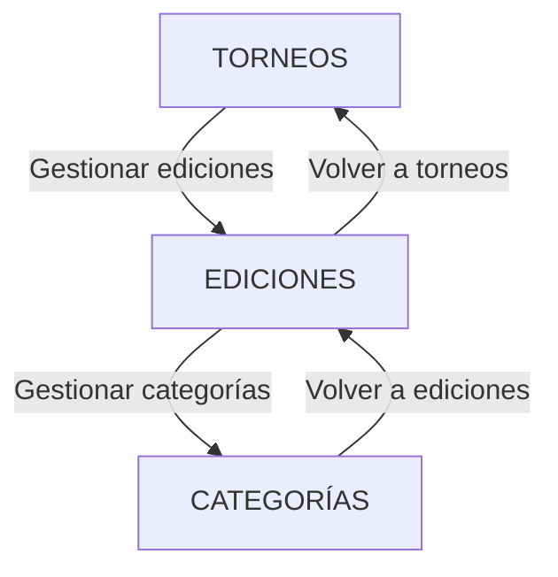

# ALTO-SISTEMA — Frontend

Interfaz web administrativa del sistema integral de gestión deportiva.

- Versión de ALTO-SISTEMA: **0.4.0**.
- Sistema de Diseño: **1.0**.
- Incremento actual: HU-006 — Gestión de categorías.
- Última versión consolidada: **0.3.0**.
- Estado: implementación verificada, pendiente de verificaciones técnicas finales, aprobación integral y consolidación.

## 1. Tecnologías

- React y React Router.
- Vite.
- JavaScript y CSS.
- Lucide React.
- Fontsource (Barlow Condensed e Inter).
- ESLint.

HU-006 reutiliza la infraestructura tecnológica y visual existente.

## 2. Instalación y ejecución local

Requisitos: Node.js 24 LTS, npm y backend de ALTO-SISTEMA configurado con MySQL.

Desde el directorio `frontend`:

```powershell
npm ci
npm run dev
```

Acceso habitual: http://localhost:5173

El backend principal deberá estar disponible en http://localhost:3000.

La base de datos deberá disponer de las migraciones 001 a 004.

Consultar el [manual de mantenimiento](../docs/MANTENIMIENTO.md) para preparar la base de datos, aplicar migraciones y crear el administrador inicial.

## 3. Configuración de la API

La URL predeterminada de la API es `http://localhost:3000/api`.

Puede configurarse mediante la variable de entorno de Vite:

```env
VITE_API_URL=http://localhost:3000/api
```

La configuración general se encuentra en `src/config/app.config.js`.

No incorporar contraseñas, secretos ni credenciales en las variables del frontend: sus valores pueden quedar expuestos al navegador.

El servicio centralizado de comunicación HTTP contempla:

- Métodos GET, POST, PUT, PATCH y DELETE.
- Envío y recepción de datos JSON.
- Inclusión de credenciales de sesión.
- Tratamiento de errores HTTP.
- Tratamiento de errores de conexión.
- Cancelación de solicitudes.

TORNEOS, EDICIONES y CATEGORÍAS utilizan el mismo servicio.

## 4. Organización

```text
frontend/
├── public/
├── src/
│   ├── assets/
│   ├── config/
│   ├── layouts/
│   ├── pages/
│   │   ├── Login.jsx
│   │   ├── Login.css
│   │   ├── Dashboard.jsx
│   │   ├── Dashboard.css
│   │   ├── ModuloPendiente.jsx
│   │   ├── ModuloPendiente.css
│   │   ├── Torneos.jsx
│   │   ├── Torneos.css
│   │   ├── Ediciones.jsx
│   │   ├── Ediciones.css
│   │   ├── Categorias.jsx
│   │   └── Categorias.css
│   ├── services/
│   │   └── api.js
│   ├── styles/
│   │   ├── tokens.css
│   │   ├── typography.css
│   │   └── components.css
│   ├── App.jsx
│   ├── App.css
│   ├── index.css
│   └── main.jsx
├── package.json
├── package-lock.json
└── README.md
```

La comunicación HTTP se centraliza en `src/services/api.js`, con inclusión de credenciales de sesión, tratamiento de errores y soporte de cancelación de solicitudes.

Las validaciones de la interfaz no sustituyen los controles de autenticación, origen e integridad del backend.

### Archivos incorporados o modificados en HU-006

| Archivo | Responsabilidad |
|---|---|
| `src/pages/Categorias.jsx` | Gestión administrativa de categorías |
| `src/pages/Categorias.css` | Estilos particulares y adaptación responsive |
| `src/pages/Ediciones.jsx` | Indicadores y acceso a categorías |
| `src/pages/Ediciones.css` | Integración visual de categorías |
| `src/App.jsx` | Registro de la ruta privada de categorías |
| `src/config/app.config.js` | Actualización de versión |
| `package.json` | Identificación de versión 0.4.0 |
| `package-lock.json` | Sincronización de versión |

## 5. Funcionalidades disponibles

| Pantalla | Responsabilidad |
|---|---|
| Acceso privado | Autenticación y acceso administrativo |
| Dashboard | Indicadores y accesos rápidos |
| TORNEOS | Creación, consulta, edición, archivado, reactivación y eliminación |
| EDICIONES | Administración de las ediciones de un torneo |
| CATEGORÍAS | Administración de las categorías de una edición |
| Módulos pendientes | Pantallas provisionales identificadas |

### Rutas privadas principales

| Pantalla | Ruta |
|---|---|
| Dashboard | `/` |
| TORNEOS | `/torneos` |
| EDICIONES | `/torneos/:torneoId/ediciones` |
| CATEGORÍAS | `/torneos/:torneoId/ediciones/:edicionId/categorias` |

### Gestión de TORNEOS — HU-004

Disponible desde la versión 0.2.0.

- Creación de torneos con nombre obligatorio y descripción opcional.
- Consulta, búsqueda y filtrado.
- Edición de datos.
- Archivado reversible.
- Reactivación.
- Eliminación definitiva con confirmación.
- Indicadores de torneos totales, activos y archivados.
- Indicadores de ediciones asociadas desde HU-005.

La eliminación definitiva requiere que no existan dependencias incompatibles.

Un torneo con ediciones asociadas no puede eliminarse.

### Gestión de EDICIONES — HU-005

Disponible desde la versión 0.3.0.

La pantalla se accede desde la tarjeta del torneo correspondiente, sin agregar un módulo independiente al menú lateral.

Ruta privada: `/torneos/:torneoId/ediciones`.

- Indicadores de cantidad total, planificadas, en curso y finalizadas.
- Búsqueda por nombre y descripción y filtrado por estado.
- Nombre obligatorio y descripción opcional.
- Fechas de inicio y finalización opcionales, editables y eliminables.
- Transiciones manuales: PLANIFICADA → EN_CURSO → FINALIZADA; reapertura a EN_CURSO.
- Confirmación de operaciones de cambio de estado y eliminación.
- Identificación del torneo seleccionado y retorno a TORNEOS.
- Indicadores de ediciones totales y en curso en las tarjetas de TORNEOS.
- Estados de carga, error, ausencia de registros y búsqueda sin coincidencias.

Los torneos archivados permiten consultar, editar, finalizar y eliminar ediciones sin dependencias, pero no crear, iniciar ni reabrir ediciones.

Las fechas no modifican automáticamente el estado deportivo.

Desde HU-006, las tarjetas de EDICIONES incorporan:

- Indicador CATEGORÍAS.
- Indicador ACTIVAS.
- Botón GESTIONAR CATEGORÍAS.

Una edición con categorías asociadas no puede eliminarse, independientemente del estado de estas.

Las restricciones definitivas se aplican en el backend.

### Gestión de CATEGORÍAS — HU-006

Disponible desde la versión 0.4.0.

La pantalla se accede desde el botón GESTIONAR CATEGORÍAS de la edición correspondiente.

No se agrega un módulo independiente al menú lateral.

Ruta privada:

`/torneos/:torneoId/ediciones/:edicionId/categorias`

Funcionalidades:

- Identificación del torneo y la edición seleccionados.
- Referencia jerárquica del contexto deportivo.
- Indicadores de categorías totales, activas y archivadas.
- Creación de categorías configurables.
- Edición de nombre y descripción.
- Archivado reversible.
- Reactivación.
- Eliminación definitiva con confirmación.
- Búsqueda por nombre y descripción.
- Búsqueda local insensible a mayúsculas y acentos.
- Filtros por estado administrativo.
- Contadores de caracteres.
- Mensajes de éxito, error y advertencia.
- Estados de carga y ausencia de registros.
- Navegación de regreso a EDICIONES.
- Actualización de indicadores externos.
- Adaptación responsive.

#### Campos del formulario

| Campo | Condición |
|---|---|
| Nombre | Obligatorio; hasta 100 caracteres |
| Descripción | Opcional; hasta 500 caracteres |

El estado inicial de una categoría es ACTIVA.

El nombre debe ser único dentro de su edición.

Se permiten nombres iguales en diferentes ediciones o torneos.

No existen categorías predeterminadas ni una cantidad fija de categorías.

La edición asociada no puede modificarse mediante el formulario.

#### Estados administrativos

| Estado | Significado |
|---|---|
| ACTIVA | Categoría administrativamente habilitada |
| ARCHIVADA | Categoría conservada, pero desactivada |

El archivado conserva los datos y la identidad del registro.

La eliminación definitiva retira físicamente el registro cuando no existen dependencias incompatibles.

#### Restricciones del contexto deportivo

La creación y reactivación de categorías requieren simultáneamente:

- Torneo ACTIVO.
- Edición PLANIFICADA o EN_CURSO.

| Operación | Contexto habilitado | Torneo archivado o edición finalizada |
|---|---|---|
| Consultar | Permitida | Permitida |
| Buscar y filtrar | Permitida | Permitida |
| Crear | Permitida | Bloqueada |
| Editar | Permitida | Permitida |
| Archivar | Permitida | Permitida |
| Reactivar | Permitida | Bloqueada |
| Eliminar sin dependencias | Permitida | Permitida |

La interfaz informa las restricciones y deshabilita las acciones incompatibles.

Archivar un torneo o finalizar una edición no modifica automáticamente los estados de sus categorías.

El backend mantiene la responsabilidad definitiva sobre las reglas de negocio.

#### Indicadores administrativos

Los indicadores representan todas las categorías de la edición, independientemente de los filtros.

```text
TOTAL = ACTIVAS + ARCHIVADAS
```

Las tarjetas de EDICIONES muestran el total de categorías y las que se encuentran activas.

Cuando no se puede obtener un indicador externo, se muestra un guion en lugar de un cero ficticio.

El regreso a EDICIONES vuelve a recuperar los indicadores correspondientes.

#### Integración jerárquica



La navegación utiliza identificadores parametrizados.

El backend verifica la pertenencia de las entidades al contexto correspondiente.

Esta navegación no constituye todavía el selector global de contexto deportivo previsto para HU-008.

### Funcionalidades pendientes

- HU-007: identidad visual de competiciones.
- HU-008: selección global del contexto deportivo.
- Equipos e inscripciones.
- Listas de buena fe.
- Reglamentos de edad.
- Fases y zonas.
- Jornadas y partidos.
- Tablas de posiciones.
- Goleadores.
- Valla menos vencida.
- Copas y playoffs.
- Disciplina.
- Publicaciones deportivas PNG.
- Historial deportivo.

Los módulos pendientes no deberán presentar funcionalidades simuladas como si estuvieran operativas.

## 6. Sistema de Diseño

Se mantiene el Sistema de Diseño v1.0, incorporado durante HU-004:

- Identidad institucional oscura y azul eléctrico `#3333FF`.
- Barlow Condensed para encabezados e Inter para la interfaz.
- Design Tokens centralizados.
- Componentes CSS reutilizables con prefijo `as-`.
- Iconografía Lucide React.
- Distribución responsive.
- Acciones destructivas diferenciadas.
- Indicadores y estados semánticos.
- Controles de foco y mecanismos de accesibilidad.

### Estados visuales

| Entidad | Estado | Tratamiento visual |
|---|---|---|
| Torneo | ACTIVO | Verde |
| Torneo | ARCHIVADO | Gris neutro |
| Edición | PLANIFICADA | Azul informativo |
| Edición | EN CURSO | Verde |
| Edición | FINALIZADA | Gris neutro |
| Categoría | ACTIVA | Verde |
| Categoría | ARCHIVADA | Gris neutro |

Los estados se identifican mediante texto y color.

### Acciones administrativas

| Acción | Tratamiento visual |
|---|---|
| Crear | Azul institucional |
| Guardar | Acción principal |
| Editar | Neutro |
| Archivar | Advertencia |
| Reactivar | Éxito |
| Eliminar | Peligro |
| Gestionar categorías | Azul institucional |

Las confirmaciones de operaciones administrativas utilizan el mecanismo nativo del navegador.

### Estilos particulares

| Archivo | Responsabilidad |
|---|---|
| `src/pages/Torneos.css` | Gestión de torneos e indicadores de ediciones |
| `src/pages/Ediciones.css` | Gestión de ediciones e indicadores de categorías |
| `src/pages/Categorias.css` | Gestión de categorías |

HU-006 incorpora en EDICIONES los estilos:

- `ediciones-categorias`
- `ediciones-categorias-indicadores`
- `ediciones-categorias-indicador`
- `ediciones-categorias-acceso`

El botón GESTIONAR CATEGORÍAS utiliza el icono Layers.

### Adaptación responsive

Se conservan los puntos de corte institucionales:

| Contexto | Ancho |
|---|---|
| Móvil compacto | Hasta 480 px |
| Navegación móvil | Hasta 900 px |
| Escritorio | Desde 901 px |
| Escritorio amplio | Desde 1440 px |

Los módulos pueden incorporar puntos de corte particulares para reorganizar sus componentes.

CATEGORÍAS adapta:

- Cabecera y navegación contextual.
- Identificación del torneo y edición.
- Indicadores administrativos.
- Buscador y filtros.
- Tarjetas.
- Formularios.
- Acciones administrativas.

La validación móvil de HU-006 fue confirmada mediante emulación del navegador a 390 × 844 px.

La identidad institucional es independiente de las futuras identidades visuales de las competiciones.

La versión interna del Sistema de Diseño permanece en 1.0.

## 7. Comandos de desarrollo

Ejecutar desde `frontend`:

| Comando | Responsabilidad |
|---|---|
| `npm ci` | Instalación reproducible de dependencias |
| `npm run dev` | Servidor de desarrollo |
| `npm run lint` | Análisis estático |
| `npm run build` | Compilación de producción en `dist/` |
| `npm run preview` | Vista previa local de la compilación |

No versionar `node_modules/`, `dist/` ni archivos privados de entorno.

La vista previa de Vite no constituye un despliegue de producción.

Las modificaciones exclusivamente documentales no requieren reiniciar los servidores.

## 8. Verificaciones

### HU-004 — v0.2.0

| Control | Resultado |
|---|---|
| Revisión visual inicial | 8/8 |
| ESLint | Sin errores ni advertencias |
| Compilación de producción | Exitosa |
| Pruebas unitarias de backend | 43/43 |
| Pruebas de integración de backend | 2/2 |
| Total de pruebas automatizadas | 45/45 |
| Validación funcional | Satisfactoria |
| CHECK integral | Aprobado |
| Consolidación | Commit `27654c0` |

### HU-005 — v0.3.0

| Control | Resultado |
|---|---|
| ESLint | Sin errores informados |
| Compilación de producción | Exitosa |
| Validaciones funcionales | 17/17 |
| Adaptación responsive | Confirmada mediante navegador |
| Pruebas unitarias de backend | 102/102 |
| Pruebas de integración de backend | 3/3 |
| Total de pruebas automatizadas | 105/105 |
| Limpieza de registros temporales | Completada |
| CHECK integral | Aprobado |
| Consolidación | Commit `ccfb4d2` |

HU-005 quedó aprobada y consolidada en v0.3.0.

### HU-006 — v0.4.0

| Control | Resultado |
|---|---|
| Implementación de CATEGORÍAS | Completada |
| Integración con EDICIONES | Completada |
| Sistema de Diseño v1.0 | Conservado |
| Pruebas unitarias de categorías | 111/111 |
| Integración de categorías | 1/1 |
| Controles internos de integración | 28/28 |
| Pruebas unitarias acumuladas | 213/213 |
| Integraciones acumuladas | 4/4 |
| Total de pruebas automatizadas | 217/217 |
| Validaciones funcionales | 17 controles revisados |
| Adaptación responsive | Confirmada mediante navegador |
| Capturas esenciales | 5/5 revisadas |
| Backend v0.4.0 | Operativo |
| Frontend v0.4.0 | Operativo |
| ESLint final | Pendiente |
| Compilación de producción final | Pendiente |
| CHECK integral | Pendiente |
| Consolidación | Pendiente |

Las pruebas automatizadas indicadas corresponden al backend y a sus integraciones HTTP con MySQL.

No constituyen pruebas automatizadas de la interfaz.

### Regresión automatizada

La ejecución general de `npm test` desde backend registra:

```text
tests 217
pass 213
fail 0
cancelled 0
skipped 4
todo 0
```

Las cuatro integraciones omitidas intencionalmente fueron ejecutadas y aprobadas por separado.

Resultado acumulado: 217/217 pruebas automatizadas.

### Validación funcional de CATEGORÍAS

Durante HU-006 se revisaron los siguientes controles:

1. Integración con EDICIONES.
2. Estado inicial vacío.
3. Creación sin descripción.
4. Creación con descripción.
5. Prevención de duplicados.
6. Edición de categoría.
7. Archivado.
8. Reactivación.
9. Búsqueda y filtros.
10. Actualización de indicadores externos.
11. Independencia entre ediciones.
12. Restricciones de edición finalizada.
13. Reapertura de edición.
14. Restricciones de torneo archivado.
15. Integridad referencial.
16. Eliminación de registros.
17. Adaptación responsive.

Los controles recibieron confirmaciones satisfactorias durante el desarrollo.

No todos disponen de una evidencia visual independiente.

La secuencia manual de eliminación fue parcialmente abreviada debido a la eliminación anticipada de registros. La independencia entre contextos y la eliminación ordenada cuentan también con verificación automatizada.

### Evidencias visuales de v0.4.0

| Archivo | Evidencia |
|---|---|
| `30-ediciones-categorias-v040.png` | Integración con EDICIONES |
| `31-categorias-listado-v040.png` | Listado y estados administrativos |
| `32-categorias-formulario-v040.png` | Formulario de creación |
| `33-movil-categorias-v040.png` | Adaptación móvil |
| `34-pruebas-v040.png` | Regresión automatizada |

Las evidencias se documentan en el README principal.

A partir de HU-006 se priorizan las capturas esenciales de las nuevas funcionalidades, evitando repetir pantallas anteriores que no hayan sufrido modificaciones relevantes.

### Verificaciones pendientes

- Análisis estático final de v0.4.0.
- Compilación de producción final de v0.4.0.
- Verificación conjunta de versiones.
- Limpieza final de registros demostrativos.
- Verificación definitiva de archivos de capturas.
- Consolidación documental.
- CHECK integral de HU-006.
- Aprobación formal.
- Consolidación mediante Git y publicación.

### Limitaciones generales

Permanecen pendientes:

- Pruebas automatizadas del frontend.
- Pruebas visuales automatizadas.
- Validación en dispositivos móviles físicos.
- Evaluación sistemática entre navegadores.
- Auditoría formal de accesibilidad.
- Pruebas de rendimiento y carga.
- Optimización definitiva de recursos tipográficos.
- Despliegue en producción.

La validación mediante emulación del navegador no sustituye las pruebas en dispositivos físicos.

## 9. Documentación oficial

- [README principal](../README.md)
- [Arquitectura](../docs/ARQUITECTURA.md)
- [Normas de desarrollo](../docs/DESARROLLO.md)
- [Manual de mantenimiento](../docs/MANTENIMIENTO.md)
- [Modelo multitorneo](../docs/MODELO_MULTITORNEO.md)
- [Sistema de Diseño](../docs/SISTEMA_DE_DISENO.md)

La documentación principal constituye la referencia para las reglas deportivas y operativas.

Este README describe exclusivamente el frontend y no modifica las decisiones de negocio aprobadas.

---

**ALTO-SISTEMA | Tecnología aplicada al fútbol amateur.**